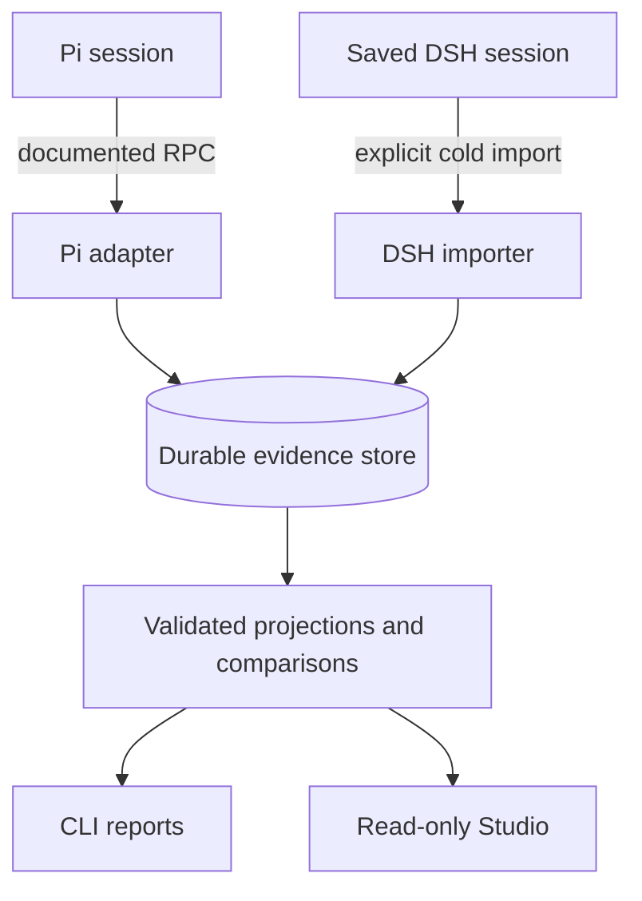

<a id="endophasia"></a>

<div align="center">

<h1>endophasia</h1>

<p><strong>Instrumented cognition for coding agents.</strong></p>

<p>
A local-first research instrument and governed workbench for coding agents.<br>
Record what a harness does, inspect the evidence, and test what changes its behaviour.
</p>

<p>
  <a href="#what-works-today"></a>
  <a href="https://github.com/earendil-works/pi"></a>
  <a href="LICENSE"></a>
</p>

<p>
  <a href="#quick-start">Quick start</a> &nbsp; · &nbsp;
  <a href="#endophasia-web">Endophasia Web</a> &nbsp; · &nbsp;
  <a href="#what-works-today">What works today</a> &nbsp; · &nbsp;
  <a href="#architecture">Architecture</a> &nbsp; · &nbsp;
  <a href="#research-direction">Research</a> &nbsp; · &nbsp;
  <a href="#documentation">Documentation</a>
</p>

</div>

---

Endophasia connects to [Pi](https://github.com/earendil-works/pi) to record live harness activity, run replay and
controlled experiments, and submit explicitly authorised prompts or interventions. It can also import persisted
[DeepSeek Harness (DSH)](docs/dsh-native-importer.md) sessions for inspection and comparison. Pi owns its execution
loop; DSH import reads saved records without starting or controlling DSH.

The browser interface provides **Observe**, **Compare** and **Develop** workspaces. `endo studio` opens a read-only
view of recordings. A separate, opt-in **live Pi workbench** shows the current conversation and lets the browser
request a prompt, with approval entered in the controlling terminal before it is sent.

*Endophasia* is an old term for inner speech. This project measures observable agent behaviour: requests, responses,
tool activity and outcomes. It does not claim to read a model's thoughts.

> [!IMPORTANT]
> **Source and release status — 29 October 2026.** Build from `main` for the current React interface, DSH import and
> live workbench. Published `0.1.0-alpha.2` contains the earlier read-only browser page; npm's `alpha` tag points to it,
> while `latest` still points to the CLI-only `0.1.0-alpha.1`. The source manifest also says `0.1.0-alpha.2`, so the
> version string alone does not distinguish a new source build from the published package. See the
> [changelog](CHANGELOG.md) and [published release record](docs/release-0.1.0-alpha.2.md).

### Why use it?

- **Inspect a session:** identify the harness build and configuration, read its event timeline, and see what was
  observed, reported, derived or unavailable.
- **Compare recordings:** inspect lifecycle, tool-call, tool-result and outcome differences across eligible Pi and
  DSH recordings, with mapping losses and missing signals kept explicit.
- **Test reproducibility:** replay Pi sessions with recorded model responses, then separately test live repeatability
  and sensitivity to changes in prompts, paths, sampling or execution conditions.
- **Work with explicit control:** use the live Pi conversation and terminal-approved prompts, or the CLI's authorised
  STEER, QUEUE and STOP path.
- **Study harness design:** treat the harness, its policies and its environment as experimental variables, with
  recorded conditions and independently checked evidence.

## Quick start

Requires **Node.js >= 22.19.0**. Install and configure Pi separately for live work; Endophasia does not install,
update or patch it. The demo and inspection of existing recordings do not need Pi or a model provider.

### Build the current interface

```sh
git clone https://github.com/noctem-o/endophasia.git
cd endophasia
npm ci
npm run build

# Optional demo: use a new or empty directory. No Pi or model call is needed.
node scripts/seed-cockpit-demo.ts ./demo-store
node dist/cli/index.js studio ./demo-store
```

Open the private loopback address printed by the command. The demo uses committed fake-Pi lifecycle fixtures and a
recorded Pi 1.0.0 conformance specimen. Stop the server with **Ctrl-C**.

The commands below run the built CLI from this checkout, so an older globally installed `endo` cannot be selected
by mistake. Rebuild after updating the source.

### Open a live Pi workbench

This source-build feature currently requires **Linux with `/proc` and a controlling terminal**. Both stdin and
stderr must be that terminal; pipes, redirected approval input and unverifiable terminals are refused.

```sh
node dist/cli/index.js doctor --root ./recordings
node dist/cli/index.js harness attach ./recordings \
  --cwd /path/to/project --control --workbench
```

1. Open the workbench address printed in the terminal and choose **Develop**.
2. Enter the one-time pairing code shown in the terminal. Type `pair` there if you need a new code.
3. Request a prompt in the browser. Review its full text in the terminal and type the exact
   `APPROVE PROMPT <digest>` phrase shown there to send it. Each prompt needs its own approval.
4. Follow the conversation and run state. **Follow** enables bounded polling; model acceptance and run completion
   are shown separately. Stop the attached session with **Ctrl-C**.

Pi uses its configured provider and model. You can select them with `--provider <provider> --model <model>`, or select
a Pi executable with `--pi /path/to/pi`. `--cwd` sets Pi's project directory; `./recordings` is the separate evidence
store. Approved prompts run real agent work and can incur provider cost or use Pi's tools. Terminal approval controls
request dispatch; it does not sandbox the tools Pi runs.

The workbench controls only the Pi child launched by this attach process. Its first slice supports new prompts
while the session is idle; browser STEER, QUEUE and STOP are not implemented. Those interventions remain available
through the separately authorised CLI control path. See [workbench usage](docs/studio.md#live-workbench-opt-in-the-one-writable-boundary)
and [steering](docs/steering.md).

### Record and inspect from the CLI

```sh
node dist/cli/index.js harness check ./recordings       # local protocol checks; no model call
node dist/cli/index.js harness attach ./recordings \
  --cwd /path/to/project --prompt "Summarise this project"
node dist/cli/index.js harness status ./recordings
node dist/cli/index.js harness overview ./recordings
node dist/cli/index.js trajectory show ./recordings <session-id>
node dist/cli/index.js studio ./recordings
```

Use the session ID printed by `attach`. The prompt uses Pi's model provider; `attach` reports both acceptance and
whether the run was observed to settle within its wait budget. Omitting the store selects `$ENDO_STORE_ROOT`, then
`$XDG_DATA_HOME/endophasia/store`, then `~/.local/share/endophasia/store`.

### Import a saved DSH session

```sh
node dist/cli/index.js dsh import --root ./recordings /path/to/session-directory
node dist/cli/index.js dsh loss-accounting
node dist/cli/index.js studio ./recordings
```

Name one persisted **Session format-4 directory**, not a DSH home, process or transcript file. Import leaves the source
unchanged and writes validated evidence to the Endophasia store. It does not watch, resume or operate DSH.
`loss-accounting` prints the static mapping contract, not a measurement of that particular session. Use **Compare**
to select eligible recordings; a DSH recording needs a clean, complete import checkpoint. See the
[import contract](docs/dsh-native-importer.md).

### Use the published alpha

For the earlier packaged browser page and CLI:

```sh
npm install -g endophasia@0.1.0-alpha.2
endo doctor
endo studio
```

Explicitly select the version: a bare install follows npm's older `latest` tag. This package does not contain the
React workspaces, DSH import or live workbench described above. Full installation, store selection and packaged
verification: [docs/install.md](docs/install.md).

<a id="studio"></a>
## Endophasia Web

<p align="center">
  
</p>

<p align="center"><sub>Observe screenshot, 22 October 2026. Recorded harness evidence; not a model-internal trace or a live workbench view.</sub></p>

The browser is still labelled **Studio** in parts of the interface and is launched with `endo studio` for read-only
inspection. **Endophasia Web** is its product name. `endo web`, a native desktop application and native installers
are not implemented.

| Workspace | What it shows | Control boundary |
| :--- | :--- | :--- |
| **Observe** | Runtime identity, capability evidence, source condition and events in storage order, with provenance and an inspector | Reads recorded snapshots; explicit refresh |
| **Compare** | Eligible Pi/DSH recordings and separate lifecycle, tool-call, tool-result and outcome verdicts | Read-only selection and comparison; no claim of causal equivalence |
| **Develop — recordings** | Recorded sessions, run structure, tool activity, reported usage and links into Observe and Compare | Read-only; a recorded `running` state does not establish a live process |
| **Develop — live workbench** | Current Pi connection and run state, private conversation, prompt composer and approval status | Only through `harness attach --control --workbench`; the browser requests and the terminal approves |

Capabilities and Evolve remain placeholders. Cognition, Research, model-internal observation, project/worktree views
and an embedded terminal are not built.

**Access and retention.** Both launch paths bind to `127.0.0.1` and use a private per-launch address. Anyone who can
read that address can read the store's presented evidence; keep it private. `endo studio` does not write the store,
although its first launch can create a separate comparison key. The workbench adds a separate, expiring in-memory
grant for its live view and prompt requests; the page address alone cannot authorise a prompt.

The live transcript keeps user and assistant text in bounded memory, clears it when the session ends, and never puts
that text in canonical evidence or the read-only Studio API. It includes tool names and outcomes, not tool arguments,
results or reasoning text. **Pi still keeps its own session file.** Recorded-only views cannot reconstruct withheld
text from digests. See [browser usage and limits](docs/studio.md) and the
[workbench design](docs/develop-workbench.md).

## What works today

This is an experimental project. The table describes **source-tree `main` as of 29 October 2026**, with the evidence
behind each capability. Published alphas have the narrower scope described above.

| Capability | Entry point | Evidence and limits |
| :--- | :--- | :--- |
| Pi identity, local checks, live recording and capability admission | `doctor`, `harness check`, `harness attach`, `harness status` | Installed-package CI uses Pi 1.0.0 with a fake model endpoint; real-model studies used Pi 1.0.1 and later Pi 1.0.4. This is not general-version conformance |
| Durable sessions and Pi trajectory comparison | `harness overview`, `trajectory show`, `trajectory diff` | Real Pi recordings plus synthetic failure cases. The trajectory CLI is Pi-specific; use browser Compare for native DSH recordings |
| Capture and cassette replay | `proxy record`, `proxy replay`, `replay` | Forty exact replays across four recorded Pi sessions and a negative control. Recorded model responses are held fixed |
| Controlled Pi experiments | `experiment run`, `experiment report` | Real studies with blocked randomisation, manipulation checks and declared conditions. The studies pre-registered designs; the CLI does not enforce pre-registration |
| Authorised STEER, QUEUE and STOP | `harness attach --control` and `steer`; declared experiment interventions | Real-runtime intervention studies; the CLI control endpoint is tested against fake Pi. Runtime acceptance, observed consumption and effects remain separate |
| DSH cold import and loss accounting | `dsh import`, `dsh loss-accounting` | Five retained captures from pinned `dsh-v0.2.1-rc.2`, including failure/resume cases, plus adversarial tests. No live DSH control |
| React Observe, Compare and recorded-session Develop | `studio` | Projection, HTTP and browser tests; package smoke checks the built interface. Comparison selectors are bound to verified store generations |
| Governed live Pi workbench | `harness attach --control --workbench` | Broker, HTTP, fake-Pi process, pseudo-terminal and browser tests. Linux terminal gate; prompt-only browser control; no real-model workbench conformance claim |
| Verified initial scratch copies and governed continuation | Source-tree checkpoint, initial-child and two-turn APIs | Synthetic tests, a four-turn real initial-child pilot and real same-session continuation. Fresh Pi processes and tool-free turns; no historical process restore or general effect sandbox |
| Matched two-turn A/A research workflow | `research/governed-initial-continuation/aa/operate.ts` | One real four-session/eight-request run completed under declared assumptions. Research script, not an `endo` subcommand; engineering hardening remains open |
| ACP v1 adapter and ACP v2 conformance study | Library APIs | Deterministic tests; v1 also has an opt-in OMP smoke path. No admitted ACP capability and no real v2-agent conformance |

Cognition graphs, evolution records and selection policies, model orchestration, and mappings for Codex, Prime,
REEF, Magpie, Deadbolt and Cogitator also exist as libraries. They are not live integrations exposed by the CLI or
browser. No working autonomous self-improvement loop is claimed. The full inventory is in
[docs/status.md](docs/status.md); the newest workbench boundary is documented in [docs/develop-workbench.md](docs/develop-workbench.md).

### What the evidence means

| Distinction | Meaning |
| :--- | :--- |
| **Observation / interpretation** | An observation names its source; a reported value names its reporter; a derivation names its method. Missing evidence stays `UNAVAILABLE`, not zero |
| **Acceptance / completion** | A runtime accepting a request does not prove that it executed, consumed an intervention or achieved the intended result |
| **Evidence / authority** | A successful check or comparison does not grant permission. Consequential operations need their own explicit authorisation |
| **Exact replay** | Did the harness reproduce the recorded session when given recorded model responses? |
| **Live repeatability** | Do new runs agree under the same declared conditions? |
| **Perturbation invariance** | Does behaviour hold when an input expected to be irrelevant changes? |

DSH's persisted turns and steps map to qualified Endophasia lifecycle records. A tool request does not prove execution,
and a recovery-written closer is not an observation of a crash. Comparison preserves those limits: matching layers
do not prove identical causes, and different digest domains cannot establish equality. See the
[vision and distinctions](docs/vision.md) and [comparison contract](docs/cockpit.md#compare-candidate-discovery).

## Architecture

Endophasia keeps execution, evidence acquisition and presentation separate. Its main observation paths are:



An optional recording proxy captures the model request/response boundary for replay and experiments. Pi capabilities
are admitted from current transport, identity and conformance evidence; a runtime or configuration change invalidates
dependent evidence. DSH has a separate, version-pinned import contract with explicit mapping losses.

The **live workbench** runs inside the process that owns the attached Pi child. It serves the same frontend on its own
loopback address, supplies the private live transcript and exposes a closed prompt-request boundary. Approval comes
from the controlling terminal, and the broker checks the session, grant and idle state again before dispatch. Prompt
proposals, authorisations, dispatches and outcomes have a separate recorded chain. The read-only `endo studio` server
does not gain that authority.

The **initial-state research APIs** are a separate path: verify a replay and its initial scratch archive, prepare
checked sibling copies, start a fresh tool-free Pi session with explicit approval, and require another approval for
its second turn. An independent reader verifies the resulting receipts. This is bounded same-session continuation,
not restoration of a historical process or isolation of all external effects.

Contracts: [Pi attachment](docs/attachment.md) · [capture and replay](docs/replay.md) ·
[DSH importer](docs/dsh-native-importer.md) · [observation bridge](docs/cockpit.md) ·
[workbench](docs/develop-workbench.md) · [initial-state continuation](docs/initial-continuation.md).

## Research direction

The research goal is to explain how the model, harness, tools and environment contribute to agent behaviour, then
test changes under declared conditions. The project keeps execution resumption, exact replay, live repeatability
and perturbation invariance as separate claims.

### Selected results

| Study | Finding | Scope |
| :--- | :--- | :--- |
| [Cassette replay](research/README.md#cassette-replays) | Forty replays were exact; a changed workspace produced the expected divergence | Pi 1.0.1, four recorded sessions, fixed model responses |
| [Variance and pinned environment](research/README.md#pinned-environment-study-e3) | With the environment pinned, deterministic sampling and prompt cache off, all judged layers and requests matched across 20 trials per task | Three small tasks, Pi 1.0.1 and qwen3.8-27b on one machine; not a universal determinism result |
| [Path sensitivity](research/README.md#path-sensitivity-study) | Working-directory paths changed whether steering was followed, and changed a baseline on one task | Two tasks and 30 paths; acceptance and consumption were measured separately from following the instruction |
| [Completion cap](research/README.md#completion-cap-study) | Raising the cap from 16,384 to 32,768 tokens raised success from 10/24 to 19/23 | Two selected tasks, four paths, small samples; the interval excludes zero only with all four paths included |
| [Governed initial-child pilot](research/governed-initial-child/1.0.4/RESULTS.md) | Four approved turns returned `ready`; cwd-adjusted request bodies matched, complete responses differed | Pi 1.0.4/Nanbeige4.3-33B, tool-free, private verified receipts |
| [Matched two-turn A/A — 29 October](research/governed-initial-continuation/aa/RESULTS.md) | Four fresh Pi sessions and eight approved requests completed; all request/admission bindings and the independent reader verified; owned-server cleanup was confirmed | `COMPLETE-UNDER-DECLARED-ASSUMPTIONS`. One real run, not a noise floor, model-parity result or server attestation; hardening and an approval-display question remain open |
| [CPU numerical execution probe](research/numerical-execution-probe/FIRST-RESULT.md) | Logits were bitwise equal within each submission schedule and different across schedules; argmax stayed the same | SmolLM2-135M f16, four CPU processes. No specific kernel attribution, CUDA result or integrated model-internal viewer |

The [research index](research/README.md) links designs, results and limitations. Some raw recordings and governed
execution receipts remain private; public summaries do not make those runs reproducible from the repository alone.
See [research data](research/DATA.md).

<a id="roadmap"></a>
### Delivery direction

The current browser workspaces and governed initial-state APIs are implemented. The documented follow-on work has
two immediate threads:

- **Develop:** extend the workbench's typed broker to STEER, QUEUE and STOP while preserving terminal approval and the
  distinction between acceptance and observed consumption. OMP, richer transcripts, Git changes and any terminal
  surface are later workbench slices, not current support.
- **Research and verification:** harden and extend continuation experiments, isolate external effects and validate
  a cassette-then-live boundary before claiming general restore/fork execution.

**Cognition** (including proposed WORK and DREAM profiles), an **Evolve** operator interface, model-internal
observation and a dedicated **Research** workspace remain design directions. Native Rust/GPUI presentation, GPU
rendering, durable-execution integrations and hardware/robotics workflows are exploratory tracks. None is a shipped
capability or a requirement for the current Pi workflow.

The full plans, candidate studies and deferred integrations belong in the [roadmap](docs/roadmap.md),
[workbench design](docs/develop-workbench.md) and [vision](docs/vision.md). A measured improvement is evidence for a
candidate; it does not by itself authorise promotion or deployment.

## Documentation

<a id="current-state"></a>
<a id="try-it"></a>

| Need | Start here |
| :--- | :--- |
| Install, inspect or use the browser | [Installation](docs/install.md) · [Studio and live workbench](docs/studio.md) · [Release history](CHANGELOG.md) |
| Check implementation status | [Detailed status](docs/status.md) · [Published alpha.2 scope](docs/release-0.1.0-alpha.2.md) · [Alpha verification](docs/release-alpha.md) |
| Record, replay, compare or intervene | [Attachment](docs/attachment.md) · [Replay](docs/replay.md) · [Trajectories](docs/trajectory.md) · [Experiments](docs/experiments.md) · [Steering](docs/steering.md) |
| Understand the browser boundary | [Observation bridge and Compare API](docs/cockpit.md) · [Frontend architecture](docs/studio-ui-architecture.md) · [Design reference](docs/cockpit-ui.md) · [Live workbench](docs/develop-workbench.md) |
| Use the initial-state research APIs | [Checkpoint candidate](docs/checkpoint-candidate.md) · [Scratch materialization](docs/checkpoint-materialization.md) · [Sibling preparation](docs/initial-branch-set.md) · [Initial-child execution](docs/initial-child-execution.md) · [Continuation](docs/initial-continuation.md) |
| Inspect adapter evidence | [Pi inventory](docs/pi-attach-inventory.md) · [Pi audit](docs/pi-attach-audit.md) · [DSH study](docs/dsh-native-attachment.md) · [DSH import](docs/dsh-native-importer.md) · [ACP v1](docs/acp-v1-slice.md) · [ACP v2 study](docs/acp-v2-study.md) |
| Read research and future designs | [Studies](research/README.md) · [A/A result](research/governed-initial-continuation/aa/RESULTS.md) · [Vision](docs/vision.md) · [Observe/Verify](docs/observe.md) · [Evolve](docs/evolve.md) · [Roadmap](docs/roadmap.md) |
| Work on contracts or provenance | [Schema compatibility](docs/schema-compatibility.md) · [Deadbolt intervention contract](docs/deadbolt-intervention-contract.md) · [Migration ledger](docs/migration-ledger.md) |

Neighbouring projects have separate roles: [Magpie](https://github.com/noctem-o/magpie) for claims, evidence and derived
standing; [Deadbolt](https://github.com/noctem-o/deadbolt) for authorising consequential actions;
[Cogitator](https://github.com/noctem-o/cogitator) for sealed run records; and
[Buzz](https://github.com/noctem-o/buzz-prime) for a shared workspace for people and agents. A record in one does not
grant authority in another. The earlier Pi-fork implementation is archived at
[endophasia-pi-legacy-deprecated](https://github.com/noctem-o/endophasia-pi-legacy-deprecated).

## Development

```sh
npm ci
npm run typecheck
npm run lint
npm test
npm run build
npm run test:package
```

After dependencies are installed, the deterministic suite needs Node and git, with no model API key or provider call.
Browser tests require Chromium; set `CHROME_BIN` to select it and `ENDO_REQUIRE_BROWSER=1` to make its absence fail
instead of skip. Other host-dependent and private-data checks report their own skips. CI also runs installed-package
acceptance with a separately installed Pi 1.0.0 and a fake model endpoint. See
[test requirements and opt-in real-Pi checks](docs/install.md#running-the-tests).

## License

Apache License 2.0 ([LICENSE](LICENSE)). Copyright 2026 George Gallagher. Upstream components such as Pi retain their
own licenses.

Published `0.1.0-alpha.1` and `0.1.0-alpha.2` were released under MIT, and that grant remains with those versions.
The Apache License applies to the source from the license-change commit onward.
