<a id="endophasia"></a>

<picture>
  <source media="(prefers-color-scheme: dark)" srcset="docs/images/endophasia-plate-dark.svg">
  <source media="(prefers-color-scheme: light)" srcset="docs/images/endophasia-plate-light.svg">
  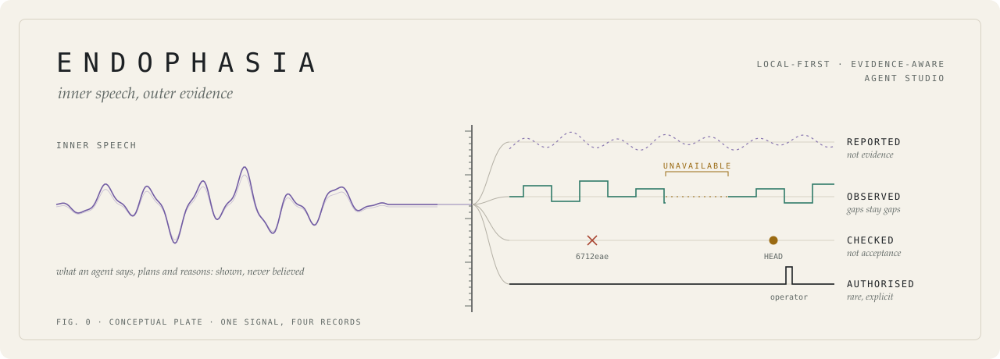
</picture>

<p align="center">
<strong>A local-first, evidence-aware studio for coding agents.</strong><br>
<sub>Develop with them · coordinate them · observe and compare them · experiment on them.</sub>
</p>

<p align="center">
  <a href="#what-works-today"></a>
  <a href="#develop"></a>
  <a href="#quick-start"></a>
  <a href="LICENSE"></a>
</p>

<p align="center">
  <a href="#why-it-exists">Why</a> &nbsp;·&nbsp;
  <a href="#four-ways-of-working">Capabilities</a> &nbsp;·&nbsp;
  <a href="#quick-start">Quick start</a> &nbsp;·&nbsp;
  <a href="#what-works-today">Status</a> &nbsp;·&nbsp;
  <a href="#architecture">Architecture</a> &nbsp;·&nbsp;
  <a href="#research-direction">Research</a> &nbsp;·&nbsp;
  <a href="#roadmap">Roadmap</a> &nbsp;·&nbsp;
  <a href="#documentation">Docs</a>
</p>

---

*Endophasia* is an old word for inner speech. Coding agents produce a lot of it: plans, reasoning, progress notes, and the
confident closing line that says the tests pass. Endophasia is a workbench for working alongside those agents, and an instrument
for finding out what they actually did. It shows an agent's inner speech in full and never treats it as evidence. What counts is
what was observed, what was checked at which commit, and what a person explicitly allowed.

> **A coding agent says the work is done and the tests exit `0`.**
> Is the program right? Is the code you are reading the code that was checked?
> Endophasia answers from records, never from the agent's report.

```console
$ node calc.mjs '2+3*4'
20                      # wrong: should be 14, and the exit status is still 0

$ endo attempt check --attempt <id> --keep-output -- node calc.mjs '2+3*4'
recorded: Observed check passed, at 6712eae5bcc3…

$ endo attempt evidence --attempt <id>
  planned   [observed] precedence ["node","calc.mjs","2+3*4"]:
            Failed at HEAD (6712eae5bcc3, latest failed)
  behaviour [plan: expected; observed] expected exit 0 and 3 byte(s) of output;
            observed exit 0, 3 byte(s), output different;
            first difference at line 1: expected "14", observed "20"
  criterion [plan: precedence] 1. 2+3*4 is 14: A planned check failed at HEAD
```

<p align="center"><sub>Real output from the <a href="docs/quickstart.md#take-the-five-minute-tour">five-minute tour</a>, abridged and re-wrapped. The comment on the second line is added.</sub></p>

The command exited `0`, so its receipt records what ran. The plan said what it should *print*, so the ledger marks the
criterion failed and shows the first line that differs. The task stays open until you decide otherwise.

---

## Why it exists

Agents are getting more capable faster than our ability to tell what they did. A harness reports that a prompt was accepted,
a model reports that it reasoned, a test suite exits zero, a reviewer agent approves. Each of those is a claim from
someone. Endophasia is built on the view that a useful agent environment keeps those claims apart and labels each one,
and that it has to stay useful when every model is switched off.

These are the working rules. Each one is enforced somewhere in the code, not only stated here:

| Rule | What it means in practice |
| :--- | :--- |
| **Intelligence is not authority.** | Model output can't create a schedule, a grant or a dispatch. Coordinator proposals carry `authority: none`. |
| **Observation is not interpretation.** | Every record names its basis: controller-observed, agent-reported, derived, or interpreted by a model. |
| **A passing check is not acceptance.** | A receipt records what *your* command did at one commit. It never moves a task. Only you do. |
| **A model's report is not independent evidence.** | An agent-written review stays `advisory-agent-review` and can never become a host check receipt. |
| **Missing stays missing.** | An unrun check, a withheld reasoning block or an unread source is shown as `UNAVAILABLE`. It is never rounded to zero or passed silently. |
| **Accepted is not executed.** | A runtime accepting a request, consuming it, and the effect that followed are three separate records. |
| **Capability is measured.** | Harness capabilities are admitted from conformance evidence. Changing the runtime invalidates the evidence that depended on it. |
| **Harnesses stay themselves.** | Pi and Codex sit behind one adapter contract without being flattened. Each keeps its own loop, tools and control set. |
| **Useful with every model off.** | The Coordinator's operational views make zero model calls. Neural advice is an optional layer on top. |
| **Change is promoted by evidence.** | A candidate can win an evaluation and still lack permission to replace anything. Nothing promotes itself. |

### Autonomy is not authority

Endophasia can do some things without you watching, and it is worth being exact about which ones. When *you* schedule
it, a tick can observe local model health, record what it saw and, for an S2 schedule you have explicitly authorised,
ask one local model for a briefing within fixed turn, token and time ceilings. Endophasia installs no timer or
service itself: `endo scheduler print-systemd-unit` prints an example and writes nothing. None of these ticks acquires authority. Nothing
automatic dispatches an agent, claims an attempt, moves a task, applies a change or merges anything. Every consequential act
is approved by the operator on a controlling terminal, one act at a time, apart from one narrow, attested Pi configuration described [below](#develop).

---

## Four ways of working

These are four ways of working with the same local records, not four products. Each section says how mature each part is.
Every screenshot is the real Studio rendering a **synthetic fixture** from the repository's browser tests, with zero model calls.
How each was produced is recorded in [docs/images/README.md](docs/images/README.md).

### Develop

Work with an agent through the harness you already use. Frame a task and an attempt with a verification plan before work
starts, approve each dispatch on your terminal, run your own checks, and read one ledger of what holds at `HEAD`.

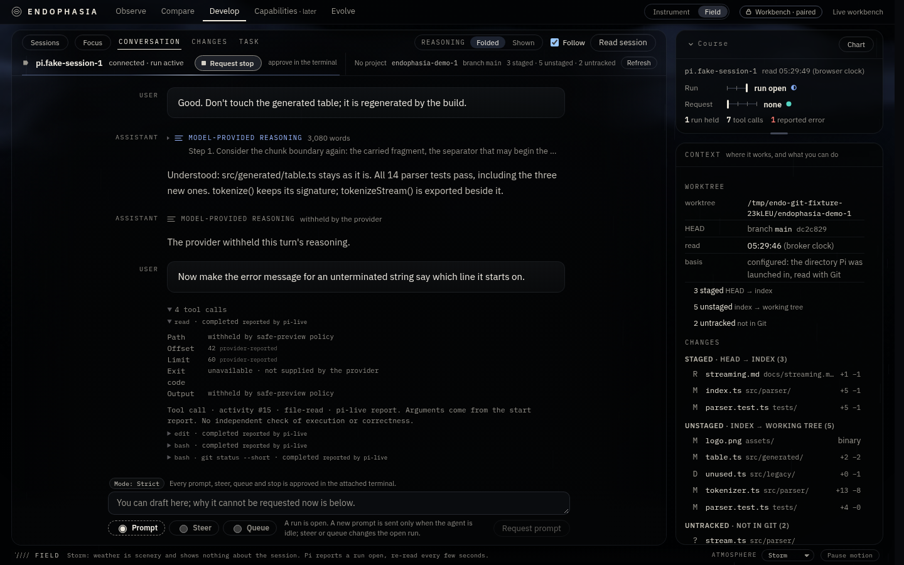
<p><sub><strong>Pi live workbench, Field appearance, Storm atmosphere</strong> (synthetic fixture). Course gauges, folded model-provided reasoning, inspectable tool calls, Git changes and terminal-gated Strict mode. The weather is scenery: its renderer receives no session state.</sub></p>

- **Live workbench.** [Pi](https://github.com/earendil-works/pi) is the reference runtime and Codex (local App Server) is the
  second live integration, both behind the harness-neutral `endo.develop-adapter.v0` contract. The page can *ask*. Only the
  controlling terminal approves. **Codex is Strict-only.** Pi can run in **Everyday** mode (one terminal grant for bounded
  page-driven sends) only inside one narrow attested configuration: stock Pi 1.5.2, the local `Ornith-1.5-9B-Q8_0` model through
  the governed relay, no tools, a read-only workspace snapshot and no credentials. Everywhere else it runs Strict.
- **Tasks, attempts and verification.** Plans, operator-run checks at clean commits, receipts, behavioural diffs, an acceptance
  ledger, working-tree provenance, and an attention overview across tasks.
- **Protected attempts.** `endo attempt protected-run` sends one prepared attempt through the Bubblewrap protected runner once,
  after a terminal phrase, and seals a candidate binding when termination is confirmed. It applies nothing.

> [!WARNING]
> Terminal approval governs **dispatch**. It does not sandbox the tools Pi or Codex runs. Codex's own `--sandbox` is
> native to Codex and separate from Endophasia's gate, and `endo attempt check` runs your command with your permissions.

<table>
  <tr>
    <td width="50%" valign="top">
      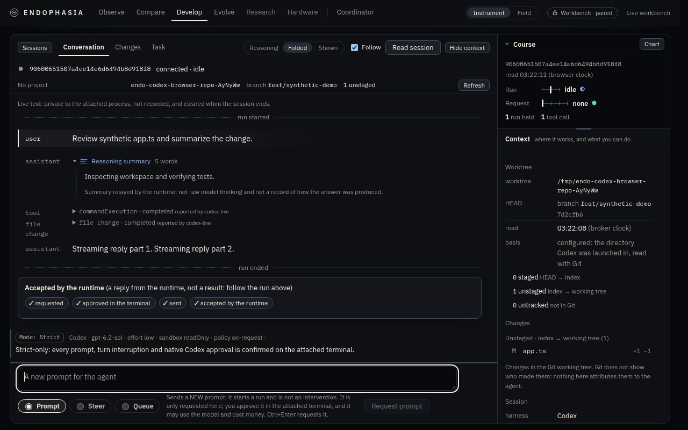
      <br><sub><strong>Codex workbench, Strict-only</strong> (synthetic fake App Server). The reasoning summary is labelled as relayed by the runtime, not raw thinking. Acceptance is shown as a reply, not a result.</sub>
    </td>
    <td width="50%" valign="top">
      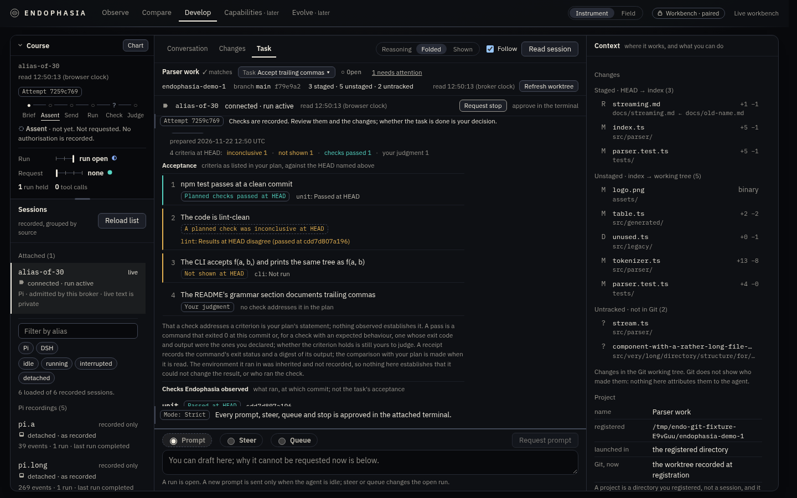
      <br><sub><strong>Instrument appearance and acceptance ledger.</strong> Six record-backed stages (<code>Brief · Assent · Send · Run · Check · Judge</code>) and a per-criterion ledger against <code>HEAD</code>. Checks are observed. Acceptance stays yours.</sub>
    </td>
  </tr>
</table>

<a id="coordinator"></a>
### Coordinate

Organise tasks, participants, assignments, dependencies, worktrees, resources and schedules across agents. The Coordinator is
built as a **deterministic operational environment first**. It ranks recorded facts with a published ruleset and shows what it
does not know. **Advisory intelligence second**: optionally, a local model can read a bounded view and write a briefing or a
proposal, stored as untrusted interpretation that grants nothing.

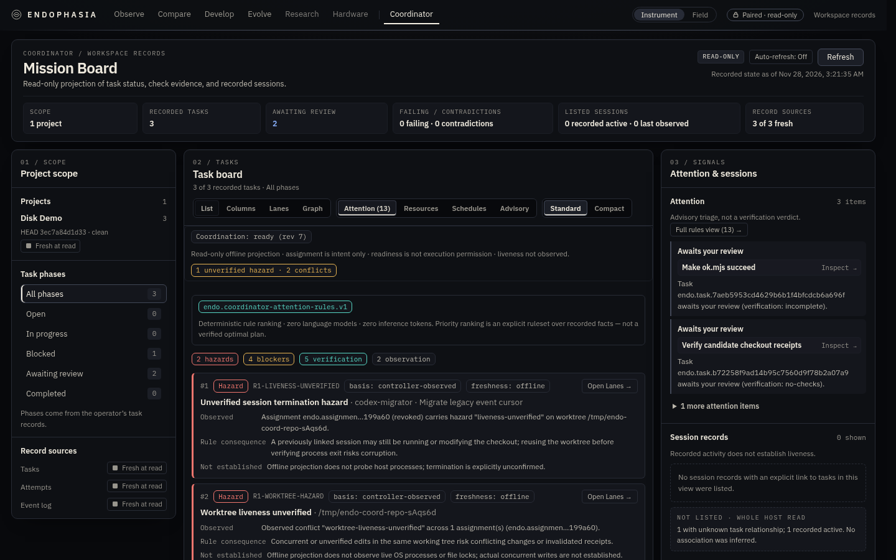
<p><sub><strong>Mission Board → Attention</strong> (Studio F1, synthetic multi-agent fixture). Hazards, blockers, verification gaps and observations, each split into <em>Observed</em>, <em>Rule consequence</em> and <em>Not established</em>. Read-only, with zero inference calls.</sub></p>

| Layer | What it does | Runs when | Model | Authority |
| :--- | :--- | :--- | :--- | :--- |
| **Status & Mission Board** | Tasks, verification standing and recorded sessions with freshness: across projects in the CLI, for the launched project on the board | On read | None | None |
| **Coordination intent** (E1, E2) | Assignments, dependencies, candidates, registered sibling worktrees, agent-reported reviews, worktree conflicts and hazards; Lanes and Graph views | Operator CLI | None | Records intent only |
| **Studio F1** | Deterministic Attention, Resources, Schedules and Advisory views in the paired workspace | On read or opt-in 30 s refresh | **Zero calls, zero wakes** | Read-only |
| **S1 scheduler** | Durable schedule ledger, zero-token local health observations, operator-declared allowance windows | `endo scheduler tick`, run by you or a timer you own | Health `GET` only, 0 tokens | None |
| **M1 model pool** | Chooses one eligible *local* member for a briefing. Fallback happens only before inference | Per briefing | Local only | None |
| **Briefing** | One sandboxed OpenClaw turn with one read-only status tool | `endo coordinator brief` | One local model | Advisory |
| **S2 advisory schedules** | Wake-gated briefings and at most one untrusted proposal per turn, with budgets and crash-honest accounting | `endo advisory tick`, only for an enabled schedule with a current grant | One local model, bounded | Proposals grant nothing |

**Disabled by default.** An S2 schedule is created disabled and unauthorised. A grant binds that exact revision, pool digest,
budget and validity window, and any change voids it. **Assignment is not authorisation and readiness is not permission.** E2's
governed dispatcher for assignment-linked attempts exists as a library with a full test matrix, but no CLI or Studio command
reaches it yet. **F2** (guided operator actions such as acknowledging a proposal from the page) is the next product milestone and is not delivered.

<table>
  <tr>
    <td width="33%" valign="top">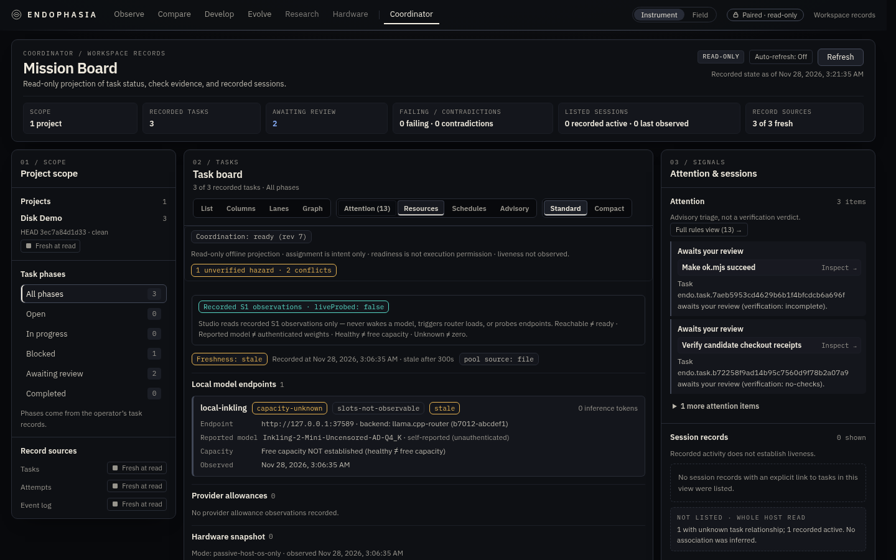<br><sub><strong>Resources.</strong> Recorded, never probed. <code>reachable ≠ ready</code>, <code>unknown ≠ zero</code>.</sub></td>
    <td width="33%" valign="top">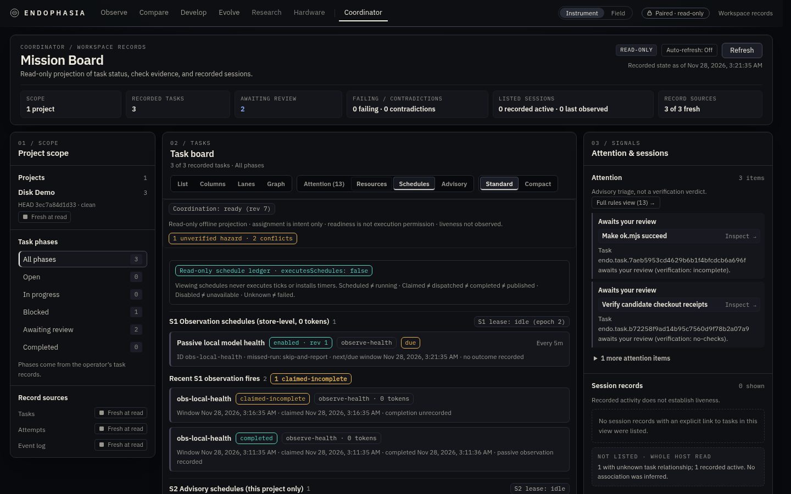<br><sub><strong>Schedules.</strong> <code>executesSchedules: false</code>. Claimed, dispatched, completed and published are kept apart.</sub></td>
    <td width="33%" valign="top">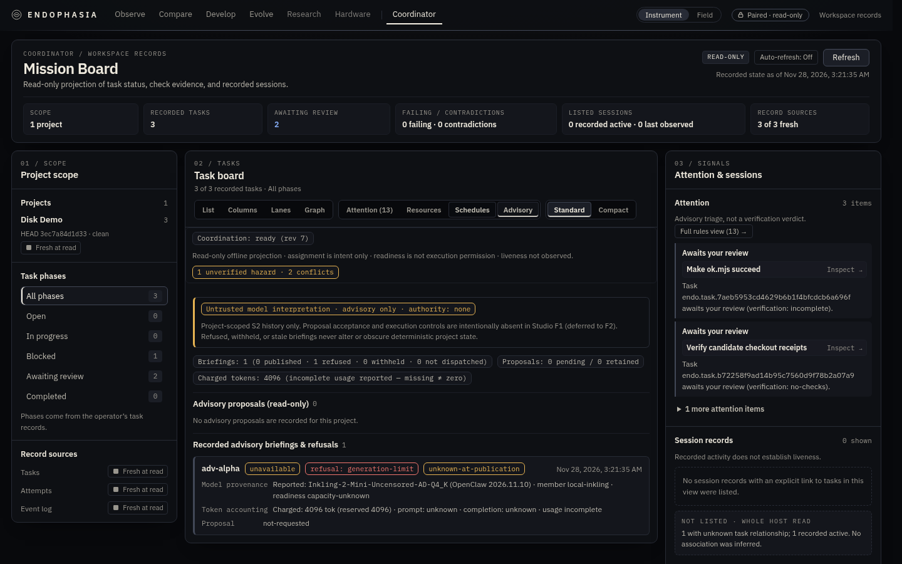<br><sub><strong>Advisory.</strong> Untrusted, <code>authority: none</code>. A refusal and its full-reservation charge, because missing usage is not zero.</sub></td>
  </tr>
</table>

### Observe & compare

Inspect what agents did after the fact, with every source labelled for what it is. Live Pi and Codex sessions are
**recorded**. Saved DeepSeek Harness sessions are **cold-imported** with explicit mapping losses. Oh My Pi's saved files are
**read in place** as metadata only. None of those last two is live integration. Trajectories are compared layer by layer
(lifecycle, tool calls, tool results, outcome) as `EXACT`, `DIVERGED` or `UNAVAILABLE`.

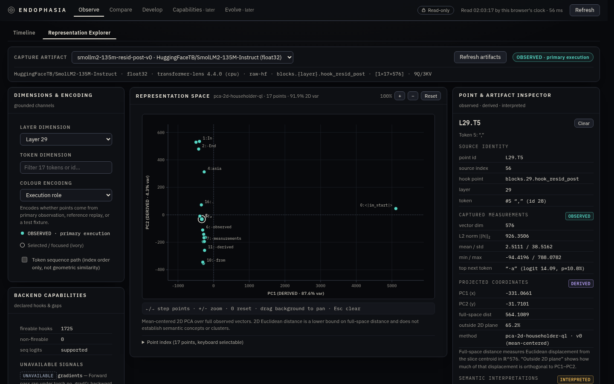
<p><sub><strong>Observe → Representation Explorer.</strong> Offline TransformerLens <code>TransformerBridge</code> captures (<code>endo studio --representations &lt;dir&gt;</code>) with strict <code>OBSERVED</code> / <code>DERIVED</code> / <code>INTERPRETED</code> / <code>UNAVAILABLE</code> separation. These are captures made offline, not live inspection of a serving model.</sub></p>

Model-provided reasoning is relayed as emitted and labelled by provenance, for example Codex's *Reasoning summary* against raw
thinking. It is never presented as a verified trace of the model's internal computation.

### Experiment & evolve

Run untrusted agents inside a Bubblewrap sandbox that is verified from the inside before execution. Collect staged multi-file
change sets only after the agent's processes are confirmed ended, and grade them with hidden cases in a separate evaluator
sandbox. Replay recorded sessions against fixed model cassettes to separate what the model did from what the harness and the
environment did.

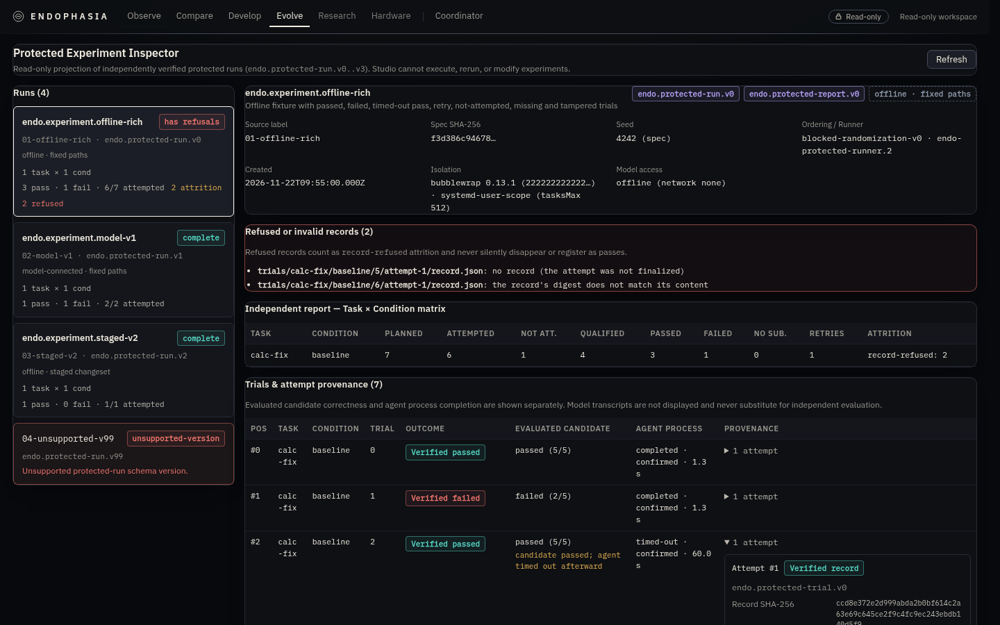
<p><sub><strong>Evolve → Protected Experiment Inspector</strong> (synthetic runs). Refused and tampered records are counted as attrition, never as passes. Evaluated correctness and agent process completion are shown separately.</sub></p>

The wider loop of observing, proposing, isolating, evaluating, comparing, admitting and promoting is a design direction ([vision](docs/vision.md),
[Evolve](docs/evolve.md)). No self-improvement loop runs, and a measured improvement never promotes or deploys itself.

---

## Quick start

Requires **Node.js ≥ 22.19.0** and Git with a configured identity (checks run only at a clean commit). Build from source:
`main` is well ahead of the npm releases.

```sh
git clone https://github.com/noctem-o/endophasia.git
cd endophasia
npm ci
npm run build
alias endo="node $PWD/dist/cli/index.js"
```

<a id="take-the-five-minute-tour"></a>
**Take the five-minute tour.** No agent, no model, no cost: you play the agent in a throwaway repository, and one bug, one
plan, one receipt and one ledger show the difference between *ran* and *right*. The tour is in [docs/quickstart.md](docs/quickstart.md#take-the-five-minute-tour).

<a id="work-with-a-live-agent"></a>
**Work with a live agent.** Install and configure [Pi](https://github.com/earendil-works/pi) or Codex separately. Endophasia
never installs, updates or patches either one. The workbench needs Linux with `/proc` and a controlling terminal.

```sh
endo doctor
cd /path/to/project
endo develop                        # live Pi workbench (reference runtime)
endo develop --harness codex        # live Codex workbench (Strict-only)
```

Open the private loopback URL the terminal prints and pair it with the one-time code. Approved dispatches do real agent work
and may cost money. Modes, controls and every other entry point (recording from the CLI, Coordinator commands, DSH import,
Oh My Pi, representation captures, protected experiments, demo fixtures) are in [docs/quickstart.md](docs/quickstart.md#more-ways-in) and the
[live workbench guide](docs/develop-workbench.md).

**Browse the Coordinator with no agent and no model.** `node scripts/demo-coordinator-studio-f1.mjs` builds a synthetic multi-agent
store in a temporary directory, serves the paired workspace and prints the URL and pairing code. A sentinel endpoint stands in for a model, and the script exits non-zero if anything contacts it.

> [!NOTE]
> **npm lags far behind.** As checked on 28 November 2026, npm's `latest` tag is the CLI-only `0.1.0-alpha.1` and `alpha` is
> `0.1.0-alpha.2` (22 October 2026), with an early read-only browser page. Neither has the workbench, Codex, the Coordinator or
> anything else above. The source manifest still reads `0.1.0-alpha.2`, so the version string doesn't distinguish a source build. See
> [docs/install.md](docs/install.md).

---

<a id="how-develop-works"></a>
## How a piece of work is recorded

You stay the operator throughout. Endophasia keeps the records. It doesn't decide.

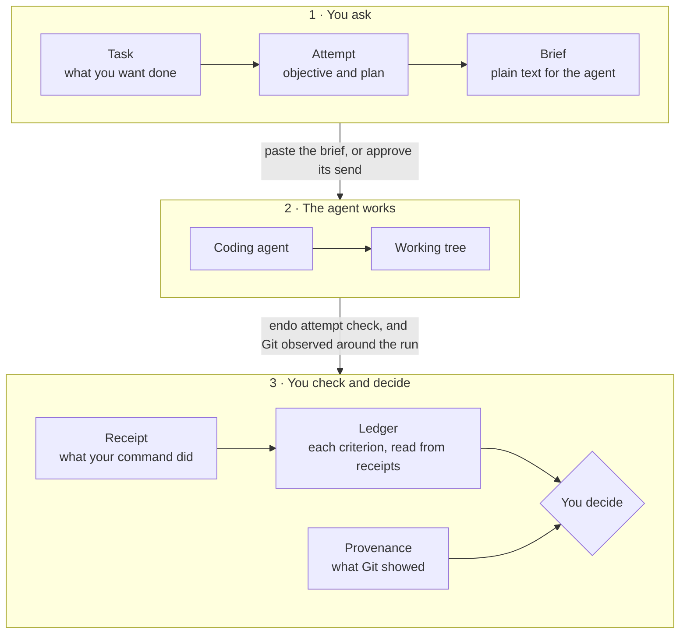

| Record | What it says | What it never says |
| :--- | :--- | :--- |
| **Task** | What you intend to get done, with a status only you move | That any work satisfies it |
| **Attempt & brief** | One frozen request: objective, constraints and verification plan | That anything was sent (preparing sends nothing) |
| **Plan** | Your checks, what each should show, and optionally the expected exit code and exact stdout | That the checks are sufficient |
| **Receipt** | What Endophasia observed when *you* ran a command at a clean commit: commit, exit status, stdout SHA-256 | Acceptance (no status moves) |
| **Ledger** | Each planned check at `HEAD` (`passed`, `failed`, `inconclusive`, `mixed`, `stale`, `not run`), with history | That a passing check proves the criterion |
| **Provenance** | Git blob ids and modes before the send, at run end and now, never file contents | Authorship: a diff between two states doesn't say who wrote it |

Design records: [work attempts](docs/designs/develop-work-attempts.md) · [receipts](docs/designs/develop-verification-receipts.md) · [plans and ledger](docs/designs/develop-verification-plans.md) · [behavioural checks](docs/designs/develop-behavioural-checks.md) · [provenance](docs/designs/develop-candidate-provenance.md) · [attempt execution](docs/designs/develop-attempt-execution.md) · [evidence bridge](docs/designs/develop-evidence-bridge.md).

---

<a id="studio"></a>
<a id="endophasia-web"></a>
<a id="current-state"></a>
## What works today

This table reflects source-tree `main` at `d2024ac51` (28 November 2026). Maturity labels mean different things and
are not interchangeable:

**Implemented**: on `main` with an operator surface and deterministic tests. **Narrow**: implemented, but validated only in the
stated configuration. **Library**: implemented and tested with no CLI or Studio entry point. **Experimental**: works, explicitly
non-authoritative or opt-in. **Design only**: specification without implementation. Research, planned and gated items are in the [roadmap](#roadmap).

| Area | Capability | Maturity | Entry point |
| :--- | :--- | :--- | :--- |
| **Develop** | Projects, tasks, attempts, briefs, checks, receipts, plans, ledger, provenance, attention overview | Implemented | `project`, `task`, `attempt …` |
| | Agent-free project workspace in a browser | Implemented | `workspace open --project <id>` |
| | Live Pi workbench, Strict mode | Implemented | `develop` |
| | Pi Everyday grants | Narrow (one attested configuration) | `develop --mode everyday` |
| | Live Codex App Server: offline check, terminal session, Strict-only workbench | Implemented | `codex check\|session`, `develop --harness codex` |
| | Prepared-attempt dispatch from the workbench | Implemented on Pi; not available on Codex | Workbench `attempt <id>` |
| | Governed protected execution of a prepared attempt | Implemented (offline v2 template) | `attempt protected-run` |
| **Coordinate** | Status projection, Mission Board, OpenClaw status plugin | Implemented | `coordinator status`, `workspace open` |
| | Coordination intent: assignments, dependencies, candidates, worktrees, reviews | Implemented (records only) | `assign`, `dep`, `candidate`, `worktree`, `review` |
| | Governed dispatch of assignment-linked attempts (E2) | Library | None yet |
| | Studio F1 deterministic Attention, Resources, Schedules, Advisory | Implemented (read-only) | `workspace open` |
| | S1 schedule ledger and zero-token resource observations | Implemented, disabled by default | `schedule`, `scheduler tick`, `resource` |
| | M1 local model pool | Implemented (local endpoints only) | `coordinator pool check`, `brief --pool` |
| | Coordinator briefing | Experimental (advisory) | `coordinator brief` |
| | S2 scheduled advisory briefings and proposal queue | Experimental, disabled by default | `advisory …` |
| | S0 persistent automation architecture | Design only | [design](docs/designs/coordinator-automation.md) |
| **Observe** | Pi identity, protocol checks, recording, capability admission | Implemented | `doctor`, `harness …` |
| | Trajectory projection and diff (Pi) | Implemented | `trajectory show\|diff` |
| | Read-only Studio: Observe, Compare, recorded Develop | Implemented | `studio` |
| | DSH cold import with loss accounting | Implemented (pinned DSH version) | `dsh import` |
| | Oh My Pi saved-session metadata, read in place | Implemented (OMP 18.x format 3) | `studio --omp-sessions` |
| | Offline representation captures | Implemented (offline only) | `studio --representations` |
| **Experiment** | Model-boundary capture and cassette replay | Implemented | `proxy record\|replay`, `replay` |
| | Controlled Pi experiments with declared conditions | Implemented | `experiment run\|report` |
| | Bubblewrap protected experiments (`v0`–`v3`) and read-only inspector | Implemented (Linux); evaluation experimental | `experiment protected-run\|report`, `studio --protected-runs` |
| | Scratch copies, governed continuation, A/A workflow | Library and research scripts | Source-tree APIs |

Evidence and limits for every row, plus the library-only surfaces, are in [docs/status.md](docs/status.md). The claim-by-claim
reconciliation behind this table is in [docs/audits/documentation-reconciliation-2026-11.md](docs/audits/documentation-reconciliation-2026-11.md).

**Not shipped:** Studio F2 operator actions, concurrent Pi and Codex sessions in one store (E4), live control of harnesses other
than Pi and Codex, live serving-time activation capture, governed experiment execution from Evolve, an `endo web` command and a
native desktop app. Studio's **Research** and **Hardware** tabs are explicit placeholders.

### What Endophasia does not claim

| Distinction | Meaning |
| :--- | :--- |
| **Observation / interpretation** | An observation names its source, a report names its reporter, and a derivation names its method. |
| **Acceptance / completion** | A runtime accepting a request doesn't prove it executed it, obeyed a steer or produced correct code. |
| **Evidence / authority** | A passing check, a matching comparison, a capability descriptor or a model proposal grants no permission. |
| **Approval / containment** | Terminal approval governs what is dispatched. It doesn't sandbox an agent's tools. |
| **Reasoning / cognition** | Model-provided reasoning is relayed verbatim, never as a verified trace of internal computation. |
| **Captured / live** | Offline representation captures aren't inference-time activation inspection. |
| **Mechanism / competence** | That a Coordinator mechanism works end to end doesn't show that its model output is reliable or useful. |
| **Local / trusted** | Records are unsigned local files. Same-UID tampering is detected where re-hashing allows, not prevented. Workstation H0 remains blocked. |

---

## Architecture

The diagram below is an **authority map**, drawn from the implementation and simplified. Read the arrows literally. A solid arrow
means records are written or read along it. A **thick arrow** means authority, and every one starts with the operator. A dotted
arrow means advisory output, shown to a person and read by nothing that acts.

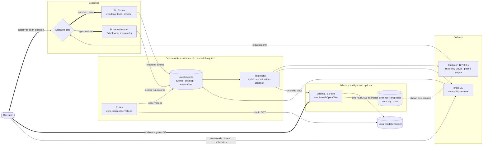

There is no path from advisory output to the dispatch gate. A paired page can draft and request, but approval comes from the
controlling terminal. The one exception is a Pi Everyday grant, which the terminal issues, inside the narrow attested configuration
above. Pi and Codex call their own model providers along their own routes. Endophasia records what they report and doesn't stand in that path.
The evidence pipeline, the Coordinator layering and the storage layout are in [docs/architecture.md](docs/architecture.md).

---

## Research direction

The research programme separates how the **model**, the **harness**, the **tools** and the **environment** each contribute to agent
behaviour, then tests changes under declared, independently verified conditions. Negative results are kept on the record.

| Study | Finding | Scope |
| :--- | :--- | :--- |
| [Cassette replay](research/README.md#cassette-replays) | 40/40 exact replays; mutating the workspace triggered the expected divergence | Pi 1.0.1, 4 recorded sessions, fixed model responses |
| [Pinned environment](research/README.md#pinned-environment-study-e3) | Pinning environment, sampling and prompt cache made all judged layers and requests match across 20/20 trials | 3 small tasks, Pi 1.0.1 + qwen3.8-27b; not a universal determinism claim |
| [Path sensitivity](research/README.md#path-sensitivity-study) | The working-directory path changed whether `STEER` was followed, and altered baseline output on one task | 2 tasks × 30 paths; acceptance, consumption and obedience measured separately |
| [Completion cap](research/README.md#completion-cap-study) | Raising Pi's cap from 16,384 to 32,768 lifted the pass rate from 10/24 to 19/23 | 2 discriminating tasks, 4 paths, small samples |
| [Matched two-turn A/A](research/governed-initial-continuation/aa/RESULTS.md) | 4 fresh Pi sessions and 8 approved requests verified end to end with confirmed server cleanup | Pi 1.0.4 / Nanbeige4.3-33B, tool-free; one run |
| [CPU numerical probe](research/numerical-execution-probe/FIRST-RESULT.md) | Logits matched bitwise within each token-submission schedule and differed across schedules | SmolLM2-135M f16, 4 CPU processes |
| [Evidence eligibility (MEM-000)](research/evidence-eligibility/RESULTS.md) | Audited recorded evidence before building any selector: 143 causally usable trials, memory selector judged not ready | Cross-study evidence audit |
| [DEVELOP work cycle & validation](research/work-cycle/README.md) | End-to-end real work cycle and human-governed run, then ledger-vs-overview validation ([001](research/develop-validation/DEVELOP-VALIDATION-001.md), [002](research/develop-validation/DEVELOP-VALIDATION-002.md)) | Exposed and fixed attention-overview drift and orphan-process gaps |
| [Isolated acceptance & trust](research/develop-acceptance-001/README.md) | Real Pi 1.5.2 + local Ornith inside a verified sandbox scored 5/5 on a hidden evaluator; tamper and timeout fixtures failed closed | Linux host; same-UID writer remains outside reader authority |
| [Counterfactual replay](research/counterfactual-replay/COUNTERFACTUAL-REPLAY-001.md) | Replay missed at exchange 2 on file mtimes; 4 live runs from identical first requests took 4 paths to the same answer | Distributional attribution only; no causal trace claims |
| [Coordinator consolidation](docs/designs/coordinator-consolidation-001.md) | The advisory machinery worked end to end on real hardware, but Inkling 2 Mini published 0/6 turns under the experimental `grounded-v1` contract, even at 16,384 completion tokens with clean stops. Advisory value above deterministic rules was not demonstrated | One local model; evidence archived in open research PRs #192–#194; `grounded-v1` not promoted |

The last row is why the Coordinator is built deterministic-first. Full catalogues: [research/README.md](research/README.md),
[docs/research-index.md](docs/research-index.md), [docs/thread-results-summary.md](docs/thread-results-summary.md) and [research/DATA.md](research/DATA.md).

<a id="roadmap"></a>
## Roadmap

Three independent tracks, set by the [November 2026 Coordinator roadmap](docs/designs/coordinator-roadmap-2026-11.md). The product
track doesn't wait on neural cognition research succeeding.

| Product | Intelligence research | Execution and platform |
| :--- | :--- | :--- |
| **F1** deterministic operational visibility (*implemented*) | Grounding-failure diagnostics (*contract on `main`, instrumentation under research*) | **E3/E4** structured event streaming and heterogeneous session infrastructure (*planned*) |
| **F2** guided operator actions (*next product milestone*) | Candidate model and cognition-contract evaluation (*under research*) | **G1/G2** execution governance and workspace lifecycle safety (*planned*) |
| | Showing advisory value beyond deterministic rules (*unproven*) | Continued trust-boundary hardening (*ongoing*) |
| | Renewable leases, revocation-responsive abort, resource-policy remediation (*under research*) | |

**Separately gated, not promoted:** experimental `grounded-v1` cognition, unattended extended-resource leases, hosted model pool
M2, the 24-hour naturalistic Coordinator trial and S3 higher-authority scheduling. Each has a written entry gate.

**Exploratory, not commitments:** persistent agents with richer cognition (WORK and DREAM profiles), live serving-time activation
capture, a dedicated Research workspace, hardware and robotics workflows, deeper systems integration and a native client.
See [docs/roadmap.md](docs/roadmap.md) and [docs/vision.md](docs/vision.md).

---

<a id="try-it"></a>
## Documentation

| Need | Start here |
| :--- | :--- |
| Get going | [Quick start and tour](docs/quickstart.md) · [Installation](docs/install.md) · [Studio guide](docs/studio.md) · [Changelog](CHANGELOG.md) |
| Develop | [Live workbench](docs/develop-workbench.md) · [Projects & tasks](docs/develop-tasks.md) · [Adapter contract](docs/designs/develop-adapter-contract.md) · [Codex live](docs/designs/develop-codex-live.md) · [Codex in Studio](docs/designs/develop-codex-studio.md) · [Protected attempts](docs/designs/protected-attempt-execution.md) · [Private activity](docs/private-activity.md) · [Reasoning](docs/develop-reasoning.md) · [Course](docs/develop-course.md) · [Field](docs/develop-field.md) · [Atmospheres](docs/develop-atmospheres.md) |
| Coordinate | [Roadmap (Nov 2026)](docs/designs/coordinator-roadmap-2026-11.md) · [Status](docs/designs/coordinator-status.md) · [Mission Board](docs/designs/coordinator-board.md) · [Studio F1](docs/designs/coordinator-studio-f1-002.md) · [Runtime](docs/designs/coordinator-runtime.md) · [Assignment architecture](docs/designs/coordinator-assignment.md) · [E1](docs/designs/coordinator-assignment-implementation.md) · [E2](docs/designs/coordinator-assignment-e2-implementation.md) · [S0](docs/designs/coordinator-automation.md) · [M1](docs/designs/coordinator-model-pool-m1-implementation.md) · [S1](docs/designs/coordinator-automation-s1-implementation.md) · [S2](docs/designs/coordinator-automation-s2-implementation.md) · [Consolidation](docs/designs/coordinator-consolidation-001.md) |
| Observe & compare | [Attachment](docs/attachment.md) · [Trajectories](docs/trajectory.md) · [Replay](docs/replay.md) · [Representation Explorer](docs/designs/observe-representation-explorer.md) · [DSH importer](docs/dsh-native-importer.md) · [OMP observer](docs/develop-omp-observer.md) · [Steering](docs/steering.md) |
| Experiment & evolve | [Experiments](docs/experiments.md) · [Protected experiments](docs/protected-experiments.md) · [Protected model access](docs/protected-model-access.md) · [Staged change sets](docs/designs/protected-staged-changeset.md) · [Evolve](docs/evolve.md) |
| Architecture & internals | [Architecture](docs/architecture.md) · [Observation bridge](docs/cockpit.md) · [Frontend architecture](docs/studio-ui-architecture.md) · [Session surface](docs/develop-session-surface.md) · [Schema compatibility](docs/schema-compatibility.md) · [Upstream boundaries](docs/upstream-boundaries.md) · [Migration ledger](docs/migration-ledger.md) |
| Status & research | [Detailed status](docs/status.md) · [Roadmap](docs/roadmap.md) · [Vision](docs/vision.md) · [Studies](research/README.md) · [Research index](docs/research-index.md) · [Thread summary](docs/thread-results-summary.md) · [Reconciliation record](docs/audits/documentation-reconciliation-2026-11.md) |

Neighbouring projects keep separate authorities: [Magpie](https://github.com/noctem-o/magpie) (claims, evidence and derived standing),
[Deadbolt](https://github.com/noctem-o/deadbolt) (authorising consequential actions), [Cogitator](https://github.com/noctem-o/cogitator)
(sealed run records) and [Buzz](https://github.com/noctem-o/buzz-prime) (a shared workspace for people and agents). A record in one never grants
authority in another. The earlier Pi-fork codebase is archived at [endophasia-pi-legacy-deprecated](https://github.com/noctem-o/endophasia-pi-legacy-deprecated).

---

## Development

```sh
npm ci
npm run typecheck
npm run lint
npm run test:inventory
npm run test:fast        # sub-minute unit feedback loop
npm test                 # full suite (fast + browser + process)
npm run build
npm run test:package
```

The deterministic suite needs only Node and Git: no API keys and no model calls. Browser tests use Chromium (set `CHROME_BIN` to choose
it, or `ENDO_REQUIRE_BROWSER=1` to fail instead of skip). Host-capability suites (`ENDO_REAL_SCOPES=1`, `ENDO_REQUIRE_ISOLATION=1`) are
opt-in, one suite at a time. See [docs/testing.md](docs/testing.md).

## License

Apache License 2.0 ([LICENSE](LICENSE)). Copyright 2026 George Gallagher. Upstream components such as Pi keep their own licences.
The README artwork in `docs/images/endophasia-plate-*.svg` is original to this repository, generated by
[docs/images/source/plate.mjs](docs/images/source/plate.mjs), and covered by the same licence.

Published `0.1.0-alpha.1` and `0.1.0-alpha.2` were released under MIT, and that grant remains with those versions. The Apache
License applies to the source from the license-change commit onward.
