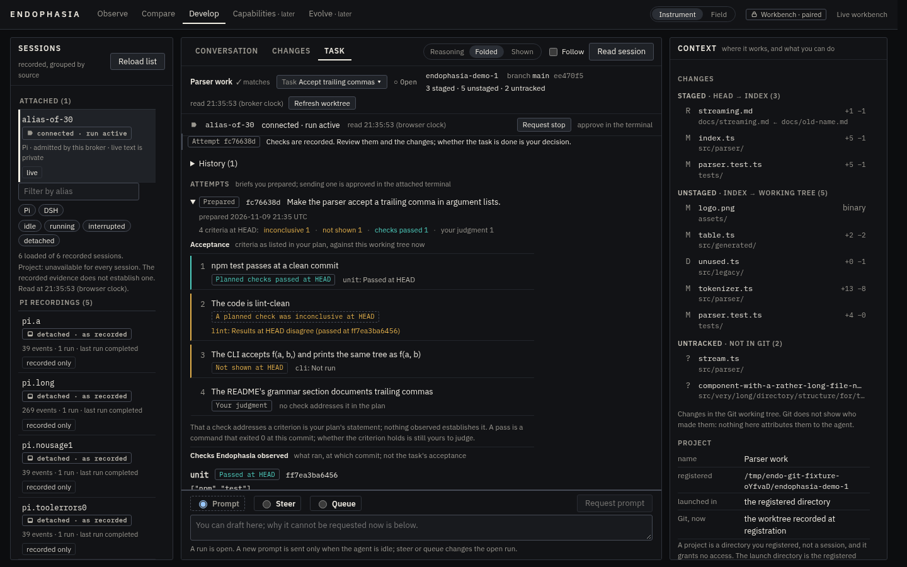
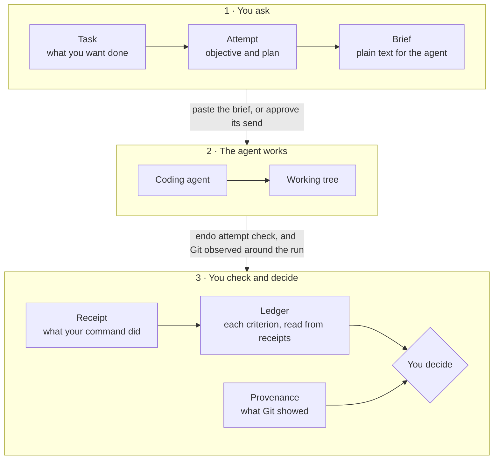
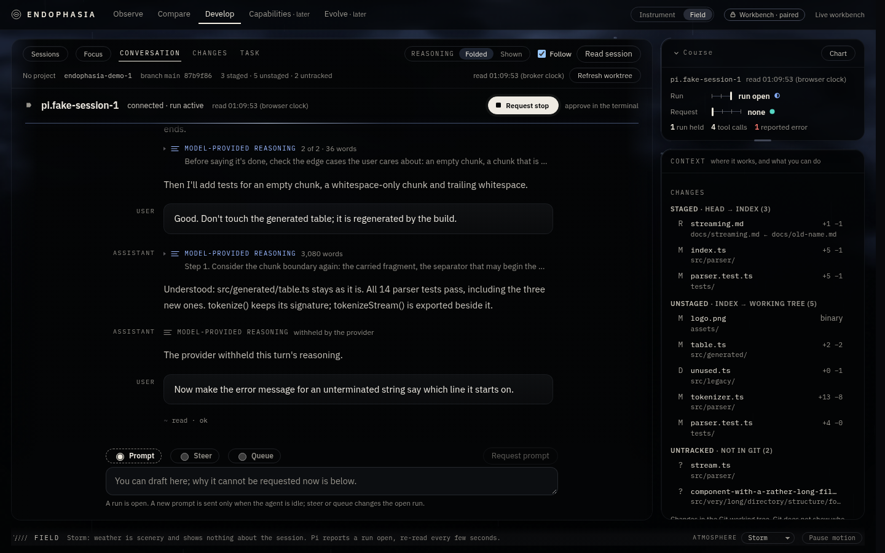
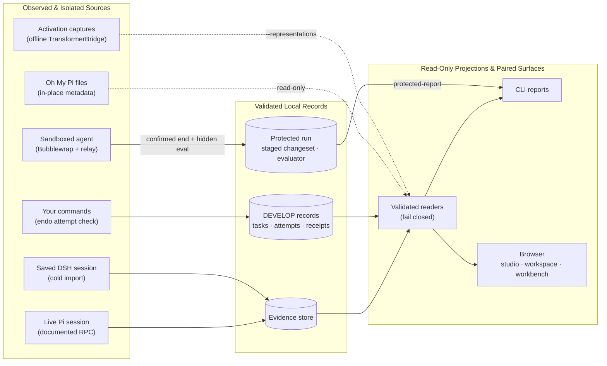

<a id="endophasia"></a>

<div align="center">

<br>

<h1>E N D O P H A S I A</h1>

<p><strong>Work with agents. Inspect the evidence. Test what changes.</strong></p>

<p>
<em>An old word for inner speech — a local-first workbench and research instrument<br>
for checking what coding agents actually did, and keeping the record for every claim.</em>
</p>

<p>
  <a href="#what-works-today"></a>
  <a href="https://github.com/earendil-works/pi"></a>
  <a href="#quick-start">= 22.19"></a>
  <a href="LICENSE"></a>
</p>

<p>
  <a href="#quick-start">Quick start</a> &nbsp;·&nbsp;
  <a href="#how-develop-works">How it works</a> &nbsp;·&nbsp;
  <a href="#endophasia-web">Browser instrument</a> &nbsp;·&nbsp;
  <a href="#what-works-today">What works</a> &nbsp;·&nbsp;
  <a href="#architecture">Architecture</a> &nbsp;·&nbsp;
  <a href="#research-direction">Research</a> &nbsp;·&nbsp;
  <a href="#documentation">Docs</a>
</p>

<br>


<p><sub><strong>Instrument</strong> — an attempt's acceptance ledger against <code>HEAD</code> beside the live Git tree. Checks are observed; acceptance stays yours.</sub></p>

</div>

---

> **A coding agent says the work is done and the tests exit `0`.**
> Is the program right? Is the code you are reading the code that was checked?
> Endophasia answers from records — never from the agent's report.

```console
$ node calc.mjs '2+3*4'
20                      # wrong: should be 14, and the exit status is still 0

$ endo attempt check --attempt <id> --keep-output -- node calc.mjs '2+3*4'
recorded: Observed check passed, at 6712eae5bcc3…

$ endo attempt evidence --attempt <id>
  planned   [observed] precedence ["node","calc.mjs","2+3*4"]:
            Failed at HEAD (6712eae5bcc3, latest failed)
  behaviour [plan: expected; observed] expected exit 0 and 3 byte(s) of output;
            observed exit 0, 3 byte(s), output different;
            first difference at line 1: expected "14", observed "20"
  criterion [plan: precedence] 1. 2+3*4 is 14: A planned check failed at HEAD
```

<p align="center"><sub>Real output from the <a href="#take-the-five-minute-tour">five-minute tour</a> below, abridged and re-wrapped. The comment on the second line is added.</sub></p>

The command exited `0`, so its receipt records what ran. The plan stated what it should *print*, so the ledger marks the criterion failed and prints the first line that differs.

| Develop | Observe & Compare | Experiment |
| :--- | :--- | :--- |
| Frame tasks, attempts and verification plans before work starts. Approve live [Pi](https://github.com/earendil-works/pi) dispatches on your terminal, run your own checks, and read one ledger of what holds at `HEAD`. | Record Pi sessions, cold-import DeepSeek Harness runs, read Oh My Pi metadata in place, diff trajectories layer by layer, and explore offline activation captures without inventing missing signals. | Replay sessions against fixed model cassettes, or run untrusted agents inside verified Bubblewrap sandboxes with staged multi-file change sets and hidden evaluators. |
| [Quick start](#quick-start) · [How DEVELOP works](#how-develop-works) | [Browser instrument](#endophasia-web) · [Representation Explorer](docs/designs/observe-representation-explorer.md) | [Protected runs](docs/protected-experiments.md) · [Studies](research/README.md) |

Pi is the reference runtime and the only live integration today; Pi still owns its execution loop.

> [!NOTE]
> **Build from source for everything on this page.** `main` is well ahead of the npm releases. Published
> `0.1.0-alpha.2` (22 October 2026) ships an earlier read-only browser page without the React workspaces, DSH import,
> Representation Explorer, live workbench, staged protected runs or DEVELOP records described here. The source manifest
> still reads `0.1.0-alpha.2`, so the version string alone does not distinguish a source build from the tarball. See
> [CHANGELOG.md](CHANGELOG.md) and [docs/release-0.1.0-alpha.2.md](docs/release-0.1.0-alpha.2.md).

---

## Quick start

Requires **Node.js >= 22.19.0** and Git with a configured identity (`user.name` and `user.email`): checks run only at a clean commit.

```sh
git clone https://github.com/noctem-o/endophasia.git
cd endophasia
npm ci
npm run build
alias endo="node $PWD/dist/cli/index.js"
```

The alias runs the CLI built from this checkout ahead of any older global `endo`. Rebuild after pulling source changes.

### Take the five-minute tour

No agent, no model, no cost — you play the agent in a throwaway Git repo and store.

<details open>
<summary><strong>Walk through one bug, one plan, one receipt and one ledger</strong> (6 steps)</summary>

**1. Create a small calculator with an operator-precedence bug.**

```sh
mkdir ~/endo-tour && cd ~/endo-tour
export ENDO_STORE_ROOT=$PWD/store

mkdir calc && cd calc && git init -q
cat > calc.mjs <<'EOF'
// Evaluates left to right, so 2+3*4 comes out as 20.
const tokens = process.argv[2].match(/\d+|[+*]/g);
let total = Number(tokens[0]);
for (let i = 1; i < tokens.length; i += 2)
  total = tokens[i] === "+" ? total + Number(tokens[i + 1]) : total * Number(tokens[i + 1]);
console.log(total);
EOF
git add calc.mjs && git commit -qm "A calculator"
```

**2. Declare what a right answer looks like, before any work begins.**

```sh
cat > ../plan.json <<'EOF'
{
  "checks": [
    {
      "name": "precedence",
      "argv": ["node", "calc.mjs", "2+3*4"],
      "shows": "multiplication binds tighter than addition",
      "expect": { "exitCode": 0, "stdout": "14\n" }
    }
  ],
  "criteria": [{ "text": "2+3*4 is 14", "checks": ["precedence"] }]
}
EOF
```

**3. Register the project, add a task and prepare an attempt.** Each command prints the id the next one takes.

```sh
endo project add --name "Calculator" --path "$PWD"
endo task add --project endo.project.<id> --title "Fix operator precedence"
endo attempt prepare --project endo.project.<id> --task endo.task.<id> \
  --objective "Make multiplication bind tighter than addition" --plan-file ../plan.json
```

Nothing has been sent anywhere. `endo attempt brief --attempt endo.attempt.<id>` prints the plain-text brief, plan included, ready to hand to any coding agent.

**4. Run the check yourself, then read the ledger.**

```sh
endo attempt check --attempt endo.attempt.<id> --keep-output -- node calc.mjs '2+3*4'
endo attempt evidence --attempt endo.attempt.<id>
```

The criterion reads *A planned check failed at HEAD*, as in the excerpt at the top.

**5. Fix it, commit and check again.**

```sh
cat > calc.mjs <<'EOF'
// Multiplication first, then addition.
const terms = process.argv[2].split("+");
const products = terms.map((term) => term.split("*").reduce((a, b) => a * Number(b), 1));
console.log(products.reduce((a, b) => a + b, 0));
EOF
git commit -qam "Multiplication binds tighter"

endo attempt check --attempt endo.attempt.<id> --keep-output -- node calc.mjs '2+3*4'
endo attempt evidence --attempt endo.attempt.<id>
endo attempt observe --attempt endo.attempt.<id>
endo attempt provenance --attempt endo.attempt.<id>
```

The planned check now reads *Passed at HEAD*, followed by *at another commit … failed* — the earlier failure stays on record. `observe` captures what Git shows now, and `provenance` compares it against each checked commit. The task stays `open` until you decide with `endo task status`.

**6. Open it in a browser.**

```sh
endo workspace open --project endo.project.<id>
```

Open the private loopback address it prints, enter the pairing code from the terminal and pick the task. Stop with **Ctrl-C** and delete `~/endo-tour` when done.

</details>

### Work with a live agent

The live workbench attaches to [Pi](https://github.com/earendil-works/pi), which you install and configure separately; Endophasia never installs, updates or patches it. It requires **Linux with `/proc` and a controlling terminal** — stdin and stderr must both be that terminal, and piped or redirected approval input is refused.

```sh
endo doctor
cd /path/to/project
endo develop
```

`endo develop` is `endo harness attach --control --workbench` in one word, without `--prompt` (every prompt is requested from the page and authorised on the terminal). A session needs neither a registered project nor a task; when you want tasks, attempts and receipts beside the conversation, register once and name it:

```sh
endo project add --name "My project" --path /path/to/project
endo develop --project endo.project.<id>
```

**Modes** ([DEVELOP-UX-002](research/develop-ux/DEVELOP-UX-002.md)). `endo develop` *requests* **Everyday**: one terminal authorisation grants bounded page-driven prompts, steers, queues and stops for 30 minutes (up to 200 sends) in one workspace — *only* while Endophasia verifies an enforced sandboxed session. Today that attested configuration is narrow: stock Pi 1.5.2 with local `Ornith-1.5-9B-Q8_0` through the governed relay, no tools, ephemeral session, read-only workspace snapshot, no credentials and no unrestricted network. Everywhere else, Everyday falls back cleanly to **Strict** (each request approved on the terminal) and states why. Use `--mode strict` to ask for Strict outright, `--mode protected` to refuse to start where protection cannot be enforced, or `--confirm short` to approve non-attempt Strict requests with a four-character code shown on the terminal.

1. Open the private loopback URL printed in the terminal (it lands directly on **Develop**) and pair it with the one-time code. Type `pair` in the terminal for a fresh code.
2. Draft a **Prompt** when idle, or request **Steer**, **Queue** or **Request stop** during an open run whenever the broker offers them.
3. In Strict mode, approve on the controlling terminal (e.g. `APPROVE PROMPT <digest>`). **The page can ask; only the terminal approves.**
4. Send a prepared attempt via `attempt <id>` on the terminal or from the **Task** view — its full brief is shown and requires its own `APPROVE ATTEMPT` phrase, at most once per attempt.
5. Watch the conversation, folded model-provided reasoning, **Course** gauges and Git worktree changes in **Conversation | Changes**. **Follow** starts on (bounded, paused when hidden, toggleable off), or click **Read session** for an explicit read. Stop with **Ctrl-C**.

Choose Pi's provider, model or binary with `--provider`, `--model` and `--pi`. Approved dispatches perform real agent work and may incur provider costs.

> [!WARNING]
> Terminal approval governs *dispatch*. It **does not sandbox the tools Pi runs**. Likewise, `endo attempt check`
> runs your command with your permissions, and a repository's test suite is that repository's code.

Guides: [live workbench](docs/develop-workbench.md) · [projects and tasks](docs/develop-tasks.md) · [sending an attempt](docs/designs/develop-attempt-workbench.md) · [private activity](docs/private-activity.md) · [process containment](docs/live-process-containment.md).

### More ways in

<details>
<summary><strong>Record and inspect a Pi session from the CLI</strong></summary>

```sh
endo harness check ./recordings       # local protocol checks; no model call
endo harness attach ./recordings --cwd /path/to/project --prompt "Summarise this project"
endo harness status ./recordings
endo harness overview ./recordings
endo trajectory show ./recordings <session-id>
endo studio ./recordings
```

`--cwd` is Pi's project directory; `./recordings` is the separate evidence store. Omitting the store resolves `$ENDO_STORE_ROOT`, then `$XDG_DATA_HOME/endophasia/store`, then `~/.local/share/endophasia/store`.

</details>

<details>
<summary><strong>Browse the interface with demo fixtures</strong> (no Pi, no model)</summary>

```sh
node scripts/seed-cockpit-demo.ts ./demo-store
endo studio ./demo-store
```

Seeds a new or empty directory with fake-Pi lifecycle fixtures and a recorded Pi 1.0.0 conformance specimen.

</details>

<details>
<summary><strong>Explore offline model activation captures</strong> (Observe → Representation Explorer)</summary>

```sh
endo studio ./recordings --representations /path/to/captures
```

Loads validated offline TransformerLens 4.x `TransformerBridge` captures (`endo.observe-representation-capture.v0`) read-only, computes a deterministic 2D PCA slice on the server, and renders observed stats, derived coordinates, isolated interpretations and explicit `UNAVAILABLE` gaps — with zero Python, PyTorch or GPU requirement in Studio itself. See [Representation Explorer](docs/designs/observe-representation-explorer.md).

</details>

<details>
<summary><strong>Import a saved DeepSeek Harness (DSH) session</strong></summary>

```sh
endo dsh import --root ./recordings /path/to/session-directory
endo dsh loss-accounting
endo studio ./recordings
```

Pass one persisted **Session format-4 directory**. Import leaves the source untouched and writes validated evidence with explicit mapping losses; it never starts, watches or controls DSH. See [DSH native importer](docs/dsh-native-importer.md).

</details>

<details>
<summary><strong>Read Oh My Pi saved sessions in place</strong></summary>

```sh
endo studio ./recordings --omp-sessions /path/to/omp/sessions
```

Read-only metadata from OMP's own format-3 files (counts, kinds, built-in tool names, model names, exit records) — no message text, no live view, no control. Link a saved session to a task with `endo task link`. See [OMP observer](docs/develop-omp-observer.md).

</details>

<details>
<summary><strong>Run a sandboxed experiment</strong> (Linux, Bubblewrap)</summary>

```sh
endo experiment protected-run <spec.json> --out <dir>
endo experiment protected-report <dir>
```

An untrusted agent works on a disposable tree inside a Bubblewrap sandbox verified from the inside before execution starts. Submissions — either fixed paths (spec `v0`/`v1`) or opt-in arbitrary multi-file **staged change sets** verified against a controller-pinned baseline (`v2`/`v3`) — are collected only after agent processes are confirmed ended, then graded inside a separate evaluator sandbox from hidden cases. Model-connected runs (`v1`/`v3`) reach one declared local endpoint through a recording relay and can opt into capability-consistent Pi runtime prompting ([runtime-prompt.ts](adapters/sandbox/runtime-prompt.ts)). Refuses rather than run unprotected. See [protected experiments](docs/protected-experiments.md), [protected model access](docs/protected-model-access.md) and [staged change sets](docs/designs/protected-staged-changeset.md).

</details>

<details>
<summary><strong>Install the earlier packaged alpha</strong></summary>

```sh
npm install -g endophasia@0.1.0-alpha.2
endo doctor
endo studio
```

Name the version explicitly: npm's `latest` tag pointed to the CLI-only `0.1.0-alpha.1` when last checked. `0.1.0-alpha.2` contains the earlier read-only browser page without the DEVELOP features above. See [docs/install.md](docs/install.md).

</details>

---

## How DEVELOP works

You stay the operator throughout. Endophasia keeps records; it does not decide, and nothing runs on its own.



| Record | What it says | What it never says |
| :--- | :--- | :--- |
| **Task** | What you intend to get done, with a status only you move | That any work satisfies it |
| **Attempt & brief** | One frozen request: objective, constraints and verification plan | That anything was sent — preparing sends nothing |
| **Plan** | Your checks, what each should show, and optional expected exit code / exact stdout | That the checks are sufficient |
| **Receipt** | What Endophasia observed when *you* ran a command at a clean commit: commit hash, exit status, stdout SHA-256 | Acceptance — no status moves |
| **Ledger** | Every planned check at `HEAD` (`passed`, `failed`, `inconclusive`, `mixed`, `stale`, `not run`), prior-commit history and each criterion's standing | That a passing check proves the criterion |
| **Provenance** | Git blob ids and modes before send, at run end and now — never file contents | Authorship — a diff between two states is not who wrote it |

### Four laws of the instrument

- **Only you run commands.** Checks run the exact arguments after `--` with no shell. Nothing stored in a plan, page or record is ever executed.
- **Only the terminal approves.** A paired page drafts and requests; only the controlling terminal authorises dispatch.
- **A passing check is not acceptance.** A receipt records an execution; a diff records Git blobs; only you move a task.
- **Missing stays missing.** An unrun check, a damaged authorisation record, a withheld reasoning block or an absent signal is reported explicitly — never rounded to zero or silently passed.

Design records: [work attempts](docs/designs/develop-work-attempts.md) · [receipts](docs/designs/develop-verification-receipts.md) · [attention overview](docs/designs/develop-attention.md) · [workspace host](docs/designs/workspace-host.md) · [attempt execution](docs/designs/develop-attempt-execution.md) · [attempt evidence](docs/designs/develop-attempt-evidence.md) · [plans and ledger](docs/designs/develop-verification-plans.md) · [provenance](docs/designs/develop-candidate-provenance.md) · [behavioural checks](docs/designs/develop-behavioural-checks.md).

---

<a id="studio"></a>
<a id="endophasia-web"></a>
## Endophasia Web (Browser Instrument)

The browser interface — **Endophasia Web**, served locally under the `endo` CLI — is a React and TypeScript application with **Observe**, **Compare** and **Develop** workspaces. Every mode binds strictly to `127.0.0.1` behind a private per-launch capability URL, with no external requests.

<table>
  <tr>
    <td width="50%" valign="top">
      
      <br>
      <sub><strong>Field, Course &amp; Atmospheres</strong> — live <em>Run</em> and <em>Request</em> gauges, folded or explicitly <em>withheld</em> model reasoning, and optional weather atmospheres (<em>"weather is scenery and shows nothing about the session"</em>).</sub>
    </td>
    <td width="50%" valign="top">
      
      <br>
      <sub><strong>Observe → Representation Explorer</strong> — offline <code>TransformerBridge</code> activations (<code>endo studio --representations &lt;dir&gt;</code>) with strict <code>OBSERVED</code> / <code>DERIVED</code> / <code>INTERPRETED</code> / <code>UNAVAILABLE</code> separation.</sub>
    </td>
  </tr>
</table>

| Command | Needs | The page can | The page cannot |
| :--- | :--- | :--- | :--- |
| `endo studio [<root>]` | A store (`--representations`, `--omp-sessions` optional) | Read recorded evidence in Observe (Timeline + Representation Explorer), Compare and recorded-session Develop | Write to the store or request any action |
| `endo workspace open --project <id>` | A registered project (no Pi or model) | After pairing: create/edit tasks, move statuses, inspect attempts, receipts, ledgers, provenance and the attention overview | Prompt, steer, stop an agent or run commands |
| `endo develop` (`harness attach --control --workbench`) | Pi on Linux with a controlling terminal | After pairing: all of the above, plus live conversation, structured private activity, Course gauges, Git changes and *requests* for PROMPT, STEER, QUEUE, STOP or attempt send | Approve its own request — authorisation belongs to the terminal (or an attested Everyday grant) |

- **Instrument & Field.** **Instrument** is DEVELOP's crisp default sheet. **Field** is an OLED-oriented night-survey appearance with **Focus** mode and selectable **Atmospheres** (`None`, `Contours`, `Rain`, `Storm`). Weather is pure scenery: its renderer receives zero session state.
- **Course.** Above the session rail, **Course** draws two gauges (`Run`, `Request`) and — when a task has a prepared attempt — six record-backed stages (`Brief · Assent · Send · Run · Check · Judge`). It visualises what the page holds; it is never a workflow engine or verifier ([docs/develop-course.md](docs/develop-course.md)).
- **Not yet shipped.** `endo web`, a native desktop app, live serving-time activation capture, embedded terminals and live control of non-Pi harnesses remain future directions. **Capabilities** and **Evolve** stay explicit placeholders.

<details>
<summary><strong>Access, privacy and retention boundaries</strong></summary>

- Keep the loopback Studio URL private: anyone holding it can read presented evidence. `endo studio` writes nothing to the store (first launch may create its own comparison digest key).
- Workspace and workbench require separate one-time pairing and an expiring in-memory grant; the URL alone grants no write or request authority.
- Live transcripts carry user/assistant text, structured model-provided reasoning where Pi emits it, and structured private activity (`tool`, `file-change`, `activity` rows) with policy-bounded previews and an explicit non-authorising capability descriptor (*"A description, not a permission"*). Literal `<think>` tags are never treated as authenticated reasoning. See [docs/private-activity.md](docs/private-activity.md) and [docs/develop-reasoning.md](docs/develop-reasoning.md).
- Live transcript and reasoning stay bounded in process memory, are excluded from canonical evidence and the read-only Studio API, and clear with the live session. Pi's own session files are separate.
- Receipts always store a SHA-256 of stdout; `--keep-output` additionally retains the first 8 KiB for behavioural diffs, so avoid it on commands that print secrets.
- DEVELOP records are local, unsigned files under `<root>/develop/` — anything able to write the store can modify them.

See [docs/studio.md](docs/studio.md).

</details>

---

## What works today

Endophasia is an experimental project. This table reflects **source-tree `main` as of 22 November 2026**.

| Area | Capability | Entry point |
| :--- | :--- | :--- |
| **Develop** | Projects, tasks, work attempts and plain-text briefs | `project`, `task`, `attempt prepare\|brief\|handoff\|report\|abandon` |
| | Operator-run checks, receipts, verification plans, behavioural diffs and ledger-backed attention overview | `attempt check`, `attempt receipts`, `attempt evidence` |
| | Working-tree provenance around an attempt | `attempt observe`, `attempt provenance` |
| | Agent-free project workspace in a browser | `workspace open --project <id>` |
| | Governed live Pi workbench with Course, Field atmospheres, structured private activity and modes | `develop`, `harness attach --control --workbench` |
| **Observe & Compare** | Pi identity, protocol checks, live recording and capability admission | `doctor`, `harness check`, `harness attach`, `harness status` |
| | Durable sessions and Pi trajectory diffs | `harness overview`, `trajectory show`, `trajectory diff` |
| | Read-only browser for Observe, Compare and recorded sessions | `studio` |
| | Offline activation geometry & Representation Explorer | `studio --representations <dir>` |
| | DSH cold import and static loss accounting | `dsh import`, `dsh loss-accounting` |
| | Oh My Pi saved-session metadata observer | `studio --omp-sessions <dir>`, `task link` |
| **Research & Experiments** | Model-boundary capture and cassette replay | `proxy record`, `proxy replay`, `replay` |
| | Controlled Pi experiments with declared conditions | `experiment run`, `experiment report` |
| | Bubblewrap-sandboxed experiments (`v0`–`v3`): fixed paths or staged change sets, model relay, capability-consistent Pi prompt, hidden evaluator | `experiment protected-run`, `experiment protected-report` |
| | Authorised STEER, QUEUE and STOP outside the workbench | `harness attach --control`, `steer` |
| | Verified scratch copies, governed continuation and matched two-turn A/A workflow | Source-tree APIs & research scripts |
| | ACP v1 adapter and ACP v2 conformance study | Library APIs |

<details>
<summary><strong>Evidence and limits, row by row</strong></summary>

| Capability | Evidence and limits |
| :--- | :--- |
| Projects, tasks, attempts and briefs | Atomic, locked, revisioned metadata under `<root>/develop/`, separate from the event store. Exercised by unit, multi-process, broker, HTTP, PTY and browser tests plus real work cycles ([WORK-CYCLE-001A/B](research/work-cycle/README.md)); damaged authorisation records fail closed (`EVIDENCE-INTEGRITY-001`). |
| Checks, receipts, plans, ledger & attention | Shell-free execution at clean commits with timeouts and lingering-process detection (Linux `/proc`; inconclusive where `/proc` is absent). Behavioural checks compare exit code and stdout only (no stdin, stderr, servers or browsers). Both `attempt evidence` and the cross-task attention overview read planned checks through the same acceptance ledger (`DEVELOP-ATTENTION-002`). Check environment variables are inherited and not attested. |
| Working-tree provenance | Records Git blob ids and modes, never contents. Ignored paths are excluded; two equal states do not prove nothing happened between them; diffs never establish authorship. |
| Workspace without an agent | Separate pairing; zero harness, session or command surface. Covered by host, CLI and browser tests. |
| Governed live Pi workbench | Terminal approval (or attested narrow Everyday grant on Linux with Pi 1.5.2 + local `Ornith-1.5-9B-Q8_0`), Course gauges, Field atmospheres, structured private activity (`tool` / `file-change` / `activity`) and non-authorising capability descriptor. Linux systemd user scopes confirm process cleanup where available. No general real-model workbench conformance claim. |
| Pi identity, recording & capability admission | Installed-package CI pins Pi 1.0.0 with a fake endpoint; real-model studies span Pi 1.0.1, 1.0.4, 1.5.0, 1.5.2 and 1.6.0. Not general-version conformance. |
| Representation Explorer | Read-only offline TransformerLens 4.x `TransformerBridge` captures (`SmolLM2-135M-Instruct` verified with `9Q/3KV` GQA semantics), scale-invariant 2D Householder-QL PCA, explicit `UNAVAILABLE` gaps and strict CSP/wire gates. No live serving-time or GGUF internal-activation capture. |
| DSH cold import & loss accounting | Five retained captures from pinned `dsh-v0.2.1-rc.2` (including failure/resume) plus adversarial tests. No live DSH control. |
| Oh My Pi saved-session observer | Read-only metadata from OMP 18.x format-3 files, verified in place against local OMP 18.13.3/18.14.1 stores plus adversarial tests. No live observation or control. Claude Code, Codex, Hermes and Amp are not integrated. |
| Capture & cassette replay | 40 exact replays across 4 recorded Pi sessions plus negative control with model responses held fixed. |
| Sandboxed protected experiments (`v0`–`v3`) | Linux Bubblewrap with inside-sandbox preflight, confirmed scope termination before collection, controller-pinned baseline + verified staged change-set reconstruction (`v2`/`v3`), opt-in capability-consistent Pi prompt (`PI-RUNTIME-CONSISTENCY-001`), recording model relay and isolated hidden evaluator. Verified with real Pi 1.5.2 / 1.6.0 against local models (`DEVELOP-ACCEPTANCE-001`, protected real-repo studies). Same-uid host tampering is detected by re-hashing, not prevented. |
| Initial scratch copies, continuation & A/A | Fresh tool-free Pi turns with separate approvals and independent receipt verification (`research/governed-initial-continuation/aa/operate.ts`). Not historical process restore or a general effect sandbox. |
| ACP v1 adapter & v2 study | Deterministic tests plus opt-in OMP smoke path; no admitted ACP capability or real v2-agent conformance. |

</details>

Cognition graphs, evolution records, model orchestration and mappings for Codex, Prime, REEF, Magpie, Deadbolt and Cogitator also exist as libraries without CLI or browser exposure. Full inventory: [docs/status.md](docs/status.md).

### What Endophasia does not claim

| Distinction | Meaning |
| :--- | :--- |
| **Observation / interpretation** | An observation names its source; a report names its reporter; a derivation names its method. Missing evidence stays `UNAVAILABLE`, not zero. |
| **Acceptance / completion** | A runtime accepting a request does not prove it executed, obeyed a steer or produced right code. |
| **Evidence / authority** | A passing check, matching comparison or capability descriptor grants zero permission. Consequential actions require separate explicit authorisation. |
| **Approval / containment** | Terminal approval governs what is dispatched; it does not sandbox an agent's tools. |
| **Reasoning / cognition** | Model-provided reasoning is relayed verbatim as emitted — never as a verified trace of internal computation. |
| **Replay / repeatability / invariance** | *Exact replay* fixes model responses; *live repeatability* tests new runs under declared conditions; *perturbation invariance* tests sensitivity to supposedly irrelevant changes. |

No autonomous self-improvement loop is claimed, and measured improvement never auto-promotes or deploys a change. See [docs/vision.md](docs/vision.md) and [docs/cockpit.md](docs/cockpit.md#compare-candidate-discovery).

---

## Architecture

Endophasia keeps **execution**, **evidence acquisition** and **presentation** strictly separated — every reader validates on read and fails closed.



- **Recording & admission.** An optional recording proxy captures the HTTP model boundary for cassette replay and controlled experiments. Pi capabilities are admitted from live transport, identity and conformance evidence; changing runtime or configuration invalidates dependent evidence.
- **DEVELOP records** live under `<root>/develop/`, separate from the canonical event store — atomic, locked, revisioned and re-validated on every read.
- **The live workbench** runs inside the process owning the attached Pi child. Its paired loopback broker keeps transcripts and reasoning memory-only, re-checks every operation against session state and active grants before dispatch, and leaves read-only `endo studio` with zero execution authority.
- **Protected experiments** isolate untrusted coding agents inside Bubblewrap, verify the boundary from inside before execution, wait for confirmed process termination before staging changes against a controller-pinned baseline, and grade reconstructed candidates inside an independent evaluator sandbox.

Contracts: [Pi attachment](docs/attachment.md) · [capture & replay](docs/replay.md) · [DSH importer](docs/dsh-native-importer.md) · [observation bridge](docs/cockpit.md) · [workbench](docs/develop-workbench.md) · [workspace service](docs/develop-workspace-service.md) · [protected experiments](docs/protected-experiments.md) · [initial-state continuation](docs/initial-continuation.md).

---

## Research direction

The research programme separates how **model**, **harness**, **tools** and **environment** contribute to agent behaviour, then tests changes under declared, independently verified conditions.

### Selected findings

| Study | Finding | Scope |
| :--- | :--- | :--- |
| [Cassette replay](research/README.md#cassette-replays) | 40/40 exact replays; mutating the workspace triggered the expected divergence | Pi 1.0.1, 4 recorded sessions, fixed model responses |
| [Variance & pinned environment](research/README.md#pinned-environment-study-e3) | Pinning environment, sampling and prompt cache made all judged layers and requests match across 20/20 trials | 3 small tasks, Pi 1.0.1 + qwen3.8-27b; not a universal determinism claim |
| [Path sensitivity](research/README.md#path-sensitivity-study) | Working-directory path changed whether `STEER` was followed, and altered baseline output on one task | 2 tasks × 30 paths; acceptance, consumption and obedience measured separately |
| [Completion cap](research/README.md#completion-cap-study) | Raising Pi's cap from 16,384 to 32,768 lifted pass rate from 10/24 to 19/23 | 2 discriminating tasks, 4 paths, small samples |
| [Matched two-turn A/A](research/governed-initial-continuation/aa/RESULTS.md) | 4 fresh Pi sessions and 8 approved requests verified end-to-end with confirmed server cleanup | Pi 1.0.4 / Nanbeige4.3-33B, tool-free; one run under declared assumptions |
| [CPU numerical probe](research/numerical-execution-probe/FIRST-RESULT.md) | Logits matched bitwise within each token-submission schedule and differed across schedules | SmolLM2-135M f16, 4 CPU processes |
| [Evidence eligibility (MEM-000)](research/evidence-eligibility/RESULTS.md) | Audited recorded evidence before building any selector: 143 causally usable trials, memory selector judged not ready | Cross-study evidence audit |
| [DEVELOP work cycle & validation](research/work-cycle/README.md) | End-to-end real work cycle + human-governed run ([001B](research/work-cycle/WORK-CYCLE-001B.md)), followed by ledger-vs-overview validation ([VALIDATION-001](research/develop-validation/DEVELOP-VALIDATION-001.md) / [002](research/develop-validation/DEVELOP-VALIDATION-002.md)) | Exposed and fixed attention-overview drift and orphan-process gaps |
| [Isolated acceptance & trust](research/develop-acceptance-001/README.md) | Real Pi 1.5.2 + local Ornith inside verified sandbox scored 5/5 on hidden evaluator; tamper/timeout fixtures failed closed; QEMU guest verification ([TRUST-004](research/develop-verify-trust-004/PROTOCOL.md)) | Linux Arch host; host same-uid writer remains outside reader authority |
| [Counterfactual replay feasibility](research/counterfactual-replay/COUNTERFACTUAL-REPLAY-001.md) | Replay missed at exchange 2 on file mtimes; 4 live runs from identical first requests took 4 paths to the same answer | Distributional attribution only; no causal trace claims |

Full catalog of live studies, designs and limits: [research/README.md](research/README.md), [docs/thread-results-summary.md](docs/thread-results-summary.md) and [research/DATA.md](research/DATA.md).

<a id="roadmap"></a>
### Delivery direction

- **DEVELOP hardening:** exercise the full loop (behavioural checks, provenance, ledger-backed attention) on real Pi tasks, extend behavioural checks beyond exit code + stdout (stdin, stderr, servers, browsers), and keep refining live workbench reliability and diagnostics.
- **Studio × Protected Experiments:** surface completed `endo experiment protected-run` / `protected-report` outputs inside Studio's **Evolve** workspace as a read-only Protected Experiment Inspector before considering any governed execution surface.
- **Research & verification:** keep governed continuation, effect isolation, offline/reference-replay representation analysis and sandboxed evaluation as separate, explicitly bounded threads.
- **Exploratory / not current requirements:** Cognition (`WORK`/`DREAM`), live serving-time activation capture, embedded terminals, live control of non-Pi harnesses and a native Rust/GPUI client remain future design directions ([docs/roadmap.md](docs/roadmap.md), [docs/evolve.md](docs/evolve.md), [docs/vision.md](docs/vision.md)).

---

## Documentation

<a id="current-state"></a>
<a id="try-it"></a>

| Need | Start here |
| :--- | :--- |
| Install & browser usage | [Installation](docs/install.md) · [Studio & workbench](docs/studio.md) · [Changelog](CHANGELOG.md) |
| Run the DEVELOP loop | [Projects & tasks](docs/develop-tasks.md) · [Attempts](docs/designs/develop-work-attempts.md) · [Receipts](docs/designs/develop-verification-receipts.md) · [Plans & ledger](docs/designs/develop-verification-plans.md) · [Behavioural checks](docs/designs/develop-behavioural-checks.md) · [Provenance](docs/designs/develop-candidate-provenance.md) · [Attempt evidence](docs/designs/develop-attempt-evidence.md) |
| Work with a live agent | [Live workbench](docs/develop-workbench.md) · [Sending an attempt](docs/designs/develop-attempt-workbench.md) · [Private activity](docs/private-activity.md) · [Reasoning & privacy](docs/develop-reasoning.md) · [Git review](docs/develop-project-review.md) · [Process containment](docs/live-process-containment.md) · [Course](docs/develop-course.md) · [Field](docs/develop-field.md) · [Atmospheres](docs/develop-atmospheres.md) |
| Workspace without an agent | [Workspace host](docs/designs/workspace-host.md) · [Attention overview](docs/designs/develop-attention.md) · [Workspace service](docs/develop-workspace-service.md) · [OMP observer](docs/develop-omp-observer.md) |
| Observe, replay & compare | [Attachment](docs/attachment.md) · [Replay](docs/replay.md) · [Trajectories](docs/trajectory.md) · [Representation Explorer](docs/designs/observe-representation-explorer.md) · [Experiments](docs/experiments.md) · [Steering](docs/steering.md) |
| Sandboxed experiments | [Protected experiments](docs/protected-experiments.md) · [Protected model access](docs/protected-model-access.md) · [Staged change sets](docs/designs/staged-changeset.md) · [Protected staged runs](docs/designs/protected-staged-changeset.md) |
| Browser & contract internals | [Observation bridge & Compare API](docs/cockpit.md) · [Frontend architecture](docs/studio-ui-architecture.md) · [Session surface](docs/develop-session-surface.md) · [Schema compatibility](docs/schema-compatibility.md) · [Deadbolt contract](docs/deadbolt-intervention-contract.md) · [Migration ledger](docs/migration-ledger.md) |
| Initial-state research APIs | [Checkpoint candidate](docs/checkpoint-candidate.md) · [Scratch materialization](docs/checkpoint-materialization.md) · [Sibling set](docs/initial-branch-set.md) · [Initial-child execution](docs/initial-child-execution.md) · [Continuation](docs/initial-continuation.md) |
| Adapter & status records | [Detailed status](docs/status.md) · [Thread summary](docs/thread-results-summary.md) · [Pi inventory](docs/pi-attach-inventory.md) · [Pi audit](docs/pi-attach-audit.md) · [Pi 1.4.0 upgrade](docs/pi-1.4.0-upgrade.md) · [DSH study](docs/dsh-native-attachment.md) · [DSH importer](docs/dsh-native-importer.md) · [ACP v1](docs/acp-v1-slice.md) · [ACP v2 study](docs/acp-v2-study.md) |
| Research & vision | [Studies](research/README.md) · [Vision](docs/vision.md) · [Observe/Verify](docs/observe.md) · [Evolve](docs/evolve.md) · [Roadmap](docs/roadmap.md) |

Neighbouring projects keep separate authorities: [Magpie](https://github.com/noctem-o/magpie) (claims, evidence and derived standing), [Deadbolt](https://github.com/noctem-o/deadbolt) (authorising consequential actions), [Cogitator](https://github.com/noctem-o/cogitator) (sealed run records) and [Buzz](https://github.com/noctem-o/buzz-prime) (shared workspace for people and agents). A record in one never grants authority in another. The earlier Pi-fork codebase is archived at [endophasia-pi-legacy-deprecated](https://github.com/noctem-o/endophasia-pi-legacy-deprecated).

---

## Development

```sh
npm ci
npm run typecheck
npm run lint
npm test
npm run build
npm run test:package
```

The deterministic suite requires only Node and Git (no API keys or model calls). Browser tests use Chromium (`CHROME_BIN` to select it; `ENDO_REQUIRE_BROWSER=1` to fail instead of skip). CI runs three parallel test shards plus installed-package acceptance against pinned Pi 1.0.0 and a fake model endpoint. See [docs/install.md](docs/install.md#running-the-tests).

## License

Apache License 2.0 ([LICENSE](LICENSE)). Copyright 2026 George Gallagher. Upstream components such as Pi retain their own licenses.

Published `0.1.0-alpha.1` and `0.1.0-alpha.2` were released under MIT, and that grant remains with those versions. The Apache License applies to the source from the license-change commit onward.
