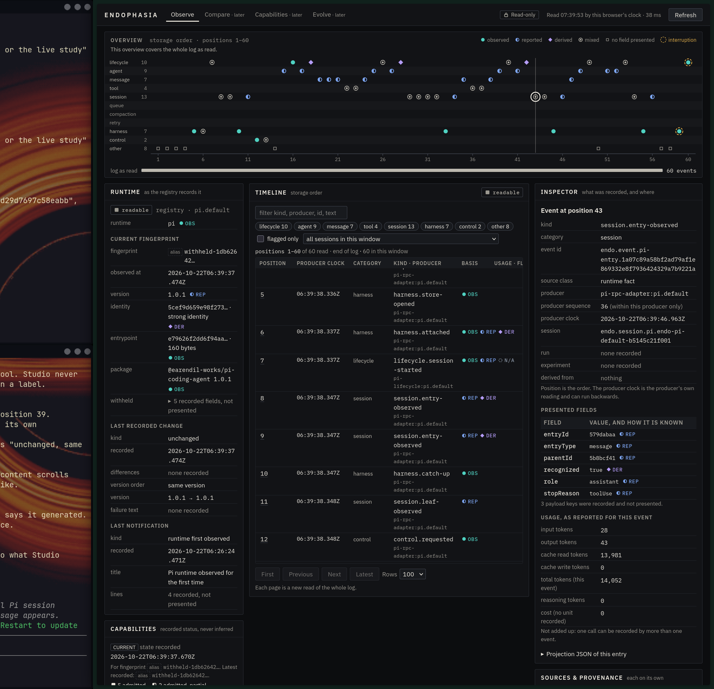

<h1>endophasia</h1>

<strong>Instrumented cognition for coding agents.</strong>

An experimental, evidence-first instrument for studying coding-agent behaviour: 
it records observable harness activity and keeps observation, interpretation, evidence and permission apart.

  
  
  

  <a href="#endophasia-web">Endophasia Web</a> &nbsp; · &nbsp;
  <a href="#quick-start">Quick start</a> &nbsp; · &nbsp;
  <a href="#what-works-today">What works today</a> &nbsp; · &nbsp;
  <a href="#architecture">Architecture</a> &nbsp; · &nbsp;
  <a href="#research-direction">Research</a> &nbsp; · &nbsp;
  <a href="#documentation">Documentation</a>

---

Endophasia studies coding-agent systems through explicit, evidence-bounded adapters. On `main`, it can attach to
[Pi](https://github.com/earendil-works/pi) for live recording, or deliberately cold-import persisted
[DeepSeek Harness (DSH)](docs/dsh-native-attachment.md) Session format-4 records without operating DSH.
Both paths produce durable evidence from which Endophasia can construct trajectories and read-only comparisons.
The CLI also provides Pi recording, replay, controlled experiments and authorised intervention; the browser interface
(currently `endo studio`) displays recorded observations and compares two explicitly selected Pi/DSH recordings through the authoritative read-only APIs.

It is harness-neutral by design, but **the two evidence sources do not have the same capabilities**: DSH import is
offline, not a live attachment or a Pi-equivalent replay/control path. Endophasia does not replace a harness's execution
loop. It is not itself an agent runtime, a model provider, a benchmark or a deployment system.

*Endophasia* is an old term for inner speech. The project is built on the opposite discipline: it records the outside of an
agent (what it requested, what it was told, what it reported and what it did), and it does not claim to read what a model
"thought".

> [!IMPORTANT]
> **Release and naming status (25 October 2026):** `0.1.0-alpha.1` is CLI-only. Published `0.1.0-alpha.2` adds the original
> read-only browser page (`endo studio`); `alpha` points to it on npm, while `latest` still points to `0.1.0-alpha.1`.
> The newer React/TypeScript Observe and Compare workspaces, DSH CLI import and Compare backend described below are **on `main`, not
> in published `0.1.0-alpha.2`**. The intended
> interface names are **Endophasia Web** (browser) and **Endophasia** (proposed native desktop binary), but the existing CLI
> remains `endo studio`: `endo web`, the native application and its installers **do not exist yet**. See
> [release history](docs/release-0.1.0-alpha.2.md), [current browser interface](docs/studio.md) and [quick start](#quick-start).
> The earlier
> Pi-fork version, which demonstrated the v0 cockpit and observation contracts, lives at
> [endophasia-pi-legacy-deprecated](https://github.com/noctem-o/endophasia-pi-legacy-deprecated).

### Why you might use it

- To know which Pi harness build and configuration produced a live recording, and when its admitted evidence changes.
- To import a persisted DSH session without driving or resuming DSH, while retaining explicit mapping losses and unavailable signals.
- To replay a recorded Pi session and learn whether it reproduces under the recorded model responses, with divergence classified.
- To compare eligible recorded Pi and DSH trajectories layer by layer: lifecycle, tool calls, tool results and outcome.
- To steer a running Pi session through an explicit, authorised intervention, distinguishing acceptance, observed consumption
  and subsequent behaviour.
- To run controlled Pi experiments in which the harness and its configuration are treated as variables, not as plumbing.

### What it keeps apart

~~~text
observation  != inference
acceptance   != execution
evidence     != standing
proposal     != permission
~~~

An observed event is shown as an observation. A reported value says who reported it. A derived value names its derivation.
A capability a runtime cannot be shown to meet stays `UNAVAILABLE`; Endophasia does not fill the gap. And it keeps three
properties of reproducibility apart, because they are different claims:

~~~text
exact replay               did the recorded session reproduce under its recorded responses?
fixed-condition repeat     do repeated live runs under the same declared conditions agree?
perturbation invariance    does behaviour hold when an input that should not matter changes?
~~~

The fuller statement of these distinctions, and the projects Endophasia stays separate from, is in [docs/vision.md](docs/vision.md).

## Endophasia Web

  

<strong>A read-only inspection view of recorded events.</strong> The source-tree React interface is newer
than the browser page in the published <code>0.1.0-alpha.2</code> package. This is a view of recorded evidence, not a live
model-brain visualisation or an internal-activation trace.

**Endophasia Web** (currently invoked as `endo studio`) is the existing browser interface. The source tree implements
**read-only Observe and Compare workspaces**, served from
the installed package on `127.0.0.1` behind a private per-launch address. Observe shows, as recorded:

- the **runtime identity**: which harness installation the registry recorded, its fingerprint, and what changed;
- the **capability state**, each capability with its status, classification and the limits that qualify it;
- a **timeline in storage order**, filterable, with a per-event inspector for the recorded fields and where each came from;
- the **condition of each source**: the event log and each registry are read independently, and each says whether it was
  readable, empty, absent, degraded or unopenable.

Each claim carries its basis (observed, reported or derived) or the N/A mark with the record's own reason; a value that was
never recorded is shown as not recorded, never as zero. The page does not poll, draws no live activity or scores, and has no controls that act on a
run or a store: only ones that change what it shows. It does not start, attach to or steer an agent, and it does not write to the
store it reads.

Endophasia Web is meant to grow beyond this first read-only page. **DEVELOP, COGNITION, VERIFY and EVOLVE are not implemented as
browser workspaces**; a model-internal OBSERVE view does not exist either. WORK and DREAM are **proposed cognition profiles**
within a possible COGNITION workspace, not separate top-level tabs. Further profiles could be added without creating
new workspaces. Source builds include the read-only React **Compare workspace** for discovering and selecting recorded Pi/DSH sessions.
Capabilities and Evolve remain marked "later" and show no records.
Its guarded read-only routes discover eligible Pi/DSH recordings and compare two selections from one configured store,
using generation-bound opaque selectors rather than exposing raw source identities. It does not read active harnesses,
import files or claim two sources are equivalent. Details: [docs/studio.md](docs/studio.md),
[Compare backend contract](docs/cockpit.md#compare-candidate-discovery) and the frontend's
[design reference](docs/cockpit-ui.md).

## Quick start

Requires **Node >= 22.19.0**. Pi is installed separately, by you; Endophasia never installs, updates or patches it.

**Install the published browser alpha.** Explicitly select `0.1.0-alpha.2`: npm's `latest` tag still points
at the CLI-only `0.1.0-alpha.1`. `0.1.0-alpha.2` has the **earlier browser page**, not the newer React frontend on `main`.

~~~sh
npm install -g endophasia@0.1.0-alpha.2
endo doctor                          # read-only: Node, Pi, store locations, recorded evidence
endo harness check                   # local Pi checks, no model call; records evidence
endo harness attach --prompt "..."   # uses your Pi model provider and may cost money
endo harness status                  # recorded identity and capability state
endo harness overview                # recorded session lifecycle
endo trajectory show <session-id>    # the id attach prints
endo studio                          # serves the published read-only browser page
~~~

**Try the newer source-tree capabilities (absent from the `0.1.0-alpha.2` package):**

~~~sh
git clone https://github.com/noctem-o/endophasia.git && cd endophasia
npm ci && npm run build
node scripts/seed-cockpit-demo.ts ./demo-store    # optional: committed fixtures and Pi 1.0.0 specimen; no Pi needed
node dist/cli/index.js studio ./demo-store        # React Observe and Compare; prints a private local address
~~~

**Cold-import a DSH recording from the source build** (one explicit persisted Session format-4 directory,
not a DSH home, running process or transcript file):

~~~sh
node dist/cli/index.js dsh import --root ./recordings /path/to/session-directory
node dist/cli/index.js dsh loss-accounting       # static fidelity contract, not a measurement of this session
node dist/cli/index.js studio ./recordings       # React Observe and Compare
~~~

Import reads DSH source bytes without modifying them, then writes validated evidence to the Endophasia store.
It neither drives DSH nor watches for changes. A comparison requires eligible, recorded trajectories and a clean,
complete DSH import checkpoint. Select recordings in the browser Compare workspace. See
[DSH importer usage](docs/dsh-native-importer.md) and [Compare backend details](docs/studio.md#compare-workspace).

Omit the store to read the default one that `endo harness attach` writes. Studio listens on loopback only and prints its
address once; anyone who can read that address can read the store, so treat it as a secret. It never writes the store it
reads. The one thing it creates is its own comparison key, on first launch, and it says so. Complete first-run guide:
[docs/install.md](docs/install.md). Browser-interface arguments, key handling and limits: [docs/studio.md](docs/studio.md).

## What works today

Maturity is stated by the **evidence** behind each row, because that is what differs:

- **Real Pi:** the installed-package CI `acceptance` job runs against separately installed **Pi 1.0.0** and a local fake
  model endpoint (no credentials or provider cost). The research studies used **Pi 1.0.1** with one local model on one machine.
- **Recorded DSH:** the native importer was checked against five retained captures from pinned DSH
  `dsh-v0.2.1-rc.2`, including failure and resume cases. This is not live attachment or general-version conformance.
- **Deterministic/packaged:** fake-harness tests, retained fixtures, browser tests and source-built package smoke validate
  specific contracts. These do not establish behaviour across all runtimes or operating systems.
- **Library:** implemented and unit-tested, but not reachable through a command or served interface.
- **Not built:** designed or planned, with no implementation.

The table distinguishes features on **source-tree `main`** from the older published `0.1.0-alpha.2` package.

| Capability | Reached through | Evidence |
| :--- | :--- | :--- |
| Pi attachment: runtime identity, change records, evidence invalidation, capability admission | `endo doctor`, `endo harness check\|attach\|status` | Real runtime (Pi 1.0.0 acceptance; Pi 1.0.1 studies) and deterministic suites |
| Recorded sessions: durable store with validated recovery, lifecycle events, session overview | `endo harness overview`; `endo status\|events\|ledger` | `harness overview`: real runtime. The others: deterministic (no command writes a ledger yet) |
| Pi trajectory show and diff, layer by layer | `endo trajectory show\|diff` (Pi-specific CLI paths) | Real Pi recordings; hostile cases against the fake Pi only. These commands do not select native DSH trajectories |
| Capture and cassette replay | `endo proxy record\|replay`, `endo replay` | Real runtime: 40 replays EXACT, plus a negative control that diverged as it should |
| Experiments: specs, blocked randomisation, manipulation checks, pinned environments (the studies pre-registered their designs; the CLI does not enforce that) | `endo experiment run\|report` | Real runtime: the studies below. Also writes evaluation records |
| Authorised steering: STEER, QUEUE, STOP | `endo harness attach --control` with `endo steer`; or an experiment's declared intervention | Real runtime for the intervention desk, driven by `endo experiment run` (the steering study) and the lifecycle recorder (STOP). The `attach --control` / `endo steer` endpoint is tested against the fake Pi only. v0 proposals come only from the operator; an external authority provider is a documented seam, not wired |
| **DSH native cold import**: verified append-only import, qualified trajectory projection, static loss accounting | `endo dsh import`, `endo dsh loss-accounting` on `main` | Five retained captures from a pinned real DSH runtime and importer/CLI tests. No live attach, DSH control, native DSH `trajectory show` CLI selection or published-alpha support |
| **Compare backend**: privacy-preserving trajectory presentation, candidate discovery and selected comparison | Studio local GET APIs `/api/v0/compare/candidates` and `/api/v0/compare/selected/...` on `main` | Tested Pi/Pi, DSH/DSH and mixed-source recordings; bounded pages, eligibility and generation-bound selectors. No store writer or inference of causal equivalence |
| **Endophasia Web**: read-only Observe and Compare workspaces | `endo studio` (published `0.1.0-alpha.2`: earlier page; source-tree build: React Observe and Compare) | Real Pi 1.0.0 acceptance (fake model endpoint) and browser tests; the newer React interface has its own source and browser tests |
| ACP v1 adapter (`adapters/acp`) | none; a library | Deterministic fake agent; an opt-in smoke against real OMP that CI does not run. No capability admitted from it |
| ACP v2 conformance study | none; a library; experimental, against a Draft protocol | Deterministic fake agent only; no real v2 agent. No capability admitted from it |
| Cognition graph; evolution and promotion records and selection policies (the CLI can read an evidence ledger, but no command writes one); Codex, Prime, REEF, Magpie, Deadbolt and Cogitator record mappings; model orchestration; an OpenAI-compatible provider adapter; the unwired scene state in `visualization/` | none; libraries | Unit tests only. The sealed Prime 0.9.7 study admitted no exact capability |
| Verified initial Pi scratch-state candidate | Source-tree `endo replay` artifact (`endo.checkpoint-candidate.v0`) | Evidence-bound initial boundary only; absent from published npm alpha versions. See [limits](docs/checkpoint-candidate.md) |
| Browser workspaces beyond Observe and Compare; native Endophasia binary; `endo web` alias; model-internal observation; WebGPU rendering; WORK and DREAM cognition profiles; an EVOLVE operator interface; forkable checkpoints | none | Not built |

Some of the distinctions that matter when reading the table:

- **Replay.** Exact cassette replay reproduces a session under its *recorded* responses. It says nothing about whether a live
  run would repeat, or whether behaviour survives an irrelevant change. Those are separate measurements.
- **Steering.** An intervention is a chain of separate records: a proposal, an authorisation bound to its exact digest, the
  request, the runtime's acceptance, the consumption the recording proxy shows, and the consequence. Acceptance is not
  execution, and an effect is only what the trajectory afterwards shows.
- **DSH.** Import is an explicit snapshot of persisted source evidence, not continuous observation. DSH's turns and
  steps map to *qualified* Endophasia runs and turns. A tool request does not establish execution; recovery-written
  closers are not observations of a crash. Missing usage and timing stay unavailable.
- **Compare.** The authoritative comparator keeps lifecycle, calls, results and outcome separate. The HTTP projection
  withholds sensitive source values and rejects insufficient or ambiguous evidence. Different digest domains cannot
  establish equality; matching layers do not establish identical causes. Selection tokens are tied to the verified
  store generation and become invalid if the evidence changes.
- **OBSERVE.** What exists is harness-level observation: lifecycle, context, tools, usage and trajectories. That is not
  model-internal interpretability. Residual-stream capture, logits and probes would be provider-specific and capability-gated, and
  none is implemented.
- **EVOLVE.** Records, selection policies and promotion gates exist as libraries. Nothing in this repository is a working
  autonomous self-improvement system.

The implementation detail, limits included, is in [docs/status.md](docs/status.md).

## Architecture

~~~mermaid
flowchart TB
    subgraph native["Harness-owned execution"]
        H["Pi live execution loop"]
        D["DSH independent execution loop"]
    end
    subgraph acquisition["Explicit evidence acquisition"]
        A["Pi RPC adapter identity · lifecycle"]
        X["Recording proxy optional model boundary"]
        L["Persisted DSH Session format 4"]
        I["DSH cold importer source read-only"]
    end
    M["Model endpoint provider or local server"]
    S[("Durable store events · evidence · registry · cassettes")]
    V["Read-only evidence projections capabilities · Pi/DSH trajectories · Compare · reports"]
    C["endo CLI record · import · replay · experiment · report"]
    N["Local read-only HTTP boundary 127.0.0.1 · private address · GET only"]
    U["Endophasia Web React Observe and Compare"]

    H -->|"documented RPC"| A
    H -.->|"model requests"| X
    X -.-> M
    D -->|"writes independently"| L
    L -->|"explicit import"| I
    A --> S
    X --> S
    I -->|"validated evidence"| S
    S --> V
    V --> C
    V --> N
    N --> U
    C -.->|"authorised Pi STEER · QUEUE · STOP"| A
    C -.->|"operator invokes import"| I
~~~

Each harness owns its execution loop. Pi attach, recording, replay, experiments and authorised steering use their
documented boundaries; the DSH importer instead reads an explicitly named persisted session directory and appends
validated evidence to the Endophasia store. It does not install, resume, control or watch DSH. Recording and import
commands write Endophasia evidence; reporting and the Studio HTTP bridge read it without changing the store.

The browser receives only validated presentation projections. Its Observe page reads recorded snapshots; the Compare
APIs independently discover and compare eligible recordings from one configured store. The React Compare workspace consumes those APIs, and browser requests cannot trigger a model call, import or intervention. Apart from starting Pi sessions
(attach, replay, experiments), Endophasia affects a running Pi session only through an authorised STEER, QUEUE or STOP
at the intervention desk, never from the browser.

Pi capabilities are admitted on current evidence in order: transport, identity, local protocol checks, optionally a
live study, then admission. When the installed Pi runtime or its configuration changes, dependent evidence stops
counting and says so. DSH uses a different, version-pinned import and loss-accounting contract; its persisted events
must not be presented as equivalent live runtime capability. Details:
[Pi attachment](docs/attachment.md), [DSH importer](docs/dsh-native-importer.md) and
[Compare contracts](docs/cockpit.md#compare-candidate-discovery).

## Research direction

The long-term ambition is a reproducible way to study coding agents as systems: what the harness and the model contribute,
how to observe both without confusing measurement with interpretation, and how to change them under explicit, evidence-backed
gates. These directions name distinct responsibilities, not a fixed set of Studio tabs. Where each stands today:

| Direction | What it names | Today |
| :--- | :--- | :--- |
| **DEVELOP** | The current session: what the agent is doing, what the runtime reported, whether to intervene | Observation and authorised steering from the CLI. Studio's read-only page shows recorded sessions but is not a DEVELOP mode |
| **OBSERVE** | The measurement surface: what was recorded and what can be derived reproducibly | Harness level: implemented. Model-internal signals: design only ([docs/observe.md](docs/observe.md)) |
| **VERIFY** | What the observations justify: replay, repetition, perturbation invariance, comparison | Pi replay/experiments, trajectory comparison and Pi/DSH read-only Compare APIs on `main`, consumed by the React Compare workspace. Causal checkpoint interventions require forkable checkpoints, not built |
| **EVOLVE** | Explicit candidate, evaluation, admission and promotion, never silent self-modification | Records and policies as libraries; no operator interface ([docs/evolve.md](docs/evolve.md)) |
| **COGNITION** | A possible Studio workspace for declared cognition policies and externally represented plans, hypotheses and branches | Not built. **WORK** (one bounded main trajectory) and **DREAM** (wider search with counterfactual branches) are proposed profiles, not separate tabs ([docs/vision.md](docs/vision.md#work-and-dream)) |
| **RESEARCH (proposed)** | Controlled comparisons of harnesses, agent hierarchies, skill policies, inference budgets and experimental methods | Pi experiment runner and studies exist; no dedicated Research workspace, cross-harness intervention experiment or general training integration |

COGNITION would accommodate additional or custom profiles as they are developed, rather than hard-code navigation around
WORK and DREAM. A declared profile would describe intended policy; recorded actions and outcomes would establish what
actually happened. Model-internal measurements would remain capability-gated observations, not a claim that Studio can
see private reasoning. No profile selector, policy compiler or cognition workspace exists today.

The proposed RESEARCH direction could compare bounded single-agent and multi-agent coordination, skill policies and
local inference conditions with matched budgets and declared outcomes. These are experimental questions, not an
endorsement of any orchestrator or a claim that the dedicated workspace, SkillBench or a training pipeline exists.

### Interfaces and near-term delivery (planned)

The intended product names are **Endophasia Web** for the browser and **Endophasia** for a future native desktop
instrument. The headless CLI stays `endo`. **Today the only shipped browser command is `endo studio`; `endo web`
is a proposed future alias, not an accepted CLI invocation.** The native binary, AppImage and Windows executable
are also proposed, not built. Internal `studio-ui/` and `cockpit-http/` names need not change with the branding.

The proposed native application would be a separate Rust/GPUI-based presentation client over validated, read-only
Endophasia projections. A GPU renderer (`wgpu` / WGSL) would be optional and separately benchmarked; a native app must not
interpret evidence differently, silently write the store or bypass authorization. The browser remains an independent
interface, with WebGPU as a possible later renderer. GPU composition and portability require feasibility work before
promising a particular backend or packaging format.

**Sequencing (25 October 2026):** the [Compare presentation (#69)](https://github.com/noctem-o/endophasia/pull/69),
[DSH study and native importer (#70–71)](https://github.com/noctem-o/endophasia/pull/71),
[DSH CLI entry point (#72)](https://github.com/noctem-o/endophasia/pull/72), and
[Compare HTTP and candidate-discovery backend (#73–74)](https://github.com/noctem-o/endophasia/pull/74)
are **merged into `main`** and absent from the `0.1.0-alpha.2` package. Source builds also expose those contracts in React Compare, without changing their evidence or privacy semantics. Next: prioritise
forkable checkpoints for reproducible continuation and branching. A small, independently evaluated Rust/GPUI
feasibility spike may run alongside this work but should not displace checkpoints or introduce a second
authoritative implementation of evidence semantics. A useful native read-only instrument and deeper EVOLVE
loops depend on those foundations, not on graphics alone. The existing Pi acceptance baseline is unchanged.
See [roadmap](docs/roadmap.md).

### Exploratory horizon: physical-world systems (not implemented)

Coding agents are the current research scope, but these evidence and authority boundaries could eventually be useful
when agents work with physical systems. A possible application-specific **HARDWARE** workspace might bring together
electronic and mechanical designs, firmware changes, sensor-network events, instrument measurements and robotics
experiments. It would distinguish proposals from authorised operations, simulations from real measurements, and
reported actions from observed physical effects.

External projects such as [Backplane](https://github.com/i2cjak/Backplane) (agentic KiCad/FreeCAD development) and
[LeRobot](https://github.com/huggingface/lerobot) (robotics datasets and policies) are examples of potential research
interfaces, **not** supported integrations or dependencies. No hardware workspace, device adapter, robot control or
physical-world evaluation capability is implemented or committed to the delivery roadmap.

The chain for any adaptation loop is longer than "the score went up", and every link is its own record:
grader evidence is not reward, reward is not selection, selection is not promotion, and promotion is not authority.

**What the studies have found so far.** All of it comes from Pi 1.0.1, one local model (qwen3.8-27b on llama.cpp) and one
machine, so none of it is a statement about other runtimes or models. The full designs, results and caveats are in
[research/README.md](research/README.md).

- [Variance](research/README.md#variance-study-e2) and [pinned environment](research/README.md#pinned-environment-study-e3):
  runs were "unstable" under every arm, from sampling and then from tool output that carried wall-clock values; with the
  environment pinned, sampling deterministic and the cache off, every judged layer and every request was identical across the
  20 trials of each of three small tasks. That is an observation under a declared condition, not a claim that intrinsic noise
  is zero.
- [Steering](research/README.md#steering-study) and [path sensitivity](research/README.md#path-sensitivity-study): in the
  deterministic condition a STEER and a QUEUE were consumed where Pi documents (80 of 80 steered trials). A QUEUE was followed at
  every path; whether a STEER was followed varied by task and with the working-directory path (27 of 30 paths on one task, 6 of
  30 on the other), and on one task the path changed the baseline too. Two tasks, one message each, one point.
- [Discriminating tasks](research/README.md#discriminating-task-study) and the [completion cap](research/README.md#completion-cap-study):
  of 12 small tasks only two discriminate for this model (13 of 20 and 7 of 20), and, in a post-hoc reading that was not
  pre-registered, 21 of the 25 failures on the advancing tasks were responses cut off at Pi's default completion cap. Raising
  the cap from 16,384 to 32,768 tokens raised success on those two tasks from 10 of 24 to 19 of 23 (pooled over four paths at
  3 trials per cell; the interval excludes 0 only with all four paths included).

The next core substrate milestone remains forkable checkpoints, with the merged Compare backend exposed through the React workspace; an optional native-interface feasibility experiment can run independently. The full sequence, the
numbered capability map and the deferred research tracks are in [docs/roadmap.md](docs/roadmap.md). One proposed, not yet run
study (a shadow epistemic ledger beside a deliberately gameable post-training environment) is in
[research/epistemic-alignment-experiment.md](research/epistemic-alignment-experiment.md).

### Candidate study: durable execution compatibility (not implemented)

[Vercel's `durable-harness`](https://github.com/vercel-labs/durable-harness)
([design explanation](https://vercel.com/blog/making-every-harness-durable)) is a candidate *external execution layer*
to investigate, starting with its Pi/`pi-durable` integration. It records model/tool-call intents and outcomes in a
Workflow SDK World and can resume interrupted turns. This is **not** Endophasia's durable observation store or cassette
replay: those can reconstruct and compare *recorded behaviour*, but do not themselves provide automatic mid-turn
continuation. No compatibility, adapter support or execution durability is currently claimed. Separately, [dquickts](https://github.com/stencil-hq/dquickts)
is a candidate for evaluating in-process execution-state snapshots rather than reconstructing a harness from an intent log;
neither approach captures external effects automatically or proves exactly-once execution.

A bounded, opt-in compatibility study should:

1. Pin the experimental `durable-harness` and Pi versions; use a local World, a fake model endpoint and a synthetic
   workspace, without adding a required runtime dependency or changing Endophasia's harness-owned execution loop.
2. Check whether the existing Pi attachment can observe the durable runtime with authentic identity, lifecycle and
   capability evidence. If the interface or evidence is absent, record `UNAVAILABLE` rather than asserting support.
3. Inject process death before a call, during a tool call, after an external effect but before its outcome is recorded,
   and during recovery. Compare World records, Endophasia's observed trajectory and the actual external effects.
4. Distinguish completed, not-started and *outcome-unknown* operations; test declared safe retries versus never-retry
   operations, reconciliation/idempotency where available, and possible duplicate side effects. Neither a retry policy
   nor a durable intent alone proves exactly-once execution.
5. Verify ordering, session continuity, provenance of reconstructed events, interruption/recovery attribution and
   divergence classifications. Keep **execution resumption**, **exact cassette replay**, **live repeatability** and
   **perturbation invariance** as separate claims.

Only consider a private, self-hosted Postgres World after the local test demonstrates a useful observable boundary.
This is a research candidate, not the next delivery milestone: forkable checkpoints remain next, and Endophasia
remains the observer rather than becoming the execution engine. The upstream package is currently experimental
(`0.0.x`); revisit its interfaces and security properties before any integration.

## Documentation

**Using it**
[Install and first run](docs/install.md) ·
[Endophasia Web (currently `endo studio`)](docs/studio.md) ·
[Published 0.1.0-alpha.2 release record](docs/release-0.1.0-alpha.2.md) ·
[Alpha release scope and verification](docs/release-alpha.md) ·
[v0.1.0-alpha.1 release notes](https://github.com/noctem-o/endophasia/releases/tag/v0.1.0-alpha.1) ·
[Changelog](CHANGELOG.md)

**What is implemented, and how it works**
[Status, in detail](docs/status.md) ·
[Attaching and evidence admission](docs/attachment.md) ·
[Capture and replay](docs/replay.md) ·
[Trajectories](docs/trajectory.md) ·
[Experiments](docs/experiments.md) ·
[Steering](docs/steering.md) ·
[Schema compatibility](docs/schema-compatibility.md)

**Browser interface and the observation bridge**
[Observation bridge and Compare backend](docs/cockpit.md) ·
[React frontend architecture](docs/studio-ui-architecture.md) ·
[Frontend design reference](docs/cockpit-ui.md) ·
[Sequencing after the first slice](docs/cockpit-next-stages.md)

**Adapters and boundaries**
[Pi attach inventory](docs/pi-attach-inventory.md) ·
[Pi attach audit](docs/pi-attach-audit.md) ·
[ACP v1 adapter](docs/acp-v1-slice.md) ·
[ACP v2 study](docs/acp-v2-study.md) ·
[DSH native attachment study](docs/dsh-native-attachment.md) ·
[DSH cold-import contract and CLI](docs/dsh-native-importer.md) ·
[Deadbolt intervention contract](docs/deadbolt-intervention-contract.md)

**Vision and design** (intent, not implementation)
[Vision and distinctions](docs/vision.md) ·
[OBSERVE and VERIFY](docs/observe.md) ·
[EVOLVE](docs/evolve.md) ·
[Roadmap](docs/roadmap.md)

**Research**
[Real recordings and studies](research/README.md) ·
[Where the raw run data lives](research/DATA.md) ·
[Epistemic alignment experiment (proposed)](research/epistemic-alignment-experiment.md) ·
[Developmental epistemic training v0 (proposed)](research/developmental-epistemic-training-v0.md) ·
[Migration ledger](docs/migration-ledger.md)

**Neighbouring projects**, each with its own job, none granting another authority:
[Magpie](https://github.com/noctem-o/magpie) (claims, evidence and derived standing) ·
[Deadbolt](https://github.com/noctem-o/deadbolt) (authorising consequential actions) ·
[Cogitator](https://github.com/noctem-o/cogitator) (sealed run records) ·
[Buzz](https://github.com/noctem-o/buzz-prime) (a shared workspace for people and agents).

## Development

`npm ci`, then `npm test` (needs only Node and git; no network, no API key) and `npm run typecheck`. The opt-in checks against
your own Pi (`ENDO_PI_EXECUTABLE=$(command -v pi) npm run test:pi-real`) and the host-dependent tests are described in
[docs/install.md](docs/install.md#running-the-tests).

## License

Apache License 2.0 ([LICENSE](LICENSE)). Copyright 2026 George Gallagher. Upstream components such as Pi remain under their own licenses.

Versions published before this change (`0.1.0-alpha.1` and `0.1.0-alpha.2`) were released under the MIT License, and that grant stays with those versions; the Apache License applies to this source from the commit that changed it onward.
