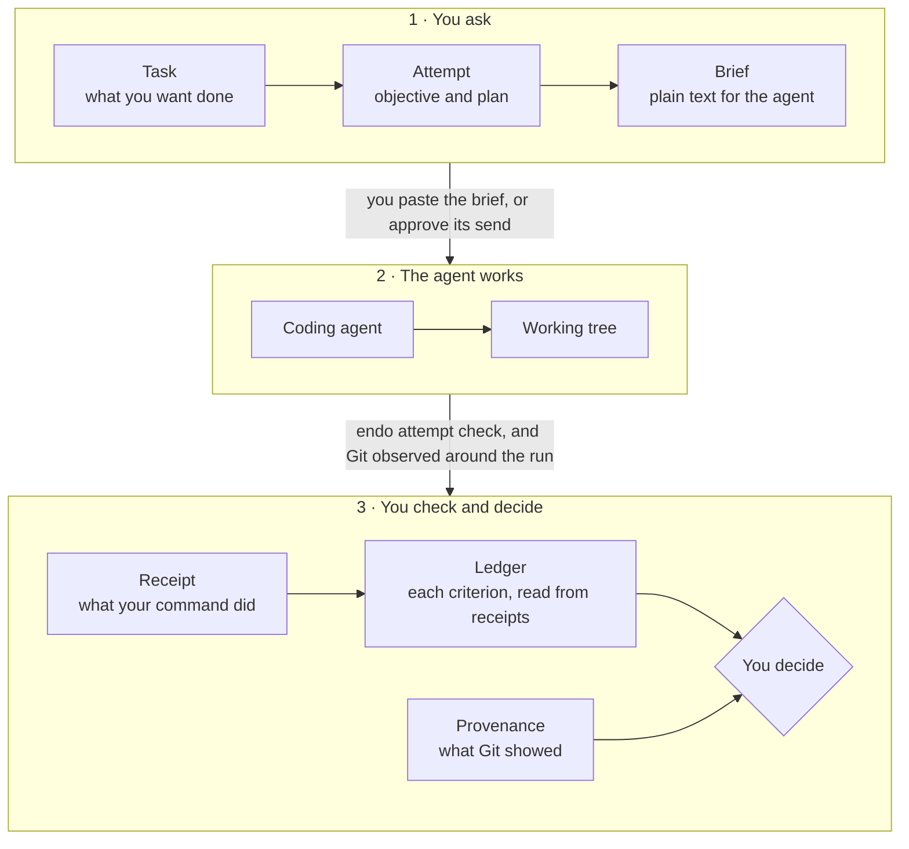
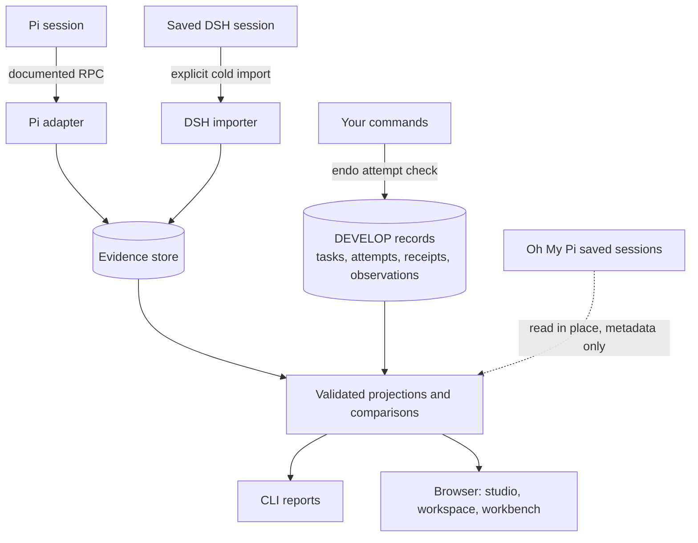

<a id="endophasia"></a>

<div align="center">

<h1>endophasia</h1>

<p><strong>Work with agents. Inspect the evidence. Test what changes.</strong></p>

<p>
A local-first development workbench and research toolkit for coding agents.<br>
Hand work to an agent, check what it really did, and keep the evidence for every claim.
</p>

<p>
  <a href="#what-works-today"></a>
  <a href="https://github.com/earendil-works/pi"></a>
  <a href="LICENSE"></a>
</p>

<p>
  <a href="#quick-start">Quick start</a> &nbsp; · &nbsp;
  <a href="#how-develop-works">How it works</a> &nbsp; · &nbsp;
  <a href="#endophasia-web">Endophasia Web</a> &nbsp; · &nbsp;
  <a href="#what-works-today">What works today</a> &nbsp; · &nbsp;
  <a href="#architecture">Architecture</a> &nbsp; · &nbsp;
  <a href="#research-direction">Research</a> &nbsp; · &nbsp;
  <a href="#documentation">Documentation</a>
</p>

</div>

---

A coding agent says the work is done and the tests exit 0. Is the program right? Is the code you are reading the
code that was checked? Endophasia answers from records, not from the agent's report.

```console
$ node calc.mjs '2+3*4'
20                      # wrong: it should be 14, and the exit status is still 0

$ endo attempt check --attempt <id> --keep-output -- node calc.mjs '2+3*4'
recorded: Observed check passed, at 6712eae5bcc3…

$ endo attempt evidence --attempt <id>
  planned   [observed] precedence ["node","calc.mjs","2+3*4"]:
            Failed at HEAD (6712eae5bcc3, latest failed)
  behaviour [plan: expected; observed] expected exit 0 and 3 byte(s) of output;
            observed exit 0, 3 byte(s), output different;
            first difference at line 1: expected "14", observed "20"
  criterion [plan: precedence] 1. 2+3*4 is 14: A planned check failed at HEAD
```

<p align="center"><sub>Real output from the <a href="#take-the-five-minute-tour">five-minute tour</a> below, abridged and re-wrapped. The comment on the second line is added.</sub></p>

The command exited 0, so its receipt says the check passed. The plan said what the command should *print*, so the
ledger says the criterion failed and shows the first line that differs.

| Develop | Observe and compare | Research |
| :--- | :--- | :--- |
| Keep tasks, prepare a work attempt, hand its brief to an agent, then run your own checks and read one ledger of what is established and what is not. | Record a [Pi](https://github.com/earendil-works/pi) session, read its timeline, and compare recordings layer by layer without inventing missing signals. | Replay sessions against recorded model responses, run controlled and sandboxed experiments, and keep each kind of claim separate. |
| [Quick start](#quick-start) · [How it works](#how-develop-works) | [Record and inspect](#more-ways-in) · [Endophasia Web](#endophasia-web) | [Research](#research-direction) · [Studies](research/README.md) |

*Endophasia* is an old term for inner speech. The project studies observable behaviour, evidence and experimental
conditions. Pi is the reference runtime and the only live integration today; Pi still owns its execution loop.

> [!NOTE]
> **Build from source for everything on this page.** `main` is well ahead of the npm packages. Published
> `0.1.0-alpha.2` (22 October 2026) contains an earlier read-only browser page, without the React workspaces, DSH
> import, live workbench or DEVELOP records described here. The source manifest also says `0.1.0-alpha.2`, so the
> version string alone does not tell a source build from the package. See the [changelog](CHANGELOG.md) and the
> [release record](docs/release-0.1.0-alpha.2.md).

## Quick start

Requires **Node.js >= 22.19.0** and Git.

```sh
git clone https://github.com/noctem-o/endophasia.git
cd endophasia
npm ci
npm run build
alias endo="node $PWD/dist/cli/index.js"
```

The alias runs the CLI built from this checkout, ahead of any older `endo` installed globally. Rebuild after
updating the source.

### Take the five-minute tour

No agent, no model and no cost: you play the agent. It uses a throwaway Git repository and a throwaway store.

**1. Make a small project with a bug in it.**

```sh
mkdir ~/endo-tour && cd ~/endo-tour
export ENDO_STORE_ROOT=$PWD/store

mkdir calc && cd calc && git init -q
cat > calc.mjs <<'EOF'
// Evaluates left to right, so 2+3*4 comes out as 20.
const tokens = process.argv[2].match(/\d+|[+*]/g);
let total = Number(tokens[0]);
for (let i = 1; i < tokens.length; i += 2)
  total = tokens[i] === "+" ? total + Number(tokens[i + 1]) : total * Number(tokens[i + 1]);
console.log(total);
EOF
git add calc.mjs && git commit -qm "A calculator"
```

**2. Say what a correct result looks like,** before any work is done.

```sh
cat > ../plan.json <<'EOF'
{
  "checks": [
    {
      "name": "precedence",
      "argv": ["node", "calc.mjs", "2+3*4"],
      "shows": "multiplication binds tighter than addition",
      "expect": { "exitCode": 0, "stdout": "14\n" }
    }
  ],
  "criteria": [{ "text": "2+3*4 is 14", "checks": ["precedence"] }]
}
EOF
```

**3. Register the project, add a task and prepare an attempt.** Each command prints the id the next one needs.

```sh
endo project add --name "Calculator" --path "$PWD"
endo task add --project endo.project.<id> --title "Fix operator precedence"
endo attempt prepare --project endo.project.<id> --task endo.task.<id> \
  --objective "Make multiplication bind tighter than addition" --plan-file ../plan.json
```

Nothing has been sent anywhere. `endo attempt brief --attempt endo.attempt.<id>` prints the brief as plain text, with
the plan in it, ready to paste into any coding agent.

**4. Run the check yourself, then read the evidence.**

```sh
endo attempt check --attempt endo.attempt.<id> --keep-output -- node calc.mjs '2+3*4'
endo attempt evidence --attempt endo.attempt.<id>
```

The criterion reads *A planned check failed at HEAD*, as in the excerpt at the top.

**5. Fix it, commit, and check again.**

```sh
cat > calc.mjs <<'EOF'
// Multiplication first, then addition.
const terms = process.argv[2].split("+");
const products = terms.map((term) => term.split("*").reduce((a, b) => a * Number(b), 1));
console.log(products.reduce((a, b) => a + b, 0));
EOF
git commit -qam "Multiplication binds tighter"

endo attempt check --attempt endo.attempt.<id> --keep-output -- node calc.mjs '2+3*4'
endo attempt evidence --attempt endo.attempt.<id>
endo attempt provenance --attempt endo.attempt.<id>
```

The planned check now reads *Passed at HEAD*, followed by *at another commit … failed*: the earlier failure stays
on record. `provenance` compares what Git showed of the working tree with each commit you checked. The task is
still `open`, because accepting the work is your decision: `endo task status`.

**6. See it in a browser.**

```sh
endo workspace open --project endo.project.<id>
```

Open the private address it prints, type the pairing code from the terminal into the page, and choose the task. Stop
it with **Ctrl-C**. Delete `~/endo-tour` when you are done.

### Work with a live agent

The live workbench attaches to [Pi](https://github.com/earendil-works/pi), which you install and configure
separately; Endophasia never installs, updates or patches it. It needs **Linux with `/proc` and a controlling
terminal**: stdin and stderr must both be that terminal, and pipes, redirected approval input and unverifiable
terminals are refused.

```sh
endo doctor
endo project add --name "My project" --path /path/to/project      # once per project
endo harness attach --cwd /path/to/project --control --workbench --project endo.project.<id>
```

1. Open the private address printed in the terminal, choose **Develop**, and pair the page with the one-time code
   shown in that terminal. Type `pair` there for a new code.
2. Ask for a **Prompt** from the page when the session is idle. During a run, **Steer**, **Queue** and **Request
   stop** appear when the broker offers them.
3. Each request waits until you type its exact approval phrase, such as `APPROVE PROMPT <digest>`, in the
   controlling terminal. The page can ask; only the terminal can approve.
4. To send a prepared attempt, type `attempt <id>` in the terminal or use the page's **Task** view. Its brief is
   shown whole and sent only after its own `APPROVE ATTEMPT` phrase, at most once per attempt.
5. Read the conversation, the model-provided reasoning (folded by default) and the Git worktree's changes in
   **Conversation | Changes**. Use **Follow** for bounded polling or **Read session** for an explicit refresh.
   Stop the attached process with **Ctrl-C**.

Pi uses its configured model and provider; choose them with `--provider <provider> --model <model>`, or choose a
Pi executable with `--pi /path/to/pi`. Approved requests do real agent work and can incur provider costs. The page
can only reach the Pi child owned by its own attach process; DSH imports and recorded-only sessions stay read-only.

> [!WARNING]
> Terminal approval controls what is *sent*. It **does not sandbox the tools Pi runs**. Likewise, `endo attempt
> check` runs your command with your permissions, and a repository's tests are that repository's code.

See [the live workbench and its approval boundaries](docs/develop-workbench.md), [projects and
tasks](docs/develop-tasks.md), [sending an attempt](docs/designs/develop-attempt-workbench.md) and [process
containment](docs/live-process-containment.md).

### More ways in

<details>
<summary><strong>Record and inspect a Pi session from the CLI</strong></summary>

```sh
endo harness check ./recordings       # local protocol checks; no model call
endo harness attach ./recordings --cwd /path/to/project --prompt "Summarise this project"
endo harness status ./recordings
endo harness overview ./recordings
endo trajectory show ./recordings <session-id>
endo studio ./recordings
```

Use the session id printed by `attach`. The prompt uses Pi's model provider; `attach` reports both acceptance and
whether the run was seen to settle within its wait budget. `--cwd` is Pi's project directory; `./recordings` is the
separate evidence store. Omitting the store selects `$ENDO_STORE_ROOT`, then `$XDG_DATA_HOME/endophasia/store`, then
`~/.local/share/endophasia/store`.

</details>

<details>
<summary><strong>Browse recorded sessions with demo data</strong> (no Pi, no model)</summary>

```sh
node scripts/seed-cockpit-demo.ts ./demo-store      # a new or empty directory
endo studio ./demo-store
```

Open the private loopback address it prints. The demo uses committed fake-Pi lifecycle fixtures and a recorded
Pi 1.0.0 conformance specimen.

</details>

<details>
<summary><strong>Import a saved DeepSeek Harness (DSH) session</strong></summary>

```sh
endo dsh import --root ./recordings /path/to/session-directory
endo dsh loss-accounting
endo studio ./recordings
```

Name one persisted **Session format-4 directory**, not a DSH home, process or transcript file. Import leaves the
source unchanged and writes validated evidence to the store; it does not watch, resume or operate DSH.
`loss-accounting` prints the static mapping contract, not a measurement of that session. In **Compare**, a DSH
recording needs a clean, complete import checkpoint. See the [import contract](docs/dsh-native-importer.md).

</details>

<details>
<summary><strong>Read Oh My Pi saved sessions</strong></summary>

```sh
endo studio ./recordings --omp-sessions /path/to/omp/sessions
```

Read-only metadata from OMP's own files: entry counts and kinds, built-in tool names, model names and OMP's exit
records. No text, no live view and no control. A task can reference a saved session with `endo task link`. See the
[OMP observer](docs/develop-omp-observer.md).

</details>

<details>
<summary><strong>Run a sandboxed experiment</strong> (Linux, Bubblewrap)</summary>

```sh
endo experiment protected-run <spec.json> --out <dir>
endo experiment protected-report <dir>
```

An untrusted agent works on a disposable workspace inside a Bubblewrap sandbox that is checked from inside before
the agent starts. Its submission is collected only after its processes are confirmed gone, and a separate evaluator
sandbox judges it from cases the agent never sees. The command refuses rather than run unprotected. A version 1
spec reaches one declared local model through a recording relay. See [protected
experiments](docs/protected-experiments.md) and [protected model access](docs/protected-model-access.md).

</details>

<details>
<summary><strong>Install the earlier packaged alpha</strong></summary>

```sh
npm install -g endophasia@0.1.0-alpha.2
endo doctor
endo studio
```

Name the version explicitly: a bare install follows npm's `latest` tag, which pointed to the CLI-only
`0.1.0-alpha.1` when last checked on 31 October 2026. This package has the earlier read-only browser page and CLI,
and none of the DEVELOP features above. Full installation, store selection and packaged verification:
[docs/install.md](docs/install.md).

</details>

## How DEVELOP works

You stay the operator throughout. Endophasia keeps records; it does not decide, and nothing runs on its own.



| Record | What it says | What it never says |
| :--- | :--- | :--- |
| **Task** | What you intend to get done, with a status only you move. Choosing a task sends nothing | That any work satisfies it |
| **Attempt and brief** | One request: objective, constraints and the plan, frozen when prepared | That anything was sent. Preparing sends nothing |
| **Plan** | Your checks, what each should show, and optionally its expected exit code and exact standard output | That the checks are sufficient. The command decides what is checked |
| **Receipt** | What Endophasia observed when *you* ran a command in a clean, committed working tree: the commit, the exit status and a SHA-256 of standard output | Acceptance. No status moves |
| **Ledger** | Each planned check at the current `HEAD` (passed, failed, inconclusive, mixed, stale or not run), what it read at other commits, and each criterion read from its checks or left to your judgment | That a passing check proves the criterion |
| **Provenance** | What Git showed of the working tree before a send, when the run ended and now, as blob ids and never contents | Who changed anything. A difference between two states is not authorship |

Three rules hold everywhere:

- **Only you run commands.** A check runs the arguments you type after `--`, with no shell. Nothing stored in a
  plan, a page or a record is ever executed.
- **Only the terminal approves.** A paired page can request a prompt, an intervention or an attempt's send. Each is
  dispatched only after its exact phrase is typed in the controlling terminal.
- **Missing stays missing.** A check that was not run, a record that is damaged and a run that was not observed are
  each reported as such, with the gap named.

Designs, in the order they were built: [work attempts](docs/designs/develop-work-attempts.md) ·
[verification receipts](docs/designs/develop-verification-receipts.md) · [attention
overview](docs/designs/develop-attention.md) · [workspace host](docs/designs/workspace-host.md) · [attempt
execution](docs/designs/develop-attempt-execution.md) · [attempt evidence](docs/designs/develop-attempt-evidence.md) ·
[plans and the ledger](docs/designs/develop-verification-plans.md) · [working-tree
provenance](docs/designs/develop-candidate-provenance.md) · [behavioural
checks](docs/designs/develop-behavioural-checks.md).

<a id="studio"></a>
## Endophasia Web

**Endophasia Web** is the browser interface's product name. It is a React and TypeScript application with
**Observe**, **Compare** and **Develop** workspaces, served by one of three commands. All three bind to `127.0.0.1`
behind a private per-launch address.

| Command | Needs | The page can | The page cannot |
| :--- | :--- | :--- | :--- |
| `endo studio [<root>]` | A store | Read recorded evidence in Observe, Compare and recorded-session Develop | Write the store or request anything |
| `endo workspace open --project <id>` | A registered project. No Pi, model or provider | After pairing: create and edit tasks and move their statuses; read attempts, receipts, the ledger, provenance and the attention overview | Prompt, steer or stop an agent, or run anything |
| `endo harness attach --control --workbench` | Pi, on Linux with a controlling terminal | After pairing: all of the above, plus the live conversation, model-provided reasoning, Git change review, and *requests* for PROMPT, STEER, QUEUE, STOP or an attempt's send | Approve its own request. Approval is typed in the terminal |

| Workspace | What it shows |
| :--- | :--- |
| **Observe** | Recorded runtime identity, capability evidence, source condition, event timeline and inspector |
| **Compare** | Eligible Pi and DSH recordings, with separate lifecycle, tool-call, tool-result and outcome verdicts, and no assertion of causal equivalence |
| **Develop** | Tasks and what needs your attention; each attempt's brief, sends, receipts, ledger and provenance; with a live Pi session, the conversation and worktree changes. Recorded sessions and Oh My Pi saved sessions are read-only, and a recorded `running` status is not a live process |

**Instrument** is DEVELOP's default appearance. **Field** is an optional OLED-oriented night-survey appearance with
a typographic terrain, a live-state legend and a **Focus** layout. Both use the same validated data and authorised
controls; Field's motion is not a picture of model cognition.

`endo web`, a native desktop app and native installers are not yet implemented. Capabilities and Evolve remain
placeholders. Cognition and Research workspaces, general model-internal observation, an embedded terminal and live
control of other harnesses are not shipped.

<details>
<summary><strong>Access, privacy and retention</strong></summary>

- Anyone with the read-only Studio address can read the store's presented evidence, so keep that address private.
  `endo studio` does not write the store, although its first launch may create a separate comparison key.
- The workspace and the workbench require separate pairing and an expiring, in-memory grant. The page address alone
  cannot authorise an action.
- The live transcript relays user and assistant text, structured model-provided reasoning where Pi supplies it, and
  tool names and outcomes, with explicit limits and truncation. It does **not** relay tool arguments or results, or
  treat literal `<think>` text as authenticated reasoning.
- Transcript and reasoning content are bounded in process memory, excluded from canonical evidence and the read-only
  Studio API, and cleared with the live session. Pi's own session-file retention is separate. Recorded-only views
  cannot reconstruct withheld content from digests.
- A receipt stores a SHA-256 of a check's standard output. With `--keep-output` it also stores the first 8 KiB as
  text and shows it on a paired page, so do not use that flag for a command that can print a secret.
- DEVELOP records are local, unsigned files. Anything that can write the store can write them.

See [reasoning's data and privacy contract](docs/develop-reasoning.md) and [browser usage](docs/studio.md).

</details>

## What works today

This is an experimental project. The table describes **source-tree `main` as of 10 November 2026**. Published alphas
have the narrower scope described above.

| Area | Capability | Entry point |
| :--- | :--- | :--- |
| **Develop** | Projects, tasks, work attempts and briefs | `project`, `task`, `attempt prepare\|brief\|handoff\|report\|abandon` |
| | Operator-run checks with receipts, verification plans, the acceptance ledger and behavioural checks | `attempt check`, `attempt receipts`, `attempt evidence` |
| | Working-tree provenance around an attempt | `attempt observe`, `attempt provenance` |
| | The workspace in a browser with no agent running | `workspace open --project <id>` |
| | Governed live Pi workbench: PROMPT, STEER, QUEUE, STOP and attempt sends, each approved in the terminal | `harness attach --control --workbench` |
| **Observe** | Pi identity, local checks, live recording and capability admission | `doctor`, `harness check`, `harness attach`, `harness status` |
| | Durable sessions and Pi trajectory comparison | `harness overview`, `trajectory show`, `trajectory diff` |
| | Read-only browser for Observe, Compare and recorded sessions | `studio` |
| | DSH cold import and loss accounting | `dsh import`, `dsh loss-accounting` |
| | Oh My Pi saved-session observer | `studio --omp-sessions <dir>`, `task link` |
| **Research** | Capture and cassette replay | `proxy record`, `proxy replay`, `replay` |
| | Controlled Pi experiments | `experiment run`, `experiment report` |
| | Sandboxed experiments with an independent evaluator | `experiment protected-run`, `experiment protected-report` |
| | Authorised STEER, QUEUE and STOP outside the workbench | `harness attach --control`, `steer`, declared experiment interventions |
| | Verified initial scratch copies, governed continuation and a matched two-turn A/A workflow | Source-tree APIs and research scripts |
| | ACP v1 adapter and ACP v2 conformance study | Library APIs |

<details>
<summary><strong>Evidence and limits, row by row</strong></summary>

| Capability | Evidence and limits |
| :--- | :--- |
| Projects, tasks, attempts and briefs | Operator metadata under `<root>/develop/`, separate from the evidence store; atomic, locked, revisioned and bounded. Store, multi-process, broker, HTTP, pseudo-terminal and browser tests against fake Pi and session fixtures. One local Pi 1.4.0 smoke (no prompt, no model). One real work cycle was reconstructed from stored evidence, followed by one human-governed run ([WORK-CYCLE-001A/B](research/work-cycle/README.md)); no conformance claim |
| Checks, receipts, plans and the ledger | Checks run without a shell in a clean, committed working tree, with timeouts and detection of processes that outlive the command. A receipt is not acceptance. Behavioural checks compare the exit code and standard output only: no stdin, stderr, servers or browsers. Demonstrated with a known-wrong program and its fix, as in the tour; not yet exercised with real Pi. Where `/proc` is missing (macOS) leftover processes cannot be seen, so every behavioural check there reads inconclusive. The cross-task attention overview still reads behavioural checks by exit status alone |
| Working-tree provenance | Records Git blob ids and modes, never contents. Ignored files are not compared; two equal observations do not mean nothing changed between them; nothing is attributed to an author. Fake-Pi broker tests and CLI demonstrations; not yet exercised with real Pi |
| Workspace with no agent | Its own pairing; no harness, session or command surface. Host, CLI and browser tests |
| Governed live Pi workbench | Prompt, steer, queue and STOP requests require terminal approval; bounded private conversation, structured reasoning relay and Git change review. Broker, HTTP, pseudo-terminal and browser tests, plus a real Pi 1.0.1 relay test against a fake model endpoint. On Linux with a reachable systemd user manager each session's processes run in their own scope and cleanup is reported as confirmed, incomplete or unverified; elsewhere it is reported unverified. No general real-model workbench conformance claim |
| Pi identity, checks, recording and capability admission | Installed-package CI uses Pi 1.0.0 with a fake model endpoint; real-model studies used Pi 1.0.1 and later Pi 1.0.4. This is not general-version conformance |
| Durable sessions and trajectory comparison | Real Pi recordings plus synthetic failure cases. The trajectory CLI is Pi-specific; use browser Compare for native DSH recordings |
| Read-only browser | Projection, HTTP and browser tests; package smoke checks the built interface. Comparison selectors are bound to verified store generations |
| DSH cold import and loss accounting | Five retained captures from pinned `dsh-v0.2.1-rc.2`, including failure and resume cases, plus adversarial tests. No live DSH control |
| Oh My Pi saved-session observer | Read-only, metadata-only reading of OMP 18.x format-3 files. Adversarial adapter, HTTP and browser tests, plus a read of a local OMP directory's existing sessions in place (OMP 18.14.1 installed; 18.13.3 and 18.14.1 recorded in the files; unchanged; no OMP process run). Not live observation and not control. Claude Code, Codex, Hermes and Amp are not integrated |
| Capture and cassette replay | Forty exact replays across four recorded Pi sessions and a negative control. Recorded model responses are held fixed |
| Controlled Pi experiments | Real studies with blocked randomisation, manipulation checks and declared conditions. The studies pre-registered designs; the CLI does not enforce pre-registration |
| Sandboxed experiments | Linux-first, with Bubblewrap. The boundary is checked from inside before the agent starts; sealed per-trial records can be read without trusting the agent. In the model-access study, real Pi ran inside the sandbox against a real local model through the recording relay. See [protected experiments](docs/protected-experiments.md) |
| Authorised STEER, QUEUE and STOP | Real-runtime intervention studies and fake-Pi broker and CLI tests. Acceptance, observed consumption and effects remain separate |
| Initial scratch copies and governed continuation | Synthetic tests, a four-turn real initial-child pilot and real same-session continuation. Fresh Pi processes and tool-free turns; no historical process restore or general effect sandbox |
| Matched two-turn A/A workflow | One real four-session, eight-request run completed under declared assumptions. A research script (`research/governed-initial-continuation/aa/operate.ts`), not an `endo` subcommand; engineering hardening remains open |
| ACP v1 adapter and ACP v2 study | Deterministic tests; v1 also has an opt-in OMP smoke path. No admitted ACP capability and no real v2-agent conformance |

</details>

Cognition graphs, evolution records and selection policies, model orchestration, and mappings for Codex, Prime,
REEF, Magpie, Deadbolt and Cogitator also exist as libraries. They are not live integrations exposed by the CLI or
browser. The fuller inventory is in [docs/status.md](docs/status.md).

### What Endophasia does not claim

- **Reasoning is relayed as the model emitted it.** That text is not a verified record of the model's internal
  computation.
- **A passing check is not acceptance,** and a diff is not authorship. Only you move a task's status.
- **Approval is not containment.** Terminal approval governs dispatch; it does not sandbox the tools an agent runs.
- **No autonomous self-improvement loop** is claimed, and measured improvement does not by itself authorise
  promotion or deployment.

| Distinction | Meaning |
| :--- | :--- |
| **Observation / interpretation** | An observation names its source; a reported value names its reporter; a derivation names its method. Missing evidence stays `UNAVAILABLE`, not zero |
| **Acceptance / completion** | A runtime accepting a request does not prove that it executed, consumed an intervention or achieved the intended result |
| **Evidence / authority** | A successful check or comparison does not grant permission. Consequential operations need their own explicit authorisation |
| **Exact replay** | Did the harness reproduce the recorded session when given recorded model responses? |
| **Live repeatability** | Do new runs agree under the same declared conditions? |
| **Perturbation invariance** | Does behaviour hold when an input expected to be irrelevant changes? |

DSH's persisted turns and steps map to qualified Endophasia lifecycle records. A tool request does not prove
execution, and a recovery-written closer is not an observation of a crash. Comparison preserves those limits:
matching layers do not prove identical causes, and different digest domains cannot establish equality. See the
[vision and distinctions](docs/vision.md) and the [comparison contract](docs/cockpit.md#compare-candidate-discovery).

## Architecture

Endophasia keeps execution, evidence acquisition and presentation separate.



- **Recording.** An optional recording proxy captures the model request and response boundary for replay and
  experiments. Pi capabilities are admitted from current transport, identity and conformance evidence; a runtime or
  configuration change invalidates dependent evidence. DSH has a separate, version-pinned import contract with
  explicit mapping losses.
- **DEVELOP records** live under `<root>/develop/`, apart from the event store: operator metadata, each written
  once or under a lock, validated on every read. A browser page receives only what the reader has validated, and
  refuses an answer whose parts disagree.
- **The live workbench** runs inside the process that owns the attached Pi child. Its private, paired broker serves
  a bounded, memory-only transcript, offers requests, and reads Git worktree information without writing to the
  repository. It re-checks each operation against the current session, grant, state and capability before dispatch.
  Proposals, authorisations, dispatches and outcomes have separate evidence chains, without persisting the
  transcript or model-provided reasoning. The read-only `endo studio` server gains no execution authority.
- **The initial-state research APIs** are a separate path: verify a replay and its initial scratch archive, prepare
  checked sibling copies, start a fresh tool-free Pi session with explicit approval, and require another approval
  for its second turn. An independent reader verifies the resulting receipts. This is bounded same-session
  continuation, not restoration of a historical process or isolation of all external effects.

Contracts: [Pi attachment](docs/attachment.md) · [capture and replay](docs/replay.md) ·
[DSH importer](docs/dsh-native-importer.md) · [observation bridge](docs/cockpit.md) ·
[workbench](docs/develop-workbench.md) · [workspace service](docs/develop-workspace-service.md) ·
[initial-state continuation](docs/initial-continuation.md).

## Research direction

The research goal is to explain how the model, harness, tools and environment contribute to agent behaviour, then
test changes under declared conditions. The project keeps execution resumption, exact replay, live repeatability
and perturbation invariance as separate claims.

### Selected results

| Study | Finding | Scope |
| :--- | :--- | :--- |
| [Cassette replay](research/README.md#cassette-replays) | Forty replays were exact; a changed workspace produced the expected divergence | Pi 1.0.1, four recorded sessions, fixed model responses |
| [Variance and pinned environment](research/README.md#pinned-environment-study-e3) | With the environment pinned, deterministic sampling and prompt cache off, all judged layers and requests matched across 20 trials per task | Three small tasks, Pi 1.0.1 and qwen3.8-27b on one machine; not a universal determinism result |
| [Path sensitivity](research/README.md#path-sensitivity-study) | Working-directory paths changed whether steering was followed, and changed a baseline on one task | Two tasks and 30 paths; acceptance and consumption were measured separately from following the instruction |
| [Completion cap](research/README.md#completion-cap-study) | Raising the cap from 16,384 to 32,768 tokens raised success from 10/24 to 19/23 | Two selected tasks, four paths, small samples; the interval excludes zero only with all four paths included |
| [Governed initial-child pilot](research/governed-initial-child/1.0.4/RESULTS.md) | Four approved turns returned `ready`; cwd-adjusted request bodies matched, complete responses differed | Pi 1.0.4/Nanbeige4.3-33B, tool-free, private verified receipts |
| [Matched two-turn A/A, 29 October](research/governed-initial-continuation/aa/RESULTS.md) | Four fresh Pi sessions and eight approved requests completed; all request and admission bindings and the independent reader verified; owned-server cleanup was confirmed | `COMPLETE-UNDER-DECLARED-ASSUMPTIONS`. One real run, not a noise floor, model-parity result or server attestation; hardening and an approval-display question remain open |
| [CPU numerical execution probe](research/numerical-execution-probe/FIRST-RESULT.md) | Logits were bitwise equal within each submission schedule and different across schedules; argmax stayed the same | SmolLM2-135M f16, four CPU processes. No specific kernel attribution, CUDA result or integrated model-internal viewer |
| [Evidence eligibility (MEM-000)](research/evidence-eligibility/RESULTS.md) | The recorded evidence held 143 examples usable for causal policy learning, all from one study; the planned memory selector was judged not ready | An audit of what the records permit learning, made before any selector was built |
| [One DEVELOP work cycle](research/work-cycle/README.md) | A real work cycle was reconstructed from stored evidence and inspected independently end to end; the [first human-governed run](research/work-cycle/WORK-CYCLE-001B.md) followed, approved on the workbench terminal | One task on one machine. Two bugs were found and fixed, and a gap was documented: a tool process started by Pi could outlive the workbench |
| [Counterfactual replay feasibility](research/counterfactual-replay/COUNTERFACTUAL-REPLAY-001.md) | Cassette replay of a real run missed at its second exchange, on file modification times; four runs from an identical first request took four different trajectories and reached the same workspace and answer | Two measurements on a real model. Counterfactuals look feasible at the initial checkpoint; attribution is distributional only, with no causal claims from traces |

The [research index](research/README.md) links designs, results and limitations, and the [thread results
summary](docs/thread-results-summary.md) lists what each line of work produced. Some raw recordings and governed
execution receipts remain private; public summaries do not make those runs reproducible from the repository alone.
See [research data](research/DATA.md).

<a id="roadmap"></a>
### Delivery direction

**DEVELOP** now covers the loop from a task to a decision: attempts and briefs, terminal-approved sends, operator-run
checks, the acceptance ledger, behavioural checks and working-tree provenance. Near-term work is to **use it on real
tasks and harden it**:

- run the whole loop, behavioural checks and provenance included, with real Pi and a real model;
- make the attention overview read behaviour, not only exit status;
- extend behavioural checks beyond the exit code and standard output: stdin, stderr, servers and browsers;
- keep refining the live workbench: interaction and accessibility, failure and reconnection handling, and better
  diagnosis of what a runtime reported versus what the broker confirmed.

A general docking framework, an embedded terminal, live OMP control and live control of other harnesses are **not**
implemented.

**Research and verification** remain a separate thread: extend governed continuation studies, isolate external
effects, and validate cassette-then-live boundaries before claiming general restore or fork execution.

**Cognition** (including proposed WORK and DREAM profiles), an **Evolve** operator interface, model-internal
observation and a dedicated **Research** workspace remain design directions. Native Rust/GPUI presentation, GPU
rendering, durable-execution integrations and hardware and robotics workflows are exploratory tracks, not current
Pi-workbench requirements.

Full plans, candidate studies and deferred integrations belong in the [roadmap](docs/roadmap.md), the [workbench
design](docs/develop-workbench.md) and the [vision](docs/vision.md).

## Documentation

<a id="current-state"></a>
<a id="try-it"></a>

| Need | Start here |
| :--- | :--- |
| Install, inspect or use the browser | [Installation](docs/install.md) · [Studio and live workbench](docs/studio.md) · [Release history](CHANGELOG.md) |
| Run the DEVELOP loop | [Projects and tasks](docs/develop-tasks.md) · [Work attempts](docs/designs/develop-work-attempts.md) · [Receipts](docs/designs/develop-verification-receipts.md) · [Plans and the ledger](docs/designs/develop-verification-plans.md) · [Behavioural checks](docs/designs/develop-behavioural-checks.md) · [Provenance](docs/designs/develop-candidate-provenance.md) · [Attempt evidence](docs/designs/develop-attempt-evidence.md) |
| Work with a live agent | [Live workbench](docs/develop-workbench.md) · [Sending an attempt](docs/designs/develop-attempt-workbench.md) · [Reasoning and privacy](docs/develop-reasoning.md) · [Git review](docs/develop-project-review.md) · [Process containment](docs/live-process-containment.md) · [Field](docs/develop-field.md) |
| Open the workspace without an agent | [Workspace host](docs/designs/workspace-host.md) · [Attention overview](docs/designs/develop-attention.md) · [Workspace service](docs/develop-workspace-service.md) · [OMP observer](docs/develop-omp-observer.md) |
| Check implementation status | [Detailed status](docs/status.md) · [Thread results summary](docs/thread-results-summary.md) · [Published alpha.2 scope](docs/release-0.1.0-alpha.2.md) · [Alpha verification](docs/release-alpha.md) |
| Record, replay, compare or intervene | [Attachment](docs/attachment.md) · [Replay](docs/replay.md) · [Trajectories](docs/trajectory.md) · [Experiments](docs/experiments.md) · [Steering](docs/steering.md) |
| Run sandboxed experiments | [Protected experiments](docs/protected-experiments.md) · [Protected model access](docs/protected-model-access.md) |
| Understand the browser boundary | [Observation bridge and Compare API](docs/cockpit.md) · [Frontend architecture](docs/studio-ui-architecture.md) · [Session surface](docs/develop-session-surface.md) |
| Use the initial-state research APIs | [Checkpoint candidate](docs/checkpoint-candidate.md) · [Scratch materialization](docs/checkpoint-materialization.md) · [Sibling preparation](docs/initial-branch-set.md) · [Initial-child execution](docs/initial-child-execution.md) · [Continuation](docs/initial-continuation.md) |
| Inspect adapter evidence | [Pi inventory](docs/pi-attach-inventory.md) · [Pi audit](docs/pi-attach-audit.md) · [Pi 1.4.0 upgrade](docs/pi-1.4.0-upgrade.md) · [DSH study](docs/dsh-native-attachment.md) · [DSH import](docs/dsh-native-importer.md) · [ACP v1](docs/acp-v1-slice.md) · [ACP v2 study](docs/acp-v2-study.md) |
| Read research and future designs | [Studies](research/README.md) · [A/A result](research/governed-initial-continuation/aa/RESULTS.md) · [Vision](docs/vision.md) · [Observe/Verify](docs/observe.md) · [Evolve](docs/evolve.md) · [Roadmap](docs/roadmap.md) |
| Work on contracts or provenance | [Schema compatibility](docs/schema-compatibility.md) · [Deadbolt intervention contract](docs/deadbolt-intervention-contract.md) · [Migration ledger](docs/migration-ledger.md) |

Neighbouring projects have separate roles: [Magpie](https://github.com/noctem-o/magpie) for claims, evidence and
derived standing; [Deadbolt](https://github.com/noctem-o/deadbolt) for authorising consequential actions;
[Cogitator](https://github.com/noctem-o/cogitator) for sealed run records; and
[Buzz](https://github.com/noctem-o/buzz-prime) for a shared workspace for people and agents. A record in one does
not grant authority in another. The earlier Pi-fork implementation is archived at
[endophasia-pi-legacy-deprecated](https://github.com/noctem-o/endophasia-pi-legacy-deprecated).

## Development

```sh
npm ci
npm run typecheck
npm run lint
npm test
npm run build
npm run test:package
```

After dependencies are installed, the deterministic suite needs Node and Git, with no model API key or provider
call. Browser tests require Chromium; set `CHROME_BIN` to select it and `ENDO_REQUIRE_BROWSER=1` to make its absence
fail instead of skip. Other host-dependent and private-data checks report their own skips. CI runs the suite in
three parallel shards, and also runs installed-package acceptance with a separately installed Pi 1.0.0 and a fake
model endpoint. See [test requirements and opt-in real-Pi checks](docs/install.md#running-the-tests).

## License

Apache License 2.0 ([LICENSE](LICENSE)). Copyright 2026 George Gallagher. Upstream components such as Pi retain
their own licenses.

Published `0.1.0-alpha.1` and `0.1.0-alpha.2` were released under MIT, and that grant remains with those versions.
The Apache License applies to the source from the license-change commit onward.
