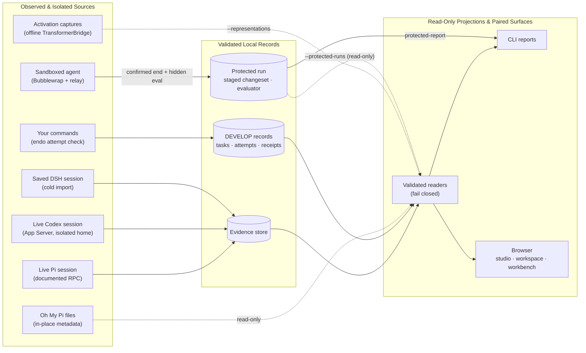
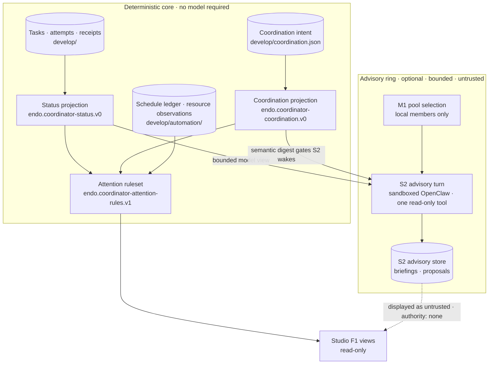

# Architecture

This page holds the architecture detail behind the [README's authority map](../README.md#architecture). It has two
diagrams with different jobs. The **evidence pipeline** shows how observations become validated records and reach a
surface. The **Coordinator layering** shows how the deterministic operational core relates to optional advisory intelligence.
Both describe the pinned tree (`d2024ac51`, 28 November 2026). Neither is a permission diagram: execution authority is
shown only in the README's authority map, and it comes from the operator alone.

## Evidence pipeline

Endophasia keeps **execution**, **evidence acquisition** and **presentation** separate, and every reader validates on read and fails closed.
In this diagram, a solid arrow means records are written or read along it, and a dotted arrow means a source is read in place without being imported.
No arrow here carries authority.

- **Recording, adapter contract & admission.** Live Pi and Codex sessions implement the harness-neutral `endo.develop-adapter.v0` operational contract and share a single-writer lock on the canonical event store. An optional recording proxy captures the HTTP model boundary for cassette replay and controlled experiments. Harness capabilities are admitted from live transport, identity and conformance evidence; changing runtime or configuration invalidates dependent evidence.
- **DEVELOP records** live under `<root>/develop/`, separate from the canonical event store — atomic, locked, revisioned and re-validated on every read.
- **The live workbench** runs inside the process owning the attached Pi or Codex child. Its paired loopback broker keeps transcripts, reasoning and pending native approval summaries memory-only, re-checks every operation against session state and active grants before dispatch, and leaves read-only `endo studio` with zero execution authority.
- **Protected experiments** isolate untrusted coding agents inside Bubblewrap, verify the boundary from inside before execution, wait for confirmed process termination before staging changes against a controller-pinned baseline, and grade reconstructed candidates inside an independent evaluator sandbox.

Contracts: [adapter contract](designs/develop-adapter-contract.md) · [Pi attachment](attachment.md) · [Codex live](designs/develop-codex-live.md) · [Codex in Studio](designs/develop-codex-studio.md) · [capture & replay](replay.md) · [DSH importer](dsh-native-importer.md) · [observation bridge](cockpit.md) · [workbench](develop-workbench.md) · [workspace service](develop-workspace-service.md) · [protected experiments](protected-experiments.md) · [coordinator assignment](designs/coordinator-assignment.md) · [initial-state continuation](initial-continuation.md).

## Coordinator layering

The Coordinator is built as a deterministic environment first and an advisory one second. The design principle, from the
[November 2026 roadmap](designs/coordinator-roadmap-2026-11.md), is to build something that stays useful when every language model is
unavailable, and to let neural cognition augment it only where it demonstrably helps.

- **The core makes no model calls.** Status, coordination and attention are pure projections over local records.
  The S1 observer (`endo scheduler tick`) sends zero-token `GET` health requests and maintains its own ledger: observations, fire outcomes, cursors, retention and its lease. It never dispatches or touches task and attempt records.
  F1 reads these records and never probes an endpoint (`liveProbed: false`).
- **The advisory ring is optional and fenced.** A briefing turn sees a bounded view of the status projection, not the store. It runs
  in a sandboxed OpenClaw agent with one read-only tool, through a relay that allows one route, one model and two exchanges.
  S2 adds deterministic wake gating, per-revision grants, budgets and crash-honest accounting around that same path.
  S2's durable advisory records are confined to `develop/automation/advisory/`, apart from the shared automation lock beside it and
  temporary runner files outside the store. Test S0-AT10 compares the rest of the store before and after. On-demand `endo coordinator brief`
  takes the same turn path but writes its result to stdout and stores nothing.
- **There is no edge from the ring to execution.** Proposals are one of six closed kinds about a task that exists, and they
  carry `authority: none`. Acknowledging or dismissing a proposal changes the advisory queue and nothing else.
- **Attention is ranking, not planning.** The ruleset orders recorded facts into hazard, blocker, verification and observation
  tiers. It separates *observed*, *rule consequence* and *not established*, and says outright that its ranking is not a verified optimal plan.

## Storage at a glance

| Location | Holds | Written by |
| :--- | :--- | :--- |
| `<root>/events/` | Canonical event store (Pi, Codex, DSH imports) | Harness attachments and importers, one writer at a time |
| `<root>/develop/tasks.json`, `attempts/`, `receipts/`, `observations/` | DEVELOP records | Operator CLI and paired pages |
| `<root>/develop/attempt-routes/`, `adapter-authorizations/`, `protected-attempts/` | Write-once dispatch reservations and authorisations | Dispatch paths, after operator approval |
| `<root>/develop/coordination.json`, `coordination-reviews/` | Coordination intent and agent-reported reviews | Operator CLI |
| `<root>/develop/automation/` | S1 schedules, fires, leases and resource observations | `endo schedule`, `endo scheduler tick`, `endo resource` |
| `<root>/develop/automation/advisory/` | S2 schedules, grants, turns, briefings and proposals | `endo advisory` |

All of these are local, unsigned files. Anything that can write the store as the same user can change them. Readers detect
inconsistency and fail closed, but a same-UID writer who rewrites a record and recomputes its digests isn't detected, and nothing prevents it.

Coordinator records: [status](designs/coordinator-status.md) · [Mission Board](designs/coordinator-board.md) · [runtime](designs/coordinator-runtime.md) · [assignment architecture](designs/coordinator-assignment.md) · [E1](designs/coordinator-assignment-implementation.md) · [E2](designs/coordinator-assignment-e2-implementation.md) · [S0](designs/coordinator-automation.md) · [M1](designs/coordinator-model-pool-m1-implementation.md) · [S1](designs/coordinator-automation-s1-implementation.md) · [S2](designs/coordinator-automation-s2-implementation.md) · [consolidation](designs/coordinator-consolidation-001.md) · [F1](designs/coordinator-studio-f1-002.md).
