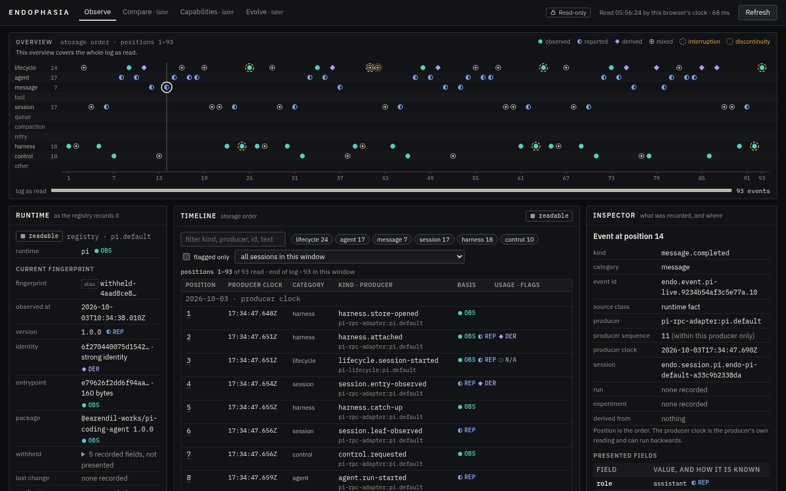

# The Studio frontend: design and behaviour reference

One screen, served by the local Studio server, built from the observation bridge's projections. It answers four questions: what
runtime is attached, what has been recorded, what capabilities are recorded and with what limits, and what can actually be verified
from the observations. The frontend is a **projection of records, not an observation system**: it reads `GET /<cap>/api/v0/snapshot`
and shows what comes back. It invents no capability, status, confidence, activity, outcome or internal state. How it is built, packaged
and secured, why, and how it relates to the concept it takes its design from, is in
[studio-ui-architecture.md](studio-ui-architecture.md); this page is what it does and refuses to do.

```text
endo studio [<root>]                   # the installed command (docs/studio.md): serves the frontend packaged in dist/studio-ui/
npm run cockpit -- <store-root>        # from a checkout: builds the frontend, starts the server, prints the access URL once
node scripts/seed-cockpit-demo.ts <empty-directory>   # a demo store from the committed fake-Pi lifecycle fixtures (3 sessions) and the real Pi 1.0.0 specimen
```



_The real frontend at 1440 x 900 in headless Chromium with the GPU off, over a store seeded by `scripts/seed-cockpit-demo.ts` (an event selected). Nothing on it is a mock-up._

The printed address ends in `/`; it is the access capability for that launch, so it is shown once and never logged.

## Layout

A top bar (the wordmark, the four workspaces, the read-only state, the read status and Refresh), the sources that need attention, the
overview, and three columns of panels (two columns below 1280 px; one column and a modal inspector below 1024 px).

- **Workspaces.** Observe is the one built. Compare, Capabilities and Evolve are named as "later", load on demand, say what each would
  need (a projection that does not exist yet) and show no record and no number.
- **Sources that need attention** (under the top bar, at every width): every source that is not readable or empty (absent, degraded,
  unopenable, or a condition this build does not know), with what its condition means and what the projection recorded about it
  (a torn tail's bytes, the first record that failed verification, the source's error, that it has no position). At narrow widths the
  same list is repeated **inside** the inspector dialog, because the dialog makes the page behind it inert.
- **Overview.** The loaded window of the event log, one lane per event category, one mark per event, placed by storage position, with a
  sentence saying whether it covers the whole log as read, the readable prefix of a degraded log, or one window of a longer one, and a
  strip showing where the window lies in the log. Marks are drawn by how the event's presented fields are known and ringed by what the
  projection flagged; selection is neutral ivory; an event the filters hide stays on the map, dimmed. It is a pointer convenience: the
  table is the keyboard path to the same events.
- **Runtime** (left): the selected attachment's registry as projected: runtime family, current fingerprint (id, observation time,
  reported version, identity digest and confidence, entrypoint, package), what was recorded and withheld, the last change and
  notification, and notes. Choosing another attachment is local and needs no request.
- **Capabilities** (left): the latest recorded state, whether it is `current`, `stale` or `unknown` for the latest fingerprint, a count of
  records per recorded status, and one row per capability: status (shape and word), classification (or "unclassified"), and how many
  limits apply. Selecting a row opens it in the inspector.
- **Timeline** (centre): the event log's window in **storage order**. Columns: position, producer clock (the date is shown once above
  the rows it covers), category, kind and producer, how the fields are known, and usage and flags. Filters (text over ids, kind, producer,
  session and presented text; category chips; flagged only; session) act on the loaded window only and say "k of n in this window".
  Pagination is First, Previous, Next, Latest and rows per page (50, 100, 200, 500); each is one read.
- **Inspector** (right, pinned): one selected event or capability, evidence first: the recorded identity and position, flags with what
  each means, the presented payload fields each with a basis, usage, how many payload keys were withheld, and the projection JSON of that
  one entry. A capability shows its recorded status, the limits on it, the cited evidence and the limitations it states. With nothing
  selected it is the legend for every mark. Below 1024 px it is a modal dialog: focus moves in, Escape or Close ends it and clears the
  one selection, focus returns to the row it came from.
- **Sources & provenance** (right): the event log and every registry, each with its own condition and position, and a fixed statement
  that they are independent. A card explains its condition in words only when it is not simply readable or empty.

Deviations from the concept, and why, are in [studio-ui-architecture.md](studio-ui-architecture.md) section 7.

## What the frontend will not claim

| Rule | How the page keeps it |
| :--- | :--- |
| A missing value is not zero | A null cost or reasoning count reads "not recorded"; a recorded zero reads `0`; a null classification reads "unclassified"; a source without a position reads "no position", never length 0 |
| An unavailable claim is not an inactive one | Every claim shows its basis or the **N/A** mark with the record's own reason; statuses `unavailable` and `unverified` have different shapes and words |
| Order is storage order | The position column is the order, and the overview places marks by position. The producer clock is labelled as the producer's, its dates are dividers (which may go back; that is recorded), there is no time axis, and a producer sequence is shown only in the inspector, "within this producer only" |
| A window is not the log | The overview and the table say which positions they cover, of how many read; a filter acts on the window and says so; nothing is drawn as a whole trajectory or a session outcome |
| Independent sources stay independent | The snapshot's `independent-sources` is stated on the page; every source has its own state and watermark; nothing is summed or joined; there is no aggregate health indicator |
| Usage is per event | Shown per event and in the inspector, never totalled ("one call can be recorded by more than one event"); a cost has no currency |
| A browser time is not a recorded time | "Read 07:46:23 by this browser's clock" is separate from every producer clock, and the frontend is never labelled LIVE |
| A projection is not evidence | The sources panel says so; a "limit" is shown as a reason a status cannot be taken at face value; "no limit applies" is not a verification |
| Withheld is withheld | The policy's withheld text and generated `withheld-<hex>` aliases render as hatched **withheld** and dashed **alias** marks, never as ordinary text or a real id |
| An unknown value is shown as what it is | A note, limit or state code this build does not know is shown as its raw code; a contract version it does not read is named and nothing from it is shown |

Marks never rely on colour alone. Provenance is a family of discs and a diamond (observed ●, reported ◐, derived ◆, unavailable a dashed ring; an event with several bases is *mixed*, one with no presented field is a hollow square, *envelope only*); source conditions and capability statuses are a separate family of squares (readable solid, empty hollow, absent a bar, degraded half, unopenable crossed; admitted solid, admitted-partial half, unverified hollow, unavailable dashed, mismatch a triangle), so a status can never be read as a basis. Flags are rings of different textures. Each basis also has its three letters (**OBS**, **REP**, **DER**, **N/A**) with its meaning on hover and in the legend.

## Who decides what may be shown

The page is not a second admission authority. The policy for which source fields are presented, and in what form, belongs to the
projections and nowhere else:

| Stage | Owns | What it does |
| :--- | :--- | :--- |
| Projection (PR A: `protocol/cockpit-fields.ts`, `cockpit/projections/`) | the policy | copies an allowlist of payload fields per event kind with the basis and type of each, withholds text that looks like a path, address or credential, replaces opaque identifiers with their public form or alias, and counts what it left out (`withheldFields`). A kind with no approved field is shown by its envelope only; an unlisted key of any kind is not copied |
| Bridge (PR B: `cockpit/snapshot.ts`) | the check that the policy was applied | validates every projection against the same policy module (`validateEndoCockpit...V0` rejects an entry carrying a field, basis, type or opaque value the policy does not allow) and throws rather than return one that fails |
| Server (`cockpit-http/server.ts`) | the last gate and the wire | reads each record again under the version it declares (`readEndoCockpitRecordV0`) and sends nothing otherwise; serializes the validated record, canonically |
| Frontend (this document) | rendering | checks that the versions are ones it reads and that the shapes are ones it can draw (`reply.ts`, and building every reachable view model before a read is accepted), then shows each value as text |

The frontend therefore checks a reply's versions and shapes, never *which* fields an event may carry. It does not repeat the allowlist:
a second copy would have to be kept equal to the first, and the day they differed the page would either hide something the policy
presents or give the appearance of a check it cannot make. It trusts the same-origin, capability-protected API to have served only
what the policy admitted.

**What the frontend does itself.** Whatever it is given, it draws as text: a record's string is a React text child (the browser takes it as
text, never as markup), no component uses a raw-markup sink (`tests/endo-studio-ui-source.test.ts` holds that for the whole source),
and the served page requires Trusted Types with none allowed, so an attempt to parse markup throws
(`tests/endo-studio-observe-browser.test.ts`: "has Trusted Types on", and "shows text from the API as text", which sends hostile strings
through the real page from a stand-in API). A hostile string cannot become markup or script. It can still be shown as text.

**Residual risk.** A compromised or nonconforming server on the capability URL, or a different server behind it, could send a
snapshot that is well formed and carries a field the policy would not have presented; the frontend would show it. Browser-side shape
validation is not independent proof that the presentation policy was applied, and the frontend does not claim to be. The control for
that case is the capability URL and the loopback-only server (`tests/endo-cockpit-http-security.test.ts`), not the frontend. If it
ever needs to stand on its own against an untrusted source, that is a different design: it would take the policy as a shared
artifact the browser imports, not a copy.

**Where the producer's side is tested.** `tests/endo-cockpit-projections.test.ts` (a field the policy does not present for an
entry's kind is rejected; an envelope-only kind withholds its whole payload; a field relabelled with another basis or type is
rejected), `tests/endo-cockpit-http-routes.test.ts` (a canary, a path and a credential never reach a body; an unlisted key and its
plain value, in a kind with approved fields and in one with none, are absent from every response and counted as withheld), and the
adversarial suite (`tests/endo-cockpit-adversarial.test.ts`).

## Reading, refreshing and failing

One snapshot request per user action (`?afterSequence=&limit=`), at most one in flight. The frontend reads once when it opens; after that it
reads only when asked. There is no polling and no timer: a read validates the whole history (PR B measured about 1.3 s at 50,000 events),
so it does not offer "latest on open" (that would be two reads) but a **Latest** button that uses the watermark's length.

| Reply | The page |
| :--- | :--- |
| 200, a snapshot of a version it reads | shows it, with the browser time and how long it took |
| 429 | "The server is pacing reads", the time from `Retry-After` (the server sends at most 3,600 s, so the figure is always a plain number a timer can hold), controls off until then (one timeout, set from the same `performance.now()` deadline the lock reads, so a wall clock set back or forward during the wait changes neither), the last read stays on screen marked not current, no retry. The control that started the read lost focus when it was disabled; when that same timeout lifts the pause, focus goes back to it, unless the operator has taken focus elsewhere or started a read in the meantime |
| network failure, timeout (60 s) | says the server did not answer or the read was abandoned; the last read stays, marked not current |
| 404, 421, 403 | says the address or the request was refused (404: the access address changes on every launch) |
| 5xx | says the server reported an internal error |
| 200 of an unknown schema, projection or consistency | names the record that declared it (snapshot, timeline, runtime identity or capability state), the declared version as text, and the version this build reads for that record; shows nothing from it |
| 200 that is not JSON or not the expected shape | says so and shows nothing from it |
| 200 the classifier passes but a view cannot be built | before a snapshot replaces anything, every view the operator can reach from it without a further read is built once as data: the timeline (under the current filters and under none), the sources, every event's detail, and for every attachment its runtime panel, capability list and every capability's detail. If any of that throws it is a failed read (the previous read stays, marked not current), so a malformed event field or evidence record cannot wait behind a click. A value a record should hold and does not (a missing field) is such a failure too: the cell constructors and `grouped()` refuse it, so it is never drawn as a blank or as the word "undefined". The components format nothing, so what is built is what is drawn |

## Tokens

All in `studio-ui/src/studio.css`, once, in `:root`; the colour tokens are the concept's (`src/design/tokens.json`), the subset Observe uses.

| Token | Value | Use |
| :--- | :--- | :--- |
| `--surface-0` to `--surface-4` | `#0c0d0f` `#121316` `#181a1e` `#1f2227` `#2a2e35` | page, panel, field, raised, hover |
| `--line-subtle` `--line` `--line-strong` | `#22252b` `#2e323a` `#454a55` | hairlines, control borders |
| `--fg-1` to `--fg-3` | `#ece8df` `#bdb9af` `#9a978f` | text; each at least 4.5:1 on `--surface-1`. `--fg-4` is not used for text |
| `--obs` `--rep` `--der` `--na` | `#4fd1c1` `#7fa8f5` `#b49cf7` `#8a95a5` | provenance only: observed, reported, derived, unavailable |
| `--attention` `--fault` | `#e3b04b` `#f0716a` | degraded, absent, stale, interruption, discontinuity; unopenable, anomaly, mismatch |
| `--select` | `#f2eee4` | selection and focus only: never a provenance, status or flag colour (a test holds this) |
| `--sans` `--mono` | IBM Plex Sans (400, 600), IBM Plex Mono (400), bundled, with system fallbacks | no remote font; identifiers, digests and times are mono |

Motion: a hover fade on overview marks, and a spinner while the first read is running. `prefers-reduced-motion` removes both; at rest nothing
animates (`document.getAnimations()` is empty, and a test says so).

## Code boundaries

```text
studio-ui/src/
  api.ts            the only fetch: relative URL, no credentials, no referrer, no redirect, no cache, 60 s timeout; never throws
  use-observe.ts    the one read at a time, the one timeout that lifts a pause, focus given back; everything else is the reducer's
  model/            pure: no DOM, no network, no clock
    reply.ts          classify a response (status, Retry-After, type, body) into a Reply; versions checked, nested included
    labels.ts         the wording of every closed vocabulary (Records over the protocol's unions) and the versions the frontend reads
    views.ts          presentText, usageView, pagerView, categoryCounts, capabilityRows, source views, note views
    cells.ts          text, basis and cell models; str() refuses a missing value
    detail.ts         event, capability, runtime, capability-list and source models
    timeline.ts       rows, filters, pager, the overview (lanes, marks by position, coverage)
    observe.ts        toObserveViewModel, checkDisplayable, the legend
    state.ts          the one state, its actions and the reducer
  observe/          the workspace: overview, table, inspector, side panels, banner, attention, the placeholder workspaces
  ui/               marks, text and cell drawing, panels, the narrow-width hook
  App.tsx           the shell
```

The contract types come from `protocol/` by `import type` only, so nothing of the protocol or the bridge runs in the browser, and a
protocol change breaks the typecheck (the label tables are `Record`s over the protocol's unions) and
`tests/endo-studio-ui-contract.test.ts` (which pins the versions and the withheld text against the protocol's exports).

The build (`npm run build:studio-ui`, run by `npm run cockpit`) bundles `studio-ui/src` with esbuild into a flat, content-hashed
directory with a manifest (`studio-ui/dist/`, ignored). The launcher reads that directory once, checks it against its manifest, and hands
the server a map of name to content; the server serves exactly those names from memory. `npm run build` builds the same into
`dist/studio-ui/` after it has emptied `dist/`, and `endo studio` reads it from there once installed ([studio.md](studio.md)).

## Tests

`tests/endo-studio-ui-contract.test.ts` (classifier, view functions, vocabulary pins), `tests/endo-studio-observe-model.test.ts` (the adapter
and the reducer), `tests/endo-studio-ui-source.test.ts` (what the source may not contain), `tests/endo-cockpit-http-ui.test.ts` (the
routes, headers, guards, budget, the unchanged JSON API), `tests/endo-studio-ui.test.ts` and `tests/endo-studio-host.test.ts` (the build
and the loader), and the real frontend in headless Chromium with the GPU off: `tests/endo-studio-observe-browser.test.ts` (Trusted Types
enforced, no console or policy violation; populated, empty, absent, degraded and unopenable sources; paging, filtering, single-flight
refresh, a real 429, a pause under a wall clock set back, a stopped server, replies a server never sends, among them snapshots holding a
view that cannot be shown until it is opened; the narrow dialog, the keyboard, the overview and the table kept in step), and
`tests/endo-studio-ui-browser.test.ts` with `tests/studio-ui-acceptance.ts` (the same questions, also asked of the installed package by
`scripts/package-smoke.mjs`). The browser is found on PATH or by `CHROME_BIN`; without one those tests skip, saying so, unless
`ENDO_REQUIRE_BROWSER=1`, which CI sets, makes that a failure.

`tests/cockpit-browser.ts` is the test browser driver (it can press real keys and hover the real pointer), and
`tests/cockpit-browser-launch.test.ts` holds its failure paths with stand-in executables and a local WebSocket endpoint, so they run
without Chromium: a launch that fails leaves nothing behind; a connection lost after launch rejects every command still waiting and every
later one at once; and browser discovery gives each candidate a bounded time to answer `--version` (10 s by default).

## Intentionally deferred

Compare, Capabilities (declared versus observed) and Evolve, each of which needs a read-only projection first; any push or live view (SSE,
watcher, incremental index); steering, queueing or stopping a run; attachment management; evidence promotion; spatial renderings
(WebGL or WebGPU); and any interpretability view, which needs a real measurement source and a contract for it first. A freshness check
(`checkEndoCockpitSourceFreshnessV0`) and an evidence-inspection endpoint are deferred items and are not needed by one screen.
The installed command is `endo studio` ([studio.md](studio.md)); the frontend's visible name is Studio, while the directories keep the
names `studio-ui` and `cockpit-http`.
