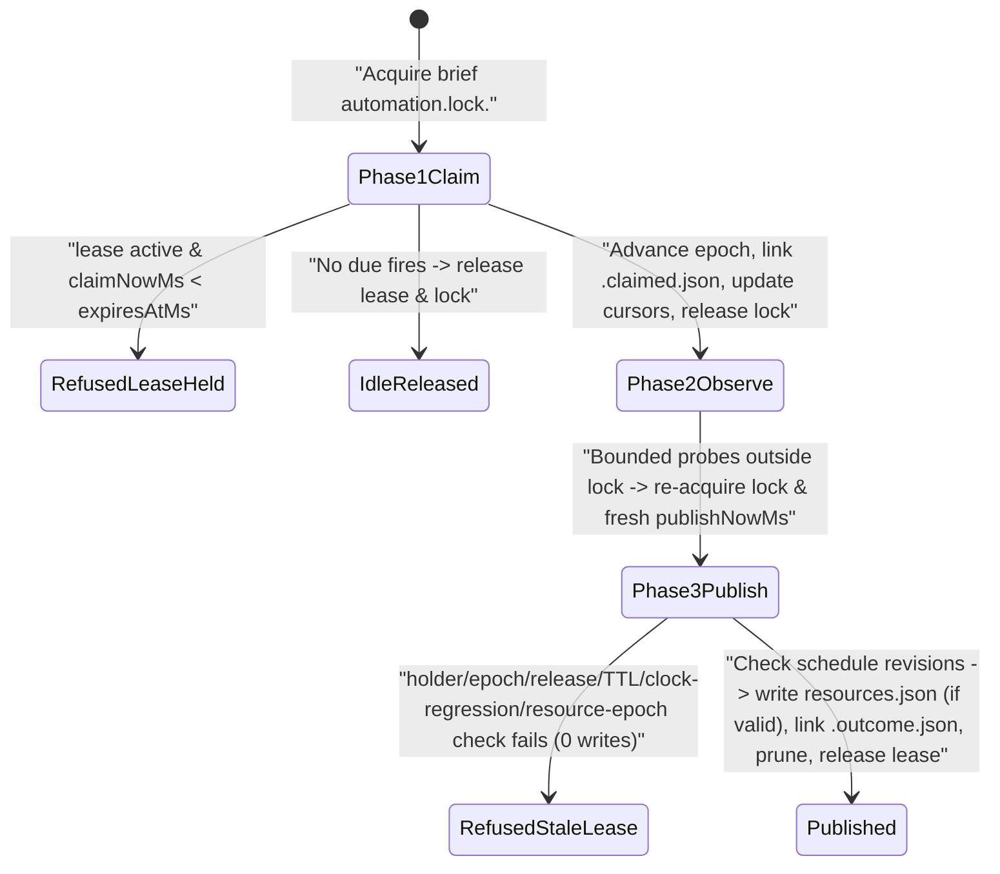

# COORDINATOR-AUTOMATION-S1: Deterministic Coordinator Observations and Durable Schedule Ledger

- **Mission:** `COORDINATOR-AUTOMATION-S1` (Milestone **S1**)
- **Status:** Implemented on branch `feat/coordinator-automation-s1` (draft PR). Strictly read-only, zero-LLM observations and durable schedule bookkeeping; disabled by default.
- **Baseline:** `origin/main` @ `e62914bf9ad59ca2555faa64e76cb4d687489ed5` (incorporates PR #184 E1, PR #186 E2, PR #187 S0, and PR #188 M1).
- **Canonical Contract:** [S0 Appendix B](coordinator-automation.md#appendix-b-separately-actionable-implementation-brief--s1-coordinator-automation-s1), reconciled with [M1 §3](coordinator-model-pool-m1-implementation.md#3-health-observation-probelocalendpointv0).
- **Explicit Exclusions:** Zero LLM inference (`tokensConsumed: 0`), zero operational harness dispatch, zero `.route.json` claims, zero standing authorizations, zero automatic `systemd` installation/activation, zero hosted provider polling or credential access, zero E4 event-store migration, zero worktree mutation. Codex remains Strict-only; workstation `H0` remains `BLOCKED`.

---

## 1. Architecture and Storage Layout

S1 implements Layers 3 (Deterministic Health & Resource Observations) and 4 (Persistent Schedule & Trigger Manager) of [S0](coordinator-automation.md#2-s0-a-separation-of-responsibilities) while keeping Layers 1–2 (Coordinator intelligence and Model Pool inference) and Layers 5–6 (governance admission and operational harnesses) strictly decoupled.

### Module Map

| Layer | Module | Responsibility |
| :--- | :--- | :--- |
| Protocol | `protocol/develop-automation.ts` | Closed schemas (`endo.develop-schedules.v0`, `endo.develop-automation-lease.v0`, `endo.develop-schedule-fire-claim.v0`, `endo.develop-schedule-fire-outcome.v0`, `endo.develop-resource-observation.v0`, `endo.develop-resource-declarations.v0`), strict limits, patterns, version tables |
| Pure Runtime Contract | `runtime/contracts/develop-automation.ts` | Canonical trigger cursors & idempotency keys, O(1) deterministic recurrence (interval, once, IANA TZ + DST calendar), freshness & allowance degradation, S2 recorded-observation M1 observer seam, safe `systemd` unit renderer |
| Durable Storage | `storage/develop-automation.ts` | `<root>/develop/automation/` store, `automation.lock.<n>` synchronous critical section, atomic JSON replacement, write-once `link(2)` fire claim/outcome records, retention pruning, lock-free read-only projection |
| Deterministic Tick Runner | `adapters/develop/scheduler-tick.ts` | Three-phase fenced `runEndoSchedulerTickV0`, M1 passive `probeLocalEndpointV0` reuse, E2 offline liveness & coordination reads, passive `node:os` hardware seam, operator declaration merging |
| CLI | `cli/scheduler.ts`, `cli/index.ts`, `cli/help.ts` | `endo schedule <add\|list\|enable\|disable\|remove>`, `endo scheduler <tick\|print-systemd-unit>`, `endo resource <declare-window\|list>` |

### Store-Local Namespace (`<root>/develop/automation/`)

```text
<root>/develop/automation/               # 0700 plain directory (never symlink)
  automation.lock.<n>                    # short-lived writer mutex (storage/numbered-lock.ts)
  schedules.json                         # endo.develop-schedules.v0 (atomic temp+fsync+rename)
  lease.json                             # endo.develop-automation-lease.v0 (expiring duty lease + monotonic epoch)
  resources.json                         # endo.develop-resource-observation.v0 (fenced by leaseEpoch)
  declarations.json                      # endo.develop-resource-declarations.v0 (operator-declared windows)
  fires/
    <idempotencyKey>.claimed.json        # endo.develop-schedule-fire-claim.v0 (write-once link(2))
    <idempotencyKey>.outcome.json        # endo.develop-schedule-fire-outcome.v0 (write-once link(2))
```

### Lock Separation Invariant

- S1 uses **only** `<root>/develop/automation/automation.lock.<n>`.
- S1 **never** acquires or nests `tasks.lock.<n>`, `coordination.lock.<n>`, or `<root>/events/session-attachment.lock`.
- `DevelopAutomationStoreV0.withAutomationLockSync` accepts only a synchronous callback, structurally preventing any async network probe or subprocess from running while `automation.lock.<n>` is held.

---

## 2. Versioned Protocol Contracts

Every persisted and externally supplied object in `protocol/develop-automation.ts` is **closed** (unknown fields, prototype keys, missing required fields, duplicate JSON keys, control characters, and unsafe identifiers are rejected). No record accepts executable commands, shell strings, callbacks, or credentials.

| Schema Version | File | Purpose | Key Invariants |
| :--- | :--- | :--- | :--- |
| `endo.develop-schedules.v0` | `schedules.json` | Durable schedule ledger & retired cursors | Max 64 schedules, max 256 retired cursors, closed S1 actions (`observe-health`, `refresh-projection`), closed missed-run policies (`skip-and-report`, `coalesce-once`), unique `scheduleId` |
| `endo.develop-automation-lease.v0` | `lease.json` | Expiring duty lease with monotonic `epoch` | `epoch >= 1`, `expiresAtMs > acquiredAtMs`, `releasedAtMs: number \| null`; distinct from PID-bound `automation.lock.<n>` |
| `endo.develop-schedule-fire-claim.v0` | `fires/<key>.claimed.json` | Write-once pre-probe fire claim | Linked before Phase 2 probes via `link(2)`; pins `scheduleRevision`, `triggerCursor`, `windowStartMs`, `leaseEpoch`, `holderId` |
| `endo.develop-schedule-fire-outcome.v0` | `fires/<key>.outcome.json` | Write-once terminal fire outcome | Closed status (`completed`, `missed-skipped`, `failed`, `cancelled-schedule-changed`), `tokensConsumed: 0` |
| `endo.develop-resource-observation.v0` | `resources.json` | Latest bounded resource observation snapshot | Stamped with `leaseEpoch`, `observedAtMs`, `publishedAtMs`, `staleAfterMs`, `tokensConsumed: 0`; carries M1 local observations, provider allowances, E2-E session liveness, worktree summaries, hardware seam, and projection summary |
| `endo.develop-resource-declarations.v0` | `declarations.json` | Operator-declared provider reset windows | Strictly `basis: "operator-declared"`; standing restricted to `exhausted-until-reset \| approaching-limit \| unknown` (never `available`) |

---

## 3. State Transitions and Three-Phase Fenced Lease Lifecycle



### Fencing Rules (Phase 3)

Before any Phase 3 write occurs, `runEndoSchedulerTickV0` evaluates a fresh publication clock `publishNowMs = now()` (never reusing Phase 1's `claimNowMs`) and checks under `automation.lock.<n>`:

1. `lease.holderId === myHolderId`
2. `lease.epoch === myEpoch`
3. `lease.releasedAtMs === null`
4. `publishNowMs >= lease.acquiredAtMs` (backward clock-jump guard)
5. `publishNowMs < lease.expiresAtMs` (exact-boundary expiry guard)
6. `monotonicElapsedMs < leaseTtlMs` (real-time wall-clock rollback guard)
7. `existingResources === null || myEpoch >= existingResources.leaseEpoch`

If any check fails, Phase 3 aborts immediately with `stale-lease-epoch` and **zero writes** to `resources.json`, `schedules.json`, `fires/`, or `lease.json`.

### Schedule Revision Linearisation (S1-C / S1-AT08)

Inside Phase 3 (after passing lease fencing), each claimed fire is re-checked against the freshly read `schedules.json`:

- **Removed in flight:** outcome recorded as `cancelled-schedule-changed` (`schedule-removed-in-flight`) bound to the claimed `scheduleRevision`; schedule is never resurrected.
- **Disabled in flight:** outcome recorded as `cancelled-schedule-changed` (`schedule-disabled-in-flight`) bound to the claimed `scheduleRevision`; schedule stays disabled.
- **Revised in flight (`current.revision !== claim.scheduleRevision`):** outcome recorded as `cancelled-schedule-changed` (`schedule-revised-in-flight`) bound to the claimed `scheduleRevision`; revision 2's state is untouched.
- `resources.json` is published **only** if at least one claimed schedule in the tick remains valid at its claimed revision.

---

## 4. Crash-Recovery Semantics

S1 does not claim exactly-once execution across arbitrary crashes; it provides **conservative, crash-honest, idempotent recovery**:

| Crash Point | On-Disk State | Projection & Next-Tick Behaviour |
| :--- | :--- | :--- |
| Before `lease.json` rename | Previous lease intact | Next tick proceeds normally |
| After `.claimed.json` link, before `schedules.json` cursor update | `.claimed.json` exists, no `.outcome.json`, lease active | Reads as `claimed-incomplete`; after lease expiry, next tick attempts `link(2)`, gets `exists`, advances cursor without re-running probes |
| After Phase 1 (`afterPhase1Claim`) | `.claimed.json` exists, no `.outcome.json`, cursor advanced | Reads as `claimed-incomplete`; never deleted, overwritten, fabricated as completed, or replayed |
| Before `resources.json` replace | Previous `resources.json` intact, claim incomplete | Reads honestly as `claimed-incomplete`; lease expires naturally |
| After `resources.json` replace, before `.outcome.json` link | Valid `resources.json` at `myEpoch`, claim without outcome | `resources.json` inspectable; fire stays `claimed-incomplete` (never fabricated as `completed`) |
| After `.outcome.json` link, before lease release | Valid `resources.json` + `completed` outcome, lease still active | Clean terminal fire; next tick safely advances `epoch + 1` after `expiresAtMs` |
| After atomic rename, before directory `fsync` | New file visible, directory durability unconfirmed | Returns explicit `commit-uncertain` refusal |

---

## 5. Schedule Recurrence and Retention Semantics

- **Canonical idempotency key:** `sha256(canonicalJson({ schema: "endo.schedule-fire-key.v0", scheduleId, windowStartMs, triggerCursor }))` (64 lowercase hex chars).
- **`once`:** Fires at most once at `atMs`. Within `onTimeGraceMs` (default 60s), executes normally; past grace, `skip-and-report` records `missed-skipped` and `coalesce-once` executes once. `cursor.completedOnce` prevents any replay.
- **`interval`:** Anchored strictly to `anchorMs + k * everyMs` (`everyMs >= 1s`, `<= 365d`). Evaluated in O(1) arithmetic regardless of outage duration (a 10-year outage computes `missedWindowCount` in O(1) without iteration). Effective on-time grace is `min(onTimeGraceMs, floor(everyMs / 4))`.
- **`calendar`:** Deliberately limited, zero-dependency syntax (`hourly:MM`, `daily:HH:MM`, `weekly:<sun..sat>@HH:MM`) with validated IANA timezone (`Intl.DateTimeFormat`).
  - **DST policy (`skip-nonexistent-first-ambiguous`):** Spring-forward nonexistent local wall-times (e.g., `America/New_York` 2026-03-08 02:30) are skipped; fall-back ambiguous local wall-times (e.g., `America/New_York` 2026-11-01 01:30) fire once at the first chronological UTC instant (`05:30Z`) and do not double-fire at `06:30Z`.
  - Long outages (> 32 nominal periods) use bounded O(1) missed-window counting rather than iterating over historical periods.
- **Backward wall-clock jumps:** If `nowMs < cursor.lastConsumedWindowStartMs`, evaluation returns `clock-behind-cursor` with zero replay.
- **Retention safety:** `pruneRetainedFires` retains at most `maxFirePairsRetained` (default 256) terminal fire pairs, **never** removes unresolved `claimed-incomplete` claims, and relies on durable `cursor.lastConsumedWindowStartMs` (live schedules) and `retiredCursors` (up to 256 removed schedules, inherited on `scheduleId` re-creation) so pruned windows cannot resurrect.

---

## 6. Resource Observation Provenance & Hardware Seam

### Provenance & Honesty Rules

- **Bases:** `authoritative-api`, `controller-observed`, `passive-response-header`, `operator-declared`, `controller-ledger-estimate`, `unknown`.
- **Freshness:** Every snapshot and provider observation carries `{ observedAtMs, staleAfterMs }`. Readers compute `fresh | stale | clock-skew` (`observedAtMs > nowMs + 5000`); any stale or clock-skewed observation downgrades `effectiveStanding` to `unknown` and `availabilityConfirmed: false`.
- **Subscription & quota separation:** Distinct windows (`rolling-5h`, `weekly`, `rpm`, `tpm`, `rpd`, `credit-balance`, `local-vram`, `custom`) and shared `quotaPoolId` values are represented separately without invented percentages. Local turn counts carry `note: "local-endophasia-lower-bound-only"`. Expired operator-declared reset times (`nowMs >= resetAtMs`) degrade to `unknown` with `resetPassedUnverified: true` — never confirmed `available`.
- **Local endpoints (M1 reconciliation):** Strictly reuses M1's `probeLocalEndpointV0`. Healthy router (`model-unconfirmed`) and awake single-server (`capacity-unknown`) yield local provider standing `unknown`, never `available`, unless an injected passive capacity observer explicitly reports `ready`.

### Hardware Observation Foundation (S1-F)

- Default observer (`passiveHostOsHardwareObserverV0`) uses strictly in-process `node:os` CPU/RAM queries (zero subprocesses, zero NVML/CUDA/DRM calls, cannot wake or reconfigure inference servers) and derives `sharedDeviceContention` (`shared-multiple-members` vs `none-observed` vs `unknown`) from optional `deviceAttribution`.
- `EndoHardwareDeviceObservationV0` models physical `deviceId`, `kind`, `backendFamily`, GPU/RAM memory bytes + `memoryBasis`, `attributedModelMemberIds`, `sharedDeviceContention`, `activeResourceLeaseIds`, and `supportsCpuOnlyDecisionModel` — ready for future NVML/DRM GPU observers and CPU-only decision models without implementing a GPU allocator in S1.

---

## 7. S0 Amendments and Deviations

Per mission §3, [docs/designs/coordinator-automation.md](coordinator-automation.md) was amended to reconcile S0 with M1's empirically verified `llama.cpp` source findings ([M1 §3](coordinator-model-pool-m1-implementation.md#3-health-observation-probelocalendpointv0), `ggml-org/llama.cpp#20227`):

1. **No `/slots`, `/metrics`, router `/models`, or query-string probes:** S1 exclusively reuses M1's `probeLocalEndpointV0` and `endoCoordinatorLoopbackOriginV0`. Unconfirmed capacity remains `capacity-unknown` / `model-unconfirmed` (standing `unknown`).
2. **S0-AT06 amended:** Verified against fake router/single/loading servers with prohibited-route sentinels plus an injected passive `saturated` observer.
3. **Separate `declarations.json` file:** Operator reset-window declarations live in `<root>/develop/automation/declarations.json` (under `automation.lock.<n>`) so `endo resource declare-window` does not contend with `lease.json` and declarations survive `resources.json` refreshes.
4. **Additional closed outcome status `cancelled-schedule-changed`:** Explicitly records in-flight schedule disable/remove/revision without misattributing work to a new schedule revision or fabricating failure.
5. **Opt-in `--pool` on `endo scheduler tick`:** When `--pool` is omitted, `observe-health` makes zero unrequested HTTP calls (protecting the operator's live `127.0.0.1:8091` server during offline/test ticks).

---

## 8. Limits and Threat Model

- **Cooperative same-host, same-UID threat model:** Consistent with `storage/numbered-lock.ts` and `storage/write-once.ts`, S1 does not claim defense against an arbitrary malicious process running as the same UID with direct write access to `<root>/develop/automation/`.
- **Filesystem hardening:** Rejects symlinks (`lstat` + `O_NOFOLLOW`), FIFOs (`O_NONBLOCK` + `fstat().isFile()`), oversized files, duplicate JSON keys, non-UTF-8 bytes, invalid schema versions, and unsafe path identifiers.
- **M1 loopback trust limitation preserved:** Literal `http://127.0.0.1:<port>` pinning and a reported `model` string do not authenticate the local listener or model weights.
- **Hard bounds (`ENDO_DEVELOP_AUTOMATION_LIMITS_V0`):** max 64 schedules, max 256 retired cursors, max 512 KiB metadata files, max 16 KiB lease file, max 64 KiB fire records, max 256 retained terminal fire pairs, max 16 probes/tick, max 4 concurrent probes, default 30 s tick budget, default 60 s lease TTL.

---

## 9. Acceptance Matrix

| Scenario ID | Coverage in `tests/develop-automation-s1.test.ts` | Status |
| :--- | :--- | :--- |
| **S0-AT01** | Unreachable + 503 local endpoints + skipped hosted member still publish honest degraded snapshot (`tokensConsumed: 0`) | Pass |
| **S0-AT03 / S1-AT04** | Two real OS Node child processes race on identical window -> 1 `.claimed.json`, 1 `.outcome.json`, zero duplicate server probes | Pass |
| **S0-AT04 / S1-AT05** | Two real OS Node child processes: Worker A pauses past TTL, Worker B advances epoch 2 & publishes, Worker A refused `stale-lease-epoch` with 0 writes | Pass |
| **S0-AT05** | 5 missed 30m windows: `skip-and-report` logs `missedWindowCount: 5` with 0 catch-up fires; `coalesce-once` fires once | Pass |
| **S0-AT06 / S1-AT11** | Fake router, single-awake, loading servers + prohibited-route sentinels (`/slots`, `/metrics`, router `/models`, completions) + injected `saturated` | Pass |
| **S0-AT08 / S1-AT12 / S1-AT13** | Codex lower-bound ledger (`unknown`), Claude multi-window (`rolling-5h` + `weekly`) + shared `quotaPoolId`, expired reset -> `unknown`, stale degradation | Pass |
| **S0-AT11 / S1-AT16** | Real `acquireEndoEventStoreWriterLockV0` holds `events/session-attachment.lock` during live event writes + S1 tick: zero contention | Pass |
| **S1-AT01** | Ordinary `--help` and `schedule list` create zero automation files, no systemd units, zero inference | Pass |
| **S1-AT02** | Malformed IDs, unsupported actions, extra `command` field, ambiguous ISO, bad dates/durations/calendars, duplicate IDs, > 64 schedules refused | Pass |
| **S1-AT03** | Deterministic interval anchoring, exact due boundary, canonical SHA-256 key, `America/New_York` DST spring-forward skip & fall-back single-fire | Pass |
| **S1-AT06** | Crash after Phase 1 claim leaves `claimed-incomplete`; next tick advances epoch without deleting, overwriting, or replaying | Pass |
| **S1-AT07** | Injected crashes before/after `resources.json`, before `.outcome.json`, before lease release, and `afterReplace` (`commit-uncertain`) | Pass |
| **S1-AT08** | Disable, remove, and revise during Phase 2 record `cancelled-schedule-changed` bound to claimed rev 1 without resurrecting or overwriting rev 2 | Pass |
| **S1-AT09** | Backward jump (`clock-behind-cursor`), mid-tick backward jump (`stale-lease-epoch`), exact expiry (`publishNowMs === expiresAtMs`), 10-year jump O(1) | Pass |
| **S1-AT10** | Pruning retains all `claimed-incomplete` claims, trims oldest terminal pairs, never resurrects pruned windows (even across remove + re-add) | Pass |
| **S1-AT14** | Hanging endpoint deadline, > 256 KiB oversized response (`probe-refused`), corrupt store fail-closed without overwrite | Pass |
| **S1-AT15** | Duplicate JSON keys, symlinked file & directory, unsafe `idempotencyKey`, FIFO rejected without hanging | Pass |
| **S1-AT17 / S1-AT18** | Tasks, coordination, git worktree byte-identical; zero routes/authorizations/attempts/receipts created; `tokensConsumed === 0`; 0 completion calls | Pass |
| **S1-AT19** | `endo scheduler print-systemd-unit` syntax, `$$`/`%%`/space escaping, bounded resource limits, zero writes to `~/.config/systemd/user` | Pass |
| **S1-AT20** | End-to-end CLI workflow + M1 `selectCoordinatorModelV0` using `createRecordedCoordinatorModelObserverV0` with 0 duplicate HTTP hits + M1 suite | Pass |

---

## 10. Adversarial Review & Verification

### Independent Adversarial Review

A separate read-only adversarial reviewer subagent audited all S1 modules (`protocol/develop-automation.ts`, `runtime/contracts/develop-automation.ts`, `storage/develop-automation.ts`, `adapters/develop/scheduler-tick.ts`, `cli/scheduler.ts`, `docs/designs/coordinator-automation.md`, and `tests/develop-automation-s1.test.ts`) across all 10 mandatory security and correctness focus areas. Zero Critical execution-authority or inference-leakage findings were reported. Every cogent finding (6 High, 7 Medium, 4 Low, plus doc-drift items) was remediated with regression tests:

| ID | Severity | Finding | Remediation |
| :--- | :--- | :--- | :--- |
| **H1** | High | `refresh-projection` passed `projects: null` with `budget` to `readStoreCoordinatorStatusV0` (which requires 1 project with budget), making `statusSha256` always `null`; `readEndoCoordinatorCoordinationV0` ran without a budget | Switched `defaultObserveProjection` to bounded per-project reads (max 16 projects/tick) for both coordination and status, plus deterministic empty-store digests. Verified by `Adversarial H1 & H2` regression. |
| **H2** | High | `observe-health` and `refresh-projection` clobbered each other's fields in `resources.json` | Preserved unrefreshed sections (`modelPool`/`providers`/`hardware` or `projectionSummary.statusSha256`) from valid `existingResources` under `automation.lock.<n>` in Phase 3. Verified by `Adversarial H1 & H2` regression. |
| **H3** | High | Phase 1 and Phase 3 wall-clock and monotonic timestamps were captured before `withAutomationLockSync` acquired `automation.lock.<n>` | Moved `claimNowMs`, `monotonicStartMs`, `publishNowMs`, and `monotonicElapsedMs` strictly inside the lock callbacks. |
| **H4** | High | `retiredCursors` silently evicted oldest entries past 256 (and could evict newly retired cursors on backward clock jump), allowing pruned window resurrection | Changed `removeSchedule` to conservatively refuse with `limit` rather than silently evicting a retired cursor floor, and used monotonic `Math.max(now, file.updatedAtMs)` for `retiredAtMs`. Verified by `Adversarial H4, H5, H6` regression. |
| **H5** | High | `#pruneRetainedFiresUnderLock` called `readFires(2048)`, causing permanent pruning deadlock once `claimed-incomplete` + other entries reached 2,048 | Rewrote `#pruneRetainedFiresUnderLock` to stream `opendirSync(firesDir)` directly (bounded 16,384 scan), sweeping expired `.tmp-*` files and pruning terminal pairs independently of accumulated `claimed-incomplete` files. Verified with 2,100 incomplete files in `Adversarial H4, H5, H6`. |
| **H6** | High | `removeSchedule` + `addSchedule` of the same `scheduleId` during Phase 2 collided at `revision: 1` and bypassed Phase 3 revision checking | Added exact `lastFireIdempotencyKey`, `actionKind`, and `triggerCursor` verification in Phase 3 `claimDispositions` (`schedule-replaced-in-flight`). Verified by `Adversarial H4, H5, H6`. |
| **M1** | Medium | Unsanitized Phase 2 error messages containing newlines/control chars or empty string could throw `EndoInvalidRecordV0` in Phase 3 and wedge the lease | Sanitized `phase2FailureDetail` by collapsing C0/C1 control chars and defaulting empty text to `"observation phase failed"`. Verified by `Adversarial M1–M7 & L1–L4`. |
| **M2** | Medium | Missing `lease.json` while `resources.json` held `leaseEpoch = N > 1` caused `N - 1` wasted TTL cycles of `stale-lease-epoch` | Phase 1 now reads `resources.json` (fail-closed) and initializes `myEpoch = Math.max(existingLease?.epoch ?? 0, existingResourcesEpoch) + 1`. Verified by `Adversarial M1–M7 & L1–L4`. |
| **M3** | Medium | Uncapped lease TTL in `validateEndoDevelopAutomationLeaseV0` and backward RTC skew could wedge `lease-held` indefinitely | Capped `expiresAtMs - acquiredAtMs <= maxLeaseTtlMs` (`300_000` ms) in schema validation and added impossible-future backward-skew break guard (`acquiredAtMs - claimNowMs > maxLeaseTtlMs`) in Phase 1. Verified by `Adversarial M1–M7 & L1–L4`. |
| **M4** | Medium | `reviseSchedule` preserved `completedOnce: true` on trigger changes | Reset `completedOnce: false` and advanced calendar cursor floor on trigger revisions in `reviseSchedule`. Verified by `Adversarial M1–M7 & L1–L4`. |
| **M5** | Medium | Prior crash before `schedules.json` update could let next tick write `missed-skipped` over existing `.claimed.json`; unchecked pre-fire missed write; unreleased lease on Phase 1 error | Checked `readFireClaim` before writing `missed-skipped` (preserving `claimed-incomplete`), checked pre-fire `mw === "failed"`, and added best-effort Phase 1 lease release on internal Phase 1 errors. |
| **M6** | Medium | In-flight disabled/revised schedule left stale `cursor.lastFireStatus` while `lastFireIdempotencyKey` pointed to cancelled fire | Keyed Phase 3 `lastFireStatus` updates by exact `lastFireIdempotencyKey` so disabled/revised schedules accurately record `cancelled-schedule-changed` without altering operator fields or replaced schedules. Verified by `Adversarial M1–M7 & L1–L4`. |
| **M7** | Medium | Operator declaration with `--provider local-inference` masked controller-observed local endpoint health | Reserved `"local-inference"` as controller-only and refused it in `declareResourceWindow`. Verified by `Adversarial M1–M7 & L1–L4`. |
| **L1** | Low | `maxAgeMs: NaN` bypassed freshness check; synthetic fallback used `"timeout"` | Validated `maxAgeMs` is a non-negative safe integer; synthetic fallback uses `"cancelled"` detail with zero network probes. Verified by `Adversarial M1–M7 & L1–L4`. |
| **L2** | Low | Calendar bracketing near `MAX_EPOCH_MS` could pass out-of-range dates to `Intl.DateTimeFormat` | Guarded `Date.UTC` bounds in `addCalendarDays`/`addCalendarHours`. Verified by `Adversarial M1–M7 & L1–L4`. |
| **L3** | Low | `onTimeGraceMs`, `maxFirePairsRetained`, `holderId` unvalidated at entry; latent tail slice hazard | Added upfront validation and preserved untouched tail schedules past `maxDueSchedulesPerTick`. Verified by `Adversarial M1–M7 & L1–L4`. |
| **L4** | Low | C1 control chars / leading `@:+!-` in systemd args; `PrivateTmp=yes` vs `/tmp/` roots | Hardened `escapeEndoSystemdExecArgV0` and `assertAbsoluteSafePath` for C0+C1 and leading prefixes; omitted `PrivateTmp=yes` when `storeRoot` starts with `/tmp/`. Verified by `Adversarial M1–M7 & L1–L4`. |

### PR #189 Codex Review Remediations (4/4 P2)

| ID | Finding | Remediation |
| :--- | :--- | :--- |
| **Codex P2 #1** | `defaultObserveLocalTurnLedger` checked `turn.started` / `prompt.submitted` instead of live-adapter canonical events (`agent.turn-started` for Pi, `codex.turn-started` for Codex) | Switched to counting canonical `agent.turn-started` and `codex.turn-started` events without double-counting `codex.prompt-dispatched` or derived lifecycle events. |
| **Codex P2 #2** | Phase 1 early return (`claimed.length === 0`) bypassed `pruneRetainedFires`, allowing `skip-and-report`-only ticks to grow `fires/` past `maxFirePairsRetained` | Invoked `s.pruneRetainedFires(maxFirePairsRetained)` under `automation.lock.<n>` whenever `missedSkipped.length > 0` before releasing the Phase 1 lease. |
| **Codex P2 #3** | `endoEffectiveProviderAllowanceV0` degraded `exhausted-until-reset` to `unknown` whenever *any* window elapsed, hiding an independently unexpired weekly exhaustion | Added closed per-window `standing` to `EndoAllowanceWindowObservationV0` and updated `endoEffectiveProviderAllowanceV0` to preserve any still-unexpired window exhaustion/approaching restriction while degrading only elapsed windows. |
| **Codex P2 #4** | `declareResourceWindow` allowed > 32 distinct providers (64 declaration cap), causing `buildProviderObservations` to exceed `maxProvidersObserved` (32) and fail resource validation | Capped distinct declared providers at `maxProvidersObserved` (32) in both protocol and storage, enforced `maxProvidersObserved` inside `buildProviderObservations` (reserving 1 slot for `local-inference` when local endpoints are probed), and surfaced `"providers-truncated"` in `projectionSummary.gaps`. |

### Verification Results

Environment: Linux (Arch), Node `v26.13.1`, Vitest `v4.1.9`, Biome `v2.3.5`, default environment (`ENDO_REAL_SCOPES`, `ENDO_REQUIRE_ISOLATION`, `ENDO_COORDINATOR_OPENCLAW` unset; no live inference server or hosted API contacted).

| Check | Exact Command | Result |
| :--- | :--- | :--- |
| Typecheck | `npm run typecheck` (`tsc --noEmit -p tsconfig.json && tsc --noEmit -p studio-ui/tsconfig.json`) | Pass (0 errors) |
| Lint | `npm run lint` (`biome check .`) | Pass (0 errors; 1 pre-existing warning in `tests/endo-cockpit-eighteenth-review.test.ts:674`) |
| Build & Packaging | `npm run build && npm run test:package` | Pass (`package smoke passed`; 281 packed files, 267 resolved `.js` modules, deterministic tarball, real Chromium Studio smoke) |
| S1 Acceptance + Multi-Process + Adversarial Suite | `npx vitest --run tests/develop-automation-s1.test.ts` | **23 passed, 0 failed, 0 skipped** (4.67 s) |
| CLI & M1 Model Pool Regressions | `npx vitest --run tests/cli-help.test.ts tests/endo-studio-source.test.ts tests/coordinator-model-pool.test.ts` | **152 passed, 6 opt-in skipped** (installed-OpenClaw cases require `ENDO_COORDINATOR_OPENCLAW`) |
| Storage, Lock & Coordination Regressions | `npx vitest --run tests/numbered-lock.test.ts tests/writer-lock-concurrency.test.ts tests/develop-tasks-store.test.ts tests/develop-coordination-store.test.ts tests/develop-coordination-cli.test.ts tests/coordinator-coordination.test.ts tests/coordinator-coordination-sandbox.test.ts` | **124 passed, 0 skipped** |
| E2 Assignment & Coordinator Runtime Regressions | `npx vitest --run tests/develop-assignment-e2.test.ts tests/coordinator-status.test.ts tests/coordinator-brief.test.ts tests/writer-lock-concurrency.test.ts tests/develop-automation-s1.test.ts` | **119 passed, 6 opt-in skipped** (prior to adding 3 adversarial tests; 23/23 S1 tests pass post-remediation) |
| Full Repository Regression Suite | `npm test` (`vitest --run`) | **321 passed, 14 skipped (335 files); 7761 passed, 211 skipped (7972 tests); 0 failed** (308.56 s; skips are opt-in real-runtime/isolation/installed-OpenClaw/real-model suites) |

---

## 11. CLI Examples & Optional Systemd Setup / Removal

### CLI Examples

```sh
# 1. Add a recurring 15-minute passive health observation schedule
endo schedule add --root /path/to/store \
  --id health-15m \
  --action observe-health \
  --every 15m \
  --missed-run skip-and-report

# 2. Add a daily calendar projection refresh in a specific IANA timezone
endo schedule add --root /path/to/store \
  --id morning-projection \
  --action refresh-projection \
  --calendar daily:08:30 \
  --tz America/New_York

# 3. Declare an operator-estimated 5-hour subscription reset window (touches no credentials)
endo resource declare-window --root /path/to/store \
  --provider codex-subscription \
  --window rolling-5h \
  --standing exhausted-until-reset \
  --reset-at 2026-11-26T22:00:00Z

# 4. Run ONE deterministic zero-LLM observation tick manually
endo scheduler tick --root /path/to/store --pool ~/.config/endo-pool.json

# 5. Inspect schedules, fires, and resource observations with live freshness
endo schedule list --root /path/to/store --include-fires
endo resource list --root /path/to/store

# 6. Enable, disable, or remove schedules explicitly
endo schedule disable --root /path/to/store --id health-15m
endo schedule enable --root /path/to/store --id health-15m
endo schedule remove --root /path/to/store --id health-15m

# 7. Print example systemd --user units to stdout ONLY (never installs or activates)
endo scheduler print-systemd-unit --root /path/to/store --pool ~/.config/endo-pool.json
```

### Optional Manual `systemd --user` Setup & Removal

Systemd acts strictly as an external wake driver; Endophasia's store-local `schedules.json` and `lease.json` remain the sole scheduling authority. Upstream `systemd.timer(5)` semantics apply: systemd does not start a second instance of an already-active oneshot service, `Persistent=true` applies to `OnCalendar=` timers and may coalesce missed wakeups, and a user manager is not necessarily running while logged out unless lingering is separately enabled.

```sh
# Print example units to inspect first:
endo scheduler print-systemd-unit --root /abs/path/to/store --endo-bin /abs/path/to/endo

# Save the printed [Unit]/[Service] and [Unit]/[Timer]/[Install] blocks manually to:
#   ~/.config/systemd/user/endo-scheduler-tick.service
#   ~/.config/systemd/user/endo-scheduler-tick.timer
systemctl --user daemon-reload
systemctl --user enable --now endo-scheduler-tick.timer
systemctl --user status endo-scheduler-tick.timer

# Removal:
systemctl --user disable --now endo-scheduler-tick.timer
rm -f ~/.config/systemd/user/endo-scheduler-tick.timer ~/.config/systemd/user/endo-scheduler-tick.service
systemctl --user daemon-reload
```

### Disposable Live Smoke-Test Procedure (Separately Authorised)

Run against a fresh disposable store without modifying the live `127.0.0.1:8091` inference server:

```sh
TMP_STORE=$(mktemp -d /tmp/endo-s1-smoke-XXXXXX)
cat > "$TMP_STORE/pool.json" <<'EOF'
{
  "schemaVersion": "endo.coordinator-model-pool.v0",
  "selection": { "fallback": "availability", "unconfirmedModel": "permit" },
  "members": [{
    "memberId": "local-primary",
    "kind": "local-openai-compat",
    "endpoint": "http://127.0.0.1:8091",
    "modelId": "Inkling-2-Mini-Uncensored-AD-Q4_K",
    "priority": 100,
    "maxPromptBytes": 8192,
    "maxOutputTokens": 2048,
    "timeoutMs": 135000,
    "advisoryOnly": true
  }]
}
EOF
endo schedule add --root "$TMP_STORE" --id smoke-health --action observe-health --once "$(date -u +%Y-%m-%dT%H:%M:%SZ)" --missed-run coalesce-once
endo scheduler tick --root "$TMP_STORE" --pool "$TMP_STORE/pool.json"
endo resource list --root "$TMP_STORE"
endo schedule list --root "$TMP_STORE" --include-fires
rm -rf "$TMP_STORE"
```

Expect: `tokensConsumed: 0`, only `GET /health` and `GET /props` sent to `127.0.0.1:8091`, `readiness: "model-unconfirmed"`, and clean removal of `$TMP_STORE`.

---

## 12. Known Limitations, Future System One Path, and S2 / F1 Handoff

### Known Limitations
- **Passive llama.cpp capacity:** No local llama.cpp endpoint confirms free slot capacity without side effects today; local router members report `model-unconfirmed` and single-server awake members report `capacity-unknown`.
- **Retired cursor cap:** `retiredCursors` retains up to 256 removed schedule high-water marks; removing and re-creating > 256 distinct schedule IDs evicts the oldest retired cursor.
- **No GPU VRAM probe in S1:** GPU memory observation is left behind `EndoHardwareObserverV0` so S1 spawns zero external GPU driver utilities (`nvidia-smi`/NVML).
- **Same-UID threat model:** Cooperative locking and write-once files assume non-adversarial same-UID processes.

### Future Integration Path: System One Decision Models (`/v1/systemone`)
Future milestones (`S2` or later research) may explore fast, low-cost local System One decision models (e.g., `llama.cpp`'s `/v1/systemone` interface, `https://huggingface.co/blog/ggml-org/decision-models-in-llamacpp`) for advisory triage or wake-gating over CPU-only or dedicated local devices.
- S1 does **not** call `/v1/systemone` or any inference endpoint.
- S1 prepares the hardware seam (`supportsCpuOnlyDecisionModel: true` on `cpu-host` in `EndoHardwareDeviceObservationV0`) and the deterministic projection digest (`statusSha256`, `coordinationSha256`) so S2+ can evaluate whether a System One decision model adds value strictly as an **untrusted advisory layer** (never as execution authority or a replacement for deterministic governance).

### Concrete S2 & F1 Handoff

1. **S2 (Scheduled Local Advisory Briefs & Proposal Queue):**
   - Pass `createRecordedCoordinatorModelObserverV0({ snapshot, expectedPoolSha256, now, fallback: probeLocalEndpointV0 })` directly into M1's `selectCoordinatorModelV0` so scheduled briefs reuse fresh S1 observations (`leaseEpoch` + `poolSha256` pinned) without redundant HTTP probes.
   - Gate scheduled `generate-advisory-brief` turns on deterministic `projectionSummary.statusSha256` + `coordinationSha256` changes so unchanged idle state consumes 0 tokens (`S0-AT09`).
   - Add a closed v1 or separate proposal-queue schema for `emit-operator-proposal` that remains strictly untrusted prose with zero `.route.json` access.
2. **F1 (Read-Only Studio Mission Board Views):**
   - Consume `readEndoAutomationProjectionV0(root)` over a read-only workspace-host endpoint (matching `cockpit-http/coordinator.ts` bounded budgets and zero-mutation policy) to render schedule state, lease epoch/activity, `claimed-incomplete` warnings, provider allowance standing with explicit freshness badges, and hardware attribution without creating a second authoritative coordination state.
