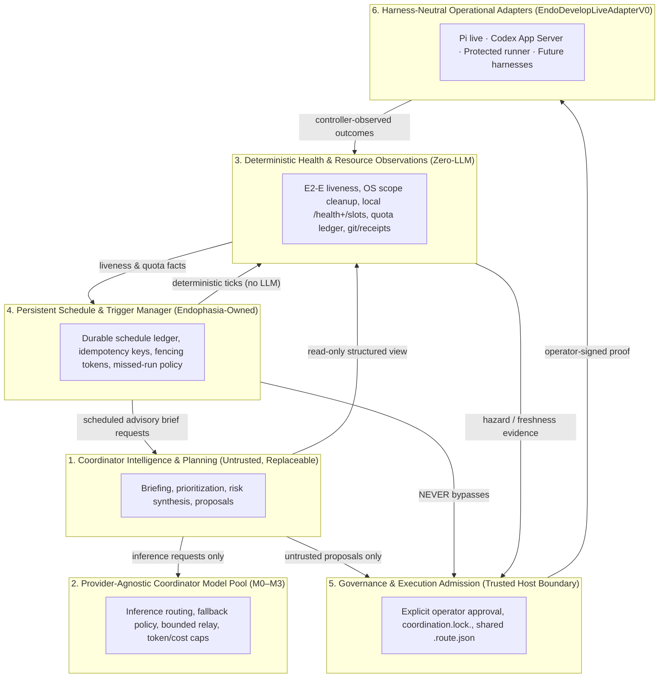
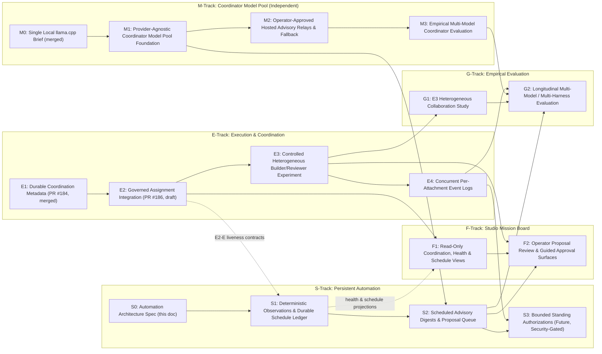

# COORDINATOR-AUTOMATION-001 (S0): Persistent Coordinator Automation Architecture

**Mission**: `COORDINATOR-ASSIGNMENT-003` (Secondary milestone: **S0 — Coordinator automation architecture**)  
**Status**: **Design specification only** (no live scheduler, daemon, M1 model pool, hosted model access, standing authorization, or E4 event-store migration is implemented by this document)  
**Baseline**: `origin/main` @ `c2b4d07e0` (PR #185 merged)  
**Unmerged Upstream Dependency**: Grounded in the E2 governed assignment, advisory review, registered worktree, and session liveness contracts proposed in **Draft PR #186** (`feat/coordinator-assignment-003`, `docs/designs/coordinator-assignment-e2-implementation.md`), which is unmerged at time of writing.

---

## 1. Purpose, Non-Goals, and Preserved Invariants

Endophasia is evolving from single-turn, operator-invoked commands (`endo coordinator brief`, `endo assign`, `endo verify`) toward a **persistent, local-first, harness-neutral operational control plane** that can monitor work across heterogeneous agents (Pi, Codex, future Claude Code / Gemini CLI), multiple inference providers, and multi-hour execution windows (including 5-hour rolling subscription windows and overnight runs).

This document defines **S0**: the persistent operational machinery that supports the Coordinator and eligible agents across time without weakening Endophasia's governance or epistemic boundaries.

### Non-Goals of S0
- S0 does **not** implement or enable a background daemon, `systemd` timer, cron runner, or live heartbeat loop.
- S0 does **not** implement the Coordinator Model Pool (`M1`), hosted provider execution, standing execution authorizations (`S3`), or concurrent per-attachment event logs (`E4`).
- S0 does **not** alter host permissions, workstation `H0` (`BLOCKED`), libvirt configuration, provider credentials, or the operator's installed OpenClaw Gateway (`~/.openclaw/`).

### Non-Negotiable Invariants Carried Forward
Every layer in this architecture preserves the existing repository invariants:
1. **Assignment is not authorization**; **readiness is not execution permission**.
2. **A model recommendation or Coordinator proposal is never an operator decision or trusted observation**.
3. **Recorded activity is never proof of current process liveness**; **revocation never proves process termination**.
4. **Missing evidence is never interpreted as successful verification**; **unknown execution outcomes never trigger automatic retries**.
5. **Native harness approvals remain separate from Endophasia approvals**; **Codex remains Strict-only**; **Pi Everyday eligibility does not broaden**.
6. **Workstation `H0` remains `BLOCKED`**; the existing protected verification boundary is never weakened.
7. **No automatic merging, candidate acceptance, or task completion**.
8. **Model-independent control plane**: the control plane (observations, schedule ledger, governance checks, health probes, Studio projections) must remain 100% functional when every inference provider is unavailable, rate-limited, or disabled.

---

## 2. S0-A: Separation of Responsibilities

A persistent Coordinator must not collapse reasoning, model inference routing, deterministic health monitoring, durable scheduling, governance admission, and harness execution into one monolithic "agent loop". If the Coordinator model changes (e.g., local `llama.cpp` → OpenRouter → Anthropic/OpenAI/Gemini or back to offline), **zero** schedules, resource states, pending work items, or operational histories may be lost.



### Layer-by-Layer Contract

| Layer | Responsibility | Trust & Epistemic Standing | Survives Total Inference Outage? |
| :--- | :--- | :--- | :--- |
| **1. Coordinator Intelligence & Planning** | Synthesizes bounded read-only projections into briefings, triage notes, and **untrusted proposals** (extending `runtime/contracts/coordinator-brief.ts`). Holds **no** durable authority state. | Untrusted prose / advisory only. Replaceable on any turn without state loss. | Degrades cleanly to `unavailable`; all other layers keep running. |
| **2. Coordinator Model Pool (`M0`–`M3`)** | Routes Coordinator *inference* calls across configured local and operator-approved hosted providers through bounded relays (`docs/protected-model-access.md`). Enforces per-call budgets, schema pinning, and provider failover for advisory tasks. | Trusted host relay; upstream model outputs remain untrusted. | Yes — reports `no-provider-available` deterministically. |
| **3. Deterministic Health & Resource Observations** | Collects zero-token facts: live/offline harness liveness (E2-E), OS process-scope cleanup, local inference `/health` & `/slots`, hosted quota/rate-limit signals, Git HEAD/dirty state, host check receipts, and attempt progress. | Controller-observed / host-observed facts with explicit freshness & basis tags. | **Yes — 100% deterministic, zero LLM calls.** |
| **4. Persistent Schedule & Trigger Manager** | Owns durable schedule definitions, trigger evaluation (time, event, window reset), idempotency keys, lease/fencing tokens, and missed-run policies. Dispatches read-only observation jobs or queues advisory proposals. | Trusted control-plane bookkeeping; holds **zero** execution authority. | **Yes — schedules & backoff timers continue offline.** |
| **5. Governance & Execution Admission** | Enforces operator authority (`terminal-phrase` / `terminal-code`), `coordination.lock.<n>` atomic commitment (E2-B), shared `.route.json` exclusivity, worktree pointer checks (E2-C), and Codex Strict-only rules. | Trusted authority boundary. Only layer permitted to admit execution. | **Yes — operator CLI & governance work offline.** |
| **6. Harness-Neutral Operational Adapters** | Executes admitted operations on workspaces via `EndoDevelopLiveAdapterV0` (Pi, Codex, future Claude Code / Gemini CLI) and `launchProtectedAttemptV0`. Manages bidirectional native harness approvals separately. | Controlled execution substrate; emits controller-observed outcomes (`consequenceObserved: false`). | Local harnesses/checks work; hosted harnesses report honest transport failure. |

### Why the Coordinator Model Pool Is Strictly Separate from Operational Harnesses
Conflating the **Coordinator Model Pool** (`M`-track) with **Operational Harnesses** (`EndoDevelopLiveAdapterV0`) is an architectural trap because they solve fundamentally different problems:

| Dimension | Coordinator Model Pool (`M`-track) | Operational Harnesses (`EndoDevelopLiveAdapterV0`) |
| :--- | :--- | :--- |
| **Primary job** | Stateless / bounded text-and-JSON inference over read-only status snapshots | Stateful multi-turn workspace engineering with tools, terminals, patches, and native approvals |
| **Side-effect surface** | Zero filesystem/shell/workspace writes (enforced by `bwrap` + host relay) | Mutable worktrees, shell execution, test runs, git commits, native approval dialogs |
| **Interchangeability** | High — any model supporting the pinned tool/JSON schema can replace another mid-day without losing state | Low/bounded — each harness has distinct capabilities (Pi `queue`/`steer` vs Codex `turn/interrupt` & Strict-only) |
| **Billing & quota shape** | Per-token API credits or local GPU slots (`llama-server`, OpenRouter, Gemini API) | Often subscription-coupled 5-hour rolling windows (Codex CLI, Claude Code) or dedicated API keys |
| **Failure recovery** | Safe to fail over across approved advisory providers with zero workspace risk | NEVER silently retried or failed over across harnesses after route reservation (`unknown` stays `unknown`) |

---

## 3. S0-B: Heartbeats, Leases, and Deterministic Observations

A persistent Coordinator must distinguish two fundamentally different mechanisms that naive agent frameworks frequently conflate:

1. **Heartbeats (Observations)**: Periodic, read-only, predominantly deterministic probes that update *observed state* with an explicit `observedAtMs`, `basis`, and `staleAfterMs`. A missed heartbeat **never** proves a process exited — it transitions state to `stale-observation` or `liveness-unknown`.
2. **Leases (Ownership with Fencing Tokens)**: Time-bound, exclusive claims over a *control-plane duty* (e.g., "single active scheduler tick runner" or "single observation collector for store X"), backed by a monotonically increasing **fencing token** (`epoch` / numbered lock revision, matching Endophasia's existing `storage/numbered-lock.ts` discipline). If a paused controller wakes up after its lease expires, its stale fencing token is rejected by the store before any state mutation.

### Deterministic Observation Domains (Zero LLM Cost)

Every periodic check in S1+ runs deterministic host/controller code first; the Coordinator LLM is **never** invoked merely to "poll whether something changed".

| Observation Target | Source / Mechanism | E2 Foundation / Contract | Vocabulary & Honesty Rules |
| :--- | :--- | :--- | :--- |
| **Harness connection & session state** | In-process controller `adapter.describe()` + `adapter.snapshot()` | `endoObserveAdapterLivenessV0` (`runtime/contracts/develop-session-liveness.ts`, Draft PR #186) | Closed 7-state enum: `connected`, `running`, `disconnected`, `termination-confirmed`, `liveness-unknown`, `stale-observation`, `unsupported-observation`. Offline projections (`endoOfflineSessionLivenessV0`) can NEVER emit `connected`, `running`, or `termination.confirmed: true`. |
| **Process liveness & termination** | `ProcessCleanupV0` (`boundary: "scope"`, `systemd` user scope cgroup emptiness) | `protocol/develop-session-liveness.ts` (`remainingProcesses === 0`) | `disconnected` ≠ terminated. `termination-confirmed` is valid **if and only if** `boundary === "scope" && result === "confirmed" && remainingProcesses === 0`. |
| **Local model endpoint health** | Loopback HTTP `GET /health`, `GET /slots?fail_on_no_slot=1`, optional `GET /metrics` (`llama-server` / `vLLM`) | Extends `docs/protected-model-access.md` loopback check | Distinguishes `ready`, `loading`, `saturated` (`503` / zero free slots), `unreachable`, `stale-observation`. Never triggers model reload on idle probe (`llama-server` `/health` exemption). |
| **Hosted provider availability & quota** | Explicit read-only quota endpoints where official (e.g., OpenRouter `GET /api/v1/key`), passive HTTP response headers (`429`, `Retry-After`, `x-ratelimit-*`), operator-declared windows, and Endophasia's own local ledger | New S0-D / S1 resource observation record | Strictly tagged with provenance (`authoritative-api`, `passive-response-header`, `operator-declared`, `controller-ledger-estimate`, `unknown`). Missing data is `unknown`, never `100%` or `0`. |
| **Task & attempt progression** | Read-only store inspection: `tasks.json`, `coordination.json`, `attempt-routes/`, `adapter-authorizations/`, `receipts/`, `coordination-reviews/<projectId>/`, Git HEAD | `readEndoCoordinatorCoordinationV0` & `readEndoCoordinatorStatusV0` | Detects stalled attempts (no event progression for `> stallThresholdMs`), superseded candidates, drifted workspaces, and unresolved `liveness-unverified` hazards without waking any LLM. |

### Freshness, Staleness, and Anti-Storm Guardrails
- **Explicit freshness window**: Every observation record carries `{ observedAtMs, snapshotAtMs, staleAfterMs }`. Readers compute staleness deterministically against their own clock; an observation older than `staleAfterMs` (or ahead of the controller clock by `> 5s`) automatically downgrades to `stale-observation`.
- **Anti-storm / bounded polling**:
  - Default deterministic health tick: `30s`–`60s` when an interactive controller or active session is attached; `5m`–`15m` when idle; `0` (disabled) when no daemon is enabled.
  - Exponential backoff with jitter on failing probes (`15s → 30s → 60s → 5m → 15m` cap), preventing probe storms against down local servers or rate-limited hosted endpoints.
  - **LLM wake gating**: A scheduled Coordinator reasoning turn is only considered when (a) a deterministic state hash (`statusSha256` + `coordinationSha256`) actually changed since the last brief, OR (b) an explicit operator-scheduled digest window arrived, AND (c) an approved model pool member is healthy and within budget. Unchanged idle state consumes **0 tokens**.

---

## 4. S0-C: Durable Scheduling and Trigger Management

### Architectural Comparison of Scheduling Substrates

| Mechanism | Strengths | Weaknesses / Risks for Endophasia | Role in S0 Architecture |
| :--- | :--- | :--- | :--- |
| **`systemd --user` timers** (`systemd.timer(5)`) | Battle-tested OS-native wakeups; `OnCalendar=`, `OnUnitActiveSec=`, `Persistent=true` (persists last trigger on disk), `RandomizedDelaySec=` (anti-thundering-herd), `AccuracySec=` (power coalescing), `loginctl enable-linger` for headless survival; zero runtime memory when idle. | Coarse unit-per-job management; `Persistent=true` catches up immediately on boot (dangerous if wired directly to side-effecting jobs without an Endophasia catch-up policy); Linux-only; requires user systemd session (not always available in stripped container/CI harnesses, as seen in `develop-protected-attempt.test.ts`). | **Recommended optional OS wake driver**: ONE lightweight `endo-scheduler-tick.timer` (or user daemon unit) that periodically invokes `endo scheduler tick --root <store>` — never one unit per dynamic task! |
| **OpenClaw Gateway scheduling & heartbeats** | Built-in SQLite state DB (`openclaw automations` / `openclaw cron`), supports `--at`, `--every`, `--cron --tz`, `--on-exit`, `--stream-command`, plus system-owned `Heartbeat (agent-id)` turns in main sessions. | Tightly couples schedule ownership, run history, and heartbeats to OpenClaw's own Gateway lifecycle, config schema, and LLM-centric session turns (default 30m heartbeat runs an *agent turn*!). Replacing OpenClaw or disabling `cron.enabled` would orphan Endophasia schedules. Also risks violating Endophasia's rule of not modifying `~/.openclaw/`. | **Explicitly NOT Endophasia's schedule authority.** OpenClaw remains a replaceable substrate behind `runtime/contracts/coordinator-brief.ts`. Endophasia must never depend on OpenClaw's internal cron to hold Endophasia's schedules. |
| **Endophasia-owned durable schedule ledger** (inspired by DBOS embedded transactional state & Temporal idempotency/fencing) | Store-local, substrate-independent, model-independent, cross-platform; survives model/OpenClaw/harness replacement; enforces per-fire **idempotency keys**, **fencing tokens** (`scheduler.lock.<n>`), explicit **missed-run policies**, and read-only auditability via CLI/Studio. | Requires an external wake trigger (`systemd --user` timer, manual `endo scheduler tick`, or foreground `endo scheduler run`) when no long-lived daemon is running. | **Canonical source of truth for all Endophasia schedules, triggers, leases, and fire history.** |

### Durable Schedule & Trigger Model (Design Contract for S1+)

Every schedule lives inside `<root>/develop/automation/schedules.json` (guarded by `automation.lock.<n>` using `storage/numbered-lock.ts` — never nested with `tasks.lock.<n>` or `coordination.lock.<n>`) alongside write-once fire records `<root>/develop/automation/fires/<fireId>.json`:

1. **Trigger classes**:
   - **Time-based**:
     - `once` (`atMs` ISO/epoch timestamp, auto-completes after one fire)
     - `interval` (`everyMs`, monotonic relative to last completed fire to prevent overlap drift)
     - `calendar` (IANA timezone + bounded cron/calendar expression)
   - **Event-driven (deterministic predicate)**:
     - Fires when a deterministic store projection transition occurs (e.g., `attempt-outcome-recorded`, `host-receipt-failed-at-head`, `candidate-declared`, `worktree-hazard-activated`, `provider-window-reset-observed`).
     - Evaluated against monotonically advancing stream/revision cursors so each state transition matches at most once.
   - **Manual operator trigger**: `endo schedule trigger --id <scheduleId>` (explicitly attributed `triggeredBy: "operator"`).
2. **Idempotency keys & duplicate-fire prevention**:
   - Every scheduled fire computes a deterministic `idempotencyKey = sha256(scheduleId + ":" + scheduledWindowStartMs + ":" + triggerCursor)` and claims `<root>/develop/automation/fires/<idempotencyKey>.json` via write-once `link(2)` (`storage/write-once.ts`).
   - Even if two wakeups race (e.g., `systemd` timer + manual `tick` after resume from suspend), at most **one** fire record can be created per window.
3. **Missed-run policies** (explicit per schedule, never implicit catch-up storms):
   - `skip-and-report` (**default for all schedules**): if the host was asleep or powered off across one or more windows, record a `missed-window` audit entry and schedule the next future window — never burst-fire stale jobs on boot.
   - `coalesce-once` (**allowed ONLY for pure read-only observation or advisory digest jobs**): if one or more windows were missed, execute at most **one** current observation/digest run immediately on wakeup.
   - `never-auto-catch-up` (**mandatory invariant**): no schedule that proposes or requests execution may ever replay missed windows automatically.
4. **Action kinds (strictly bounded in S1–S2)**:
   - `observe-health` (deterministic zero-LLM health & quota snapshot — **S1**)
   - `refresh-projection` (deterministic status + coordination snapshot — **S1**)
   - `generate-advisory-brief` (read-only Coordinator brief via Model Pool — **S2**, gated on state hash change + healthy budget)
   - `emit-operator-proposal` (writes a read-only proposal card for the operator to inspect and manually approve/reject — **S2**; **never** claims `.route.json` or dispatches a harness)

---

## 5. S0-D: Provider Usage and 5-Hour Allowance Awareness

Operating heterogeneous builders, reviewers, and a persistent Coordinator across local and hosted intelligence requires honest resource awareness — especially because frontier CLI subscriptions (Codex, Claude Code, consumer Gemini) rely on **rolling 5-hour compute windows + weekly caps**, while API gateways (OpenRouter, Gemini API, OpenAI/Anthropic API keys) use **RPM/TPM/RPD/credit caps**, and local inference (`llama-server`, `vLLM`) is constrained by **VRAM, KV-cache, and active slot occupancy**.

### Empirical Provider Capability Matrix

| Provider / Surface | Limit Structure | Official Programmatic Observation? | Honest Observation Strategy in Endophasia | What Endophasia MUST NOT Do |
| :--- | :--- | :--- | :--- | :--- |
| **Codex CLI / App Server (OpenAI Subscription)** | Rolling **5-hour primary window** + **weekly cap** (compute/reasoning weighted). | **No public REST quota endpoint** for consumer subscriptions. Interactive CLI exposes `/status` & `/statusline`; web dashboard at `chatgpt.com/codex/settings/usage`. | Passive capture of rate-limit / quota-exhausted wire errors from `CodexAppServerClientV0` + local turn/token ledger + optional operator-declared window reset (`endo resource declare-window`). | Never scrape browser cookies or undocumented private ChatGPT web endpoints. |
| **Codex / OpenAI API Key** | Per-org RPM / TPM / spend caps. | **Yes (passive)** via standard HTTP response headers (`x-ratelimit-remaining-*`, `x-ratelimit-reset-*`, `Retry-After`) on API responses. | Record header-derived snapshot tagged `basis: "passive-response-header"` with explicit `observedAtMs`. | Never extrapolate stale headers indefinitely past `staleAfterMs`. |
| **Claude Code (Anthropic Subscription)** | Rolling **5-hour session window** + **weekly cap** shared across Claude.ai, mobile, and Claude Code. | **No official public subscription quota REST API.** Interactive CLI exposes `/usage`, `/cost`, `/stats` and local logs. | Passive capture of rate-limit errors + Endophasia local turn ledger + optional operator-declared window reset. | **NEVER** extract OAuth tokens from `~/.claude/.credentials.json` or call undocumented private Anthropic endpoints! |
| **Anthropic API Key** | Per-org RPM / ITPM / OTPM + Console spend caps. | **Yes (passive)** via HTTP `anthropic-ratelimit-*` and `Retry-After` response headers. | Record header-derived snapshot tagged `basis: "passive-response-header"`. | Never infer org spend remaining unless returned explicitly. |
| **Google / Gemini / Antigravity** | **Consumer/subscription tiers**: compute-weighted rolling **5-hour refresh** + **weekly cap**. **Gemini API / AI Studio**: per-project `RPM`, `TPM`, `RPD` (resets midnight Pacific), plus **10-minute rolling spend-rate cap**. | API keys expose `429` + `Retry-After` / error details; no universal cross-tier consumer quota REST endpoint. | Distinguish API-key surface vs subscription surface explicitly; capture `429`/`Retry-After` passively + local ledger + operator-declared window. | Never conflate consumer 5-hour compute windows with API RPD quotas. |
| **OpenRouter** | **Paid models**: no OpenRouter plan rate cap (surfaces upstream `429`), credit balance / key limit. **Free models (`:free`)**: 20 RPM global, 50 RPD (`< \$10` lifetime credits) or 1,000 RPD (`>= \$10` lifetime credits); failed calls count. | **Yes (official REST)**: `GET https://openrouter.ai/api/v1/key` returns key limit, credit usage/remaining, and free-tier counters. | Deterministic read-only probe via bounded host relay (rate-limited, cached with `staleAfterMs`), tagged `basis: "authoritative-api"`. | Never poll `/api/v1/key` in a tight loop; treat network failure as `unknown`, not `exhausted` or `unlimited`. |
| **Local Inference (`llama-server`, `vLLM`)** | Hardware-bound: active decoding slots, KV-cache utilization, VRAM/thermal headroom. Zero marginal API cost. | **Yes (deterministic loopback HTTP)**: `llama-server` `GET /health` (exempt from idle model reload), `GET /slots?fail_on_no_slot=1`, `GET /metrics` (with `--metrics`); `vLLM` `GET /health`, `GET /metrics` (`vllm:num_requests_waiting`, `vllm:gpu_cache_usage_factor`). | Zero-token deterministic loopback probes on fixed `127.0.0.1` ports, tagged `basis: "controller-observed"`. | Never follow HTTP redirects or probe non-loopback addresses without explicit operator configuration. |

### Unified Resource & Allowance Observation Schema (Design Target)

```ts
// Conceptual S0 design contract (NOT implemented in this milestone)
type ResourceObservationBasis =
  | "authoritative-api"        // e.g., OpenRouter GET /api/v1/key
  | "controller-observed"      // e.g., local llama-server /health + /slots
  | "passive-response-header"  // e.g., HTTP 429 / Retry-After / x-ratelimit-*
  | "operator-declared"        // e.g., operator recorded /status 5-hour reset timestamp
  | "controller-ledger"        // local count of Endophasia-dispatched turns/tokens only
  | "unknown";                 // never coerced to 0% or 100%

type AllowanceStanding =
  | "available"
  | "approaching-limit"        // e.g., >= operator-configured soft threshold (default 80%)
  | "exhausted-until-reset"    // observed 429 / explicit resetAtMs in future
  | "degraded-endpoint"        // local server loading, saturated, or unreachable
  | "unknown";                 // default when no fresh authoritative signal exists
```

### Window-Aware Scheduling & Degradation Rules
1. **Honest `unknown` handling**: When a subscription provider (Codex, Claude Code, consumer Gemini) has no authoritative quota signal, its allowance standing is `unknown` (with local Endophasia turn count shown separately as a *lower bound*, since the operator may also use the same subscription interactively outside Endophasia!).
2. **Respect observed cooldowns**: When any provider returns HTTP `429` / rate-limit exhaustion with a `Retry-After` or reset timestamp `resetAtMs`, the scheduler transitions that provider to `exhausted-until-reset` and **defers** dependent scheduled jobs until `resetAtMs + jitter`, eliminating wasteful retry loops (critical on OpenRouter `:free`, where failed attempts still burn RPD!).
3. **Read-only advisory degradation only**: If the Coordinator's preferred hosted model is `exhausted-until-reset` or unreachable, the **Coordinator Model Pool (`M1`+)** may fall back to an operator-configured local model (e.g., `llama-server` on `127.0.0.1:8091`) for **read-only advisory briefs**, disclosing the fallback model explicitly in the brief's provenance metadata.
4. **Zero silent execution failover**: Endophasia **never** silently reroutes a build/review **work attempt** from Codex to Pi (or from one model/provider to another) because a 5-hour window is exhausted. Instead, it surfaces a clear deferral/proposal to the operator.

---

## 6. S0-E: Governance Progression and Standing Authorization Limits

Automation in Endophasia advances strictly along a **monotonic, operator-opt-in trust ladder**. Higher stages never silently activate; every stage preserves E2's atomic commitment boundary (`coordination.lock.<n>` + shared `.route.json`).

| Stage | Milestone | What Automation May Do | Operator Approval Required | Explicitly Prohibited |
| :--- | :--- | :--- | :--- | :--- |
| **Stage 0 (Current)** | **E2 (PR #186)** | Zero background automation. Operator explicitly creates assignments, registers worktrees, runs `endo coordinator brief`, and confirms every single attempt dispatch via terminal phrase/code. | Per-attempt explicit terminal confirmation (`terminal-phrase` / `terminal-code`). | Any background tick, daemon, or standing dispatch grant. |
| **Stage 1** | **S1** | Deterministic, zero-LLM background observation ticks (`observe-health`, `refresh-projection`): local endpoint probes, E2-E liveness snapshots, quota observation recording, and missed-window auditing. | Operator explicitly enables/starts the local observation service (`endo scheduler run` or opt-in user timer). | Zero LLM calls, zero workspace mutations, zero harness prompts, zero `.route.json` claims. |
| **Stage 2** | **S2 + M1** | Scheduled read-only advisory Coordinator digests and **untrusted proposal emission** (e.g., "Candidate C1 failed check X; consider preparing a fix attempt for Codex builder" or "Codex 5h window reset at 14:00 UTC; Task T2 is ready"). | Operator approves the read-only schedule & model-pool budget cap once; **every actual execution proposal still requires explicit per-attempt operator confirmation**. | Zero autonomous prompt dispatch, zero route reservation claims, zero git/filesystem writes. |
| **Stage 3 (Future)** | **S3 (Design-only here)** | Strictly bounded **standing authorizations** for pre-approved, low-risk, reversible workflows (e.g., running read-only host verification checks `endo verify` on a declared candidate, or dispatching a read-only advisory reviewer on a registered read-only sibling worktree). | Operator grants an explicit, signed, inspectable standing-authorization artifact with hard caps. | See **Hard Ceilings** below — permanent invariants that Stage 3 can NEVER cross. |

### Permanent Hard Ceilings on Any Future Standing Authorization (Stage 3+)
Even if an operator later enables Stage 3 standing authorizations, the governance engine (`Layer 5`) MUST enforce these non-waivable invariants:
1. **Bounded scope**: Bound to one `projectId`, explicit `worktreeId`(s) (never unregistered worktrees), explicit `participantRole` / `operationKind` allowlist, explicit `maxExecutions`, explicit `maxSpendUsd` / `maxTokens`, and finite `expiresAtMs`.
2. **Immediate revocation via `coordination.lock.<n>`**: Revoking a standing authorization writes to `coordination.json` under `coordination.lock.<n>`, linearising identically to E2-B assignment revocation (Winner A refuses dispatch; Winner B retains `liveness-unverified`).
3. **Never bypasses harness-specific security posture**:
   - **Codex remains Strict-only** unless explicitly redefined in a future dedicated security ADR with its own adversarial review; standing authorizations do **not** implicitly unlock Codex `session-grant`.
   - **Pi Everyday eligibility does not broaden** to prepared work attempts without explicit contract revision.
   - **Native harness approvals remain separate**: a standing dispatch authorization NEVER auto-approves Codex `commandExecution` / `fileChange` / `permissions` or Pi destructive tool calls.
4. **Permanent exclusions (NEVER eligible for standing authorization)**:
   - Automatic `git merge`, `git push`, branch deletion, worktree creation/deletion, or destructive reset.
   - Automatic candidate acceptance (`endo candidate select` / marking a task `done`).
   - Automatic retry of `unknown` execution outcomes or `commit-partial` attempts.
   - Cross-project data disclosure or bypassing `bwrap` sandbox pinning.

---

## 7. S0-F: Event Architecture Over E4 Per-Attachment Streams

In `docs/designs/coordinator-assignment.md` §6.4 (Amendment 1) and `docs/designs/coordinator-assignment-implementation.md` §8, **E4 (`EVENT-STORE-CONCURRENT-001`)** replaces the single store-wide `<root>/events/events.log` + `<root>/events/session-attachment.lock` writer bottleneck with independent per-attachment streams:

```text
<root>/events/
  session-attachment.lock                # permanent non-PID sentinel: { "format": "per-attachment-v1" }
  events.log                             # frozen historical "legacy" stream (never rewritten)
  attachments/
    <attachmentId>/
      attachment.lock                    # per-attachment single-writer lock
      events.log                         # append-only durable events for THIS attachment only
```

### How S1+ Automation Integrates with E4 Without Breaking Isolation

1. **Dedicated control-plane stream(s), never sharing a harness writer lock**:
   - Deterministic scheduler/observation events write to a dedicated, well-formed attachment stream (e.g., `events/attachments/endo.scheduler/events.log` guarded by its own `attachment.lock`), OR to `<root>/develop/automation/` write-once fire records — **never** competing with `pi.default` or `codex.*` harness writers!
   - **Pre-E4 compatibility (S1 before E4)**: Because S1 must be implementable *before* E4 merges, S1 stores its schedule ledger and write-once observation/fire snapshots under `<root>/develop/automation/` (its own numbered lock `automation.lock.<n>`), NOT by acquiring `<root>/events/session-attachment.lock`. That guarantees S1 **never** blocks a live Pi or Codex session on a pre-E4 store!
   - Once E4 lands, S1/S2 optionally mirror lifecycle events into `events/attachments/endo.scheduler/events.log` as a first-class E4 stream.
2. **Strict intra-stream `derivedFrom` preservation**:
   - E4 mandates that `derivedFrom` event-chain links stay **intra-stream** so a corrupt/sealed stream never breaks causal validation of another stream.
   - Accordingly, scheduler/heartbeat events reference harness sessions, attempts, assignments, or candidates strictly via **immutable domain IDs** (`assignmentId`, `attemptId`, `sessionKey`, `fireId`), NEVER via cross-stream `derivedFrom` parent pointers.
3. **Bounded read budgets and `bwrap` allowlist isolation**:
   - High-frequency heartbeat/health observations must be **compacted or ring-bounded** (e.g., latest-snapshot file + bounded rolling log segment) so months of 60-second ticks can never exhaust the Coordinator status worker's `8 MiB` (`project-status-worker.ts`) or `4 MiB` (`cockpit-http/coordinator.ts`) read budgets.
   - Following the E2-D `status-mounts.ts` pattern (after Adversarial Finding #3 remediation), any automation/observation files mounted into `bwrap` MUST be descriptor-pinned **after** primary `tasks.json`, `attempts/`, `receipts/`, and `events/`, with a dedicated entry cap and full FD/mount rollback so a bloated or corrupted automation directory can **never** suppress primary Coordinator status.

---

## 8. S0-G: External Reconnaissance & Limitations

External architectural and platform reconnaissance was conducted to ground S0 in verified, current documentation rather than assumptions:

| Subject | Primary Reference / Source | Key Verified Facts | Observed Limitations & Implications for S0 |
| :--- | :--- | :--- | :--- |
| **`systemd.timer(5)`** | freedesktop.org — `systemd.timer(5)` (`https://www.freedesktop.org/software/systemd/man/latest/systemd.timer.html`) | Supports `OnCalendar=` (wall-clock), `OnUnitActiveSec=` (monotonic relative to last activation), `Persistent=true` (persists last trigger on disk and fires immediately on boot if missed), `RandomizedDelaySec=` (spreads load), and `AccuracySec=` (default `1min`, coalesces wakeups for power). Applied in order: `RandomizedDelaySec=` then `AccuracySec=`. | `Persistent=true` triggers immediate catch-up on boot without knowing whether a missed job is safe to replay; requires user systemd session (`loginctl enable-linger` for headless). Therefore `systemd` is only an optional wake-driver for `endo scheduler tick`, while Endophasia owns catch-up policy and idempotency. |
| **OpenRouter Limits & Key API** | OpenRouter Docs — Limits & `GET https://openrouter.ai/api/v1/key` (`https://openrouter.ai/docs/api-reference/limits`) | Official `GET /api/v1/key` returns key limits, credit usage/remaining, and free-model daily counters. `:free` models are capped at **20 RPM** globally and **50 RPD** (`< \$10` lifetime credit purchases) or **1,000 RPD** (`>= \$10`); failed attempts count against RPD. Paid models have no OpenRouter plan rate cap and surface upstream `429`. | Only OpenRouter (among the hosted aggregators surveyed) provides a clean, official, key-scoped credit/usage endpoint. Still requires strict caching/backoff and explicit failure handling (`unknown` on network outage). |
| **OpenClaw Gateway Scheduling & Heartbeats** | OpenClaw Docs (`openclaw.ai` — Automations / Cron & Heartbeats) | Gateway maintains durable SQLite-backed `openclaw automations` (`openclaw cron` alias) supporting `--at`, `--every`, `--cron --tz`, `--on-exit`, `--stream-command`, plus one system-owned `Heartbeat (agent-id)` job per agent (default `30m`, executes an *agent turn* over `HEARTBEAT.md`; `0m` disables cadence while keeping manual wakes; disabled if `cron.enabled: false`). | Heartbeats in OpenClaw invoke an LLM turn in the main session by default and live inside OpenClaw's private SQLite DB. Relying on OpenClaw for Endophasia's persistent control plane would violate model/substrate replaceability and zero-token health monitoring. |
| **Codex CLI / App Server Quotas** | OpenAI Codex CLI docs & usage guides (`chatgpt.com/codex/settings/usage`) | Subscription plans (Plus/Business/Pro) enforce a compute/reasoning-weighted **rolling 5-hour primary window** + **weekly cap**. CLI displays remaining limits & reset timestamps via `/status` and `/statusline`. API keys use standard `x-ratelimit-*` HTTP headers. | No official public REST endpoint to poll consumer subscription remaining percentage programmatically. S0 relies on passive wire error capture + local turn ledger + optional operator-declared reset window. |
| **Claude Code Quotas** | Anthropic Claude Code & Platform Console (`platform.claude.com/usage/limits`) | Consumer/Team subscriptions enforce a **rolling 5-hour session window** + **weekly cap** shared across Claude.ai, mobile, and Claude Code; interactive `/usage`, `/cost`, `/stats` show active quota bars. API keys use per-org rate-limit headers and spend caps. | No official public REST endpoint for subscription quotas. Community tools scrape `~/.claude/.credentials.json` to hit private endpoints — Endophasia explicitly **forbids** credential scraping or private endpoint abuse. |
| **Google / Gemini / Antigravity Quotas** | Google Gemini API & AI Studio docs | Consumer subscription tiers use a compute-weighted **5-hour refresh window** + **weekly cap**. Gemini API / AI Studio uses per-project `RPM`, `TPM`, `RPD` (midnight PT reset), and **10-minute rolling spend-rate caps**. | Must separate consumer 5-hour compute-window tracking from API `RPM`/`TPM`/`RPD` tracking; no universal cross-tier subscription quota endpoint. |
| **Local Inference (`llama-server` & `vLLM`)** | `llama.cpp` `llama-server` & `vLLM` OpenAI server docs | `llama-server`: `GET /health` (exempt from idle model reload), `GET /slots` (`?fail_on_no_slot=1` returns `503` when full), `GET /metrics` (requires `--metrics`, else `501`). `vLLM`: `GET /health` (`200 OK`), `GET /metrics` (default on, exposes `vllm:num_requests_waiting`, `vllm:num_requests_running`, `vllm:gpu_cache_usage_factor`). | Both provide deterministic, zero-token loopback health & saturation probes ideal for S1's deterministic health layer and M1's local pool member readiness. |
| **Durable Execution Patterns (Temporal & DBOS)** | Temporal (`temporal.io`) & DBOS (`dbos.dev`) architecture docs | Temporal: centralized cluster with timer/matching services, Workflow ID idempotency, single-worker task dispatch, and activity heartbeats/leases. DBOS: embedded library over a single database with transactional checkpoints, Workflow ID idempotency, and per-replica `executor_id` atomic claims. | Temporal's multi-service cluster is far too heavy for local-first Endophasia; DBOS's **embedded store-local idempotency + atomic claim + fencing** model maps directly onto Endophasia's write-once `link(2)` + numbered-lock (`storage/numbered-lock.ts`) architecture. |

---

## 9. Expanded Roadmap Dependency Diagram (E, M, S, F, G Tracks)

The roadmap separates five orthogonal tracks so **M1 (Coordinator Model Pool)** and **S1 (Deterministic Observations & Schedule Ledger)** can progress without artificially serializing behind unrelated milestones:

- **E-track (Execution & Multi-Harness Coordination)**: `E1` (merged #184) → `E2` (Draft PR #186) → `E3` (controlled heterogeneous builder/reviewer experiment) → `E4` (concurrent per-attachment event logs).
- **M-track (Coordinator Model Pool & Inference Routing)**: `M0` (existing `COORDINATOR-RUNTIME-001` single local `llama.cpp` + OpenClaw brief) → **`M1` (independently implementable now!)** (provider-agnostic Coordinator Model Pool foundation over `runtime/contracts/coordinator-brief.ts`) → `M2` (operator-approved hosted advisory relays e.g. OpenRouter + quota-aware fallback) → `M3` (empirical multi-model Coordinator evaluation).
- **S-track (Persistent Scheduling & Automation)**: `S0` (this design spec) → `S1` (deterministic zero-LLM observations, local endpoint probes, durable schedule ledger & `endo scheduler tick`) → `S2` (scheduled read-only advisory digests & operator proposal queue, combining `S1` + `M1`) → `S3` (future bounded standing authorizations for low-risk reversible checks, gated on `E4` + `S2` + dedicated security review).
- **F-track (Studio Mission Board & Operator Ergonomics)**: `F1` (read-only Studio coordination views — landed in `E2-F`, plus live-refresh / resource & schedule views after `S1`) → `F2` (operator-gated approval inbox & proposal review surfaces after `S2`/`E3`).
- **G-track (Empirical Evaluation & Research Governance)**: `G1` (heterogeneous builder/reviewer study instrumentation over `E3`) → `G2` (longitudinal multi-model & multi-harness evaluation across `M3` + `E4` + `S2`).



> **Key decoupling**: Notice that **`M1` depends ONLY on `M0`** (existing `runtime/contracts/coordinator-brief.ts` and `docs/protected-model-access.md` already on `main`). `M1` does **not** block on `E2`, `E3`, `E4`, or `S1`, and can be implemented immediately as an independent PR.

---

## 10. Future S0 Acceptance-Test Matrix (Design Scenarios Only)

> [!IMPORTANT]
> **Status: FUTURE DESIGN SCENARIOS — NOT IMPLEMENTED TESTS.**  
> None of the scenarios below exist in the test suite today. They define the mandatory verification bar for future `S1`, `S2`, `M1`, `M2`, and `S3` implementation milestones.

| Scenario ID | Target Milestone | Scenario Description | Required Pass Criterion |
| :--- | :--- | :--- | :--- |
| **S0-AT01** | `S1` | **Total inference outage resilience**: every configured local and hosted model endpoint is unreachable (`ECONNREFUSED` / `503`). | Deterministic health ticks, E2-E liveness observations, schedule ledger persistence, and Studio read-only projections continue operating with zero crashes and zero fabricated status. |
| **S0-AT02** | `M1` | **Model/substrate replacement without state loss**: swap Coordinator model from local `llama.cpp` to another pool member (or alternate substrate) between runs. | Zero schedules, resource observations, assignments, candidates, or operational histories are lost or migrated; brief provenance records the new model & digest cleanly. |
| **S0-AT03** | `S1` | **Duplicate wakeup idempotency**: two concurrent `endo scheduler tick` processes race on the exact same schedule window. | Exactly ONE write-once fire record is created (`link(2)` on deterministic `idempotencyKey`); the second process records no duplicate side effect. |
| **S0-AT04** | `S1` | **Stale lease fencing**: a paused scheduler tick worker wakes up after its `automation.lock.<n>` lease expired and another tick advanced the revision. | Stale worker's write is refused (`stale-revision` / superseded numbered lock); zero corruption or double-fire. |
| **S0-AT05** | `S1` | **Missed-run catch-up discipline**: host sleeps across 5 scheduled windows (30m cadence) and wakes up via `systemd` `Persistent=true` timer. | Default `skip-and-report` schedules record missed-window audit entries and fire ZERO catch-up bursts; `coalesce-once` read-only observation runs execute at most ONCE. |
| **S0-AT06** | `S1` | **Deterministic local inference saturation**: `llama-server` returns `503` on `/slots?fail_on_no_slot=1` or `501` on `/metrics`. | Health observer records `degraded-endpoint` / `unsupported-observation` without crashing or triggering an idle model reload. |
| **S0-AT07** | `S1` / `M2` | **OpenRouter `/api/v1/key` & `429` cooldown discipline**: OpenRouter reports exhausted `:free` RPD or returns `HTTP 429` with `Retry-After`. | Resource observer records `exhausted-until-reset` with exact `resetAtMs` and `basis: "authoritative-api"` / `"passive-response-header"`; scheduler defers dependent calls with zero retry spam. |
| **S0-AT08** | `S1` / `S2` | **Honest 5-hour subscription window uncertainty**: Codex or Claude Code has no public quota API and no operator-declared window. | Allowance standing reports `unknown` (with local Endophasia turn count labelled as a lower bound); system NEVER scrapes `~/.claude/.credentials.json` or claims `100%` remaining. |
| **S0-AT09** | `S2` | **Zero-token idle gating**: schedule fires while canonical `statusSha256` + `coordinationSha256` are unchanged from the last digest. | Scheduler skips LLM invocation cleanly (0 tokens consumed) and records `skipped-unchanged` in the fire record. |
| **S0-AT10** | `S2` | **Schedule cannot bypass governance**: a scheduled Coordinator turn emits a proposal recommending dispatch of an active assignment. | Proposal is stored strictly as an untrusted advisory proposal; `.route.json` stays absent; zero harness transport calls occur without explicit operator confirmation. |
| **S0-AT11** | `S1` / `E4` | **Pre-E4 and E4 writer-lock non-interference**: `endo scheduler tick` runs while a live Pi or Codex session holds `<root>/events/session-attachment.lock` (pre-E4) or its own `attachment.lock` (E4). | Zero lock contention or failure on live harness event writing; bloated automation logs cannot starve `bwrap` primary Coordinator status (`tasks.json`, `attempts/`, `receipts/`, `events/`). |
| **S0-AT12** | `S3` | **Standing authorization hard ceilings**: a future Stage 3 standing authorization attempts Codex `session-grant`, `git merge`, candidate acceptance, or unknown-outcome retry, or races revocation under `coordination.lock.<n>`. | All permanently excluded actions are refused at the governance layer; revocation wins cleanly under `coordination.lock.<n>` with zero bypass. |

---

## Appendix A: Separately Actionable Implementation Brief — M1 (`COORDINATOR-MODEL-POOL-001`)

**Milestone**: `M1` — Provider-Agnostic Coordinator Model Pool Foundation  
**Dependencies**: **None beyond `main` (`M0`)** — independently implementable today without waiting for `E2`, `E3`, `E4`, or `S1`.  
**Scope**: Read-only advisory Coordinator inference ONLY (zero workspace tools, zero execution authority, zero background daemon).

### Objective
Replace the hardcoded single `127.0.0.1:8091` local `llama.cpp` coupling in `endo coordinator brief` (`docs/designs/coordinator-runtime.md`) with a clean, config-driven **Coordinator Model Pool** abstraction behind `runtime/contracts/coordinator-brief.ts` that supports multiple local endpoints first (and establishes the exact provider contract for `M2` operator-approved hosted advisory relays such as OpenRouter).

### Concrete Deliverables
1. **Protocol & Contracts (`protocol/coordinator-model-pool.ts`, `runtime/contracts/coordinator-model-pool.ts`)**:
   - Closed schema `endo.coordinator-model-pool.v0` defining pool members (`memberId`, `kind: "local-openai-compat" | "hosted-relay"`, `endpoint` restricted to loopback in M1, `modelId`, `priority`, `maxPromptBytes`, `maxOutputTokens`, `timeoutMs`, `advisoryOnly: true`).
   - Deterministic health probe interface (`probeLocalEndpointV0`: `GET /health` + optional `GET /slots?fail_on_no_slot=1`, bounded timeout, zero redirects, loopback-only).
   - Selection policy (`selectCoordinatorModelV0`): selects highest-priority healthy member matching caller's requested profile or explicit `--model-member <id>` override, returning closed refusal codes (`no-healthy-member`, `member-not-found`, `endpoint-not-loopback`) when none are available.
   - Explicit provenance extension on `EndoCoordinatorBriefResultV0`: records `selectedMemberId`, `fallbackOccurred: boolean`, and `skippedMembers: { memberId, reason }[]`.
2. **Bounded Relay Generalization (`adapters/coordinator/model-relay.ts`)**:
   - Generalize the existing `127.0.0.1:8091` host relay to target any validated loopback pool member while keeping all existing M0 invariants intact (single `endophasia_status` tool definition, per-turn synthetic bearer, exact request/response schema validation, zero redirect following, strict byte/turn caps).
3. **CLI Integration (`cli/coordinator.ts`)**:
   - Extend `endo coordinator brief` with optional `--pool <config.json>` and `--member <memberId>`, keeping default M0 behavior 100% backward-compatible when omitted.
   - Add read-only `endo coordinator pool check [--pool <config.json>]` outputting deterministic JSON endpoint readiness (zero LLM inference tokens).
4. **Deterministic Tests (`tests/coordinator-model-pool.test.ts`)**:
   - Local fake OpenAI-compat servers on ephemeral loopback ports testing: priority ordering, failover from unhealthy/saturated (`503`) primary to healthy secondary, total outage (`no-healthy-member`), non-loopback endpoint refusal in M1, exact provenance attribution on fallback, and zero modification of store state.

### Explicit Exclusions from M1
- No hosted network egress or API key management yet (deferred to `M2`).
- No operational harness routing (Codex/Pi remain exclusively under `EndoDevelopLiveAdapterV0`).
- No scheduler, timer, or persistent daemon.

---

## Appendix B: Separately Actionable Implementation Brief — S1 (`COORDINATOR-AUTOMATION-S1`)

**Milestone**: `S1` — Deterministic Coordinator Observations & Durable Schedule Ledger  
**Dependencies**: `S0` (this spec) + `E2` (Draft PR #186 merged, for E2-E liveness contracts and E2-C/E2-D coordination projection). Does **not** require `E4` or `M2`!  
**Scope**: Strictly **read-only, zero-LLM** observation collection and durable schedule bookkeeping (Stage 1 of §6). Zero LLM calls, zero harness prompts, zero `.route.json` claims, zero background daemon auto-enabled on install.

### Objective
Build Endophasia's store-local durable schedule ledger, idempotent one-shot tick runner (`endo scheduler tick`), and deterministic health/resource observation store so an operator (or an opt-in `systemd --user` timer) can monitor local endpoints, harness/session liveness, worktree hazards, and provider allowance windows with zero inference cost and zero lock interference with live Pi/Codex sessions.

### Concrete Deliverables
1. **Protocol (`protocol/develop-automation.ts`)**:
   - Closed schemas:
     - `endo.develop-schedules.v0` (`<root>/develop/automation/schedules.json`, max 64 schedules): trigger (`once | interval | calendar`), `actionKind: "observe-health" | "refresh-projection"` (strictly read-only in S1!), `missedRunPolicy: "skip-and-report" | "coalesce-once"`, `enabled: boolean`, `revision`.
     - `endo.develop-schedule-fire.v0` (write-once `<root>/develop/automation/fires/<idempotencyKey>.json`): `scheduleId`, `idempotencyKey`, `windowStartMs`, `firedAtMs`, `status: "completed" | "missed-skipped" | "failed"`, `observationDigest`, `tokensConsumed: 0`.
     - `endo.develop-resource-observation.v0` (latest bounded snapshot `<root>/develop/automation/resources.json`): per-provider allowance standing (`available | approaching-limit | exhausted-until-reset | degraded-endpoint | unknown`), explicit `basis`, `observedAtMs`, `staleAfterMs`, `resetAtMs`, and local turn-count lower bound.
2. **Storage (`storage/develop-automation.ts`)**:
   - Guarded exclusively by `<root>/develop/automation/automation.lock.<n>` (`storage/numbered-lock.ts`). NEVER acquires `tasks.lock.<n>`, `coordination.lock.<n>`, or `events/session-attachment.lock`.
   - Write-once fire deduplication via `storage/write-once.ts` (`link(2)`).
   - Bounded fire history retention (e.g., max 256 fire files or explicit pruning policy outside write-once receipts) so automation records never grow unboundedly.
3. **Deterministic Tick Runner (`adapters/develop/scheduler-tick.ts`)**:
   - Pure one-shot `runEndoSchedulerTickV0({ root, now, probes })`: evaluates due schedules, enforces missed-run policies, claims idempotent fire record, runs deterministic zero-LLM probes (`endoOfflineSessionLivenessV0`, local loopback `GET /health` + `GET /slots`, passive quota state check), writes resource snapshot, and exits cleanly.
   - Explicit operator resource declaration command (`endo resource declare-window --provider <id> --reset-at <iso>`) for subscription surfaces without public quota APIs (Codex, Claude Code, consumer Gemini).
4. **CLI & Opt-In Template (`cli/scheduler.ts`)**:
   - `endo schedule <add|list|enable|disable|remove>` (operator-controlled CLI mutations).
   - `endo scheduler tick --root <dir>` (single deterministic pass; safe to invoke manually or from a user-installed `systemd --user` timer).
   - `endo scheduler print-systemd-unit` (prints a read-only example `systemd --user` `.service` + `.timer` template with `Persistent=true`, `RandomizedDelaySec=15s`, `AccuracySec=30s` to stdout — **never** installs or enables systemd units automatically!).
5. **Deterministic Tests (`tests/develop-automation-s1.test.ts`)**:
   - Implements acceptance scenarios **S0-AT01, S0-AT03, S0-AT04, S0-AT05, S0-AT06, S0-AT08, S0-AT11 (pre-E4)** from §10 using fake loopback endpoints, injected clocks, and multi-process race tests.

### Explicit Exclusions from S1
- No LLM calls or scheduled `endo coordinator brief` runs (deferred to `S2`, once `M1` + `S1` are both merged).
- No standing execution authorizations (deferred to `S3`).
- No automatic installation or activation of `systemd` timers or background daemons.
- No modification of `~/.openclaw/` or provider credential files.
