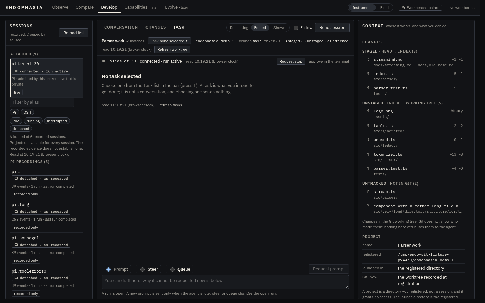
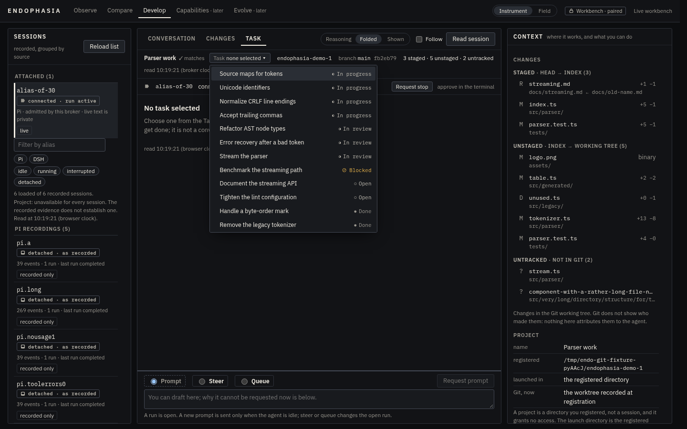
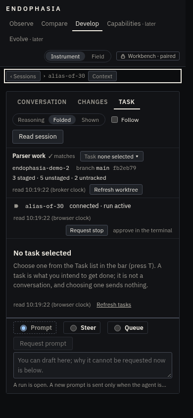
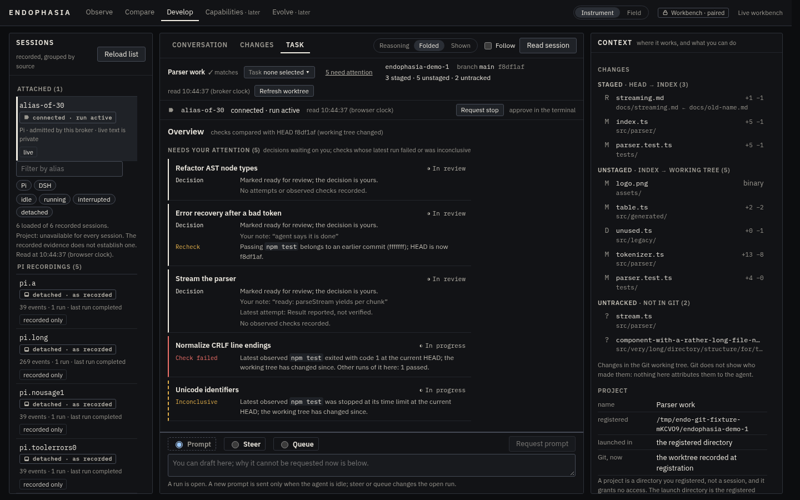
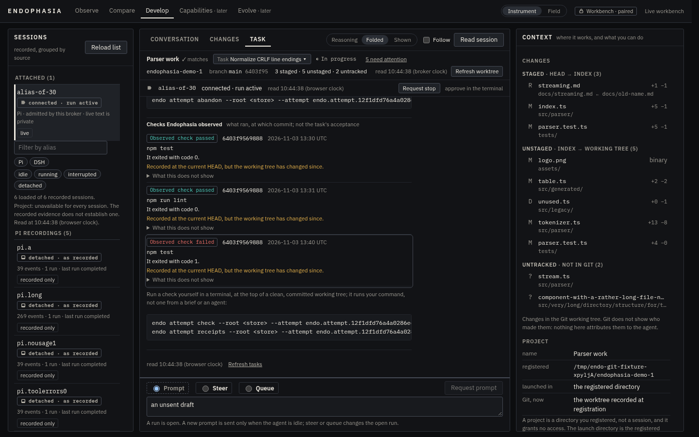
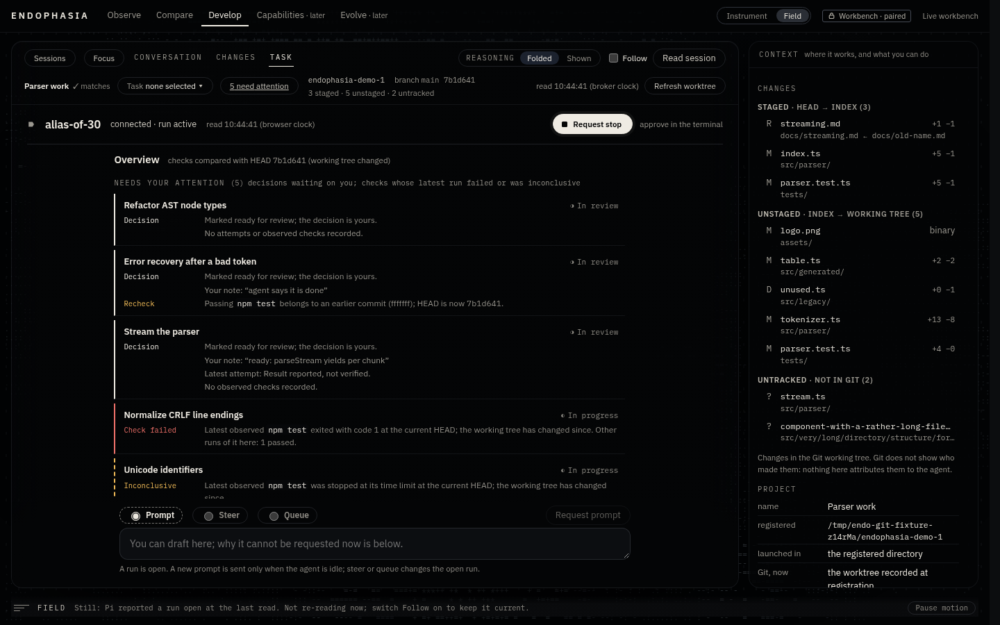
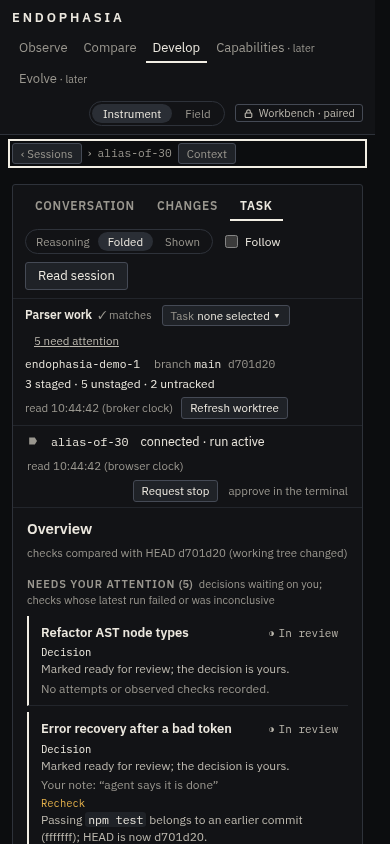
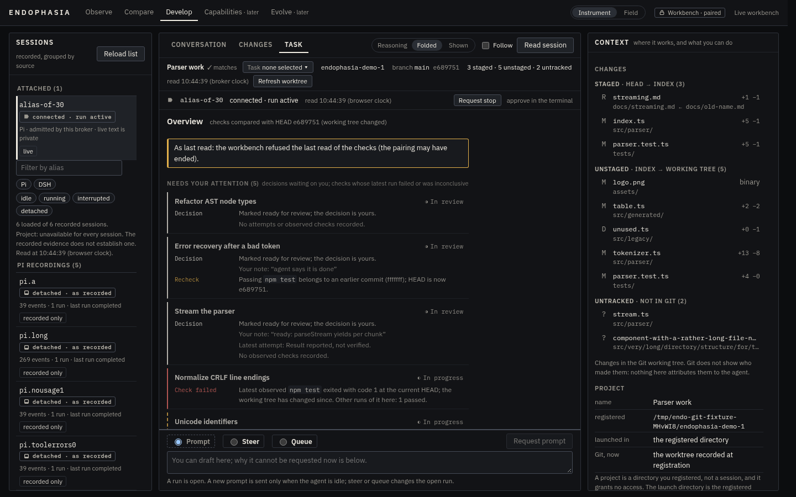

# DEVELOP Slice G: the attention overview

Status: implemented on `feat/develop-attention`. Builds on Slice E (work attempts, [develop-work-attempts.md](develop-work-attempts.md))
and Slice F (verification receipts, [develop-verification-receipts.md](develop-verification-receipts.md)).

**Question:** when the operator opens DEVELOP, what needs them, and why? The answer comes from what is recorded and observed. Nothing
is generated: no model, no score, no guess at progress.

## 1. The interface before this change

What the Task tab offered (see the "before" screenshots below):

- **The worktree bar** holds the project cluster: the name, whether the launch matches its registration, a **Task** picker, and the
  chosen task's status. The picker lists every task with its status, ordered by status, but nothing about evidence.
- **The Task tab** sits beside Conversation and Changes and shows one task: its words, status buttons, session references, attempts and
  (inside each attempt) its receipts. With no task chosen it was an empty pane reading "No task selected".
- **The Context column** is mostly the changed files, then the project facts and the worktree. It is already full at 1440 px.
- **The composer** is docked under all three tabs. Its words survive switching tabs.

What the operator could not see was the project. To learn which tasks had a failing check, they had to choose each task and open each
attempt. And the attempts route serves **only the selected task**, so the page had no truthful way to compute anything project-wide
from what it held.

| Before: no task chosen | Before: the picker (status only) | Before: 390 px |
| --- | --- | --- |
|  |  |  |

## 2. What changes

1. **An overview in the Task tab.** It replaces the empty "No task selected" pane, and the Task tab opens on it. A **‹ Overview**
   button above a task's details returns to it. The overview has four sections:
   - **Needs your attention**;
   - **In progress or blocked**;
   - **Open** (eight shown, the rest on request);
   - **Done**, folded away.
2. **One quiet line in the worktree bar**, for example "5 need attention". It appears only once the checks have been read and only
   when the count is above zero. It opens the overview, so the answer is reachable from Conversation without a new tab or a dashboard.
3. **Opening a row** chooses its task exactly as the picker does. When the row is about a check, that attempt opens and the receipt is
   scrolled to, focused and outlined.
4. **One read-only route, `GET workspace/attention`.** It is a bounded projection of every open task's attempts and latest checks
   (§4).

Nothing was moved or removed apart from the empty pane. The picker, `T`, the status buttons, the attempts and receipts views, the
Context column and the composer are unchanged.

## 3. The attention model

### What a row can say, and the fact behind each line

| Line (word shown) | When | Fact it follows from |
| --- | --- | --- |
| **Decision**: "Marked ready for review; the decision is yours." | status is `review` | the operator's own status |
| **Check failed**: "Latest observed `cmd` exited with code N …" | a command's latest receipt is `failed` | an observed receipt |
| **Inconclusive**: "Latest observed `cmd` was stopped at its time limit …" | a command's latest receipt is `inconclusive` | an observed receipt |
| **Recheck**: "Passing `cmd` belongs to an earlier commit …" | a review task's command passed, but not at the current clean HEAD | receipt plus HEAD now |
| "Marked blocked by you." and "Your note: …" | status is `blocked` (the note is the operator's own) | the operator's own status |
| "Latest attempt: Result reported, not verified." | newest attempt has an outcome | the operator's records |
| **Incomplete**: "One attempt's checks could not be read …" | unreadable directory, unusable files, read limit | the read itself |
| "No attempts or observed checks recorded." | a review task with none | absence, said as absence |

Every check line also says **where the check was recorded** relative to this worktree's HEAD now. The relations are never collapsed into
one "stale":

| Relation | Words |
| --- | --- |
| `at-head` | "at the current HEAD" |
| `at-head-changed` | "at the current HEAD; the working tree has changed since" |
| `head-differs` | "at an earlier commit (abc1234)" |
| `other-worktree` | "in a different working tree; not compared with this one" |
| `other-repository` | "in a different repository; not compared" |
| `unavailable` | "it cannot currently be compared with this worktree" (and one note for the whole read) |

### Which receipt is summarised

For each task, receipts are grouped into **checks**: one exact argv, run in one working tree of one repository. Within a check, the
latest is chosen in two steps:

1. If any receipt is at the current HEAD (`at-head` or `at-head-changed`), only those receipts are candidates.
2. Among the candidates, the latest is the one with the greatest start time, then end time, then id.

The check's other receipts are only counted ("Other runs of it here: 1 failed"). Consequences:

- an older pass never hides a newer failure of the same command;
- a later pass of **another** command (`npm run lint`) never hides a failure of `npm test`;
- a pass in **another worktree or clone** is a separate check, listed with its own relation, and never hides a failure here;
- a pass recorded later at an **older commit** (a bisect, an old checkout) never hides a failure at HEAD. Once HEAD moves past both,
  the newest run is the latest again;
- receipts are grouped across the task's attempts, because a check is about the code, not about the attempt.

A command whose latest run passed after an earlier failure is resolved. It is not attention.

### Precedence and ordering

A task appears **once**, in the first section that applies:

1. **Done**: always "Done". Its receipts are not read. Finished work is never urgent because an old attempt failed.
2. **Needs your attention**: any of `decision` (review), `failed`, `inconclusive`, or `reconsider` (only together with a decision). Rows
   are ordered by their first flag in that order. Within a flag, the most recent comes first: when the task entered review, or when its
   failing (or inconclusive) check ended. Ties are broken by task id.
3. **In progress or blocked**: blocked first, then in progress; within each, the most recent status change first; then id.
4. **Open** (not started): the most recently touched first; then id. An open task with a failed check is attention, like any other.

**What does not raise attention, on purpose:**

- **A stale or uncompared pass on a task that is not in review.** Work moves HEAD constantly, so every pass would go stale after every
  commit. That would be fabricated urgency. The row still says it ("passed at an earlier commit"). The asymmetry is deliberate: a
  **failure** at an earlier commit still raises "Check failed", because it is the latest thing known about that command and nothing
  newer contradicts it. The line names the commit, so the operator can judge whether it still applies.
- **No receipts.** Missing evidence is shown as missing, never as a failure.
- **A handoff.** It is the operator's statement, never a sign that anyone is working.
- **A blocked task.** It is the operator's status and may be waiting on someone else. It leads its section, but is not "attention".
- **Unreadable or truncated evidence**, including attempt records that cannot be used. It is said on the row, or for the whole read
  when a damaged record cannot be placed with a task ("Incomplete"). It neither raises nor lowers the task.

The classification is `overviewOf` in `studio-ui/src/model/attention.ts`. It is pure, with no clock, network, React or randomness, so
the same tasks and evidence always give the same sections in the same order (tested by shuffling).

## 4. Data: the smallest correct project-wide read

The selected-task attempts response cannot be turned into a project-wide list, because it covers one task. So this slice adds one
projection:

- **`GET workspace/attention`** returns `endo.develop-attention-view.v0`, from `protocol/develop-attention.ts`, computed by
  `runtime/contracts/develop-attention.ts`.
- **The project** is the launch's own, taken from `--project`. The directory compared with is the launch's own. The request carries no
  query, path or body.
- **The same grant as every workspace route.** The broker now also re-checks the grant after the awaited read and before answering, so
  a pairing revoked during a read gets a 401, not data. This also protects `GET workspace/attempts`, which had the same window.
- **Reuse.** The projection uses the existing stores (`read()` only), the receipts' own `endoReceiptRelationV0`, and the same
  display-text sanitiser as the attempts view. It writes nothing; a test compares every file's bytes and stamps after repeated reads.
- **One Git observation per read.** The launch directory's HEAD is observed once with the read-only observer the attempts view uses.
  Nothing is observed per task or per receipt, and there is no loop or watcher. A read happens when the attempts are read: after each
  good workspace read (the first one, the operator's Refresh, or their own change).
- **What it carries.** For each task that is not done: the attempt count, the newest attempt's id, state and time, and the latest
  receipt of up to 5 distinct commands (failed, then inconclusive, then passed). For each check: the command shown at most 160 characters, ids, commit, times,
  execution, reasons, relation, and the counts of the check's other runs by outcome. Plus the counts of unreadable attempts, unusable files and skipped attempts.
  It carries no path, executable, branch, objective, brief or note. The task's words and statuses come from the workspace read the page
  already has, so there is one source of truth for status. If the two reads disagree (`taskRevision`), the overview says so.

### Bounds

Done tasks are not read. At most **1,000 receipt files**, and **8 MiB** of them by their sizes, are read for the whole project. An attempt
directory holding more files or bytes than what is left is not read at all: the new `DevelopReceiptsStoreV0.readAtMost` checks the
entries' sizes and refuses before reading any file. Reading goes in a fixed order:

- review, then in progress, then blocked, then open;
- newest attempt first.

So the limit always falls on the same attempts. When it is hit, the attempts left over are counted as `skipped`, the view is
`truncated`, and both are said on the page. Responses are bounded by the task file's own limit of 300 tasks, times 5 checks of bounded
size.

### The page's gate

`readAttention` (`studio-ui/src/model/attention-wire.ts`) refuses the whole body when it:

- has unknown keys or an over-long command;
- has a check whose outcome does not follow from its execution and reasons;
- claims a current relation without an observed HEAD, or claims `unavailable` with one;
- claims `head-differs` at the HEAD commit;
- has duplicate tasks or receipts;
- has skipped attempts without truncation.

The protocol's limits are mirrored in the gate and held equal by a test, because the page imports the protocol only as types.

## 5. Trust and refresh on the page

| Situation | What the page shows |
| --- | --- |
| Current read of tasks and checks | the overview, "Read HH:MM", the HEAD compared with |
| A later read failed, or the workbench refused it | the last read, dimmed, under "As last read: …" saying why |
| The pairing is gone | the same, "this page no longer holds a pairing" |
| The checks were never read, or the route is absent | statuses only, and one sentence: no checks are shown, so an empty list is not "all clear" |
| HEAD could not be observed | every check "cannot currently be compared", and one note for the read |
| Evidence stale against HEAD | per check, in the relation's own words (§3) |

**Reads.** The attention read uses the same reader as the attempts. `LaunchReader<V>` (`model/attempts-reader.ts`) is the Slice E reader
made generic:

- one read at a time, and a refresh asked for during a read is queued;
- a launch or pairing change aborts the read in flight and makes it obsolete, so its answer changes nothing.

**Launches.** A projection is used only if its `launchId` is the one that served the tasks (`evidenceOf`). A different launch resets
the pane and the focus, as it already reset tasks and drafts.

**What the page stores.** Nothing new: the pane and the receipt focus are memory only.

## 6. Interaction

- **Pointer.** A row is one button, and clicking it opens the task and, when the row is about a check, that receipt.
- **Keyboard.**
  - ↓/↑ (or `j`/`k`) and Home/End move between the overview's rows; Enter opens one.
  - `T` still opens the picker, and Escape still returns to Conversation.
  - Focus is visible as a 2px outline.
- **Drafts.** The composer's words and unsaved task edits survive moving between the overview and tasks. Both are tested.
- **What opening a row does.** It sends no prompt, selects no session and moves no status. Choosing a task in a writable workspace
  remembers the choice (`POST workspace/tasks/select`, the picker's request). The browser tests assert this is the only write request.
- **Visual language.** Each line carries its word (Decision, Check failed, Inconclusive, Recheck, Incomplete). The row's edge has a 2px
  rule in the matching colour, so meaning never depends on colour alone. There is no animation, and the count waits for the checks so
  it does not change as they arrive. Both appearances (Instrument and Field) are styled, and narrow screens stack each line's word
  above its text.

| Overview (Instrument, 1440) | Opened from a row: the receipt it is about |
| --- | --- |
|  |  |

| Field, 1440 | 390 px | As last read, after a refused read |
| --- | --- | --- |
|  |  |  |

## 7. Limitations

- **"Latest" means the most recent start time.** It follows the recording machine's wall clock. Two overlapping runs of one command
  are ordered by when they started.
- **Two commands are the same only if their argv is identical.** `npm test` and `npm test -- --run` are separate commands, so a failure
  of one is not cleared by a pass of the other. This is conservative, on purpose.
- **Only five commands are listed per task.** The rest are counted, and counted separately if they did not pass.
- **Stale passes on tasks not in review do not raise attention** (§3). They are shown on the row.
- **The overview is as fresh as the last explicit read.** Commits made since then are not seen until Refresh. Nothing polls.
- **A read-only launch** (another directory, or the project's directory gone) can open a task but cannot remember the choice. The
  attempts beside a task are still those of the task selected in the store; this behaviour is unchanged from Slice E.
- **The operator has not yet used this in daily work.** The precedence rules are deliberately few and documented here, so they can be
  changed after feedback without touching data.

## 8. Manual smoke

```sh
root=$(mktemp -d); repo=$(mktemp -d); git -C "$repo" init -q && git -C "$repo" commit -q --allow-empty -m init
endo project add --root "$root" --name demo --path "$repo"                         # prints endo.project.<P>
endo task add --root "$root" --project <P> --title "Review me"                    # prints endo.task.<T1>
endo task add --root "$root" --project <P> --title "Checks"                       # prints endo.task.<T2>
endo task status --root "$root" --project <P> --task <T1> --to in-progress
endo task status --root "$root" --project <P> --task <T1> --to review
endo task status --root "$root" --project <P> --task <T2> --to in-progress
endo attempt prepare --root "$root" --project <P> --task <T2> --objective "Try"   # prints endo.attempt.<A>
(cd "$repo" && endo attempt check --root "$root" --attempt <A> -- false)          # exit 3: Observed check failed
endo harness attach --root "$root" --cwd "$repo" --control --workbench --project <P>
```

The CLI steps were run on this branch: `check` exits 3, and the projection reports `false` as failed with `exited` code 1.

In the workbench:

1. Pair the page. The bar says "2 need attention".
2. Click it, or open **Task**. The overview lists "Review me" (Decision) and "Checks" (Check failed: `false` exited with code 1 at the
   current HEAD).
3. Press ↓ and Enter on "Checks". Its attempt opens, with the failed receipt outlined and focused.
4. Go back with **‹ Overview**. Make an empty commit in the repository and press **Refresh**. The failure now reads "at an earlier
   commit (…)".
5. Mark "Checks" done with its status button. After the refresh it moves to **Done** and its failure is no longer shown.
6. Throughout, the composer's words stay, and no status changes unless you press a status button.

## 9. Review

A fresh-context reviewer (a separate agent with no part in writing the change; not the Elephant–Goldfish plugin, which is not installed)
read the design, the code, the tests and the screenshots. They ran the new tests, and assessed four questions: whether every label is
justified by the data, the boundaries, cognitive load, and complexity.

On the boundaries, they found:

- the route takes no query or path;
- the page uses a projection only from the launch that served the tasks;
- a launch or pairing change makes a read in flight obsolete;
- the broker re-checks the grant after the awaited read;
- `endo studio` has no such route;
- nothing is written.

On the UI, they found that it replaces the empty pane rather than adding a dashboard, and that every coloured rule has a word.

| # | Finding | Severity | Resolution |
| --- | --- | --- | --- |
| 1 | A later pass in another worktree or clone, or at an older commit, became the command's "latest" and hid a failure at the current HEAD | material | Fixed. Checks are grouped by argv, repository and worktree, and a receipt at the current HEAD outranks any at another commit. Test added; both halves of the fix were mutation-checked (each reverted alone fails it). |
| 2 | "No observed checks recorded." was said even when some checks could not be read | minor | Fixed: said only when everything was read; otherwise "No observed checks were read." |
| 3 | The empty attention sentence read as "all clear" even when some tasks had unread checks | minor | Fixed: it says "among the checks that were read" and points to the tasks that say what was not read. |
| 4 | The bar's count stayed after a refused or failed read, with no qualifier | minor | Fixed: the count is shown only when both reads are current and the page is paired. |
| 5 | "Read HH:MM" was the tasks' read time, shown beside possibly older checks | minor | Fixed: it now reads "Tasks read HH:MM", and the "As last read" note covers the checks. |
| 6 | Up to about 128 MiB of synchronous reads after every workspace read | minor | Fixed: 1,000 files and an 8 MiB byte budget, checked from the entries' sizes before any file is read. Test added. |
| 7 | The asymmetry between a stale failure and a stale pass was not stated | nit | Stated in §3. |
| 8 | Reader duplication and casts | nit | The duplicate initial state was removed. The reply union keeps `kind: string` so that the attempts reply shape is unchanged. |

### Codex review of the PR

| # | Finding | Resolution |
| --- | --- | --- |
| 1 | An unusable attempt record is reported by the attempts store as a problem of the directory, and the projection dropped it. A torn prepared record hid its attempt and failing receipt, and the overview said "No attempts or observed checks recorded." with no gap. | Fixed. Problems naming a known attempt are counted on its task (`records`): "its latest attempt's state may be wrong". The rest cannot be placed and are counted for the read (`unattributed`), with a note saying any task may be incomplete. Absence is then claimed only as "…were read", and the empty state is qualified. Test added; mutation-checked. |
| 2 | The bar's attention link left the new-task form open, which took precedence over the overview. | Fixed. The link leaves composing (its words stay in the drafts, as choosing a task already does). Browser test added: the overview opens, and "+ New task…" shows the kept words. Mutation-checked. |
| 3 | The per-task list ordered every non-passing check before the passing ones, but did not order failed before inconclusive. With more than five commands, the limit could cut a failure while keeping newer inconclusive checks, so the task read "Inconclusive". | Fixed. Checks are ordered failed, then inconclusive, then passed (the attention precedence) before the limit is applied. Test added; mutation-checked. |
