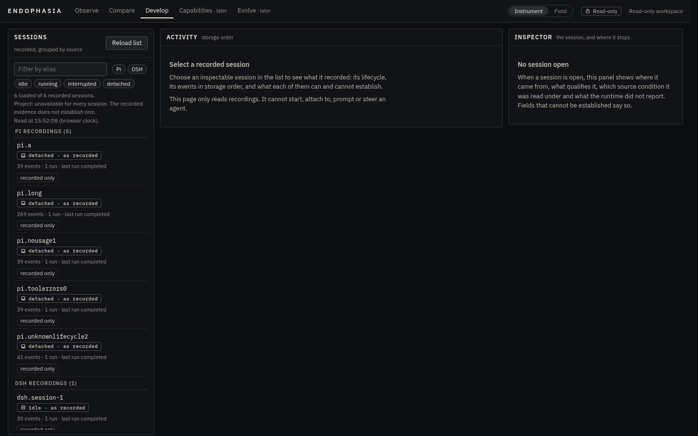
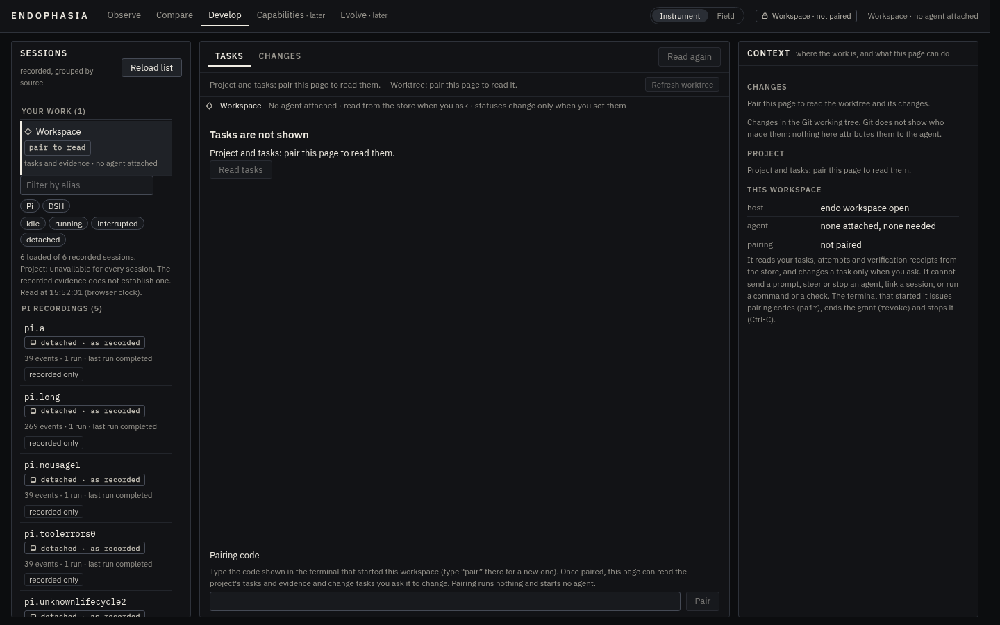
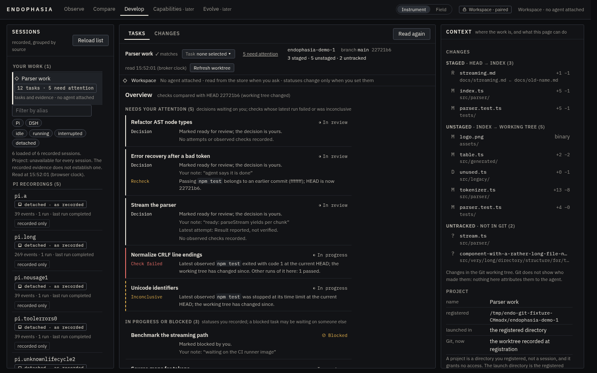
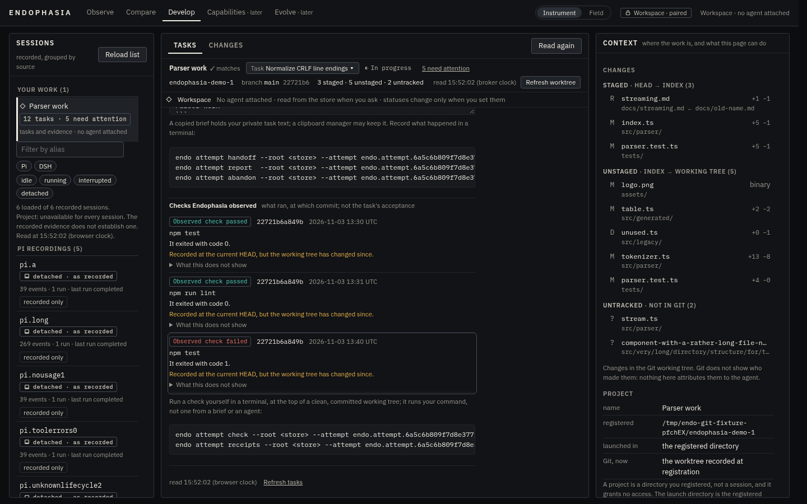
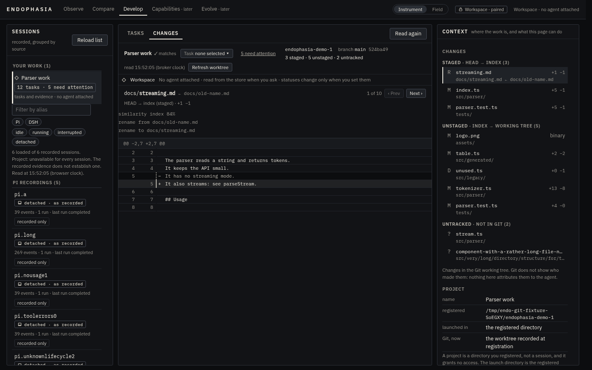
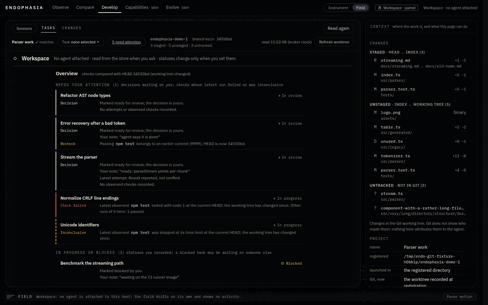
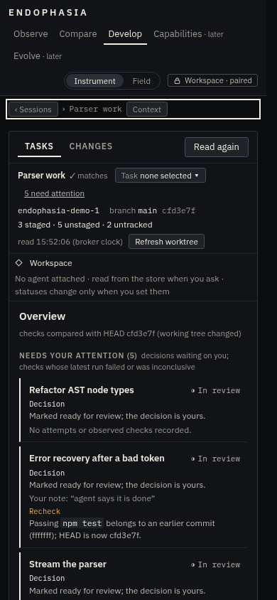
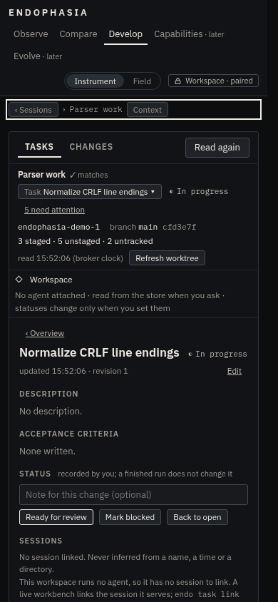
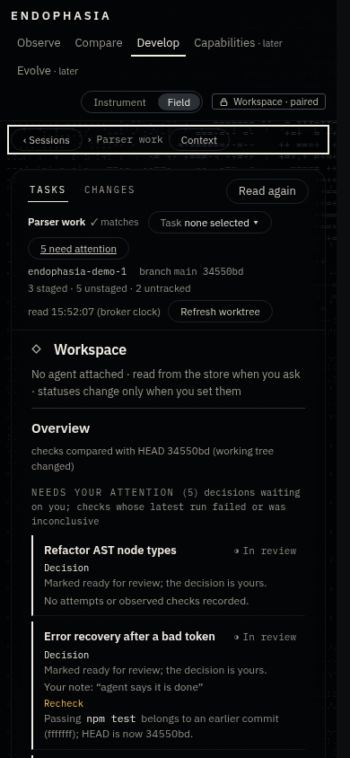
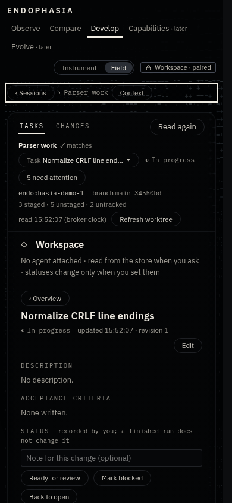

# DEVELOP Slice H: the independent workspace host

Status: implemented on `feat/workspace-host`. Builds on the workspace service ([develop-workspace-service.md](../develop-workspace-service.md)),
work attempts ([develop-work-attempts.md](develop-work-attempts.md)), verification receipts
([develop-verification-receipts.md](develop-verification-receipts.md)) and the attention overview ([develop-attention.md](develop-attention.md)).

**Question:** can an operator open their project's work, see what needs them, read the evidence and manage tasks when no agent is
running? Before this slice, no. The only writable page was the Pi workbench, and it existed only while `endo harness attach --workbench`
held a live Pi child.

**Answer:** `endo workspace open --project <id>` runs a foreground host. It serves the same page and the same task routes behind its own
pairing. It has no harness, no session and no command surface.

## 1. Audit: what was coupled, and what was not

| Component | Finding | Decision |
| --- | --- | --- |
| `runtime/contracts/develop-workspace.ts` (`DevelopWorkspaceServiceV0`, `forLaunch`) | Already harness-neutral. A host with `session: null` is a supported case: nothing can be linked and every reference is historical. | **Unchanged.** |
| Task, attempt, receipt and attention stores and projections | Plain files under `<root>/develop/`, locked, revisioned and validated. They import no adapter. | **Unchanged.** |
| `cockpit-http/server.ts` | Loopback-only. It guards Host, Origin and Fetch Metadata, uses a per-launch capability URL and bounded JSON POSTs, and forwards `api/v0/workbench/*` to an opaque `EndoCockpitWorkbenchV0` handler. | **Unchanged.** The new host is a second implementation of that one interface. |
| `adapters/pi/workbench-tasks.ts` | Pi-free code (it imports only the service) that lived under `adapters/pi/`. | **Moved** to `runtime/contracts/workspace-routes.ts`, together with the read-only project-route translation that was inline in the broker. |
| `adapters/pi/workbench.ts` (the broker) | Pairing and grant code is mixed with the Pi session, the transcript and prompt dispatch. | **Pairing extracted** to `runtime/contracts/workbench-pairing.ts` with no change in behaviour. The broker keeps everything that commands Pi. |
| `cli/workbench.ts` | Built the service (attempts, receipts, a Git HEAD observer) inline. | **Shared**: `cli/develop-service.ts` builds it once for both hosts. |
| `cli/studio.ts` (`endo studio`) | Read-only by construction: it never passes a workbench handler, so the server has no POST route. | **Unchanged.** It still gets no write route. |
| `studio-ui` | The Task view, the overview and the attempts and receipts live **inside** the live-conversation panel. A server without Pi is shown as "Read-only". | A **desk** shell for workspace mode reuses `TaskPanel`, `AttentionOverview`, `AttemptsSection`, `WorktreeBar`, `DiffView`, `ChangesList` and `ProjectBlock` unchanged. Small, explicit changes cover `harness: none`. |

The smallest safe boundary is therefore the existing `EndoCockpitWorkbenchV0` interface. Everything below it (the service and stores)
and above it (the server and its guards) already exists. The new code is one small handler, one CLI command, and a page shell.

## 2. Why a distinct command, not `endo studio --project`

`endo studio` is read-only, and its tests and docs promise that. Giving it a `--project` flag would make one command sometimes
writable, depending on a flag. That is the kind of conditional authority an operator can misread. `endo workspace open` is a separate
verb with a separate startup line, "Endophasia workspace (tasks writable after pairing, no agent)". It can be refused, documented and
tested on its own. Both commands share the host module (`cockpit-http/host.ts`), the server and the page. Neither carries the other's
capabilities.

## 3. Architecture and authority

```
 operator's terminal                                  browser (same machine)
 ───────────────────                                  ──────────────────────
 endo workspace open --project p                       http://127.0.0.1:<port>/<capability>/        
   │  prints: address (stdout), pairing code (stderr)        │ types the code once → grant (page memory only)
   │  reads:  `pair` (new code), `revoke` (drop grant)       │
   ▼                                                         ▼
 ┌───────────────────────────── cockpit-http/server.ts (unchanged) ─────────────────────────────┐
 │ loopback bind · exact Host · Origin / Sec-Fetch-Site · capability path · GET or bounded JSON  │
 │ POST from an exact same origin · closed refusals · no CORS                                     │
 └──────────────┬────────────────────────────────────────────────┬─────────────────────────────┘
   recorded reads (unchanged: snapshot, develop, compare…)   api/v0/workbench/* → handler.handle()
                                                                 │
              ┌──────────────────────────────────────────────────┴──────────┐
              │ EndoWorkspaceHostV0 (cockpit-http/workspace-host.ts)         │  ← NEW, imports no harness adapter
              │  status (no grant) · pair (code → grant)                     │
              │  ── grant required, and re-checked after every await ──      │
              │  workspace/*  → EndoWorkspaceRoutesV0 (moved, unchanged)     │
              │  project, project/diff → endoProjectRouteV0 (moved)          │
              │  anything else (transcript, prompt, intervention…) → 404     │
              └───────┬────────────────────────────────────────┬────────────┘
                      │ launch scope (session: null)            │ read-only Git
          DevelopWorkspaceServiceV0.forLaunch                   GitProjectInspectorV0 · GitRevisionObserverV0
                      │
     <root>/develop/tasks.json · attempts/ · receipts/   (same stores, locks, revisions as `endo task`, `endo attempt`)
```

### Who may do what

| Actor | May | May not |
| --- | --- | --- |
| Whoever reads the **address** | load the page; read recorded evidence exactly as `endo studio` serves it; ask `workbench/status` (launch id, paired yes or no, `harness: null`) | read a task title, a description, an attempt, a receipt or a diff; change anything |
| A page holding the **grant** (the terminal's one-time code, typed into the page) | read the project, tasks, attempts, briefs, receipts, the attention projection, and the worktree's changed files and diffs; create and edit tasks; set a status along the file's transition rules against the revision it saw; choose the selected task; remove a session reference | link a session (refused: `no-session`, because this host has none); send a prompt, steer, queue or stop (no such route); read a transcript (no such route); name a path, repository, project or evidence root (nothing in a request selects one); run a command or a check |
| The **operator's terminal** | issue a new code (`pair`), revoke the grant (`revoke`), stop the host (Ctrl-C) | (nothing on the page can do these) |

A workspace grant is **not** a workbench grant. The two are different objects in different processes with different random tokens. A
workspace host has no prompt, intervention or transcript code to call, and its route table has no such entries. It is not that those
entries exist and are disabled.

### Adversarial review of the transport (inherited, re-tested)

- **DNS rebinding.** A rebound name arrives with its own `Host` and gets 421. The test sends `Host: evil.example:<port>`.
- **Cross-origin requests.** A foreign `Origin` or `Sec-Fetch-Site: cross-site` gets 403. A POST without an exact same-origin `Origin`,
  without `application/json`, or with an oversized or chunked body is refused before the handler runs.
- **Grant leakage.** The grant lives in page memory and is sent in one custom header. It is never in a URL, a cookie, storage, a log or
  a response, apart from the pairing reply. A custom header also forces a CORS preflight that the server never approves.
- **Stale grants.** A grant expires after 1 hour, and a new pairing replaces it. `revoke` drops it, and so does stopping the host.
  Pairing codes are single-use, expire after 10 minutes and are discarded after 5 wrong tries. Every refusal looks the same.
- **Revocation during an in-flight read.** The attempts, attention and project reads await Git. The host checks the grant again
  **after** the await and answers 401 if it no longer holds, so no data that looks current leaves after a revocation. A test holds the
  Git observation open, revokes the grant, then releases the read.

## 4. Lifecycle

1. **Arguments.** The store root (as every `endo` command takes it), `--project <id>` (required), and optional `--port n` and
   `--key-file path`. Invalid arguments exit with status 2 before anything is created.
2. **Project.** The task file is read once. An unreadable file, or an id that names no project, exits with status 1. The latter case
   lists the registered ids. The **project's registered directory** becomes the launch directory. The host has no other directory to
   offer, so there is no "launch elsewhere" case. If that directory goes missing later, the service turns the workspace read-only
   (`project-missing`), as it already does.
3. **Page and key.** The page's files are checked against their manifest. The dedicated cockpit key is loaded, or created once.
4. **Listen.** The host binds 127.0.0.1 only.
5. **Announce.** Stop handlers are attached first. Then the host prints the project line and the pairing code on stderr, and the
   address last on stdout. The served page carries `data-start="develop"` on its root element, so it opens on DEVELOP. That costs no extra request, and `endo studio` still serves its page byte for byte.
6. **Serve** until SIGINT or SIGTERM, or Ctrl-C at an interactive terminal. On stop the host revokes the grant, forgets the code,
   disposes of the Git inspector, closes the server and every connection, and exits 0. No file is written on the way out. Every write
   was already complete and atomic when its request was answered.
7. **Restart** is a new launch: a new capability, a new launch id and a new code. Everything durable is in the store, so the same
   tasks, attempts and receipts reappear. A page left open from the previous launch cannot reach the new one, because its capability
   URL is gone.

No daemon, scheduler, watcher, event bus or database is added. The host polls nothing and reads only when the page asks.

## 5. The page in workspace mode

- `workbench/status` answers `endo.workspace-host-status.v0` with `harness: null`. The page records this as availability
  `workspace`, a distinct value. It is neither the live `available` nor the read-only `absent`.
- DEVELOP's navigator gets a **Workspace** row in place of the live Pi row. Selecting it shows the **desk**: a Tasks | Changes tab pair
  over the same worktree bar (project, picker, "N need attention"), and the same Task view. The overview comes first, a row opens a
  task, and **‹ Overview** returns to it. The Context column shows the changed files, the project, the worktree, and a short **Host**
  block. That block says what this host is, a workspace host with no agent attached, and what it cannot do.
- Nothing says "disconnected". The run strip, composer, Follow, reasoning and Pi controls are not drawn, because there is nothing for
  them to describe. Where the Task view explains session links, it now says "This workspace host runs no agent, so it has no session to
  link" instead of "No connected session to link".
- Recorded sessions remain in the navigator, as in `endo studio`. Opening one leaves the desk, and the Workspace row brings it back
  with its drafts, pane and focus intact.
- **Reading context is kept.** Returning to the overview focuses the row of the task just read. The open sections ("Show all" and
  "Done") stay as the operator left them. Unsaved task edits are kept per task, as before.
- **Field** gets one new sentence and no new appearance: "Workspace: no agent is attached to this host; the field drifts on its own
  and shows no activity."

## 6. Evidence semantics: unchanged by construction

The host calls the same `attentionView()` and `attemptsView()` as the workbench. They compare receipts with the HEAD of the project's
registered directory, observed once per read. Every receipt-relation distinction carries over unchanged: at-head, at-head-changed,
different-head, other worktree, other repository, unavailable. So do unreadable versus empty, truncated, `records` and `unattributed`.
Nothing is promoted, accepted or re-run. The only change is which directory is the launch directory: the project's registered one,
since the host is not started from an agent's working directory.

## 7. Rejected alternatives

| Alternative | Why not |
| --- | --- |
| `endo studio --project` | Conditional authority on a read-only command (§2). |
| A fake Pi attachment so the broker can run without Pi | It would put prompt, transcript and intervention code paths in a process that must not have them, and make "no harness" look like "a harness that is disconnected". |
| One generic "harness host" abstraction over Pi, Codex and Claude Code | Speculative, and it would presume control operations that those harnesses may not offer. The neutral parts (pairing, task routes, project routes) are extracted, and that is all a later adapter needs. |
| A background daemon serving every project | A permanent process and a multi-project authority model. Out of scope, and not needed for the workflow. |
| Browser-chosen project or store | It would turn a URL into a filesystem selector. Scope is fixed when the operator starts the host. |
| Cookie or `localStorage` grant | A grant that outlives the page and leaks into storage. The grant stays in memory, so a reload pairs again. |

## 8. Acceptance criteria (each is a test)

1. With **no `pi` on `PATH`**, `endo workspace open` starts, prints an address and a code, and serves the page.
   (`tests/endo-workspace-cli.test.ts`)
2. Pair, read tasks, read the attention projection with a failed check, change a status, and the task file shows the change, made by
   the same store rules as `endo task status`. Stop with SIGINT and the exit status is 0. Restart and the change is still there. A
   change made with `endo task` while the host runs appears on the next read. (CLI test)
3. Unpaired, expired, revoked and replaced grants cannot read or write, and a grant revoked during an awaited read gets 401.
   (`tests/endo-workspace-host.test.ts`)
4. Foreign Origin, rebound Host, cross-site fetch metadata, non-JSON or oversized bodies, unknown keys, and agent routes (`transcript`,
   `prompt/*`, `intervention/*`) are refused. `link-session` is refused as `no-session` and writes nothing. (host test)
5. Stale revisions are refused. Two concurrent writes against one revision: exactly one succeeds, and the file holds no lost update.
   Read-only routes leave every byte under `develop/` unchanged. A truncated or unreadable evidence read is reported as such. (host test)
6. The host's static import closure contains no `adapters/pi` module except the recorded-evidence projections `endo studio` already
   loads (`mapping`, `lifecycle`, `trajectory`), and nothing from `adapters/rpc-jsonl`, `cli/harness.ts` or `cli/workbench.ts`. (host test)
7. `endo studio` still answers the status constant and refuses every POST. (host test, plus the existing studio tests)
8. In Chromium, at 1440 and 390 px in Instrument and Field: pair, see the overview with a failed check, open the task and its receipt,
   change its status, keep a draft across overview and task, return to the overview with focus on the task's row, and use the keyboard
   throughout. (`tests/endo-studio-workspace-browser.test.ts`, with screenshots)
9. The live Pi workbench tests pass unchanged. That includes pairing, prompts, interventions, tasks, attempts and attention.

## 9. Deferred (ranked by operator benefit)

1. **Preparing an attempt and recording a handoff from the page.** These are the next most common CLI round-trips.
2. **Running a verification check from the page.** This needs its own authority design, because it executes a command.
3. **A longer or renewable grant for long reading sessions**, decided together with item 2.
4. **Linking an OMP saved session from the page.** This needs the observer's directory to be configured on the host.
5. **A Codex or Claude Code adapter that offers live links.** The service's `DevelopLaunchHostV0` already takes any live source the file
   format admits.

## 10. Usage

```sh
endo project add --name "Parser" --path ~/src/parser      # once; prints the project id
endo workspace open --project endo.project.<id>           # no agent needed; prints a code and a private address
# open the address, type the code; in the terminal: `pair` for a new code, `revoke` to end the grant, Ctrl-C to stop
```

What standalone mode **can** do: show what needs attention (decisions in review; checks whose latest run failed or was inconclusive;
evidence to recheck), each task's attempts, briefs and verification receipts with their exact relation to the current HEAD, and the
registered directory's changed files and diffs. It can also create and edit tasks, set statuses and choose the working task. Recorded
sessions remain readable, as in `endo studio`.

What it **cannot** do: run, prompt, steer, queue or stop any agent; link a session (references made earlier stay, shown as historical);
prepare an attempt, record a handoff or outcome, or run a check (still `endo attempt …`, see §9); or reach any project, store or path
other than the one it was started with.

## 11. Screenshots

These are synthetic fixtures (`tests/endo-studio-workspace-browser.test.ts` with `ENDO_SHOTS_DIR`).

| Before: the same store in `endo studio` (read-only, no tasks) | After: unpaired | After: the overview |
| --- | --- | --- |
|  |  |  |

| A task and the receipt its row was about | Changes | Field, 1440 px |
| --- | --- | --- |
|  |  |  |

| 390 px, Instrument: overview | 390 px, Instrument: task | 390 px, Field: overview | 390 px, Field: task |
| --- | --- | --- | --- |
|  |  |  |  |

## 12. Independent review

A fresh-context subagent reviewed the change adversarially. It did not write the code, and it ran the host and CLI tests itself.
Its brief covered authority, harness neutrality, evidence correctness, shutdown and recovery, UX and abstraction. This was **not** the
Elephant–Goldfish plugin, which is not installed here.

| Finding | Severity | Resolution |
| --- | --- | --- |
| After `revoke` or grant expiry, the desk still said "paired" and hid the pairing form. Only a reload recovered. | material | Any `grant-required` refusal (tasks, attempts, attention, worktree, or a change) now ends this page's pairing, so the pairing form returns and drafts stay (see the Codex row below for why the first fix, a status re-read, was not enough). "Read again" re-reads status too. Covered by two browser tests (revoke then read, revoke then change). A mutation check removes the re-read and the change test fails. |
| (Codex, on the PR) The fix above re-read the host's status, but `paired` there means *some* page holds the grant. When another tab paired, this tab kept its replaced token and never showed the pairing form. | material | A `grant-required` refusal is the host's answer about this page's token, so the page drops its own grant when such a refusal arrives (never for one still on screen from before a re-pairing). The attempts and attention readers now record `grant-required` as `unpaired` rather than as a generic refusal, so a 503 never unpairs. This also applies to the live workbench page, which had the same latent case. Browser test with two tabs, mutation-checked against the status re-read. |
| A refused pairing code gave no feedback on the desk | material | The desk shows the last host answer in a `role=status` live region. The pairing wording no longer says "attached terminal". Browser test. |
| The import-closure test skipped unresolved imports and used a deny-list | minor | It now fails on an unresolved relative import and allow-lists adapter directories (`git`, `pi`, `dsh-native`, `omp`, with `pi` pinned to three recorded-evidence modules). |
| "Workbench" wording left in shared task and overview messages | minor | Neutral wording ("the server", "the next workbench or workspace"). Pi-only approval wording is unchanged. |
| Ctrl-D on stdin silently disabled `pair` and `revoke` | minor | The host says so on stderr and keeps serving until Ctrl-C. |
| A response for a committed write could be dropped by a force-close during shutdown | minor (unverified) | Accepted. The write itself is atomic and complete, and a reopened page shows it. Recorded here. |
| Small duplicated helpers (`isRecord`, `refuse`), and a `WorkbenchProjectSourceV0` alias kept for compatibility | nit | Kept. They are three-line helpers, and sharing them would couple modules for no gain. |

It confirmed these as sound: grants are checked before and after every await; the pairing extraction is byte-equivalent to the
broker's code; the server boundary (Host, Origin, Fetch Metadata, JSON POSTs, capability path, no CORS) is unchanged; `endo studio`
still refuses every POST; no request can choose a scope or a session; and shutdown is clean, with handlers installed before the address
is printed.

Also found during implementation, by existing pins:

- The page's source policy forbids reading its own address, so a `#develop` suffix on the printed address was dropped.
- A status probe at load then broke the read-only Studio's promise of exactly one API read at open.
- The workspace host now marks the page it serves instead (`data-start="develop"`, `endoStartOnDevelopV0`). Studio's page and its
  requests are unchanged.
