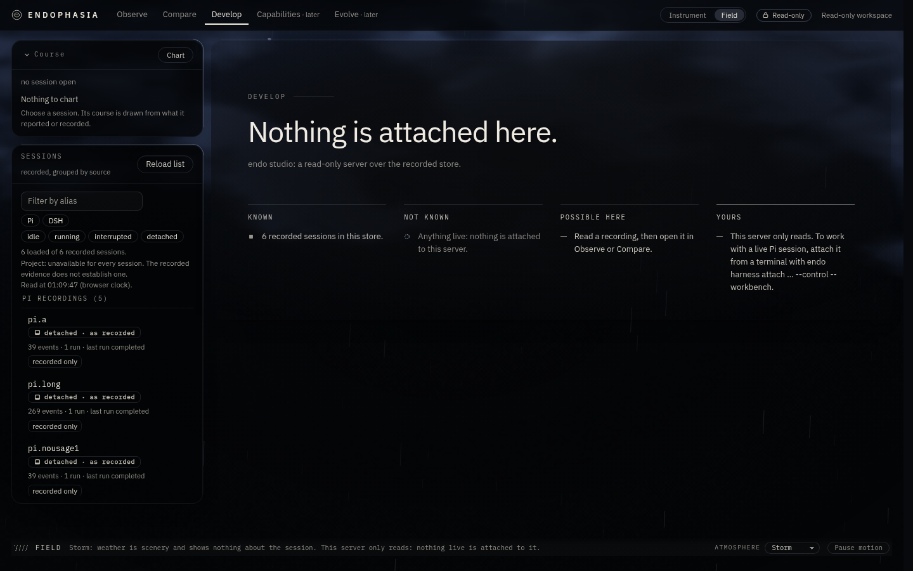
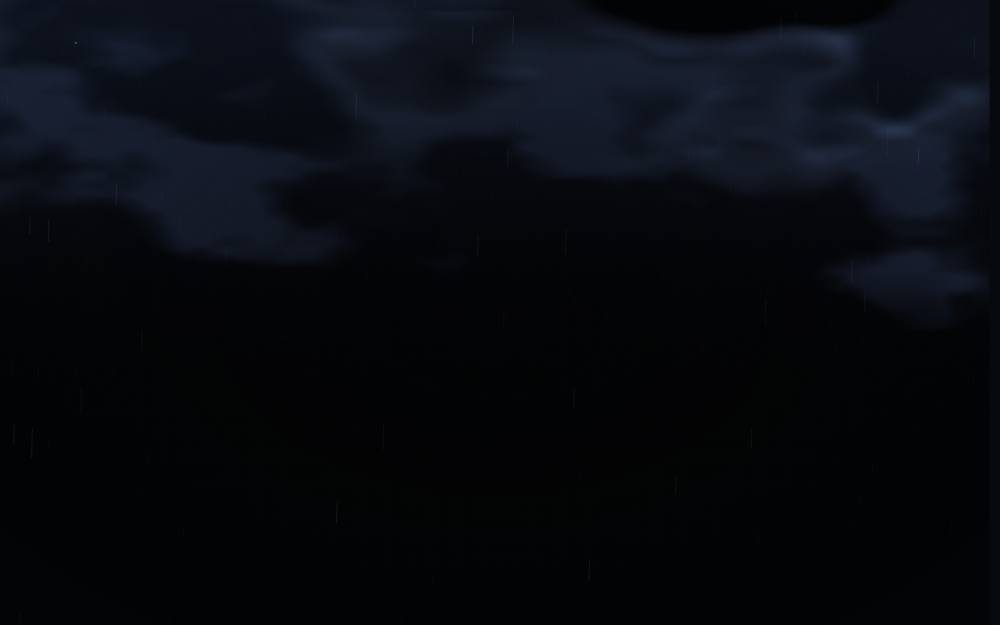
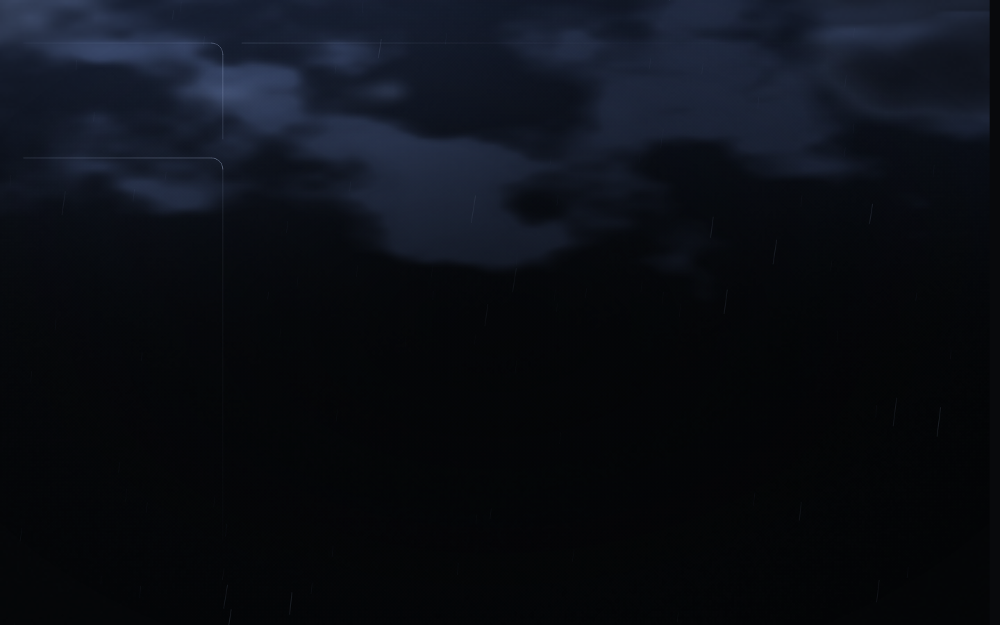
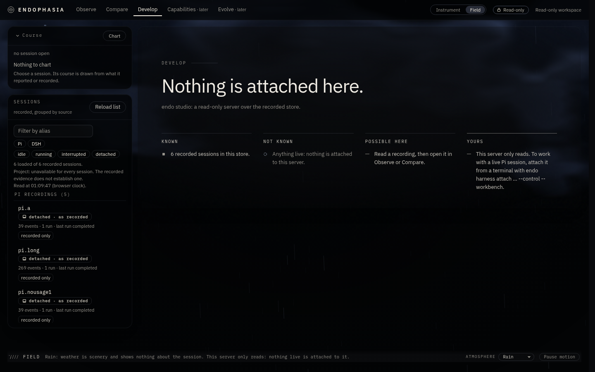
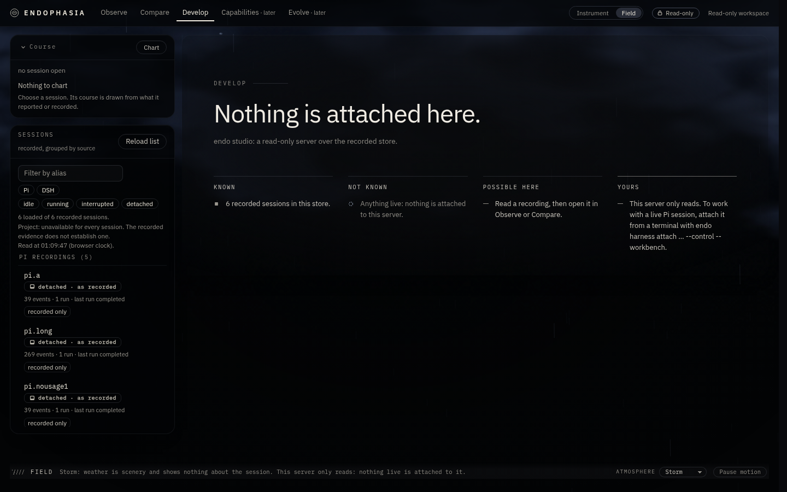
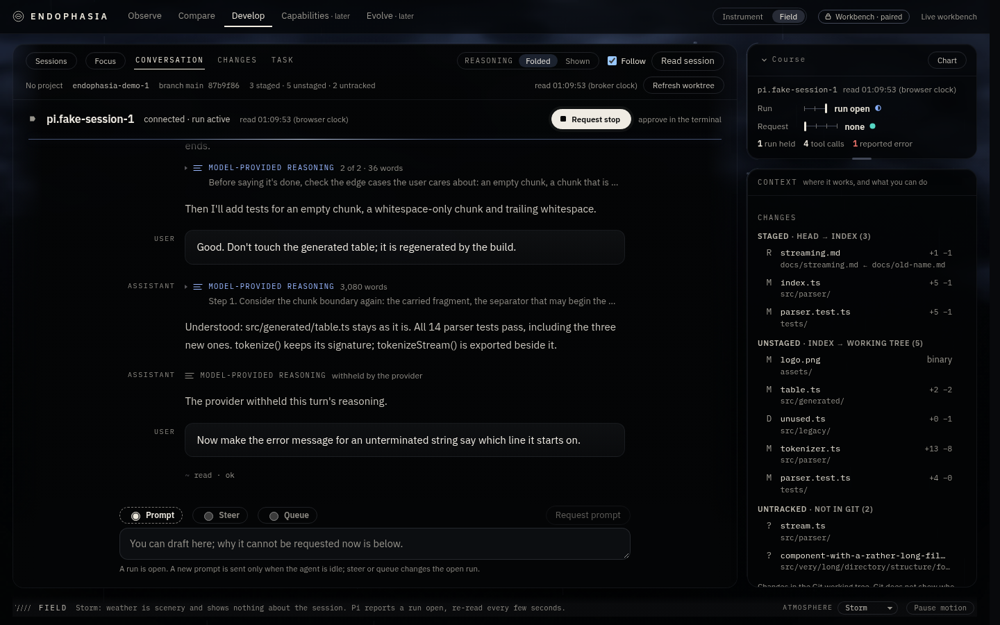
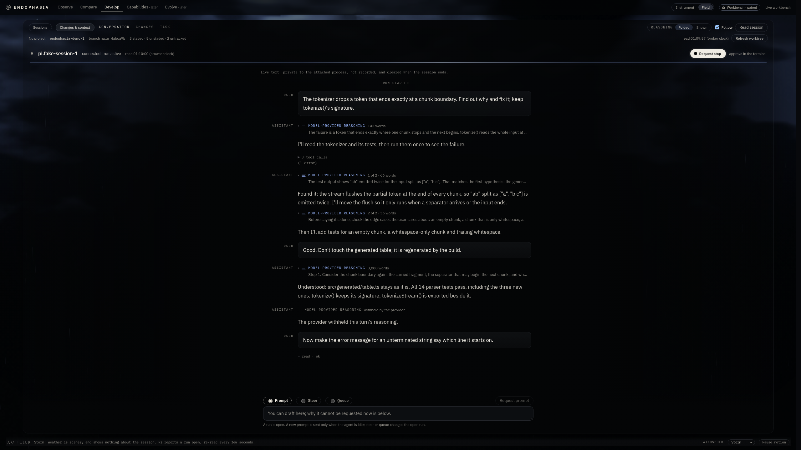
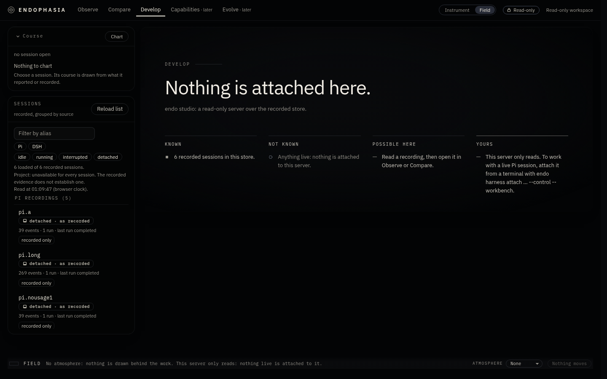
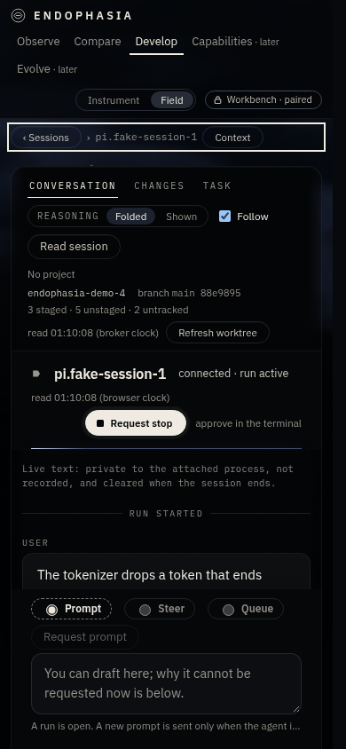
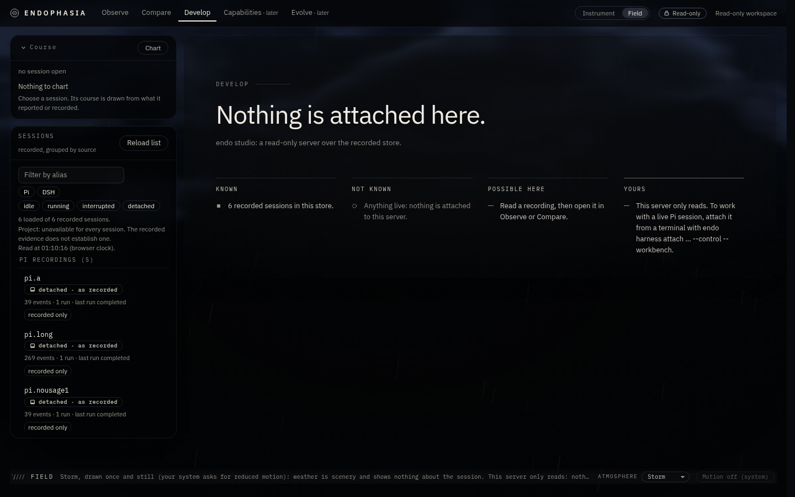

# DEVELOP: Field atmospheres

Field ([develop-field.md](develop-field.md)) draws something behind the work. **Atmosphere** chooses what:

| Atmosphere | What is drawn |
| :-- | :-- |
| **None** | Nothing. A plain near-black ground, no canvas, no animation frame, and no light moving along the horizon. |
| **Contours** | The contour field Field has always drawn, unchanged. It is what Field opens with. |
| **Rain** | A night sky: three layers of cloud drifting at different speeds, sparse dark rain, wind that slowly changes. Now and then a drop lands on a panel's upper edge. |
| **Storm** | Rain, plus distant lightning at long irregular intervals. A stroke glows inside the clouds, and the panel edges that face it catch a hairline of light. |

Choose it with **Atmosphere** in the legend at the foot of the page (a native select: Tab to it, then the arrow keys). It is separate from
the *Instrument | Field* switch. The choice lives in page memory, like the appearance: a reload is the contours again. Choosing changes
the drawing and nothing else: the draft, the open file, the view, the conversation's place and the session stay as they were.

Every image here is of the real built page in headless Chromium with synthetic fixtures. Frames named *strike* are held by the test at a
stroke's brightest frame, which lasts about a thirtieth of a second in use. Nobody has yet watched this in motion on a real display:
see §8.

## 1. Weather is scenery

Rain and lightning mean nothing. The weather renderer is given two things: which weather, and whether the operator paused motion. It
is not given the field's signal, a count, or any text, and a source test holds that. Rain does not fall harder while Pi works; a
stroke is not an event of the session.

What the page knows is still said, in the two places that already said it:

- **The horizon** under the run strip keeps its state colours under every atmosphere. With None, its moving light is stopped, because
  with None nothing on the page moves by itself.
- **The legend** says first what is drawn, then what is known, in a sentence that describes no motion:
  *"Storm: weather is scenery and shows nothing about the session. Pi reports a run open, re-read every few seconds."* Under the
  contours the legend's words are exactly what they were.

## 2. The scene

| | |
| :-- | :-- |
|  |  |

*The scene with the page hidden by the test, dark and at a strong stroke. It is never seen like this in use. In the second, the
hairlines are the edges of the (hidden) panels that face the stroke.*

- **Clouds, three layers.** A pale, soft far bank lower in the sky; a middle layer with body, lighter where it is thin and along its
  upper edges; near masses overhead, the darkest and most defined, which hide what is behind them. Each layer is two sheets of noise
  sliding past each other at different speeds, so shapes form and dissolve instead of scrolling.
- **Depth by parallax, twice.** The layers drift at different speeds (far 0.9, middle 2.1, near 4.4 CSS pixels a second). And they
  shift against the pointer: at the window's edge the near masses have moved 20 px, the middle 9, the far bank 3, eased over about
  a second. A mouse or a pen only, never a touch.
- **Rain.** A bounded pool of drops in two depths: far ones short, slow and faint, near ones longer and faster. The wind's lean is
  three slow swings whose periods share no small multiple, so it does not visibly repeat; the amount falling thins and thickens
  over minutes.
- **Lightning (Storm only).** No bolt is drawn. A stroke is a short channel inside the middle layer: it glows through that layer's
  cloud, brighter on the faces turned toward it, reaches the far bank weakly, barely tints open sky, and is hidden by the near
  masses except through their thin edges. That occlusion is what shows the clouds' depth.
- **Edges.** The same stroke lights a hairline just outside each panel edge that faces it: strongest where the edge is nearest, nothing
  on edges that face away. It fades with the stroke because it is computed from the stroke.
- **Water on the panels.** Every few seconds one drop is aimed at a panel's upper edge and leaves a small splash and a brief glint.
  Some leave a bead near a corner that sits, creeps to the corner, runs a short way down the side and falls. At most three beads
  exist at once.

In the page:

| | |
| :-- | :-- |
|  |  |
|  |  |
|  |  |

*Rain; a storm between strokes; a live conversation at 1440 px and Focus at 2560 px, each held at a stroke; None; a phone.*

Everything is drawn on canvases **behind** the page. Edge light and water are drawn just outside a panel's box, so nothing can cover
text, take a click, or change a layout.

## 3. Lightning's rules

`studio-ui/src/model/weather.ts` holds them, pure: it is handed a random source and a time step, so tests replay a storm from a seed.
In use the seed is one nobody chose.

- A storm has a mood that eases toward a new level every minute or two, mostly quiet. The wait for the next event is drawn from
  the rate at that moment (a mean of 70 s when quiet, 16 s when busy), so quiets are long and uneven.
- An event is one stroke (about 60%), two, or three. Each stroke of an event has its own strength, channel, rise and fading, and
  its own delay after the one before (0.09 to 0.32 s). A later stroke may be the stronger.
- Events gather around a storm cell that wanders across the sky; about one in five is anywhere. There is no left-right pattern.
- Some events are followed 1.6 to 5.5 s later by a weaker one nearby.
- A stroke rises over 45 to 85 ms (more than one frame, so its first frame is never its brightest), then fades with a shallow
  flicker.

Limits, enforced in the model and checked over two simulated hours for five seeds:

| Limit | Value |
| :-- | :-- |
| Strokes in one event | at most 3 |
| Strokes beginning in any one second | at most 3 |
| Between the starts of two events | at least 7 s (a follow-up: at least 1.6 s after the last stroke) |
| Events in any one minute | at most 5 |
| Brightest any channel of the sky is drawn | 200 of 255, by a soft knee from 120: never white |

In the browser test's held frame (one stroke of this seed at its brightest), the mean brightness of the whole sky canvas rises by
under 18 of 255, and its brightest channel stays at or under 200.

## 4. Readability

Weather is dark where the contours are bright, so two veils give a little under Rain and Storm only: panels from 88% to 80% opaque,
the top bar from 92% to 72%. The reading measure keeps its own 97% ground.

Contrast (WCAG 2) of Field's three inks, computed for the sky behind each surface at its brightest resting value, at a typical
stroke's core, and at the 200 ceiling:

| Surface | Resting | Typical stroke | Ceiling |
| :-- | :-- | :-- | :-- |
| Reading measure, quietest ink | 6.0:1 | 6.0:1 | 5.9:1 |
| Panel, quietest ink | 5.5:1 | 5.2:1 | 4.2:1 |
| Panel, body ink | 10.7:1 | 10.1:1 | 8.2:1 |

The ceiling column is the strongest possible stroke centred exactly behind the text, for about a tenth of a second. The top bar is
more open than a panel, so its dimmest labels fall lower during a stroke directly behind them (about 4.7:1 typical, 3.3:1 at the
ceiling). These figures are computed from the colours, not measured on a display.

## 5. Cost

Canvas 2D only; no GPU is needed and none is asked for. One loop owns both canvases.

| | Bound |
| :-- | :-- |
| Frames | at most 30 a second; none while hidden, paused or under reduced motion |
| Rain canvas | at most 4,000,000 pixels and 1.5 device pixels per CSS pixel |
| Drops | at most 420 at any window size; a larger window gets larger drops |
| Sky | computed on at most 110,000 cells (never finer than 4 CSS px) and stretched by the browser; recomputed 4 times a second, 10 while easing after the pointer, and repainted every frame only while a stroke is alight |
| Strokes alight | at most 3; landing drops 4; splash particles 24; beads 3; panels measured 10 |
| Panel geometry | measured only when a drop is about to land or a stroke begins, and only after a resize, a scroll, a layout change of the workspace, or 4 s |

Measured in headless Chromium with the GPU off on this machine, as a running average over a live storm:

| Viewport | Average frame | One sky recomputation | Sky grid |
| :-- | :-- | :-- | :-- |
| 1440 × 900 | 0.9 ms | 2.5 ms | 356 × 225 |
| 2560 × 1440 | 0.7 ms | 4.2 ms | 440 × 249 |
| 3840 × 2160 | 0.7 ms | 4.3 ms | 441 × 249 |

Not measured: a GPU-accelerated browser, battery use, or hours of continuous running.

## 6. Motion, failure and accessibility

- **Pause motion** stops the weather and draws one frame with no lightning and no water in mid-air. The legend says "paused by you".
- **Reduced motion** draws one still sky with motionless rain, and never lightning. The legend says so.
- **A hidden tab** stops the loop.
- **If the weather's file cannot be loaded or the canvas cannot be had**, the layer is left empty and the page works as before.
- The layer is `aria-hidden`, takes no pointer events and holds nothing focusable. Under `forced-colors` it is hidden.

## 7. Architecture and tests

| Module | What it is |
| :-- | :-- |
| `model/weather.ts` (new) | The atmospheres, the legend's words, the budgets, parallax, wind, the lightning scheduler, edge light. Pure, imports nothing. |
| `develop/WeatherCanvas.tsx` (new) | The renderer: its own file in the bundle, requested only when Rain or Storm is first chosen. One renderer for both. |
| `develop/Field.tsx` | The layer picks the renderer; the legend gains the selector. |
| `model/field.ts` | The signal gains `state`: what is known, in a sentence with no motion in it. |
| `develop/FieldCanvas.tsx` | Unchanged. |
| `App.tsx`, `develop/DevelopWorkspace.tsx` | Hold and pass the choice. |
| `studio.css` | The canvases, the selector, the None rules, the two veils. No new animation and no new keyframe. |

Policy pins changed in `tests/endo-studio-ui-source.test.ts`: two new modules; a third dynamic import; animation frames in a third
module; the horizon's rule excludes None; and a new block that holds the weather renderer to its two props, its imports, Canvas 2D,
one loop, and measuring panels outside the frame loop.

Tests:

- `tests/endo-studio-weather-model.test.ts` (15): the scheduler's limits and irregularity over simulated hours, strokes of an event
  differing, follow-ups, the stroke's envelope, wind, parallax, budgets, edge light by distance and facing, the legend's words.
- `tests/endo-studio-atmosphere-browser.test.ts` (9), real Chromium against the real broker and built page: the default and the
  keyboard; None; loading and unloading; nothing reset by switching; pause and reduced motion; a storm replayed from a seed with
  every count in bounds and the sky never white; live frame rate and cost at three sizes; a blocked renderer; a phone.
- `tests/endo-studio-atmosphere-shots.test.ts`: the captures, opt-in with `ENDO_SHOTS_DIR`.

**Test controls.** When the weather is first chosen it reads `document.documentElement.dataset.weather` once: `seed:<n>` replays a
storm, and `clock:manual` stops the loop and advances only on a `weather-step` event carrying seconds. Nothing in the product sets
either. They exist so a stroke can be held for a capture and a storm replayed in a test.

## 8. Limits and what is next

- **Not watched in motion.** Every judgement of the look was made from still captures in headless Chromium. Whether the rain's
  rhythm, the drift and a stroke's fading feel right needs a person and a real display.
- **Little sky at laptop widths.** In a live conversation at 1440 px with the dock open, the page covers nearly everything: the
  weather is seen behind the top bar, in the gaps between panels, faintly through the dock, and as edge light. It opens up on the
  arrival, with **Focus**, and on wide screens.
- **The clouds are soft.** They are computed on a coarse grid and stretched; at 4K a cell is about 9 px. Wisps finer than that do
  not exist.
- **The water is small.** At one device pixel per CSS pixel a bead is a few pixels and can read as a speck.
- **Hidden-page stopping** is pinned in source, not in a browser: the test driver cannot hide a page. Chromium only; no screen
  reader; forced colours not rendered.
- **Not persisted.** A reload is the contours again. Storing the choice would need the page's first storage, which is its own
  decision.
- **Parallax follows the pointer everywhere,** including over the conversation. It is small and eased; if it distracts, it should
  become a switch or be limited to the arrival.

Next, each its own change: a look at it in use and a tuning pass; an optional pointer-parallax switch; a WebGL2 cloud pass only if
the soft clouds prove not enough; persistence, if the storage question is opened.

No third-party code was copied. The references in the brief (atmos-fx, web-weather, the ittybitty shaders, *A Storm at Midnight*)
were read for approach only: collision surfaces on panel edges, particle pools held as arrays, and lightning inside cloud.
