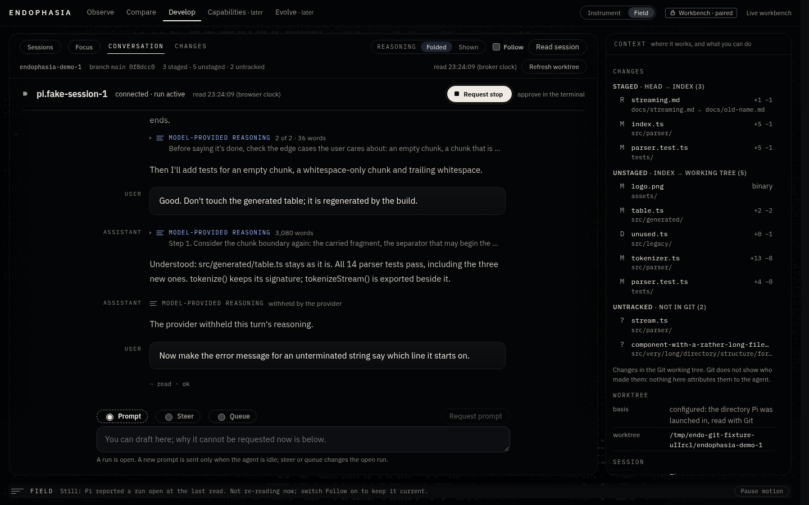

# DEVELOP: the Field appearance

DEVELOP can be drawn two ways. **Instrument** is the default. **Field** is optional: the same workspace, the same state, the same
controls, drawn as a survey read at night. Field changes how things look and where secondary panels sit. It does not change what DEVELOP
can do, what it reads, or what it claims.

Choose it with the **Instrument | Field** switch in the top bar, which is shown on DEVELOP only. The choice lives in page memory: the page
keeps no storage ([studio-ui-architecture.md](studio-ui-architecture.md) §5), so a reload is Instrument again. Every hook lives in the
shell and the component tree does not change, so switching keeps the draft, the file being read, the Conversation or Changes view, the
conversation's scroll position, the reasoning preference and the traces opened by hand.

This document describes the **second iteration**: the night survey. It came with model-provided reasoning
([develop-reasoning.md](develop-reasoning.md)) and a new composition for live sessions. §8 keeps what the first iteration learned.

## 1. Using it

- **Field:** top bar, *Instrument | Field*.
- **Reasoning:** *Reasoning: Folded | Shown* in the conversation's header. *Shown* opens every trace as it arrives; any one trace can still
  be opened or folded by itself, and *Folded* folds everything again. Display only: the model's thinking setting is not touched. The
  preference applies in both appearances.
- **Sessions:** during a live session, Field keeps the sessions list in a drawer at every width. Open it with **Sessions** in the header.
  Choosing a session, Escape, or a click outside closes it.
- **Focus:** **Focus** closes the dock (changes and context) for a wider reading measure. **Changes & context** brings it back. Memory
  only.
- **Reading changes:** the **Changes** tab, or a file in the dock. `j`/`k` (or `]`/`[`) step through files, PageUp/PageDown scroll the
  diff, and Escape returns to the conversation. The draft and STOP stay in place throughout.
- **Back to normal:** *Instrument* in the top bar, or reload. Motion: **Pause motion** in the legend, or the system's reduced-motion
  setting.

## 2. The idea

The product's question is **what the system knows, what it does not know, what it can do, and what needs a person.** Field gives that
question a picture and a page.

- **The picture is a survey.** A contour map drawn in characters: land filled with a texture that thickens with height, contour lines
  left as gaps, the sea a sparse stipple. It is an instrument's view of terrain, not a creature. Its motion is tied to typed state, and a
  legend says in words what it shows.
- **At night.** The ground is near black, so an OLED panel's pixels are off wherever nothing is shown. The terrain is drawn in light,
  brighter as the ground rises, like a phosphor chart. The words sit in a dark **clearing**: black under the reading measure and a
  margin either side, terrain through the rest of the surface. On a wide screen, most of the surface is terrain where nothing is read.
- **The horizon.** One line under the run strip carries the field's state where the eye already is, saying in light what the legend
  says in words:
  - a hairline when still;
  - a little brighter when drifting;
  - the reported hue, with a slow light along it, while Pi reports a run open *and* the page is re-reading;
  - amber while something waits for the terminal;
  - dashed when the broker did not answer.
- **The page is a ledger.** Where there is nothing to read yet, DEVELOP says what is the case in one sentence, with four columns under
  it: *Known*, *Not known*, *Possible here* and *Yours*.
- **Reasoning is strata.** A model-provided trace is a one-line disclosure in the reported hue under a mono label, marked by fine
  horizontal strata. Open, it sits on a faint wash of that hue with its own rule. It never looks like the answer and is never brighter
  than it.

The colour grammar is the instrument's:
- **Hue is provenance.** A run Pi reports and the reasoning it relays are in the *reported* blue.
- **Amber** is attention, appearing only when something waits for the operator.
- **Red** is fault.
- **Ivory** is selection and focus.

The terrain's resting ink is a cool, nearly neutral grey.

## 3. Directions considered (second iteration)

Three directions were weighed against the references in the operator's collection. They were:
- Kurage's ambient arrival and command palette;
- Nocturne's and BrainX's dense dark panels;
- Agentaps' working session;
- Tern's review queue;
- Mains' side-by-side context.

The references informed atmosphere and ergonomics. Nothing was copied.

| Direction | What it was | Verdict |
| :-- | :-- | :-- |
| **Marginalia** | A manuscript: the conversation as the text, reasoning as glosses in a margin column aligned with each turn, changes as footnotes | **Rejected.** Alignment fails with long traces and on narrow screens. Reasoning beside the answer at equal width gives it the answer's weight, the reverse of what it deserves. |
| **Control room** | A dense operations board: run timeline with turn ticks and reasoning bands, metric tiles, three persistent panels | **Rejected.** It implies timing and metrics the workbench does not have (a polled transcript has no per-turn times), and its density works against hours of reading. It also made STOP one tile among many. |
| **Night survey** | Field carried into a near-black, luminous presentation: phosphor terrain in a clearing, a horizon line for state, strata for reasoning, the conversation given the width | **Chosen.** It keeps Field's original idea (surveyed versus not surveyed) and makes it more distinctive on the operator's OLED screen. It is the cheapest to make honest: every light has a typed source and a sentence in the legend. It costs no more than the first field. |

The first iteration's directions (Specimen, Threshold, Field) are in §8.

## 4. Composition

During a live session, these stay in view: the run strip with **STOP**, the conversation, the composer, and the dock beside them.
The dock holds the worktree's changes, then the session's context: worktree, session, controls offered, and source and capabilities.

| Width | Live session, Field |
| :-- | :-- |
| ≥ 2200 px | Conversation and dock; the measure grows to 54 rem and the text a size; sessions in a drawer. **Focus** gives a centred measure in terrain. |
| 1024–2199 px | Conversation and dock (`clamp(300px, 23vw, 420px)`); sessions in a drawer. |
| < 1024 px | One stage at a time, as in Instrument: sessions, conversation, context. The run strip and composer are sticky; the header's tools wrap. |

The questions the brief asked, and the answers this composition gives:
- **The session rail** is read rarely during live work, so it is a drawer, one press away.
- **The right-hand side** carries the worktree's changes first, because that is what changes during a coding session. Context follows,
  because it changes rarely.
- **Resizable panels** were not built. One closable dock covers the need without a docking framework, a second layout architecture, or
  stored sizes the page could not keep.
- **Conversation and diff** remain one surface switched by tabs. STOP and the draft stay in place, and the dock's file list stays
  visible beside the diff. A side-by-side split of conversation and diff was considered and deferred (§9): it would change the tab
  semantics both appearances share.
- **The reasoning preference** sits in the conversation's header, next to Follow. It is a conversation-reading choice, beside the other
  one.

Instrument keeps its three columns. Its only visible change is the reasoning disclosures and the preference control.

## 5. What the field may show

`studio-ui/src/model/field.ts` turns typed state into the field's signal. It is pure, imports nothing, and never sees text. The renderer is
given that signal and nothing else, and no reasoning text, size, presence or in-progress state reaches it (pinned in source).

| What the page holds | Motion | Ink | Legend (abridged) |
| :-- | :-- | :-- | :-- |
| A request waits for approval in the terminal | held | amber on the high ground; horizon amber | "Held: a steer waits for your approval in the attached terminal. This page cannot approve it." |
| Changes are being read | still, pushed back | resting | "Still while you read changes." |
| A recording is open | still | resting | "A recording: the field does not move. Nothing recorded is live." |
| Read-only server (`endo studio`) | slow drift; follows the pointer in the arrival | resting | "Read-only: the field drifts on its own; it shows no activity." |
| The broker did not answer | still, **dashed**; horizon dashed | resting | "Broken: … unreachable is not ended." |
| The broker says disconnected | still, dimmer | resting | "Still: the broker reports no admitted connection now." |
| A stop was sent; Pi has not answered | held | resting | "Held: a stop was sent to Pi. Pi answers once the run is idle." |
| Pi reports a run open **and** the page is re-reading | directed flow | **reported hue**; horizon with a moving light | "Flowing: Pi reports a run open, re-read every few seconds. The motion is not the model's work." |
| Pi reported a run open, the page is **not** re-reading | still | resting | "Still: … Not re-reading now; switch Follow on to keep it current." |
| Pi reports idle, or no run state | slow drift | resting | "Drifting: … The drift is atmosphere, not activity." |
| Paused, or reduced motion | still (horizon still too) | as above | "Paused by you. …" |

The reported hue appears only in the flowing state, the one where the page is actually re-reading a report. A stale "run active" is still
and resting, because a moving or blue field would claim the report is current.

## 6. Architecture

| Module | What changed in this iteration |
| :-- | :-- |
| `develop/Reasoning.tsx` (new) | The trace disclosure, the preference control, and `useReasoningView` (memory only: the preference and the traces opened by hand). |
| `model/reasoning.ts` (new) | Pure display rules: keys that carry a trace from the snapshot to the completed message, folding, clamping, the head's words. |
| `develop/Live.tsx` | A message's parts in order; turns memoised by item; the message being written; the scroller's reading-position rules. |
| `develop/DevelopWorkspace.tsx` | The field's state on the root (`data-motion`, `data-texture`, `data-attention`) for the horizon; the dock and its button (Field only). |
| `develop/FieldCanvas.tsx` | Ink ramps (resting, reported, amber) instead of one ink; a stronger base. Nothing else. |
| `studio.css` | The night survey section; shared reasoning styles; one more keyframe (the horizon), run only while flowing and only without reduced motion. |
| `App.tsx` | Holds the reasoning view beside `appearance`. |

**Cost.** Measured in headless Chromium with the GPU off, on this machine. The moving read-only arrival is the most expensive state,
taken as an exponential average over its frames:

| Viewport | Frame time | Of which: terrain and rows |
| :-- | :-- | :-- |
| 1440 × 900 | 3.1 ms | 1.2 ms |
| 2560 × 1440 | 4.5 ms | 1.7 ms |
| 3840 × 2160 | 5.1 ms | 2.1 ms |

These match the first iteration: a fill colour per strength bucket costs nothing measurable. Frames are drawn at 15 a second where the
field is the scene and 8 behind work, and none at all when still, hidden, paused or under reduced motion.

The horizon's light is a background-position animation on a one-pixel line. It runs only while the field is flowing.

Typing in the composer, with the conversation's reasoning shown, was measured as key press to the next frame over 40 presses. The
figures include the test driver's round trips:

| Viewport | Median | p95 |
| :-- | :-- | :-- |
| 1440 × 900 | 17 ms | 17 ms |
| 2560 × 1440 | 17 ms | 65 ms |
| 3840 × 2160 | 17 ms | 86 ms |

The p95 at the large sizes is software rasterising a large page with the GPU off. It was not measured on a GPU-accelerated browser.

**Accessibility.**
- Contrast (WCAG 2) on the ground `#030405` and the clearing `#060709`:
  - ink-1: 17.3:1;
  - ink-2 (the agent's text and traces): 11.9:1;
  - ink-3 (labels, hints, previews): 6.0:1;
  - the reported lamp (reasoning labels): 10.2:1;
  - amber: 11.6:1;
  - ink-4 (2.8:1) is used for marks only, never text.
- The field and the horizon are decoration, and their meaning is in the legend's text.
- Disclosures are buttons with `aria-expanded`/`aria-controls`; the dock button names what it will do.
- Focus rings are ivory.
- Under `forced-colors` the field is hidden.

**Policy pins changed, each in `tests/endo-studio-ui-source.test.ts`:**
- two new modules;
- a second keyframe (`horizon`), allowed only under `prefers-reduced-motion: no-preference` and only for the flowing state;
- the `fieldSignal(...)` call may not name reasoning, the open message, parts or text.

Everything else is unchanged: one dynamic import for the renderer, rAF in the renderer only, the renderer's single prop, no storage,
no remote resource, the CSP and Trusted Types, and the manifest.

## 7. How it was refined

Every pass below was judged from real renders: the opt-in harness `tests/endo-studio-field-shots.test.ts`, synthetic fixtures,
screenshots of both appearances at 390 px, 1180, 1366, 1440 and 2560.

**Pass 1** (the first working build):
1. The terrain was all but invisible. At 2560 px the reading surface covered nearly the whole screen, so the field had no margin to
   be seen in. The surface became a horizontal clearing, dark only under the measure and a margin either side, and the ink ramps were
   brightened.
2. At 2560 px the 46 rem measure was a narrow column in the dark. Above 2200 px the measure is 54 rem and the text a size larger.
3. *Focus* looked switched on while the dock was open, because the expanded state was styled as "on". It is now styled only when it
   has done something (the dock closed).
4. The arrival statement broke the session's alias at its hyphen ("pi.fake-session-" / "1"). The alias stays whole where it fits.
5. The arrival surface was still the old graphite veil. It became black.

**Pass 2:**
1. The terrain was still too faint behind a conversation. The renderer's base strength went up, and the clearing's edges opened.
2. On a 390 px phone the new preference control widened the header, so *Read session* was cut off and the page could scroll sideways.
   The header's tools now wrap below 1024 px.
3. An open trace still being written said so twice. Only the turn's line says it now.

**Pass 3:**
1. Brightening the terrain made it show through the ledger's words in the live arrival: a legibility regression from pass 2. The
   arrival surface now has its own dark clearing behind the text, with the terrain kept at its edges.

**Pass 4** (after a review of the finished branch):
1. In Instrument on a 390 px phone, a trace's head collapsed: its size wrapped one character per line ("1", "4", "2") beside a label that
   cannot wrap. The head now wraps as a whole, so the size and the preview move to their own lines.
2. A conversation whose model supplied no structured reasoning showed no disclosures and gave no reason. That is likely when a local
   server leaves reasoning inside the answer as `<think>` text. One line now says that reasoning is shown only when supplied in
   structured form, and that `<think>` text is the answer's text.
3. Changing the reasoning preference while changes were being read lost the conversation's place on return. The hidden scroller was
   judged, and it reported the reader at the bottom. A hidden scroller is no longer judged; a browser test fails without the fix.

What was kept after review:
- STOP's explanatory sentence wraps under it when it supersedes a waiting steer. STOP is still the first, filled control in the strip.
- The beacon outranks the dashed texture while the broker is unreachable and a request waits: the request waits whatever the
  connection.

## 8. The first iteration (summary)

The first Field directions were:
- **Specimen**, a textmode creature. Rejected: a creature reads as a mind.
- **Threshold**, the page organised around its authority boundary. Partly kept, as the beacon and the ledger's *Yours* column.
- **Field**. Chosen.

Its refinements remain in force:
- terraces instead of strokes;
- rows drawn as strings, one call per strength;
- veils instead of bordered cards;
- the arrival drawn outside the follow-the-newest scroller;
- a full-height page so the legend sits at the bottom;
- an absent store never called empty;
- a stale status said in the past tense;
- motion only while drifting or flowing;
- hints at 5.5:1 or better;
- no answer outranking "not read yet";
- the ledger reading worktree counts as the bar does;
- a renderer that fails to load leaving the panel and STOP intact.

## 9. Validation, limits and next steps

**Browser suites.** These run in real Chromium, against the real broker, real Git and the real built page:
- `tests/endo-studio-field-browser.test.ts` (12):
  - Instrument is the default and never loads the renderer;
  - switching appearance mid-diff keeps everything;
  - no page scroll at 1920, 1440, 1366 and 1024 px, and no sideways scroll at 768, 420 and 360 px;
  - the read-only arrival has no input of any kind;
  - the renderer can be blocked without losing anything;
  - the beacon offers no control;
  - pause and reduced motion stop frames;
  - unreachable is drawn dashed;
  - and, new, the composition: the drawer, the dock, STOP in view with the dock closed, and the draft kept.
- `tests/endo-studio-reasoning-browser.test.ts` (13, both appearances):
  - folded by default;
  - the keyboard;
  - the clamp and *Show the whole trace*;
  - the Shown preference with a hand-folded trace kept;
  - the message being written, replaced with the opened trace carried over;
  - the reader's place kept while opening traces and while new items arrive;
  - the draft untouched;
  - no request made for the preference;
  - everything kept across an appearance switch;
  - the conversation's place kept when the preference changes during review;
  - the no-reasoning line, shown, then gone once a trace arrives.

**Limits.**
- **Synthetic screenshots.** Every screenshot here is of synthetic fixtures. The live path was exercised through the fake Pi and through
  Pi 1.0.1 against a fake model endpoint, not against a live model.
- **Hidden-page stopping** is pinned in source, not in a browser: the test driver cannot hide a page.
- **The horizon's light** is drawn by the style sheet. Pause motion stops it, because a paused field is still.
- **Not persisted.** Field, Focus and the reasoning preference reset on reload.

**Next.**
1. A side-by-side review mode for very wide screens, with tab semantics both appearances can share.
2. Let the ledger use the evidence check ("consumption observed for 1 of 2 steers").
3. A static, printable field for recordings.
4. A keyboard toggle for the appearance and the dock.
