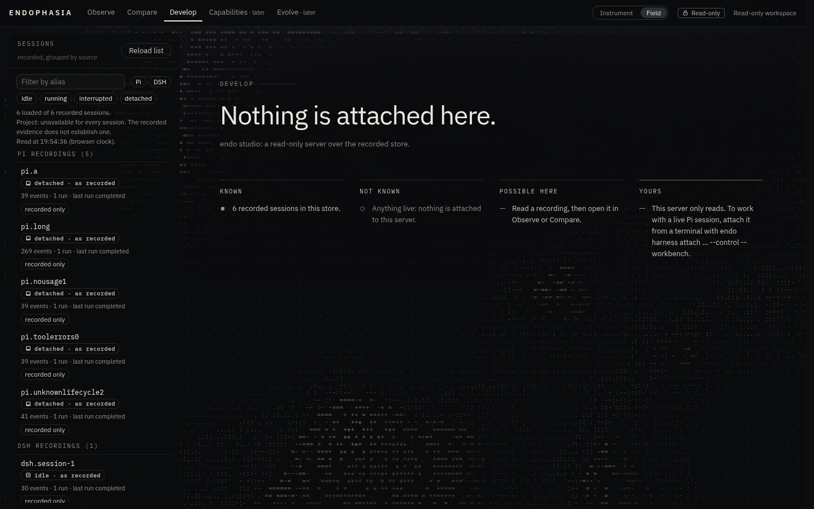

# DEVELOP: the Field appearance

DEVELOP can be drawn two ways. **Instrument** is the default and is unchanged. **Field** is optional: the same workspace, the same state,
the same controls, drawn as a survey sheet, with a contour field in text moving slowly behind the work. Field changes how things look. It
does not change what DEVELOP can do, what it reads, or what it claims.

Choose it with the **Instrument | Field** switch in the top bar. The switch is shown on DEVELOP only. The choice lives in page memory:
the page keeps no storage ([studio-ui-architecture.md](studio-ui-architecture.md) §5), so a reload is Instrument again. Switching keeps
the draft, the file being read, the Conversation or Changes view, and the conversation's scroll position, because every hook lives in
the shell and the component tree does not change.

## 1. The idea

The product's question is **what the system knows, what it does not know, what it can do, and what needs a person.** Field gives that
question a picture and a page.

- **The picture is a survey.** A contour map drawn in characters: land is filled with a light texture that thickens with height, and the
  contour lines are the gaps between terraces. The sea is a sparse stipple. It is an instrument's view of terrain, not a creature, and it
  stands for nothing it cannot show. Its motion is tied to typed state (§3), and a legend under the workspace says, in one line, what the
  field is showing right now.
- **The page is a ledger.** Where there is nothing to read yet, DEVELOP says what is the case in one sentence ("pi.alpha is connected
  and idle.", "Nothing is attached here.", "The broker did not answer."). Under it are four columns: **Known**, **Not known**, **Possible
  here** and **Yours**. Each line carries the instrument's own provenance mark: observed disc, reported half disc, unavailable dashed
  ring, a solid square for what was recorded, and a rule for how the system works. *Yours* always says that approval happens in the
  attached terminal and that this page can only request.
- **When there is work, Field steps back.** The conversation sits on one calm surface with a reading measure (46 rem) and larger text.
  The operator's own words sit on a lifted plate; the agent's are set on the page; tool calls are quiet marginal lines. The rail and the
  context column read as annotations. The field dims behind a conversation, dims further and stops while changes are read, and stops for
  a recording.

The colour grammar is the instrument's: hue is provenance, amber is attention, red is fault, ivory is selection. The field itself is ink.
Amber appears only when something waits for the operator.

## 2. Directions considered

Three genuinely different directions were weighed against the references (the HorizonX ASCII dashboards, Nocturne and BrainX, Agentaps,
Tern, Mains, o8) and the trust model.

| Direction | What it was | Verdict |
| :-- | :-- | :-- |
| **Specimen** | A textmode organism (in the vein of the reference ASCII creatures) that breathes behind a centred composer | **Rejected.** A creature reads as a mind, so it would present the model's "life" and invite a reading of cognition. That is exactly what the workbench must not draw. It is also the references' own idea, and a centred hero composer is wrong for a page that may offer no input at all. |
| **Threshold** | The page organised around its authority boundary: a horizon between what the browser can do (request) and what only the terminal can do (approve), with requests drawn as crossing it | **The strongest alternative.** It was kept in part: the beacon (§4) and the ledger's *Yours* column make the boundary visible. As a whole layout it put a diagram where the operator reads and writes, and it made the arrival about authority rather than about the session. |
| **Field** | A survey: a contour field in text plus the ledger of what is and is not known | **Chosen.** It is original among the references, it carries the product's epistemic stance (surveyed versus not surveyed), it can be still without looking broken (a recording is a map, not a film), and it retreats cleanly behind dense work. |

## 3. What the field may show

`studio-ui/src/model/field.ts` turns typed state into the field's signal. It is pure, imports nothing, and never sees text. The renderer is
given that signal and nothing else.

| What the page holds | Motion | Texture | Legend (abridged) |
| :-- | :-- | :-- | :-- |
| A request waits for approval in the terminal (prompt, steer, queue or stop) | held, amber tint on the high ground | solid | "Held: a steer waits for your approval in the attached terminal. This page cannot approve it." |
| Changes are being read | still, pushed back | solid | "Still while you read changes." |
| A recording is open (any recorded state, including `running`) | still | solid | "A recording: the field does not move. Nothing recorded is live." |
| Read-only server (`endo studio`) | slow drift, follows the pointer in the arrival | solid | "Read-only: the field drifts on its own; it shows no activity." |
| The broker did not answer | still | **dashed** (the instrument's texture for what is unavailable) | "Broken: … The session may still be running; unreachable is not ended." |
| The broker says disconnected | still, dimmer | solid | "Still: the broker reports no admitted connection now." |
| A stop was sent; Pi has not answered | held | solid | "Held: a stop was sent to Pi. Pi answers once the run is idle." |
| Pi reports a run open **and** the page is re-reading (Follow on, or a request or check open) | directed flow | solid | "Flowing: Pi reports a run open, re-read every few seconds. The motion is not the model's work." |
| Pi reported a run open, but the page is **not** re-reading | still | solid | "Still: Pi reported a run open at the last read. Not re-reading now; switch Follow on to keep it current." |
| Pi reports idle, or no run state | slow drift | solid | "Drifting: … The drift is atmosphere, not activity." |
| The operator paused it, or the system asks for reduced motion | still | — | "Paused by you. …" (the state is still described) |

The page's copy of the transcript growing makes one ripple. The signal carries the **count** of items, never the items. That is an
observation by this page that something arrived, not a measure of anything.

These rules are pinned in `tests/endo-studio-field-model.test.ts`. The most important one is the stale-status rule: with Follow off and
nothing open, the page stops reading the broker, so a "run active" status may be minutes old, and a moving field would claim it is current.

## 4. Each working state

| State | What Field does |
| :-- | :-- |
| **Arrival** (no session open, or a live session with nothing in its conversation) | The statement and the ledger, over the field at full strength. Only real controls exist: on `endo studio` there is no input of any kind; on an unpaired workbench the input is the real pairing form; on a paired one it is the real composer, gated by the broker's offers. The ledger's *Possible here* is built from the same offers and their reasons. |
| **Conversation** | One calm surface with a measure, larger type, a lifted plate for the operator's words, quiet tool lines, run markers as hairlines. The run strip names the session in the sans at 15 px. |
| **Active run** | STOP is a filled button, last in the run strip, the most visible control. The field flows only while the status is being re-read. |
| **Approval pending** | A **beacon** under the run strip: "Waiting for you in the attached terminal. Approve or decline the steer there (digest …, until …). This page cannot approve it." It is text, with no control and no hover. The field holds and the high ground turns amber. The cards in the conversation are unchanged and keep their Withdraw. |
| **Steering or stopping** | Steer and Queue drafts are drawn in a dashed amber field, the instrument's mark for "changes the open run". STOP priority and supersession are the workbench's, untouched. |
| **Reviewing changes** | The field drops to a sixth of its strength and stops. The diff gets a flat ground. Comparison identity, `j`/`k`, PageUp/PageDown, `Esc`, stale and unconfirmed marks and the draft are the same components as in Instrument. |
| **Recorded sessions** | The field is still. The activity table, the inspector, the "as recorded" wording and the live/recorded tags are unchanged. |
| **Unavailable or disconnected** | Unreachable: dashed, still, "unreachable is not ended". Disconnected: still and dimmer. The ledger says the same in words. |
| **Sizes** | ≥ 1360 px: three columns. 1024–1359 px: the sessions drawer, as in Instrument. < 1024 px: one stage at a time, the ledger above the sessions list, columns collapsing 4 → 2 → 1 by the ledger's own width (container queries). |

Screenshots (synthetic fixtures only; written by `ENDO_SHOTS_DIR=… npx vitest --run tests/endo-studio-field-browser.test.ts` and a
scratch harness over the same fixtures):
[arrival, read-only](images/field-arrival-readonly-1440.png) ·
[arrival, unpaired workbench](images/field-arrival-unpaired-1440.png) ·
[conversation 1440](images/field-conversation-1440.png) ·
[approval pending](images/field-approval-1440.png) ·
[changes](images/field-changes-1440.png) ·
[unreachable](images/field-unreachable-1440.png) ·
[laptop 1366](images/field-conversation-1366.png) ·
[phone, arrival](images/field-arrival-390.png) ·
[phone, conversation](images/field-conversation-420.png).

## 5. Architecture

| Module | What it is |
| :-- | :-- |
| `App.tsx` | Holds `appearance` and the field's `paused` flag in memory; draws the switch on DEVELOP only; passes both to the workspace. No hook moved. |
| `develop/DevelopWorkspace.tsx` | Sets `data-appearance` and `data-surface`; builds the field signal and the ledger from the hooks' state; adds the field layer, the legend, the arrival and the beacon. No state, action or element that its keyboard handlers look for changed. |
| `develop/Live.tsx` | Two optional slots on `LiveConversation`: `arrival` (shown in place of an empty conversation, outside the scroller that follows the newest item, so the statement is read from the top) and `beacon` (under the run strip). Instrument passes neither. |
| `model/field.ts` | The signal adapter (§3). Pure, no imports. |
| `model/ledger.ts` | The ledger adapter. Pure; reads the workbench status, the broker's offers, the worktree as last read, and recording counts. |
| `develop/Field.tsx` | The layer, the legend, the arrival and the beacon, plus `useReducedMotion`. The renderer is loaded from here with the bundle's second dynamic import. |
| `develop/FieldCanvas.tsx` | The renderer, its own file in the bundle, requested only when Field is first shown. |
| `studio.css` | One section, scoped to `.develop[data-appearance="field"]`. Transitions only: no keyframes were added, and the pinned animation list is unchanged. |

**The renderer's lifetime and cost.** It uses Canvas 2D (no GPU needed; the acceptance runs with the GPU off), at most 1.5 device pixels
per CSS pixel and at most 30,000 character cells (a larger window gets a larger face, not more cells). Text moves a cell at a time, so 15
frames a second is enough where the field is the scene and 8 behind work. There are no frames at all when:
- the field is still or held;
- the page is hidden;
- the operator paused it;
- the system asks for reduced motion (one still frame is drawn).

Each frame it asks for can be cancelled, and is cancelled on unmount.

The terrain is seeded noise sampled on a half-resolution lattice, so a still frame is the same on every machine. Each row is drawn as one
`fillText` per strength bucket rather than one call per character. Glyphs are ASCII only, because the bundled Plex Mono is a latin subset.
The renderer waits for that face before its first frame. If a 2D context cannot be had or is lost, it draws nothing, and a dot-grid
background in CSS remains. It is hidden under `forced-colors`, and it is `aria-hidden`; the legend carries its meaning in text.

**Measured** (headless Chromium, GPU off, this machine, steady-state frame time of the moving read-only arrival, exponential average over
about 60 frames):

| Viewport | Frame time | Of which: terrain and rows |
| :-- | :-- | :-- |
| 1440 × 900 | 3.1–3.4 ms | 1.2 ms |
| 2560 × 1440 | 5.4–5.7 ms | 1.8–2.3 ms |
| 3840 × 2160 | 6.1 ms | 2.2 ms |

At 15 frames a second that is about 5–9 % of one core at most. Behind a conversation it is 8 frames a second at lower strength, and zero
while still. This was not measured on a GPU-accelerated browser, where `fillText` is cheaper. Typing latency was not measured
separately; a frame is at most a few milliseconds and yields between frames.

**Dependencies:** none added. No WebGL, no animation library, no font. textmode.js, React Bits and Motion Primitives were considered and not
used: each would be a runtime dependency (some under licence terms beyond MIT, and textmode.js renders with WebGL), for effects that come
to about four hundred lines here.

**Policy changes, each pinned by a test** (`tests/endo-studio-ui-source.test.ts`):
- A second dynamic import, the renderer.
- `requestAnimationFrame` and `cancelAnimationFrame` are allowed in **one** file, the renderer. That file:
  - imports only `react` and the signal's **type**;
  - is imported statically by nothing;
  - contains no `fetch`, timer, worker or WebGL;
  - has exactly one prop.
- `model/field.ts` imports nothing at all.
- `Field.tsx` passes the renderer the signal and nothing else.

`setInterval` and idle callbacks stay forbidden everywhere. The page policy, the server, the routes and the manifest loader are unchanged.

**What did not change:** every hook, reducer, wire gate and route; the broker's offers as the only source of what can be requested;
terminal approval; STOP priority; the read-only `endo studio`; Git inspection and its safeguards; Observe and Compare hand-offs; what is
kept in memory and what is never stored. Instrument's DOM is the same apart from the switch in the top bar, and its browser suites pass
unchanged.

## 6. How it was refined

The first build was reviewed from real screenshots, and several things looked wrong:

1. **The first field was rain, not terrain.** It drew contour *strokes* (`- / | \`), one per character cell. On a 9 × 16 px cell the strokes
   did not join, and the result read as scratches. It became terraces: land filled with a density ramp, contour lines left as gaps, and
   light relief shading from the upper left. Two characters per terrace stop a ring from becoming a wall of `=`.
2. **It cost 10–13 ms a frame**, because each character was drawn separately. Rows are now strings, one call per strength. Measuring
   showed the earlier figures were first-frame (cold JIT) numbers; the table above is steady state.
3. **Three bordered panels brought back the "cards" look.** The rails lost their borders and became veils over the field. Only the reading
   surface keeps an edge and a shadow.
4. **The live arrival's statement was out of view.** The conversation's scroller follows the newest item, so it scrolled the ledger's head
   away. The arrival is now drawn outside that scroller.
5. **The clearing behind the arrival had a hard vertical edge,** clipped by its own box. It now bleeds past the box and is clipped only by
   the column.
6. **On a tall screen the legend sat in the middle of the page.** The Field page now fills the window.
7. **Repeated `TOOL` labels and multi-line state pills were noise.** Tool lines are marked by a tilde, with the word kept for assistive
   technology. State tags have small radii.
8. **The ledger crushed to four narrow columns on a phone.** Its columns now follow its own width.

## 7. Validation

- `tests/endo-studio-field-model.test.ts` (16): the honesty rules above, and what the ledger says per state.
- `tests/endo-studio-field-browser.test.ts` (9, real Chromium, real broker, real Git):
  - Instrument is the default, draws no field and never requests the renderer; the renderer is requested once when Field is first shown.
  - A switch, mid-diff with a draft and a scrolled conversation, keeps the view, the file, the draft, STOP and the scroll position.
  - At 1920, 1440, 1366 and 1024 px the page does not scroll, the composer is docked, and STOP is in view.
  - No sideways scroll at 768, 420, 390 and 360 px, in both appearances.
  - The read-only arrival has no input of any kind, and opening a recording stills the field.
  - An unpaired arrival's only input is the pairing form.
  - An approval shows a beacon with no control, and the field held.
  - Pause stops frames, and reduced motion never starts them.
  - An unreachable broker is drawn dashed.
  - No console message, exception, CSP or Trusted Types violation, and no request off the page's own server.
- Every existing Studio, workbench and package test is unchanged, and passes.

## 8. Limits and next steps

- **Not persisted.** The page has no storage, by policy. A durable preference would need a decision about that policy (or a
  server-side setting), not a workaround.
- **Hidden-page stopping is not tested in a browser.** The CDP driver cannot hide a page. It is pinned in source, which listens for
  `visibilitychange` and cancels the frame.
- **The ledger's *Not known* lines are general statements,** not findings. They are true of the workbench as built.
- **Next, in order:**
  1. Let the ledger use the evidence check: "consumption observed for 1 of 2 steers" is known; the rest is not.
  2. A static, printable rendering of the field for recorded sessions (a recording as a map).
  3. A small keyboard affordance to toggle the appearance.
