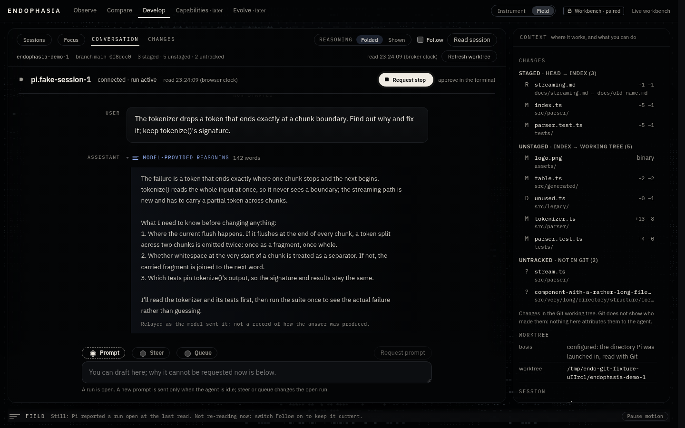

# DEVELOP: model-provided reasoning

When the model behind a live session supplies reasoning in structured form, DEVELOP shows it inside the conversation, folded by default
and labelled **Model-provided reasoning**. It is the text the model emitted as reasoning, relayed as it was sent. It can help diagnose a
run. It is **not** a faithful account of how the model computed its answer, and the page never says it is: every open trace ends with
"Relayed as the model sent it; not a record of how the answer was produced."

Nothing is summarised, inferred or invented. A turn the runtime gave no reasoning for shows none. A block the provider redacted is shown
as *withheld by the provider*, with nothing to open.



## 1. Where it comes from (Pi)

Pi's RPC stream carries reasoning in two structured forms ([pi.dev/docs/latest/json](https://pi.dev/docs/latest/json)):

- the completed assistant message (`message_end.message.content`) holds `thinking` blocks beside `text` and `toolCall` blocks, in order.
  A block may be `redacted: true`, with its opaque payload in `thinkingSignature`;
- while the message is being written, `message_update` events carry `thinking_start`, `thinking_delta` and `thinking_end` (and the
  same for text), each naming a content block by `contentIndex`.

With a local model behind llama.cpp's server, Pi's `openai-completions` provider turns the server's `reasoning_content` into these
`thinking` blocks. That depends on the server separating reasoning out. If it does not, the model's reasoning arrives as ordinary text,
`<think>` tags included, and DEVELOP shows it as ordinary text. **A `<think>` tag in ordinary text is never treated as reasoning**: there
is no provider contract that authenticates it.

## 2. The data path

```
Pi (RPC stdout)
  └─ adapters/rpc-jsonl/rpc-connection.ts        every event, parsed and size-bounded
       └─ adapters/pi/attachment.ts #onEvent      onLiveEvent(event), before mapping; a throwing observer cannot change what is recorded
            ├─ adapters/pi/mapping.ts             canonical evidence: message_end → role, stop reason, usage. No content, no reasoning.
            └─ adapters/pi/workbench.ts           the broker hands every live event to its transcript
                 └─ adapters/pi/live-transcript.ts   memory only, bounded (§3)
                      └─ GET api/v0/workbench/transcript?after=n   grant required; endo.workbench-transcript.v1
                           └─ studio-ui/src/model/workbench-wire.ts   the whole body checked; one failure refuses it whole
                                └─ studio-ui/src/model/workbench.ts   the page's copy, bounded again
                                     └─ develop/Live.tsx → develop/Reasoning.tsx   drawn as text (a React child), never markup
```

**The transcript.** Before this change it kept a message's `text` parts and dropped everything else. Now a message keeps its **parts**
in the runtime's order: text parts (adjacent ones joined, as before) and reasoning parts. A reasoning part is `supplied` (with text),
`withheld` (Pi marked it `redacted`; no text is kept, and `thinkingSignature` is never read), or `empty` (a block with no text). Tool-call
blocks and images are left out of the message. A tool's name and outcome still arrive as their own items from `tool_execution_*`, so a
message, the tools it called and the next message keep their order.

**The message being written.** Deltas are folded into **one snapshot** (`open`), held beside the item log and never in it:
- It is keyed by content index. An index outside 0–31 is ignored, so a hostile index allocates nothing. A delta cannot change a block's
  kind, and `thinking_end`/`text_end` replace what the deltas built with the block's authoritative content.
- The **completed message is authoritative.** On `message_end` the snapshot is dropped and the completed message is added as a new item.
  That item's `from` names the snapshot it replaced, so the page can carry its own display state across: a trace opened while it was being
  written stays open. Nothing of the snapshot survives into the item.
- A new assistant `message_start` (a retry) replaces the snapshot. `agent_end`, `agent_settled` and the end of the session drop it.
  An aborted stream survives only as what the completed message carries, which Pi marks `stopReason: "aborted"`. The page says
  "aborted (reported): what is shown may be incomplete".

## 3. Bounds

All in UTF-8 bytes. A cut is made at a character boundary, in linear time, and is marked.

| What | Bound | When it is reached |
| :-- | :-- | :-- |
| A message's text | 32 KiB across its text parts | cut, `truncated` |
| One reasoning block | 64 KiB | cut; the block keeps its original size in `bytes`, so the page says "cut at 64 KB of 195 KB" |
| A message's reasoning | 96 KiB across its blocks | later blocks cut |
| Parts per message | 32 | the rest counted in `partsDropped` |
| The whole transcript | 400 items and 2 MiB of text and reasoning together | oldest items evicted **whole**, counted in `evicted` |
| One page | 200 items and 512 KiB (always at least one item) | `more: true`; the page reads up to eight pages per read (the most the broker's bounds can need is seven) and, if more remain, reads again at once |
| A streamed block | the same per-block bound, counted incrementally (no re-measuring per delta) | cut, received bytes still counted |
| The message being written | the same per-message budgets as a completed message (32 KiB text, 96 KiB reasoning, 32 parts) | cut, marked |
| The page's own copy | 400 items and 2 Mi UTF-16 units | oldest items let go, counted, and said: "Earlier items are no longer held here (n dropped …)" |

An item is never changed after it is issued, because the page never re-reads a sequence number it holds, so eviction removes items
whole. `tests/endo-workbench-reasoning.test.ts` checks, after each of 400 random pushes, that the counted bytes equal the bytes held.

## 4. Privacy

Reasoning is treated exactly as the live transcript's text always was, because it is part of that transcript:

- **Memory only, in the attached process.** It is never written to the event store, the runtime-text side store, a log, an error or an
  export. Canonical evidence never had message content: `mapping.ts` keeps a `message_end`'s role, stop reason and usage only.
- **Paired page only.** The transcript route needs the grant. The status route, which the unpaired page reads, carries no text. The
  read-only `endo studio` has no workbench and so no transcript route. A recorded session never has reasoning, and its capability says so.
- **Cleared with the session.** The broker's `endSession` and `close` clear the transcript, the open snapshot included. The page forgets
  its copy when the broker says the session is disconnected or the launch changes. An unreachable broker clears nothing: unreachable is
  not ended.
- **Never decoration.** The Field renderer is given the field signal and nothing else. The signal is built from typed state and the
  *count* of items, and no reasoning text, size, presence or in-progress state reaches it. A source pin in
  `tests/endo-studio-ui-source.test.ts` checks the `fieldSignal(...)` call.
- **Pi's own retention is Pi's.** Pi keeps its session file, thinking included, as it always does. That is not Endophasia's evidence,
  and the leak test below says so by leaving Pi's session directory out of its scan.
- **A recording proxy records what passes through it.** If the operator routes the model's traffic through Endophasia's recording
  proxy (the capture that consumption checks read), the proxy keeps raw HTTP request and response bodies in `<store>/capture/blobs/`,
  outside canonical evidence, by design. Those bodies already hold whatever reasoning the provider streamed, and whatever Pi replays
  of earlier turns. They hold it exactly as they hold the answer text. This change does not add to, read from or alter that record.
  The transcript and everything built here write nothing.

`tests/pi-reasoning-leak.test.ts` drives a model endpoint that streams `reasoning_content` with a sentinel, over **two turns** (so the
second request carries the first back), through a Pi, the attachment and the broker. No recording proxy is in that path. It checks that the
sentinel reaches the transcript as a reasoning part and **no byte of it is in any file under the store** (events, side store, harness and
artifact records), outside Pi's own session directory. It runs always against the fake Pi, and with `ENDO_PI_EXECUTABLE` against an
installed Pi. It was run against Pi 1.0.1 for this change, where Pi's own provider turned the stream into a thinking block, in order
before the answer.

## 5. The wire

`GET api/v0/workbench/transcript` answers `endo.workbench-transcript.v1`. The page and the broker are one bundle served by one process,
so v0 is no longer accepted. Changes from v0:

```ts
// a message item
{ seq, kind: "message", role: "user" | "assistant",
  parts: ( { kind: "text", text, truncated }
         | { kind: "reasoning", state: "supplied" | "withheld" | "empty", text, truncated, bytes } )[],   // ≤ 32
  truncated, partsDropped, stopReason, from: number | null }
// beside the items
open: { id, afterSeq, parts } | null                  // the message being written, as of this read
reasoning: { relay: "relayed" | "withheld" | "unsupported", reason: string | null }
```

The browser's gate (`workbench-wire.ts`) is closed: no unknown member is accepted at any level. It enforces the broker's bounds
(32 KiB text, 64 KiB reasoning, 32 parts) and the states' consistency: withheld and empty carry no text, no cut and no size, and supplied
has text unless the message's reasoning budget ran out. An `open` must sit after an item the broker has issued. Any failure refuses the
body whole.

**Harness-neutral.** Presentation never depends on Pi's event names. A source says what it does with reasoning in `reasoning.relay`:
`withheld` when it has it and does not pass it on, `unsupported` when it does not provide it. The page disables the preference and gives
the source's reason. The DEVELOP session surface gains an `observe` action, **`live-reasoning`**: supported through the Pi broker while
connected; unsupported for a recording ("Reasoning is never recorded"); and whatever any other integration declares
([develop-session-surface.md](develop-session-surface.md)). Pi-specific decoding stays in `adapters/pi/live-transcript.ts`.

## 6. How it is shown

Both appearances share these components (`develop/Reasoning.tsx`, `model/reasoning.ts`).

- **Folded by default and discoverable.** Each trace is a one-line disclosure: a strata mark, the mono label *Model-provided reasoning*,
  its place ("1 of 2") and size in words, with the trace's first words on a second line. The preview is visual only, hidden from
  assistive technology. The button's name is the label and size.
- **The preference.** *Reasoning: Folded | Shown*, in the conversation's header. It applies to the whole DEVELOP workspace in both
  appearances, held in page memory: a reload is Folded again, by the page's no-storage policy. **It is display only**: it never calls
  `set_thinking_level`, and no request is made for it.
- **One trace by hand.** Any trace can be opened or folded by itself. Changing the preference applies it to every trace and clears those
  choices. A new launch clears them too.
- **Long traces.** An open trace shows about 2,400 characters, cut at a line or word, then *Show the whole trace (n more words)*. A cut
  made by the workbench's bound says so.
- **The message being written** is drawn last, with a dashed rule, its text one step quieter, and "Being written, as of the read at
  hh:mm:ss (browser clock)". It is not called streaming: it advances only when the page reads again (Follow, an open request, or
  *Read session*).
- **Reading position.** The conversation follows the newest item only while the reader is at the bottom. Opening or folding a trace
  re-judges that, so a long trace opened near the bottom is read from its top. The next arrival does not pull the reader down. The
  message being written grows without the "New items below" cue. Turns are memoised by item, so a read that brings nothing new for a turn
  does not redraw it.
- **A conversation with no reasoning says so.** When the source relays reasoning but no answer has carried any, one line under the
  privacy note explains that reasoning is shown only when supplied in structured form, and that `<think>` text inside an answer is the
  answer's text. It never guesses the model's setting. A source that withholds reasoning or has none gives its own reason.
- **Keyboard and assistive technology.** Disclosures are buttons with `aria-expanded` and `aria-controls`. The preference is a radio group
  with a legend. Folded bodies are not in the DOM.

## 7. Limits and next steps

- **Live updates are polled, not streamed.** The snapshot is as fresh as the last read, every 3 s with Follow on. A streaming transport
  (SSE) remains deferred ([develop-workbench.md](develop-workbench.md) §7). The extension path is direct: the snapshot is already
  the unit a stream would carry.
- **Tool calls written inside a message** (`toolcall_*` deltas) are not followed. A tool appears when Pi reports its execution.
- **Measured live only through fakes and Pi 1.0.1 against a fake endpoint.** No run against a live llama.cpp server or a real model was
  made for this change.
- The preference is not remembered across reloads. That would need a decision about the page's storage policy, not a workaround.
