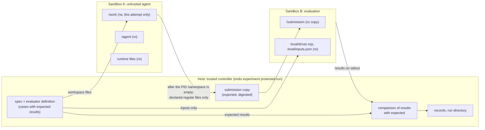

# Protected experiments (EVAL-ISO-001)

An opt-in, Linux-first experiment path. An untrusted agent works on a disposable workspace inside a Bubblewrap sandbox; the boundary is
checked from inside before the agent starts. Its submission is collected only after its processes are confirmed gone, and it is judged by an
independent evaluator in a second sandbox, from cases the agent never sees. Every attempt leaves a sealed, versioned record
(`endo.protected-trial.v0`) that a reader can check without trusting the agent or its transcript.

```sh
endo experiment protected-run <spec.json> --out <dir> [--retry-interrupted] [--max-attempts n]
endo experiment protected-report <dir>
```

**This version is offline.** The agent has no network at all, so it cannot call a model; Pi with a local model is the subject of
EVAL-ISO-002 (§9). The unprotected `endo experiment run` is unchanged.

## 1. Audit: what existed, and what this changes

| Existing (reused unchanged) | Where |
| :-- | :-- |
| Blocked randomization and its ordering text | `planEndoExperimentV0`, `ENDO_EXPERIMENT_ORDERING_V0` in `cli/experiment.ts`. Its parameter is widened to the three fields it reads, so both runners share one planner; a test checks a committed run's plan is reproduced exactly |
| Version-directed reading of self-describing records | `protocol/versioned.ts` (`defineEndoVersionTableV0`, `readEndoVersionedV0`) |
| Canonical JSON and digests | `runtime/contracts/canonical-json.ts` |
| Same fixed working directory for every trial | kept: every protected agent works in `/work` |
| Historical records | `endo.experiment-run.v0`, `endo.experiment-trial.v0/v1` are not touched; protected runs write their own records |

**Trust boundaries today, in `endo experiment run`:**
- Pi runs as an ordinary host process: the whole filesystem, the whole network, and `PATH` inherited (`piCassetteEnvV0`, `cli/cassette-session.ts`).
- `runCheck` (`cli/experiment.ts`) runs the hidden check with `cwd` in the agent's own `work/`, with the agent's environment, after the agent.
  The agent could have changed the files the check imports, or have left processes running.
- The hidden check's argv is in the spec, which `experiment.json` embeds, in a run directory that any process on the host can read.
- An interrupted trial is moved to `interrupted/` and rerun into the counted set.

MEM-000 found that no historical run records an isolation boundary, and the completion-cap study recorded a hidden-check read and broad
deletions in a shared `/tmp`.

**What this adds, and the boundary it moves:**



The agent sees `/work`, `/agent`, the runtime's own files, a private `/tmp`, HOME, `/proc` and `/dev`, and nothing else. The evaluator
sandbox sees the exported copy, the trusted driver and the case inputs. Expected results exist only in the controller.

**Mechanism chosen: Bubblewrap** (0.13.1 here), unprivileged, no setuid.

| Considered | Why not, for this slice |
| :-- | :-- |
| Rootless OCI (podman) | Not installed on the target host, and a container image is a larger, separately maintained trust base than a list of mounted files. |
| systemd user scopes | Bound resources and give cgroup-based process cleanup, but no filesystem or network view of their own. A complement (§8), not a boundary. |
| Anthropic's `sandbox-runtime` | Also Bubblewrap on Linux, but **reads are allowed everywhere by default**: it denies writes and chosen paths. A hidden-test boundary needs the opposite: an empty view with only declared files. Its network design (no network namespace inside, host-side proxies over a bind-mounted Unix socket bridged with socat, deny by default, a resolved-address check) is the reference for EVAL-ISO-002. |

**Explicit exclusions:** no model connection or relay, no Pi, no seccomp filter, no resource limits beyond tmpfs sizes and timeouts, no
evaluator for node:test suites (only function cases), and no change to DEVELOP, Studio or the default runner.

## 2. The profile

Built by trusted code (`adapters/sandbox/bubblewrap.ts`) from the operator's spec. A spec cannot supply a flag, a mount, a host path for the
sandbox or a network destination (the spec reader is closed; see `tests/protected-records.test.ts`).

- **Namespaces:** user, mount, PID, network, IPC, UTS and cgroup are all new (`--unshare-all --unshare-user`). Further user namespaces are
  disabled (`--disable-userns --assert-userns-disabled`), capabilities are dropped, and there is a new session (`--new-session`, so no
  terminal injection). The sandbox dies with its parent (`--die-with-parent`).
- **Filesystem:** an empty root, remounted read-only last. Inside it:
  - each runtime executable and each shared library `ldd` lists for it, read-only, every one checked to be a root-owned regular file in
    root-owned, non-writable directories (no links);
  - `/agent`: a copy of the condition's directory that the controller makes once the run directory is locked, checks against the
    directory's tree digest, and mounts read-only (never the live directory). Compared by real path (links resolved, including through a
    run directory that does not exist yet), an agent directory that holds, or lies inside, any evaluator material (the definition, its
    directory, its reference or negative) or the run directory is refused, as is one that holds the repository, the research archive or
    the home directory. The copy is also refused if any of its files has the content of a hidden file (a hard link or a copy of a definition,
    reference or negative), whatever its path;
  - `/work` (this attempt's workspace, the only writable host directory);
  - private, size-limited tmpfs at `/tmp` and `/home/agent`;
  - a new `/proc` (this PID namespace only) and a minimal `/dev`, itself remounted read-only (its device nodes still work).
  The host root, `/etc`, the repository, the archives and every other trial are simply not there.

  The agent can still run executables it writes into `/work` or `/tmp` (or copies from the runtime), and load native modules: the declared
  runtime is what is mounted, not a limit on what can execute.
- **Environment:** cleared, then only `HOME`, `PATH` and `TMPDIR` (bubblewrap adds `PWD`). Bubblewrap itself is started with an empty
  environment. Its options arrive through a pipe (`--args`), so the sandbox's `/proc/1/cmdline` holds no host path; stdin, stdout and
  stderr are the only descriptors the sandboxed command inherits.
- **Network:** a new namespace with only `lo`, so there is no route out. The host's loopback services and its abstract Unix sockets
  belong to another namespace and are unreachable. No host socket path is mounted.
- **Lifetime: each sandbox runs in its own systemd user scope** (`adapters/sandbox/containment.ts`). Every sandbox (the preflight
  probe, the agent, the evaluation) is started as `systemd-run --user --scope --collect --unit=endo-sandbox-<random> -p RuntimeMaxSec=…
  -p TasksMax=512 -- bwrap …`.
  - *Established before bubblewrap runs:* `systemd-run --scope` registers the scope with the user manager, with itself in it, and only
    then execs bubblewrap. The controller also checks, from `/proc/<pid>/cgroup`, that bubblewrap is in the named scope.
  - *Identified before the command runs:* bubblewrap is started with `--block-fd`, so the sandbox's first process waits, before it execs
    the command, until the controller releases it. The controller does that only after it read the init's identity and found bubblewrap
    inside the scope, both of which are then certainly alive; otherwise it stops the scope and the command never runs (`started: false`).
    A command, however short, cannot finish before it was identified, and `started` means "released to run". The release pipe is closed
    only after the scope has been stopped, since an EOF on it would also release the init.
  - *Recorded durably:* for each of an attempt's sandboxes (the preflight, the agent, the evaluation), the controller chooses the unit
    name and writes it to the attempt directory (`<sandbox>-scope.json`) before anything is started. Right after the launch it adds the
    launcher's identity (pid and start time).
  - *Ended through the user manager:* when bubblewrap exits (or is killed on timeout, with its process group, while it still exists),
    the controller stops the scope with `systemctl --user stop`. Scopes end with `KillSignal=SIGKILL` and `TimeoutStopSec=5s`, not
    systemd's default of SIGTERM with a 90-second grace. Termination is **confirmed only when the user manager no longer runs the unit
    and its cgroup, read without writing, holds no process** (`cgroup.events`: `populated 0`, or the cgroup gone). A unit the manager
    gave up on with processes still inside is `unconfirmed`. Whatever their pid, process group or session, no process the sandbox
    started can still run. Submissions are collected only after that.
  - *Bounded without the controller:* `RuntimeMaxSec` (the timeout plus 30 seconds) makes the user manager kill the scope even if no
    controller remains. An orphaned sandbox lives at most that long, plus the few seconds the kill takes (`TimeoutStopSec=5s`), unless a
    process cannot be killed at all (uninterruptible I/O). `TasksMax` bounds the processes and threads a sandbox can hold (a fork bomb).
  - *Resume:* for every recorded scope of the attempt, a resume ends the recorded launcher (exactly that pid and start time: a launcher
    that outlived the controller may not have registered its scope yet), then stops the scope and checks its cgroup. It never acts on a
    process found by number. The agent's record says whether bubblewrap was seen inside its scope (`established`; false on resume, where
    nothing observed it).
  - *Supplementary only:* the sandbox's init is still identified by pid and start time (kept in `agent-started.json`) and ended, but it
    is not the termination guarantee.
  - *Refusal:* where the systemd tools, a user manager (`XDG_RUNTIME_DIR`) or the scope properties are unavailable, protected execution is
    refused. Detection starts a real probe scope, reads back its `RuntimeMaxSec`, `TasksMax` and cgroup, and stops it.
  - *Never written:* no cgroup file is written directly; the lifecycle goes through the user manager.

  **Verified on this host** (Arch, systemd 262, cgroup v2), non-destructively, with this suite's own processes only:
  - the properties are applied;
  - `RuntimeMaxSec=2` ends a sleeping scope on its own;
  - a tight `TasksMax` stops a sandbox's children from running, which the default bound allows;
  - stopping a scope ends a process that had left the starter's process group and session (`setsid`);
  - bubblewrap runs in the named scope;
  - every agent's scope is confirmed ended and no longer known to the user manager;
  - a resume after the controller was killed stops the recorded scope.
- **The launch window (bubblewrap issue [#633](https://github.com/containers/bubblewrap/issues/633), open; 0.13.1 is affected):**
  bubblewrap clones the sandbox's first process and only then arms its own `--die-with-parent`. That process blocks on an eventfd until
  released, and arms its own parent-death signal much later. A launcher killed in between strands it (reparented, waiting forever,
  holding the caller's pipes). A controller killed before the launcher armed its signal orphans the launcher. Both stay inside the
  sandbox's scope, which is why the scope, not bubblewrap's signal, is the guarantee.
  - What the controller does: it kills bubblewrap's process group on timeout, while bubblewrap still exists (the stranded process is in
    that group until its `setsid`). It stops the scope as soon as bubblewrap exits, which releases the pipes, and stops waiting for them a
    bounded time later.
  - **Not demonstrated:** that a process stranded in this window is ended by the scope. The reproduction exists
    (`tests/protected-launch-window.test.ts`). It holds the launcher inside the window with `--userns-block-fd`, kills it, asserts the
    stranded state (alive, reparented, blocked on an eventfd read), and shows that stopping the scope ends it. It deliberately strands a
    process, so it runs only with `ENDO_DISPOSABLE_STRANDED_TEST=1`, in a separately authorised disposable environment, with the scope's
    own `RuntimeMaxSec=20` as its independent cleanup deadline. It was not run on the operator's workstation.
- **Profile digest:** the logical profile, with roles in place of host paths and every mounted file (and the agent tree, each file's
  content and the permission bits its copy keeps) by digest. It is the same for every attempt of a condition, and a resume refuses a changed one.

## 3. The preflight: enforcement checked, not assumed

Before each attempt the controller runs a probe in **that attempt's own profile** (`adapters/sandbox/preflight.ts`). The probe reports
observations only: error codes, counts and fixed words. The controller decides each probe from its own expectations, and the agent starts
only if every probe passes. Otherwise the attempt is recorded with `preflight: failed` and `agent: not-run`.

| Probe | Attempt from inside | Must observe |
| :-- | :-- | :-- |
| `fs-hidden-*` | stat the host home, the repository, the research data, the run directory, every trial, the evaluator directory and the agent's host path, and compare what is there with the host's object at that path (device and inode, which a bind mount keeps) | `ENOENT`, or `other-object`: an unrelated inside object that only shares the name passes (a controller whose home is `/home/agent`, a checkout at `/work`). `host-object` (the host's own directory) fails, and so does `unknown-object` (something is there but the host has nothing to compare with). These paths do not exist in an empty root unless something is mounted there, so these probes alone show little; what keeps those trees out is structural: only `/work` and the agent copy come from the host, and the agent directory is refused when it overlaps them (above). `fs-canary-read` is the probe that fails when a host directory is mounted at its own path |
| `fs-canary-read` | read a canary the controller just wrote in a private host directory | `ENOENT` |
| `fs-root-readonly`, `fs-dev-readonly`, `fs-readonly-mount-*` | write `/`, `/dev`, `/agent`, `/usr` | `EROFS`: the mount's own answer |
| `fs-readonly-runtime-*` | write each runtime executable | `EROFS` or `EACCES`. They are root-owned, so their mode may answer first: this shows they cannot be changed, not which mechanism stops it |
| `fs-workspace-writable` | write and remove a file in `/work` | `ok` (positive control) |
| `fs-tmp-private` | list `/tmp` | empty |
| `proc-private` | list `/proc` | at most 4 PIDs, the controller's not among them |
| `env-minimal`, `fds-inherited` | the environment's names; every descriptor above 2 | nothing beyond the declared names; only pipes and anonymous inodes (node's own; a leaked host pipe would look the same, which is why bubblewrap is given nothing but its stdio, status and option pipes) |
| `net-interfaces` | list interfaces | `lo` only |
| `net-host-loopback`, `net-host-abstract-socket` | connect to a TCP listener and an abstract socket the controller opened on the host | `ECONNREFUSED` |
| `net-external`, `net-host-path-socket` | connect to 192.0.2.1:80; to a socket file the controller opened | `ENETUNREACH`; `ENOENT` |
| `socket-hidden-*` | stat `/run/user/<uid>`, D-Bus, Docker, systemd private, X11, `$SSH_AUTH_SOCK` | `ENOENT` |

**Each restriction has a negative probe.** `tests/protected-isolation.test.ts` removes one restriction at a time, through a test-only option
that no spec or command can reach:
- the network shared with the host;
- a protected directory mounted;
- an extra environment variable;
- a writable root.

Each time the matching probes fail, the preflight fails, and the agent does not run.

## 4. Collection and independent evaluation

**Collection** (`adapters/sandbox/submission.ts`) runs only after termination is confirmed. For each declared path:
- every directory on the way must be a real directory, and the file a regular file with one link, within the size bounds;
- the file is opened with `O_NOFOLLOW`, compared with what `lstat` saw (device, inode, size, change time), read to its end, and compared
  again with a fresh `lstat`;
- the bytes are written into a new staging directory the controller creates, with each file created exclusively.

Any symbolic link, hard link, directory, socket, FIFO, oversize file, traversal or change during reading refuses the whole submission, by
reason, and the evaluator never runs.

Node has no `openat`, so these checks detect a change but cannot prevent a *live* writer swapping a directory between steps. That is why
collection waits until no sandboxed process exists.

**Evaluation** (`adapters/sandbox/evaluator.ts`, `endo.function-evaluator.v0`):
- **Sandbox:** a second sandbox holds the read-only copy, a trusted driver pinned by digest, and the case inputs.
- **Driver:** it imports the submitted module and calls its export once per input.
- **Comparison:** the controller compares the printed results with the expected results, which never left it.
- **Forged output:** a submission that prints its own result frame beside the driver's produces two frames, and fails. One that also hides
  the driver's frame passes only if the results it prints are the expected ones, which it never sees: what is measured is that the
  submission's process produced the correct results for the inputs, not strictly that its export returned them. It sees every case's
  inputs at once; for a task where seeing the inputs is itself an advantage, this evaluator is not suitable.
- **Exiting early:** a submission that exits before the driver prints fails as `no-result`.
- **Comparison is of JSON:** results are compared after a JSON round trip, so `NaN`, `undefined` and `-0` compare as `null` and `0`, and a
  `Map` as `{}`. Write cases with that in mind.
- **Faked evidence:** visible tests or result files the agent wrote play no part.

**Qualification:** before any trial, the evaluator must pass its reference solution and fail its declared negative. Both are exported
under the same policy.

## 5. The record, and how to verify it independently

One `endo.protected-trial.v0` per attempt (`protocol/protected-experiment.ts`). It holds:
- the trial's coordinates in the plan, its attempt number and the attempt it retries;
- bubblewrap's version and executable digest, the profile digest, and the requested profile (namespaces, read-only root, environment
  names, and every mount by target, kind, role and file digest);
- every preflight probe with its observation;
- the network mode (`none`, no relay);
- the agent's status, exit, duration, termination and output digest;
- the submission manifest (path, bytes, sha256) and its digest, or the refusals;
- the evaluator's definition and driver digests, its status, the case counts and the output digest;
- how the record was finalized, and the invalidating conditions.

The record holds no host path, environment value, case content or output. It is sealed with the digest of its own canonical JSON.

**The reader refuses, rather than half-reading:**
- an unknown version or field;
- a wrong digest;
- a record whose facts contradict each other, for example:
  - an evaluation result without a collected submission;
  - an agent that ran without an established boundary;
  - a submission collected before termination was confirmed;
  - a missing or invented invalidating condition.

To verify a run:
1. `endo experiment protected-report <dir>` reads `protected-run.json` (spec digest checked) and every attempt's record independently,
   by its own version and digests. It checks each record's coordinates against the plan and lists any record it refused.
2. For an attempt, the sha256 of each file in `attempt-<n>/submission/` equals the record's manifest, and the manifest's digest equals
   `submission.sha256`: that copy is exactly what was evaluated.
3. The evaluator definition's sha256 equals the spec's pin and the record's `definitionSha256`. Re-running its cases against the copy
   reproduces the result.

**Analysis rules** (printed in every report):
- every planned trial stays in the denominator;
- **qualified** (judged) means the boundary was established and the agent's termination confirmed, and then either the evaluator ran or
  the agent left no acceptable submission;
- passed and failed are counted among qualified trials only. A missing or unacceptable submission (deleted, a link, a hard link, a special
  file, access removed, too large) is the agent's own doing, so it is a **failure** (`failedWithoutSubmission`), never attrition. Only the
  errors an agent can cause (access, missing entries, links, directories in the way) are read that way; the controller's own faults while
  collecting (its staging copy, the host's I/O) are attrition (`evaluation-could-not-run`), as are the boundary, the controller, the host
  (`collection-disturbed`: a file changed while it was read after the agent was gone) and the evaluator's infrastructure;
- attrition, by its first invalidating condition, and trials not attempted are reported beside them, never as failures;
- a retry (`--retry-interrupted` only) is a new attempt that names the one it retries, and every attempt stays counted. **Only an attempt
  whose agent never started can be retried** (the controller stopped before it). An interruption while or after the agent ran is final
  attrition: otherwise an agent could re-roll its own attempt by making the controller fail (filling the disk, exhausting memory). The
  report refuses a retry of an attempt that could not be retried.

A resumed run with a different spec, isolation executable, agent profile (including agent code) or evaluator is refused. One controller at a
time: the run directory is locked (its holder named by pid and start time). A stale lock is taken over without ever leaving the lock name
free: one controller at a time may take over (an exclusive `.lock.takeover` directory), it checks again that the holder is dead, and it
replaces the lock file in a single rename, so `.lock` exists throughout. A test races eight controllers for a stale lock and exactly one
runs; an abandoned takeover directory is refused with a message, never removed by guesswork. Each attempt's marker names its controller, and an attempt whose controller is still alive is never finalized or ended
by another. A record, once written, is never replaced. A controller that was killed leaves its attempt finalized on the next run as `controller-interrupted`, from what the
directory shows: the agent's facts if it had ended (`agent-ended.json`), `interrupted` if it had not. Nothing is assumed: an attempt
directory always appears with its `started.json`, and one without it is refused. The report also refuses a record that names another
run, isolation executable, agent profile or evaluator, a gap in attempt numbers, or a retry that does not name the attempt before it.

## 6. Running the offline example

Host prerequisites: Linux with unprivileged user namespaces enabled, Bubblewrap at `/usr/bin/bwrap` (root-owned, not setuid), `ldd`, and
`/usr/bin/node`. No root, no daemon, no kernel setting changed.

```sh
node research/protected-eval/example/make-spec.ts > /tmp/protected-spec.json
endo experiment protected-run /tmp/protected-spec.json --out ../protected-runs/example
endo experiment protected-report ../protected-runs/example
```

The example (`research/protected-eval/example/`) is one function task (`mergeIntervals`) and one cooperative agent. Its evaluator
definition holds seven cases, a reference that passes and a plausible wrong negative that fails. The report shows two planned trials, both
qualified and passed. On this host the run takes under a second.

**When enforcement is unavailable** (no bubblewrap, a non-root-owned or setuid one, user namespaces refused, a runtime file that is a link
or writable by others), the command refuses before creating anything: `isolation unavailable (<reason>): <detail>`. It never runs the agent
another way. A probe that fails at an attempt refuses that attempt, which stays in the accounting.

## 7. Tests: what runs real isolation

| File | Real kernel isolation | Covers |
| :-- | :-- | :-- |
| `tests/protected-isolation.test.ts` | **yes** (skipped, and says so, where `detectBubblewrapV0` refuses) | see the list below |
| `tests/protected-isolation.test.ts`, "refusal instead of an unprotected fallback" | no | a missing or untrusted bubblewrap, a linked or non-root runtime, an undeclared executable: refused, nothing run |
| `tests/protected-records.test.ts` | no | records: tampered, truncated, unknown-version, extended and self-contradictory ones refused; a closed spec; collection on the host (links, hard links, FIFO, traversal, oversize, a change mid-read, totals); the historical planner and readers unchanged |

The real-isolation tests cover:
- a positive control: an honest agent passes the independent evaluator;
- an adversarial agent that tries to:
  - read the evaluator, the reference, a host secret, the repository, the archive, another trial, the run directory, `/etc` and a socket;
  - write outside `/work`;
  - spawn a shell;
  - reach loopback, `::1`, the LAN, the internet and DNS;
- forged evaluator frames, faked local results, and a submission that exits early;
- malicious submissions: a link, a linked directory, a hard link, a directory, a socket, oversize and missing;
- a timed-out agent with a detached descendant;
- a controller killed with `SIGKILL`, then resume and an explicit retry;
- each probe failing when its restriction is removed;
- a resume refused after the agent code or the evaluator changed.
- the independent review's attacks, each now a regression test:
  - an agent that locks its own workspace (`chmod 000`): the run continues, the trial is a failure, the directory stays removable;
  - deleting or linking the submission: a failure in the denominator, never attrition;
  - an agent directory above the evaluator, and a run directory inside the agent directory: refused;
  - the agent sees a checked copy of its directory, and no hidden material stays in the run directory;
  - a resume never kills a process it cannot identify (pid with a different start time);
  - a second controller is refused, a stale lock is taken over, and of eight controllers racing for a stale lock exactly one runs;
  - an evaluator reached through links into the agent directory, and a hard link of the definition inside it, are refused;
  - an attempt stopped before its agent started can be retried, and both attempts are counted; one stopped while its agent ran cannot;
  - an attempt stopped after the agent ended keeps the agent's facts;
  - a record sealed with another agent profile is refused by the report;
  - a submission that hides the driver's output and prints wrong results fails.

GitHub's Ubuntu runners restrict unprivileged user namespaces through AppArmor, so the real-isolation tests are expected to skip there.
Only the refusal and logic tests run there. They are run on a host that supports them; the results are in the PR.

## 8. Limitations and residual risk

- **Not protected:**
  - a kernel exploit, or a bug in bubblewrap;
  - an attacker who already controls the host account (who can also edit the records: the digests detect accidents, not forgery);
  - side channels (timing, `/proc/sys`, the CPU).
- **No seccomp filter.** The agent can make any system call the kernel allows an unprivileged user in its own namespaces.
- **No resource limits beyond the bounds.** The bounds are the timeouts, the tmpfs sizes, and the read-back bounds on output and on
  submissions. The agent can exhaust CPU and memory during its time, fill the host disk through `/work` (a host directory), and start
  processes up to the scope's `TasksMax` (512). Memory and CPU are not limited yet (`MemoryMax` and `CPUQuota` on the scope are the
  natural additions), nor is the workspace's size. If such exhaustion makes the controller fail after the agent started, the
  attempt is final attrition (`controller-interrupted`), never retried; a study should report that attrition by condition.
- **Host paths are visible to the agent, though no host content is:** `/proc/self/mountinfo` names the sources of the mounts, so the run
  directory's path (and so the user name) can be read. `/proc/1/cmdline` no longer shows them.
- **The runtime is what `ldd` lists.** A runtime that loads files at run time (plugins, ICU data elsewhere) would fail inside. That is safe,
  but limiting.
- **Collection races** are detected, not prevented (no `openat` in Node). Collection runs only after confirmed termination.
- **The evaluator runs the submission's code.** That code sees the case inputs (not the expected results) and can waste the evaluation's
  time; it cannot reach the network or the host.
- **One evaluator kind:** functions with JSON cases. node:test suites, which mix candidate and test code in one process, are not supported.
- **Termination** is confirmed by the user manager reporting the sandbox's scope gone (§2). The pid-and-start-time observation of the
  sandbox's init is kept as supplementary evidence. It has two narrow windows without a pidfd (when the start time is read, and between
  check and kill), which no longer decide termination. A scope does not protect against a kernel exploit, or against the user's own
  account stopping the user manager.
- **Where the hidden material lives:** the evaluator definition and its reference and negative stay where the operator put them. The
  controller's own copies of the reference, the negative and the cases' inputs are removed as soon as they are used, and on resume after a
  stop during evaluation, so a run directory keeps no hidden material between runs. While a controller is stopped mid-evaluation, that
  attempt's inputs are on disk until the next run.

## 9. Process containment: what remains

- The stranded-process reproduction (§2) has to be run in a disposable environment before containment of the launch window is claimed.
- `TasksMax` is fixed at 512, and memory and CPU are not limited. Adding `MemoryMax` and `CPUQuota` to the scope is a property change, not
  a new mechanism.
- The controller's own death is covered by the scope's `RuntimeMaxSec`: an orphaned sandbox can run unsupervised until the agent's
  timeout plus 30 seconds, then is killed (within `TimeoutStopSec=5s`), unless a process is stuck in uninterruptible I/O.
- The scope is established and checked from the status report: a command that ends before bubblewrap reports may not be seen in its
  scope, and that attempt is then `unconfirmed` (attrition, never a confirmation).

## 10. EVAL-ISO-002: what model-connected studies need

- **Relay:** a host-side relay listening on a Unix socket bind-mounted into the agent's sandbox, forwarding to the existing recording proxy
  (so capture and cassettes are unchanged). It allows only the methods and paths Pi actually uses, measured from Pi itself, bounds request
  sizes, and denies everything else, including llama.cpp's administration endpoints. It is never a general HTTP or CONNECT proxy.
- **Pi in the sandbox:** its runtime closure, its agent directory, `models.json` pointing at the relay, and its session files kept inside
  `/work` or a private directory.
- **Tests:** probes and negative tests for the relay (other loopback ports, other paths and methods, LAN, public hosts, oversized
  requests), and a real Pi with a local llama.cpp smoke run, separate from CI.
- **Record:** a new trial version, or a sidecar, naming the relay, its allowed routes and its digest. `endo.protected-trial.v0` refuses
  any relay.

## Verdicts

| Dimension | Status | Evidence |
| :-- | :-- | :-- |
| Execution isolation | **READY** for the filesystem, network, environment and descriptor boundary (offline, on a host where bubblewrap, user namespaces and a systemd user manager are available) | 29 probes per attempt in the example (the count depends on the paths protected), each kind with a negative test; the adversarial agent's observations and independent reviewers' attacks, on this host; refusal elsewhere |
| Process lifetime | **READY with limits**: verified on this host, every sandbox in its own scope, established before bubblewrap runs, recorded with its launcher, killed with SIGKILL through the user manager and confirmed by an empty cgroup, bounded by `RuntimeMaxSec` and `TasksMax`, and ended on resume. **NOT DEMONSTRATED** for a process stranded in bubblewrap's launch window (#633): its reproduction exists and runs only in a disposable environment (§2). Not protected: a process in uninterruptible I/O; the user's own account stopping the user manager | non-destructive scope tests on this host (properties, deadline, SIGTERM-ignoring processes, TasksMax, setsid children, resume), each sandbox's scope confirmed ended in every real run |
| Independent evaluation | **READY** (function-case evaluators) | qualified against a reference and a negative; not deceived by forged frames, faked results or early exit; exact copy identity |
| Protected model-connected studies | **NOT READY** | there is no network inside, by design; the relay and Pi integration are EVAL-ISO-002 |
