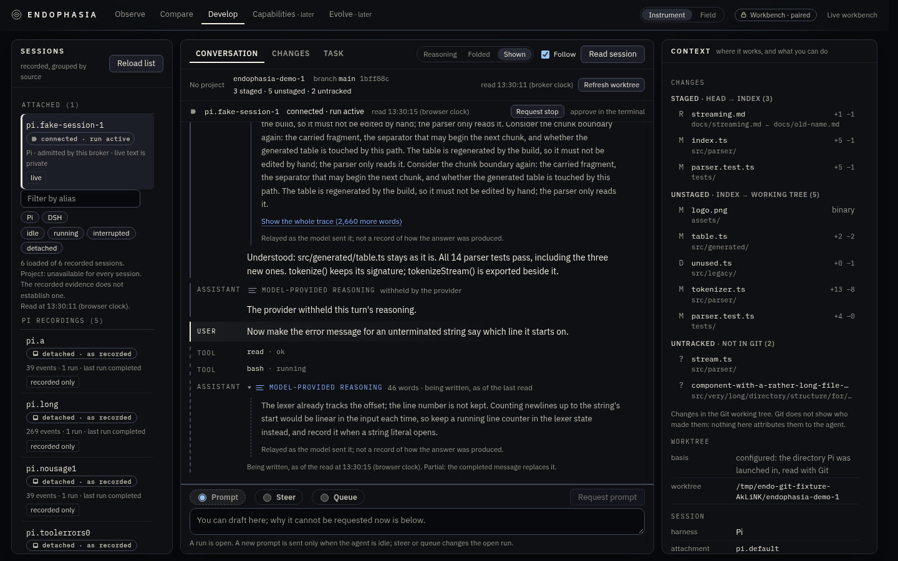
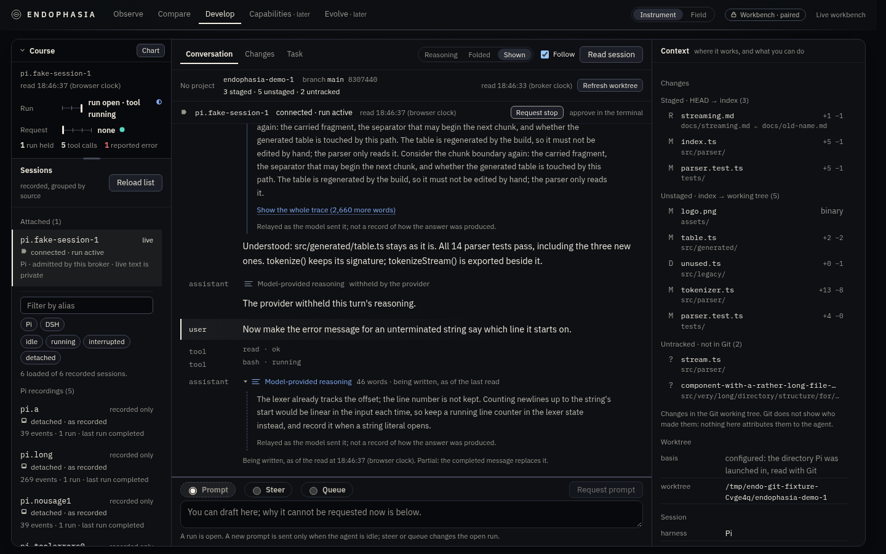
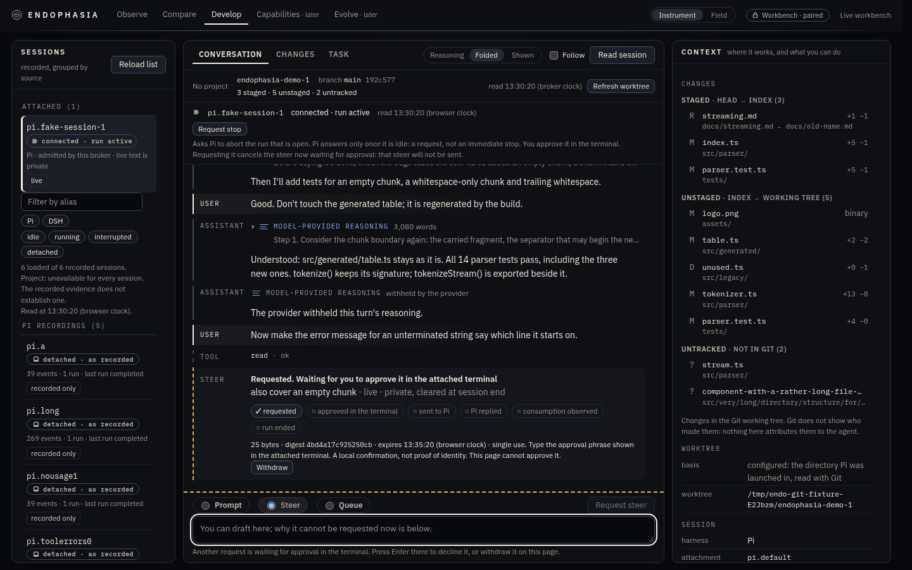
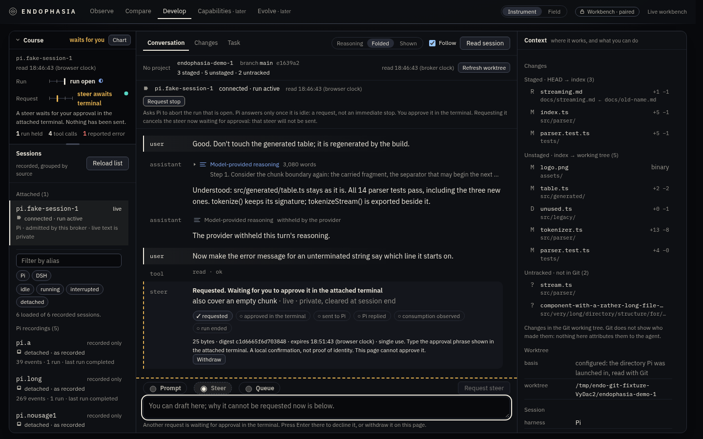
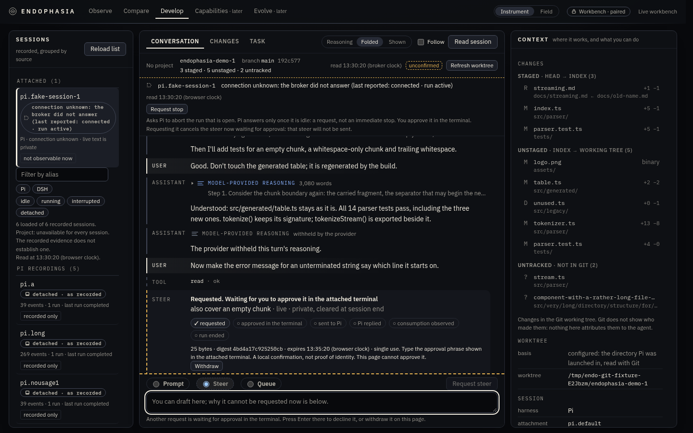
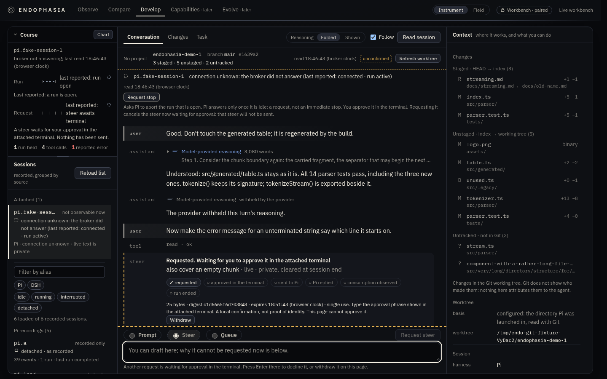
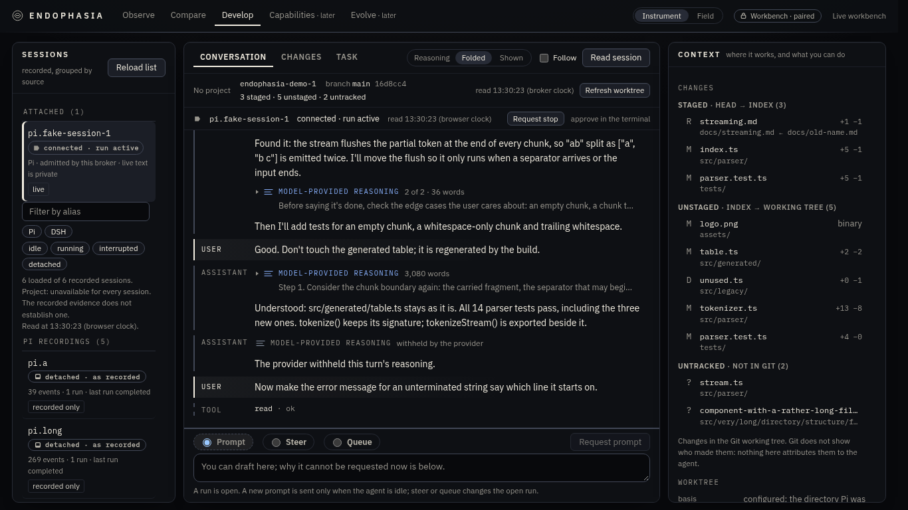
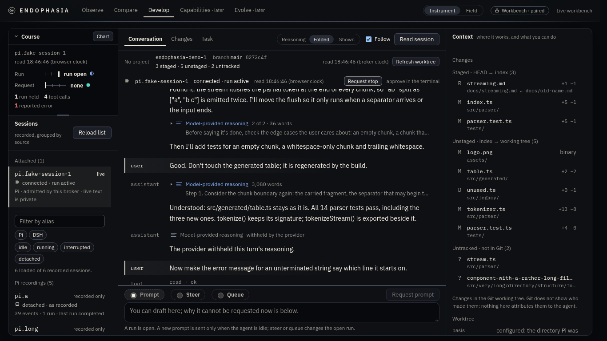
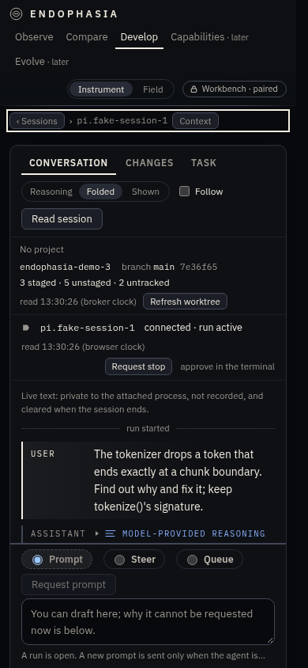
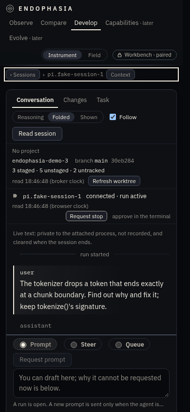

# The Living Instrument: design record

2026-11-14. Branch `feat/develop-living-instrument`, stacked on `feat/develop-ux-001` (PR #148, open and unmerged when this was built).
What the course is and does is in [docs/develop-course.md](../../docs/develop-course.md); the reviews and their dispositions are in
[REVIEW.md](REVIEW.md). This file is why it looks and behaves as it does.

Every screenshot here is of the real built page in a real browser against a real broker. The conversation and the repository in them are
synthetic fixtures. No real Pi or model was run, and nobody but the author and two model reviewers has looked at it.

## 1. What was wrong before (from the captures in `images/before-*`)

1. **The rail spent its height on chrome.** Each session was four stacked lines with two bordered pills; four lines of caveats sat
   between the attached session and the recordings. At 1440×900 two and a half recordings were visible.
2. **Three cards said "three things".** Sessions, work and context each had their own border, radius and shadow, with gaps between.
3. **Everything was a label.** Tracked capitals in monospace on panel titles, tabs, group headings, block headings and turn roles.
4. **The state of the session was a phrase in two places** ("connected · run active") and nowhere a picture; a request waiting for the
   terminal was visible only by scrolling the conversation to its card.
5. **A managed attempt's position** was a sentence in a strip, and otherwise a long page in Task.

## 2. Two directions, rendered

**A. Ruled sheet (chosen).** One sheet divided by hairlines; sans text set as text; who spoke in a margin column; one recessed gauge
above the sessions.

**B. Folio (rejected).** Floating plates with larger radii and deeper shadow, a centred serif reading column, bordered boxes for the
operator's turns, small-capital margin labels. Capture: `images/direction-b-folio-1440.png`.

Why A: at 1440×900 Folio shows about three turns where the sheet shows about seven; its boxed operator turns read as a chat
application; it keeps the card language and adds a fourth card; and it needs a serif the page does not bundle (the source policy pins
three font files), so it would render differently on every machine. Folio is the more striking screenshot and the worse place to work.
The independent critic, shown both, agreed and named what was worth keeping from B: calmer padding around turns and a course that is
never clipped. Both were taken.

The brief's own working concept was challenged in one respect. "Living" suggests motion. The page knows a session as of its last read,
and Follow is off by default, so a mark that pulsed would claim a currency the page does not have. Nothing here animates while idle; a
state change is a 130 ms change of colour. The life is in the instrument answering, not in it breathing.

## 3. The decisions

| Decision | Reason |
| :-- | :-- |
| One ruled sheet where DEVELOP fills the window | One instrument, not three cards; the rules give back the width of the gaps |
| The course is the sheet's one recess, and the only new element | "Boldness in one element, the rest quiet" |
| A lane is a gauge: a scale of ticks and a needle, with the state in words beside it | The first iteration used unlabelled dots; the critic could not decode them without the dialog (REVIEW.md, V4) |
| The needle is the text colour; amber and red are the only overrides; provenance hue is only on the mark beside the words | The first iteration coloured the lit dot by provenance when calm and by attention when not: one glyph, two meanings (V5) |
| One needle per scale; "tool running" and "writing" are words, not states | Two lit dots read as a rendering fault (V4) |
| Fitted height by default; closed and tall as the other two | Percentage heights clipped the course and starved the list at 1366×768 (V3, V14) |
| The course is above the sessions (the operator's decision, 2026-11-14; it was built below them) | Where the work stands is read before the list of sessions |
| Follow is on when the page opens (the operator's decision, same day; it was opt-in) | A conversation that does not move reads as broken. Still bounded, never on a hidden page, and one click off |
| The course is its own grid cell, not a child of the sessions' wrapper | Where sessions are a drawer it must stay in view; and the existing tests pin that wrapper's visibility |
| Run and Request are separate lanes | They are separate facts: a steer can wait while a run is open |
| Six stages: Brief, Assent, Send, Run, Check, Judge | They are the records an attempt has. Fix and Build are not recorded, so they are not drawn |
| "Assent", not "Approve" | The stage is the operator's recorded authorisation. An existing test forbids the word "Approve" on a host with no agent, rightly: it reads as a control |
| Capitals and tracking only on the wordmark and the three-letter provenance codes | A title is a title by weight and place |
| Session rows: name and kind; state (may wrap); what it holds | A fault state must never be clipped (V2) |
| What the list cannot say sinks to its foot | Read once, not every time. Visual order differs from DOM order here; DOM order keeps the caveats before the list for a screen reader |
| No new dependency, no style prop, no storage, no timer, no keyframes | The source policy test holds unchanged apart from two added module names |
| Field keeps its own lettering and its cards | It is a second appearance by design; the course appears in it, under the dock |

## 4. What was reused, and what was not built

Reused: the workbench state the page already holds (`WorkbenchState`), the attempts view, a recording's detail, the provenance glyphs
(one added: `declared`), `STATE_WORDING`, `OUTCOME_WORDING`, the dialog pattern, the panel boundary.

Not built: a workflow engine, a state machine that governs anything, a verification of anything, a new route, record, schema or store, a
synthetic demonstration mode. The Everyday/Protected/Strict authorisation redesign is untouched: pairing, approval phrases, the broker
and the terminal are byte-for-byte as in #148 (no file outside `studio-ui/`, `tests/`, `docs/` and `research/` changed).

## 5. Captures

Before (`images/before-*`) and after (`images/after-*`), same fixtures, same viewports:

| State | Before | After |
| :-- | :-- | :-- |
| Agent working, 1440 |  |  |
| Waiting for the terminal, 1440 |  |  |
| Broker not answering, 1440 |  |  |
| Laptop, 1366×768 |  |  |
| Phone, 390 |  |  |

After only: `after-attempt-run-ended-1440.png` (a managed attempt's stages), `after-chart-1440.png`, `after-recorded-1440.png`,
`after-empty-readonly-1440.png`, `after-drawer-1180.png`, `after-small-1024.png`, `after-tablet-768.png`, `after-context-390.png`,
`after-2560.png`, `after-3840.png`, `after-field-1440.png`, `after-attempt-phone-390.png`.

## 6. Limits, stated plainly

- **Not exceptional yet.** The independent critic's verdict on the first iteration was "competent and tidy, not exceptional", and that the
  Instrument is clean rather than memorable. The second iteration answered the functional findings and gave the course a character of
  its own (the gauge); it and the later move above the sessions were not shown to the critic again. Whether it is now distinctive is the operator's call.
- **Two layout languages remain.** The sheet is only where DEVELOP fills the window (a live session or the desk, 1024 px and wider). With
  a recording open the panels are separate cards of different heights; on a tablet or phone they are cards; Field is cards.
- **The head of the work is still three lines** (tabs, worktree, run), five at 1024 px. Merging them changes what each line pins in
  existing tests and was left for a change of its own.
- **Wide screens**: the composer is now held to the measure of the text and type steps up at 2200 px, but at 3840 px the sheet is still
  an island in a dark wall.
- **A sliver of scrolled text shows under the run line** as it did before; the scroll container's edge was not redesigned.
- **Dragging the separator is untested.** Its keyboard path is tested; the pointer path was reasoned about and rewritten after review,
  and never exercised by a test or by hand.
- **Not verified**: a real Pi or model; a person using it; forced-colours mode and print (rules were written, nothing was rendered);
  Safari and Firefox (Chromium only); a screen reader.

## 7. Next, each its own change

1. One head line: merge worktree and run into a single line with the times moved to Context.
2. The sheet for the recorded view and the narrow layouts, or a deliberate statement that they are cards.
3. Check drawn against a verification plan's ledger and HEAD, not only receipt outcomes.
4. If wanted, an orchestration engine with real Fix/Build/Verify stages. That is a runtime project with its own design and review, and
   the course would then draw it; it must not be grown inside a presentation adapter.
